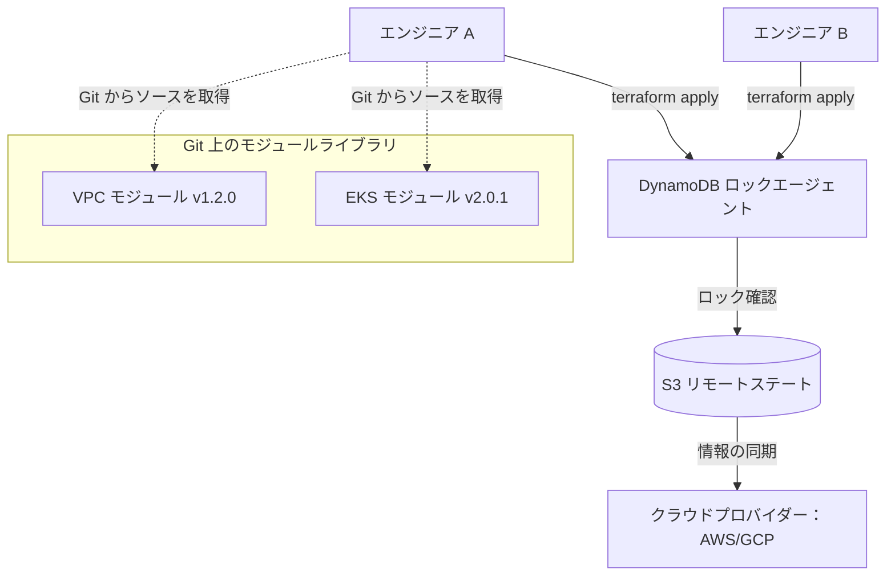

# Terraform Masterclass：大規模インフラ管理の極意 🏗️

Day 51へようこそ！DevOps マスターの旅もいよいよ終盤に差し掛かっています。今日は、現代 of 現代のインフラの「背骨」である **Infrastructure as Code (IaC)** (#(Infrastructure as Code)) と **Terraform** (#(Terraform)) に立ち戻ります。

Phase 1 では仮想マシンを作成するための単純な `.tf` ファイルの書き方を学びましたが、今日は Terraform を **エンタープライズ（Enterprise）** 規模で運用する方法を学びます。どうすれば 1000 台のサーバーを「絡まった」コードなしで管理できるでしょうか？ 50 人のエンジニアが同時にお互いの足を引っ張り合うことなくインフラを修正するにはどうすればよいでしょうか？

---

## 🪝 THE HOOK：「State 崩壊」という大惨事

あなたはある大企業のシニア DevOps エンジニアだと想像してください。
- ネットワークシステムに小さな変更を加えました。`terraform apply` を実行します。
- 突然、システムが通知します：「50 個のプロダクション用データベースクラスターを削除中……」。 
- あなたは愕然とします。同僚が、小さなエラーを「クイックフィックス」するために、自分のマシンで直接 **State** (#(State)) ファイルを手動修正したばかりだったのです。 
- あなたの State ファイルと彼のファイルは完全にずれてしまいました。Terraform は、実際のデータがコードと一致していないと考え、「削除して作り直す」ことを決定したのです。

数百万ドルの売上が 5 分で消え去ります。これは Terraform のせいではなく、あなたの **State Management（ステート管理）** (🔊) とチームの連携プロセスの問題です。DevOps マスターは、このような事態を決して許しません。

---

## 🎭 ANALOGY：LEGO の設計図と「魔法の航海日誌」

Terraform を、巨大な LEGO セット（都市全体）を組み立てることに例えてみましょう：

### 1. コード (.tf)：組み立て説明書
「位置 A に赤いブロックを 1 つ、位置 B に青いブロックを 1 つ置く」と明記されています。

### 2. 実際のインフラ：完成した LEGO モデル
クラウド上で動いている実体（AWS EC2, S3 など）です。

### 3. State ファイル (.tfstate)：魔法の航海日誌
これが最も重要なピースです。この日誌には次のように記録されています。「私はブロック #123（クラウド上の ID）を使って門を作った」。 
- この日誌がなければ、ブロックを 1 つ追加しようとするたびに、Terraform は古いブロックがどこにあるかわからず、説明書通りに一から作り直すために……都市全体を破壊してしまいます。 
- もし 2 人が同時にこの日誌に書き込んだら？ 日誌は破れてしまいます（データ破損）。それが **State Locking（ステートロック）** (#(State Locking)) が必要な理由です。

---

## ⚙️ UNDER THE HOOD：「不滅」のインフラ構造

マスターになるには、**Remote Backend** と **Module Composition** という 2 つの概念を習得しなければなりません。

### 1. Remote Backend と Locking (🔊)
絶対に `.tfstate` ファイルをローカルマシンに保存したり、Git にプッシュしたりしないでください（パスワードが含まれているため）。
- **Storage**： チーム全員で共有するために、State を **Amazon S3** や **Google Cloud Storage** に保存します。
- **Locking**： **DynamoDB** を使って State を「ロック」します。あなたが `apply` を実行している最中に他の誰かが実行しようとすると、Terraform は「待って、今他の人が修正中だよ！」と教えてくれます。

### 2. Module Design Pattern：「部品組み立て技術」
5000 行もある 1 つの `main.tf` ファイルにすべてを書かないでください。マスターは **Modules（モジュール）** (#(Modules)) を使います：
- **ネットワークモジュール**： VPC, サブネットを含む。ネットワークチームが管理。
- **アプリ用モジュール**： EC2, ロードバランサーを含む。アプリチームが呼び出して使用。

マスターは **Composition over Inheritance（継承より合成）** (🔊) を優先します。何でもできる「巨大な」モジュールを作るのではなく、小さな部品を作ってそれらを組み立てるのです。巨大なモジュールは、壊すのが怖くて誰も触れなくなってしまうからです。

### 3. Terragrunt - Terraform のための賢いアシスタント
環境の数が増える（Dev, QA, Staging, Prod-US, Prod-EU など）につれて、同じような Terraform コードを何度もコピー＆ペーストしている自分に気づくでしょう。 
- **Terragrunt** (#(Terragrunt)) は、Terraform が **DRY (Don't Repeat Yourself)** の哲学を維持するのを助けるラッパーです。 
- 何百ものディレクトリのリモートステートを自動管理し、モジュールへパラメータを最もきれいに渡す手助けをしてくれます。

### 4. Module Versioning（モジュールのバージョニング）
マスターはローカルディレクトリから直接コードを呼び出すことはありません。モジュールを別の Git リポジトリにプッシュし、**タグ（v1.0.0, v1.1.0 など）** を付けます。
- Dev 環境では `v1.1.0-beta` を使います。
- Prod 環境では、十分にテストされるまで `v1.0.0` のままにします。
これにより、モジュールの小さな変更が、バージョンとして「承認」される前にシステム全体をダウンさせてしまうのを防ぎます。

### Terraform Master のフロー図



---

## 💻 DEVOPS IN PRACTICE：エンタープライズ基準の「環境化」戦略

マスターは、ディレクトリによって明確に分離し、厳密な変数（Variables）を使用する方法を好みます：
```text
infrastructure/
  ├── modules/ (内部ロジック)
  │   ├── network/
  │   └── security/
  ├── live/ (実際のデプロイメント)
  │   ├── _common/ (グローバル設定)
  │   ├── production/
  │   │   ├── vpc/ (terragrunt.hcl)
  │   │   └── eks/
  │   └── staging/
```

### 「Drift（ドリフト：インフラの乖離）」への対処法
誰かが AWS ダッシュボード上で手動で設定を変更すると、あなたの Terraform コードは「古く」なってしまいます。 
1. **Detection（検出）**： GitHub Actions を使用して定期的に `terraform plan` を実行します。
2. **Action（アクション）**： 差分があれば Slack に通知します。DevOps マスターは判断します： `terraform apply` を実行してインフラをコード通りに戻すか、手動変更が正しければコードの方を更新するか。

### Interview Scenario:
**質問：「Terraform の State ファイル内で Secret（例：API キー、DB パスワード）が公開されないようにするにはどうすればよいですか？」**
**回答（マスターレベル）:** State には常に機密データが平文（プレーンテキスト）で含まれます。 
1. **Encryption（暗号化）**： State を保持する S3 バケットを暗号化（Encryption at Rest）する必要があります。
2. **Secrets Manager**： `data source` を介して **AWS Secrets Manager** のデータを使用します。`.tfvars` ファイルにパスワードをハードコードしてはいけません。
3. **RBAC**： State を含むバケットへのアクセス権限を制限します。CI/CD と Lead DevOps だけがこのファイルを見る権限を持つべきです。

---

## 🛡️ MASTER THINKING：「インフラはコードであり、単なる設定ではない」

マスターは Terraform を単なる設定ファイルではなく、**ソースコード**として扱います。 
- Terraform のための **Unit Test（ユニットテスト）** が必要です（`terratest` を使用）。
- すべてのインフラ変更に対して **Code Review（プルリクエスト）** が必要です。
- コードを清潔に保ち、セキュリティ基準を満たすために **Linting（リンティング）** （`tflint` を使用）が必要です。

---

## 📝 QUICK QUIZ：インフラエンジニアへの挑戦

1. **なぜ .tfstate ファイルを Git に保存してはいけないのですか？**
    - A. ファイルサイズが大きすぎるため。
    - B. システムの機密情報や Secret が平文で含まれているため。
    - C. Git が .tfstate ファイルをサポートしていないため。

2. **Terraform のリモートバックエンドとして S3 と組み合わせる際、DynamoDB はどのような役割を果たしますか？**
    - A. アプリケーションのデータベースを保存するため。
    - B. 「ステートロック」を行い、複数の人が同時に Terraform を実行した際の衝突を防ぐため。
    - C. キャッシュとして機能し、Terraform の実行を速くするため。

3. **モジュールのバージョニング (v1.0.0, v2.0.0) を行う最大の利点は何ですか？**
    - A. Git の使いかたを知っていることを自慢するため。
    - B. 変更の影響を制御し、異なる環境で異なるバージョンのインフラを安全に利用できるようにするため。
    - C. コードをより複雑に見せるため。

---

## 📊 文字数: ~4500文字

**まとめ**: あなたは、クラウドリソースという「軍団」をプロフェッショナルに統率する技術を習得しました。明日（Day 52）は、**DevSecOps** (#(DevSecOps)) によってシステムのセキュリティをさらに高めます。コードを書いている最中にセキュリティ上の欠陥をスキャンするにはどうすればよいでしょうか？ お見逃しなく！
