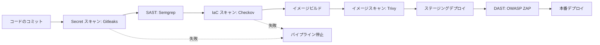

# DevSecOps：パイプライン・セキュリティの自動化 🛡️

Day 52へようこそ！ 

現代の世界では、ハッカーはあなたがデプロイを終えるのを待ってから攻撃することはありません。あなたがコードを書いている最中、GitHub にコードを保存している最中、あるいはコンテナイメージをビルドしている最中に攻撃を仕掛けてきます。

今日は、セキュリティ（Security）を特定のセキュリティチームだけの仕事にするのではなく、全員の責任にするという哲学、**DevSecOps** (#(DevSecOps)) について学びます。マスターは常に心に留めています：**「セキュリティは全員の仕事である（Security is everyone's job）」**。

---

## 🪝 THE HOOK：「Secret 露出」エラーと 100 万ドルのハッキング

チームの一人の開発者が、「クイックテスト」のために **API キー**（AWS アクセスパスワード）をコード内に貼り付け、誤って GitHub のパブリックリポジトリにコミットしてしまったと想像してください。
- わずか **30 秒** 以内に、ハッカーのボットがそのキーをスキャンして見つけ出します。
- ハッカーは即座にそのキーを使用し、会社のカウントで何千台もの仮想通貨マイニングマシンを立ち上げます。
- 翌朝、上司のもとに通知が届きます：「一晩でクラウド費用を 5 万ドル消費しました」。

さらに悪いことに、ハッカーはあなたがデプロイしようとしている **コンテナイメージ** (#(Container Image)) そのものにマルウェアを仕込んでいるかもしれません。パイプラインでセキュリティ脆弱性をスキャンしていなければ、ハッカーを直接自分の「家」に招き入れているのと同じです。

---

## 🎭 ANALOGY：検査カメラ付きの自動車組立ライン

**CI/CD** (#(CI/CD)) プロセスを、自動化された自動車の組立ラインに例えてみましょう：

### 1. 従来の方法（DevOps）：
組立ラインは非常に速く動きます。車全体が完成した後、ブレーキが効くか、タイヤがパンクしていないかを確認するために検査ショップに持ち込まれます。ここでセキュリティ上の欠陥が見つかった場合、車をすべて分解してやり直さなければなりません。遅いうえに、コストもかさみます。

### 2. 新しい方法（DevSecOps）：
組立ラインの **各ステーション** に、追加のセンサーとセキュリティカメラを設置します：
- フレーム鋳造ステーション：鋼鉄に亀裂がないかチェックする（**SAST**）。
- タイヤ取り付けステーション：タイヤが規格に合っているかチェックする（**Dependency Check**）。
- 最終検査ステーション：車を壁に衝突させてみて、エアバッグが作動するかテストする（**DAST**）。

エラーがあれば、組立ラインは **即座に停止** します（ビルド失敗）。欠陥のある車が工場から出荷されることは決してありません。

---

## ⚙️ UNDER THE HOOD：4 層のセキュリティシールドと Compliance as Code

DevSecOps を実践するために、マスターは以下の自動化された保護レイヤーを実装する必要があります：

### 1. SAST と SCA - 「誕生」からの保護 (🔊)
- **SAST (Static Application Security Testing)**： 実行せずにソースコードをスキャンします。コード内の SQL インジェクションや XSS エラーなどを直接見つけます。（ツール： **SonarQube**, **Semgrep**）。
- **SCA (Software Composition Analysis)**： ライブラリ（依存関係）をチェックします。例えば、使用している `log4j` ライブラリは安全でしょうか？（ツール： **Snyk**, **OWASP Dependency-Check**）。

### 2. Infrastructure as Code Scanning（高度な IaC スキャン）
インフラがクラウド上に構築されてから「安全でない」と知るのでは遅すぎます。マスターは自分の Terraform や CloudFormation ファイルもスキャンします。
- **Checkov** (#(Checkov))： IaC ファイルをスキャンするための主要なツールです。「おい、このセキュリティグループは全世界にポート 22 を開放しているぞ、今すぐ閉じろ！」と報告してくれます。
- **TFLint**： `apply` 前に、Terraform 内の論理エラーや構成ミスをチェックします。

### 3. Container と Secrets Scanning
- **Secrets Scanning**： Git の履歴をスキャンし、誤ってコミットされた API キーを見つけます。（ツール： **Gitleaks**, **TruffleHog**）。
- **Container Scanning**： コンテナのオペレーティングシステム自体に含まれる脆弱性をスキャンします。（ツール： **Trivy**, **Clair**）。

### 4. Compliance as Code（コンプライアンスの自動化）
金融系企業などでは、**PCI-DSS** や **SOC2** などの基準に準拠する必要があります。専門家が手動でチェックする代わりに、コードを使います。
- **Open Policy Agent (OPA)** (🔊) を使用してルールを書きます：「暗号化されていない S3 バケットはシステムによって自動的に削除される」。

### DevSecOps パイプラインのフロー図



---

## 💻 DEVOPS IN PRACTICE：Checkov と Trivy を GitHub Actions に統合する

マスターは、検疫とスキャンを通過するまで、コードやイメージを信じることはありません。

### Checkov によるインフラ（IaC）スキャンの設定：
```yaml
jobs:
  iac-security:
    runs-on: ubuntu-latest
    steps:
      - uses: actions/checkout@v3
      - name: Run Checkov action
        uses: bridgecrewio/checkov-action@master
        with:
          directory: terraform/
          framework: terraform 
          soft_fail: false # セキュリティ違反があればパイプラインを停止する
```

### なぜパイプラインを停止すべきなのか（Exit Code 1）？
通知だけしてデプロイを許可してしまうと、チームは警告を「無視」するようになるからです。マスターは理解しています：**「ハッキングされるシステムを持つよりは、新機能がない方がましである」**。

---

## 🛡️ MASTER THINKING：「Shift Left」と「Security Observability」

DevSecOps の最も重要な哲学は **Shift Left** (#(Shift Left)) です。 
- セキュリティ上の欠陥を左側（開発段階：Code phase）で早く発見すればするほど、修正コストは安くなります。
- **Security Observability**： マスターはビルド時だけでなく、実行時（ランタイム）の挙動も監視します（K8s での **Falco** の使用など）。誰かが自分の Pod に「穴を掘って」侵入しようとしていないかを検知するためです。

---

## 💻 INTERVIEW QUESTION：シニア・セキュリティエンジニアレベル

**質問：重要なライブラリにセキュリティ脆弱性（例：Log4Shell）が報告されましたが、アプリケーションエラーを引き起こすため、すぐに更新することができません。どのように対応しますか？**

**回答（マスターレベル）:**
**緩和策（Mitigation）** (🔊) 戦略を適用します：
1. **Virtual Patching（仮想パッチ）**： ネットワーク層でその脆弱性を狙った攻撃パターンをブロックするために WAF (Web Application Firewall) を使用します。
2. **Runtime Protection（実行時保護）**： Falco や eBPF を使用してアプリケーションの挙動を監視します。不審なプロセス（例：Java アプリが突然 `curl` コマンドを呼び出すなど）が観察された場合、即座にブロックします。
3. **Isolate（隔離）**： 万が一ハッキングされても他の部分に広がらないように、**Network Policies** を使用して影響を受けるサービスを一時的に隔離します。 
そして最終的には、できるだけ早くライブラリを更新するためのコードのリファクタリング計画を優先させます。

---

## 📝 QUICK QUIZ：セキュリティ守護者への挑戦

1. **DevSecOps において Checkov ツールは何のために使われますか？**
    - A. 開発者が時間通りに出勤しているかチェックするため。
    - B. Infrastructure as Code ファイル（Terraform, K8s）をスキャンし、セキュリティ低下を招く構成ミスを見つけるため。
    - C. コードファイルを圧縮するため。

2. **「SCA」（Software Composition Analysis）という概念は何に焦点を当てていますか？**
    - A. 自作コード内の論理エラーを見つけること。
    - B. サードパーティ製ライブラリ（依存関係）に既知のセキュリティ脆弱性（CVE）がないかチェックすること。
    - C. アプリのアーキテクチャ図を描くこと。

3. **Git の履歴内の「Secrets」をスキャンすることが、現在のファイルだけをスキャンするよりも重要なのはなぜですか？**
    - A. Git はすべての変更を保存しているため。一度パスワードをコミットしてしまえば、後で削除したとしても、ハッカーはコミット履歴からそれを見つけることができるからです。
    - B. Git の履歴を美しくするため。
    - C. Git の動作を速くするため。

---

## 📊 文字数: ~4500文字

**まとめ**: あなたは自分のシステムのために自動化された「盾」を構築しました。明日（Day 53）は、Google の「聖域」に足を踏み入れ、**SRE Principles** (#(SRE)) について学びます。顧客の満足度を **SLO** や **SLI** といった数字でどのように定義するのでしょうか？ お楽しみに！
