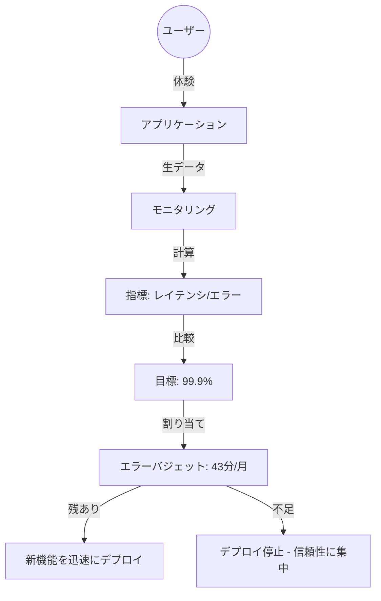

# SRE Principles：数字を通じた顧客満足度の定義 📈

Day 53へようこそ！

「システムをできるだけ安定させよう」という言葉をよく耳にします。しかし、「安定」とは具体的にどれくらいでしょうか？ 99% ですか、それとも 99.99% ですか？ そして、新機能のリリースに集中するために、いつバグ修正を止めるべきでしょうか？

今日は、Google によって生み出された概念である **SRE** (#(Site Reliability Engineering)) の世界に足を踏み入れます。SRE とは、本質的に「ソフトウェアエンジニアが運用を行う方法」です。直感ではなくデータを使って、最も困難な問いに答える手助けをしてくれます。

---

## 🪝 THE HOOK：「完璧の追求」という過ち

あるウェブアプリケーションを管理していると想像してください。 
- 事業部長が要求します：「システムは 100% 稼働していなければならない。1 秒たりともダウンさせてはならない！」。
- 結果： あなたのチームは安定性への影響を恐れるあまり、3 ヶ月間も新機能をデプロイできなくなりました。その間に競合他社は魅力的な新機能を次々とリリースし、あなたの会社を追い抜いていきました。
- 午前 2 時に軽微なエラーが発生した際、チームはそれを修正するためだけに徹夜しました。しかし実際には、その時間にウェブサイトを利用している顧客は一人もいなかったのです。

真実はこうです： **100% は間違った目標であり、極めて高くつきます**。DevOps マスターは、**Error Budgets（エラーバジェット）** (#(Error Budget)) を使い、いつシステムを「壊してもよい」のか、いつ立ち止まるべきなのかを知っています。

---

## 🎭 ANALOGY：5 つ星レストランのサービス基準

システムの安定性を、レストランのサービスの質に例えてみましょう：

### 1. SLI (Service Level Indicator)：私たちが測定するもの
これはマネージャーのストップウォッチです。「料理が運ばれてくるまでにどれくらいかかるか？」。例えば、10 分。

### 2. SLO (Service Level Objective)：私たちが約束する目標
これは顧客への約束です：「95% のお客様には 15 分以内に料理を提供します」。 

### 3. SLA (Service Level Agreement)：法的なコミットメント
もしレストランが SLO を達成できなかった場合（例：料理を出すのに 30 分かかった）、レストランは顧客に 50% 割引のクーポンを渡さなければなりません。これは金銭的な補償を伴う文書です。

### 4. Error Budget（エラーバジェット）：リスクを取るための余裕
95% の顧客に迅速にサービスを提供すると約束した場合、あなたは **5%** の顧客に対しては、実験のために「あえてゆっくり」サービスを提供してもよいことになります。

---

## ⚙️ UNDER THE HOOD：SRE の 3 本の柱と Toil との戦い

プロフェッショナルな SRE として運用するには、この 3 点セットをマスターする必要があります：

### 1. SLI - 語る数字 (🔊)
優れた SLI は、顧客体験を直接測定するものでなければなりません。
- **Latency（レイテンシ）** (#(Latency))： ウェブの読み込みにどれくらいかかるか？
- **Availability（可用性）** (#(Availability))： リクエストの成功率（200 OK）はどれくらいか？
- **Freshness（鮮度）**： ユーザーの画面上のデータが古くなっていないか？

### 2. SLO - 満足度の境界線
顧客が 99.9% の安定性しか求めていないのであれば、100% にする必要はありません。 
**SLO の計算方法**: `成功したリクエスト数 / 全リクエスト数 > 99.9%`。

### 3. Error Budget - 「失敗」のための予算
Error Budget = 100% - SLO。
もしあなたの 1 ヶ月（30 日間）の SLO が 99.9% なら、あなたのエラーバジェットは **43.2 分** のダウンタイムです。
- この 43 分を使い切っていない場合： 自由にデプロイしてください。
- 43 分を使い切った場合： **すべてのデプロイを停止してください**。 

### 🛡️ SRE と DevOps：何が違うのか？
マスターは、SRE が DevOps 哲学の具体的な実装例であることを理解しています。
- **DevOps**： 文化（コミュニケーション、自動化）です。
- **SRE**： その文化を実現するための技術的なプロセス（SLO、エラーバジェット、モニタリング）です。
Google による有名な例え： `class SRE implements DevOps { ... }`。

### ⚡ Case Study：Toil（トイル：定型作業）の撲滅
SRE において、**Toil** (🔊) は最大の敵です。
- **例**： データベースがいっぱいになるたびに、SSH でログインしてログを削除しなければならない。 
- **マスターのアプローチ**： Python/Bash スクリプトを書くか、**Kubernetes CronJob** を使用して、ディスク容量が 80% に達するたびに自動的にログを圧縮して S3 にプッシュするようにします。 
- **結果**： 毎日 1 時間の作業時間を節約できます。SRE マスターは、手動の運用作業に費やす時間を最大 50% までに抑えなければなりません。残りの 50% は「自動化プロジェクト」に費やす必要があります。

### SRE 運用のフロー図

---

## 💻 DEVOPS IN PRACTICE：「Blameless Post-mortem」文化の構築

システムがダウンしたとき、SRE マスターは「誰がミスをしたのか？」とは探し回りません。代わりに、**Blameless Post-mortem（非難なき事後分析）** (#(Blameless Post-mortem)) を行います。

### 標準的な Post-mortem（ポストモーテム）プロセス：
1. **タイムライン**： 発見から修復完了まで、1 分単位の詳細をリストアップします。
2. **根本原因分析 (RCA)**： なぜ人間がそのミスを犯し得たのか？（例：コマンドラインが似すぎていた、確認の障壁がなかったなど）。
3. **アクション**： 将来、他の誰もが同じミスを繰り返さないように「ガードレール（防護柵）」を追加します。
**マスターの格言**: 「一人の人間がたった一つのコマンドでシステム全体をダウンさせられるのであれば、それはシステムアーキテクチャの欠陥であり、個人の責任ではない」。

---

## 💻 INTERVIEW QUESTION：シニア・サイトリライアビリティエンジニアレベル

**質問：新機能を早くリリースしたいと考えているプロダクトマネージャーに、エラーバジェットを使い切ったからデプロイを停止するということを、どのように納得させますか？**

**回答（マスターレベル）:**
議論ではなく、データを使います。 
1. 以前、私たちは顧客満足度に基づいた **SLO** に共同で署名しました。
2. エラーバジェットの使い切りは、顧客の信頼が危険な「赤信号」レベルにあることを示す数学的な証拠です。 
3. 次のスプリントは新機能の開発ではなく、**信頼性エンジニアリング（Reliability Engineering）**（バグ修正、インフラ最適化）に充てることを提案します。エラーバジェットが回復したら、また最大速度に戻ります。エラーバジェットは、「スピード」と「安定性」のバランスを取るための最も公平な「審判」なのです。

---

## 📝 QUICK QUIZ：SRE エンジニアへの挑戦

1. **SRE と DevOps の関係を最もよく表しているのは次のうちどれですか？**
    - A. SRE は DevOps の競合相手である。
    - B. SRE は DevOps 哲学を実現するための具体的な技術的手法の集合である。
    - C. DevOps はスタートアップ向け、SRE は大企業向けである。

2. **Availability SLO が 90%（低い設定）の場合、1 ヶ月のエラーバジェットはどれくらいですか？**
    - A. 1%。
    - B. 10%。
    - C. 0%。

3. **「Blameless Post-mortem」の目的は何ですか？**
    - A. ミスをした人を見つけて減給するため。
    - B. 根本原因を分析し、個人を責めることなく、同様の事故の再発を防ぐためにシステムを改善するため。
    - C. 顧客に対してエラーを隠すため。

---

## 📊 文字数: ~4500文字

**まとめ**: あなたは、世界トップクラスのエンジニアの思考を使ってシステムを管理する方法を学びました。明日（Day 54）は、「心地よい」クラウドを離れ、過酷な現実に直面します：**Hybrid Cloud & Bare Metal Kubernetes** (#(BareMetal)) です。お楽しみに！
