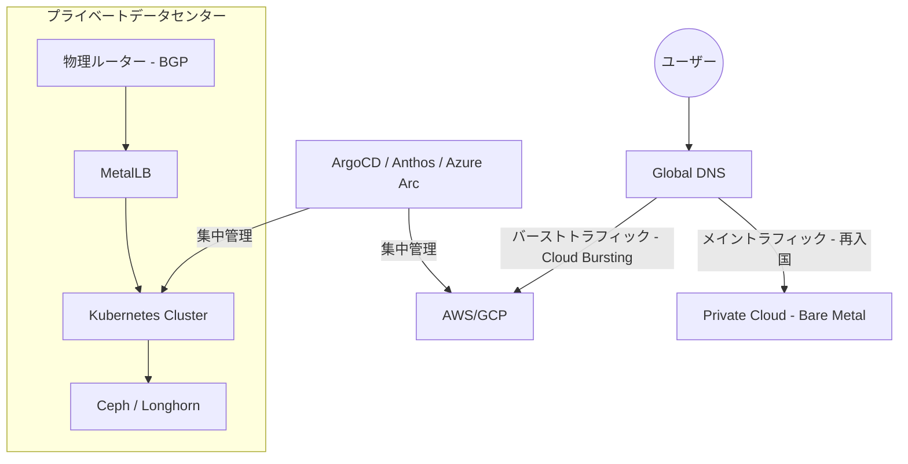

# Hybrid Cloud & Bare Metal：「巨人」への依存からの脱却 🏭

Day 54へようこそ！

私たちは AWS、GCP、Azure について多くの時間を割いてきました。それらは素晴らしく便利ですが、同時に非常に……高価です。今、一つの現実が進行しています： **Cloud Repatriation（クラウド回帰）** (#(Cloud Repatriation)) というトレンドです。数百万ドルを節約するために、データをクラウドから物理サーバーへと戻す企業が増えています。

今日は、**Kubernetes** (#(Kubernetes)) を **Bare Metal** (🔊) （本物の物理サーバー）上で運用する方法と、それらをクラウドと組み合わせて柔軟な **Hybrid Cloud（ハイブリッドクラウド）** システムを構築する方法を学びます。

---

## 🪝 THE HOOK：「クラウド請求額の急騰」エラー

あなたの会社が成功したスタートアップだと想像してください。 
- 開始当初は AWS EKS (Managed Kubernetes) を使っていました。すべてがスムーズでした。
- 2 年後、システムは成長し、ペタバイト級のデータを保存し、莫大なトラフィックを処理するようになりました。
- 月末、上司に呼び出され、机を叩かれます：「今月の AWS の請求が 1,000 万円を超えているぞ。利益がほとんど残らないじゃないか！」。
- あなたは気づきます。クラウド上での仮想マシンのレンタル料とデータ転送量（Data Transfer）のコストが、利益を食いつぶしているのです。

これこそが、DevOps マスターが解決策を持って登場する場面です： 重いタスクのために、ベアメタルを使って自社データセンターを構築するのです。

---

## 🎭 ANALOGY：家具付きマンションのレンタル vs. 自分の土地に家を建てる

### 1. Managed Cloud (EKS/GKE)：高級マンションのレンタル
荷物を持って入居するだけです。電気、水道、警備、清掃はすべて用意されています。非常に便利ですが、毎月高額なサービス料を支払わなければなりません。 

### 2. Bare Metal：自分の土地に家を建てる
レンガを買い、電気工事士や水道工事士を自分で手配しなければなりません。最初は非常に疲れ、建設費用もかかります。しかし、一度完成してしまえば、誰にも家賃を払う必要はありません。OS を骨の髄まで最適化し、拡張する全権限があなたにあります。

---

## ⚙️ UNDER THE HOOD：「ハードウェアに触れる」という挑戦

ベアメタルで K8s を動かすとき、クラウドプロバイダーの「魔法」は失われます。あなたは 3 つの死活問題を自力で解決しなければなりません：

### 1. Networking - Load Balancer と BGP (🔊)
ベアメタルには自動化されたロードバランサーがありません。
- **MetalLB**： 社内ネットワーク内の IP アドレスの制御権を奪います。 **BGP** (🔊) プロトコルを使用することで、物理ルーター（Cisco や Juniper など）に対し、「おい、もし顧客が IP X を探していたら、私の K8s クラスターへ送ってくれ！」と伝えます。
- **Cilium**： マスターは kube-proxy の代わりに Cilium (eBPF) を使用し、クラスター内のネットワーク速度を物理ハードウェアに近いレベルまで引き上げます。

### 2. Storage - ディスクはどこから持ってくるのか？（深掘り）
クラウドボリュームはありません。10 台のサーバーに散らばっている数十本の SSD を「統一されたストレージシステム」に変えなければなりません。
- **Ceph (Rook)** (#(Ceph))： ストレージ界の「怪物」です。すべてのハードディスクを巨大なプール（Pool）に変えます。データは細分化されて複製（Replication）されるか、**Erasure Coding** (🔊) を使用して、たとえ 2 台のサーバーが燃えてもデータが失われないように保証されます。
- **Longhorn**： Ceph が複雑すぎる場合、マスターは Rancher の Longhorn を使います。より軽量で、インストールが速く、直感的な管理インターフェースを持っています。

### 3. Provisioning - Talos Linux との生活 (🔊)
まず Ubuntu や CentOS をインストールしてから K8s を入れようとしてはいけません。OS の「ゴミ」が多すぎてクラスターが遅くなります。
- **Talos Linux**： SSH もシェルもなく、YAML ファイルと API だけで管理される OS です。あなたのサーバーを真の「Kubernetes アプライアンス」に変えます。電源を入れれば、Talos が自動的に起動し、クラスターに参加します。

### Hybrid Cloud アーキテクチャ図

---

## 💻 DEVOPS IN PRACTICE：Hybrid Cloud 戦略 (Anthos vs Azure Arc)

システムを分断させてはいけません。マスターは「架け橋」となるテクノロジーを使用して、物理サーバーとクラウドの両方を管理します。

1. **Google Anthos**： GKE のパワーをあなたのデータセンターに持ち込みます。
2. **Azure Arc**： どこにある Linux サーバーでも、あたかも Azure リソースであるかのように管理できるようにします。
3. **K3s**： 非常に軽量な Kubernetes バージョン（わずか約 50MB）で、店舗や工場にある「小さな」デバイス（**Edge Computing**） (#(Edge Computing)) での実行に適しています。

---

## 🛡️ MASTER THINKING：「人的資本のコスト」

ベアメタルはクラウドの請求額を節約できますが、**「専門家の給与」** という形で非常にコストがかかります。
- クラウド上： ジュニア DevOps でも運用可能です。
- ベアメタル上： Linux カーネル、ネットワーキング、ストレージに深く通じたシニア DevOps マスターが必要です。
**マスターのアドバイス**: クラウドから節約できる金額が、精鋭の運用チームを雇うコストよりも明らかに大きい場合にのみ、ベアメタルを選択してください。

---

## 💻 INTERVIEW QUESTION：インフラアーキテクトレベル

**質問：クラウドロードバランサーがないベアメタル環境で、Kubernetes コントロールプレーンのハイアベイラビリティ（HA）をどのように実装しますか？**

**回答（マスターレベル）:**
**Keepalived** と **HAProxy** を組み合わせて使用します。 
1. 3 つのマスターノードをインストールします。 
2. Keepalived を使用して、3 つのノードで共有される **Virtual IP (VIP)** を作成します。 
3. もしマスターノード 1 がダウンしても、VIP は数ミリ秒以内に自動的にマスターノード 2 へジャンプします。 
4. ワーカーノードは常にこの VIP に接続して API Server と「会話」します。この方法により、高価なハードウェアなしで 99.9% の可用性を実現できます。

---

## 📝 QUICK QUIZ：物理インフラエンジニアへの挑戦

1. **MetalLB によって使用される BGP (Border Gateway Protocol) は何のために使われますか？**
    - A. ウェブサイトのドメイン名を翻訳するため。
    - B. クラスター内の Load Balancer IP の存在を物理ネットワーク機器（ルーター/スイッチ）に通知するため。
    - C. ハードディスクのデータを暗号化するため。

2. **Ceph (Rook 経由) は Kubernetes にどのように役立ちますか？**
    - A. ウェブサイトの動作を速くする。
    - B. 分散ストレージインフラを提供し、物理ディスクを非常に耐久性の高いネットワークドライブ（Persistent Volumes）に変える。
    - C. ファイアウォールの設定に使用される。

3. **「Cloud Repatriation（クラウド回帰）」という用語はどういう意味ですか？**
    - A. システム全体をクラウドに移行すること。
    - B. 企業がコスト最適化と制御のために、インフラの一部または全部をパブリッククラウド（AWS/Azure）から自社のデータセンター（ベアメタル）に戻すトレンドのこと。
    - C. クラウドプロバイダーの名前を変更すること。

---

## 📊 文字数: ~4500文字

**まとめ**: あなたは物理ハードウェアから雲の上まで、すべてを支配する方法を学びました。明日（Day 55）は未来について話しましょう： **AIOps** (#(AIOps)) です。あなたが寝ている間に AI がシステムの不具合を自動的に修正するにはどうすればよいでしょうか？ この未来的なレッスンをお見逃しなく！
