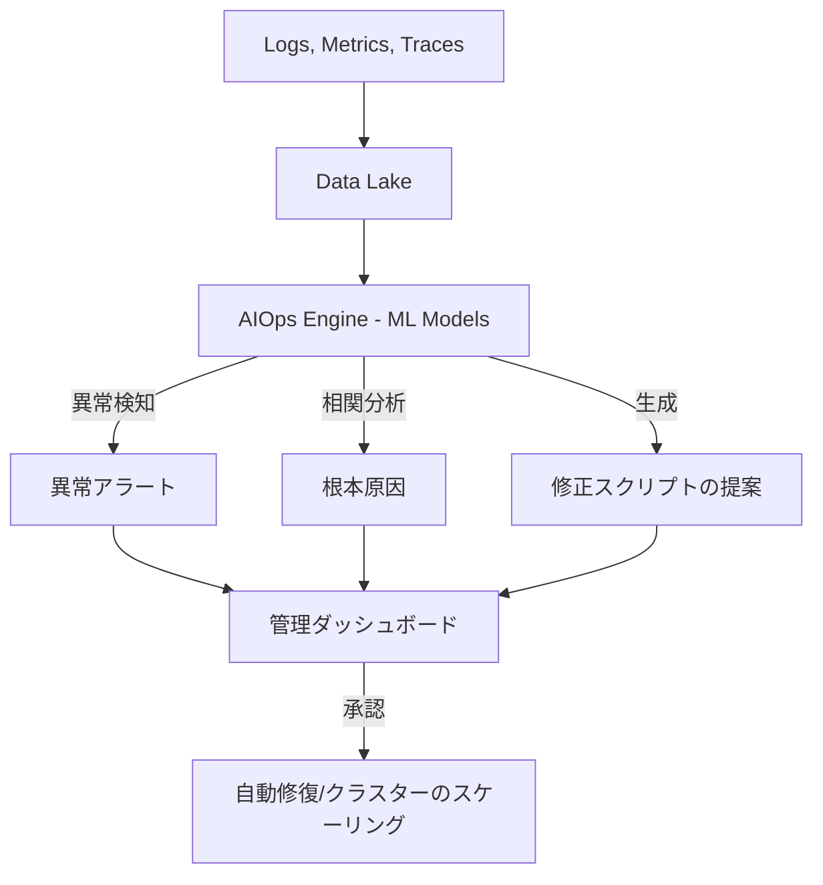

# AIOps：人工知能がシステムを掌握する時 🤖

Day 55へようこそ！ 

私たちは 50 日以上にわたり、複雑なシステムを自らの手で構築し、保護し、運用する方法を学んできました。しかし、システムが数千のマイクロサービスと毎日数十億件のログへと拡大したとき、人間の処理能力は限界に達します。

今日は、**AIOps** (#(AIOps)) (Artificial Intelligence for IT Operations) についてお話しします。これは未来の必然的なトレンドであり、AI がすべての DevOps マスターにとって最も強力な「右腕」となる領域です。

---

## 🪝 THE HOOK：「データの霧」（Data Fatigue）エラー

午前 3 時、あなたのシステムで障害が発生したと想像してください。
- 数千件の真っ赤なアラート（Alerts）があなたのスマートフォンに降り注ぎます。
- ログを開くと、毎秒数百万行のログが画面を駆け抜けていきます。
- あなたとシニアメンバーたちは、膨大なノイズデータの中から根本原因を特定するためだけに 4 時間を費やしました。
- その間、顧客はアプリを離れ、上司はあなたの背後で疑問を投げかけます：「なぜこれほど多くの監視ツールがあるのに、エラーの特定にこれほど時間がかかるんだ？」。

問題はデータの不足ではなく、**「データが多すぎる」** ことにあります。あなた一人ではすべてを読むことは不可能ですが、AI なら可能です。

---

## 🎭 ANALOGY：現代の航空機の自動操縦（Autopilot）モード

DevOps と AI の役割を、パイロットと飛行機に例えてみましょう：

### 1. Manual Ops（手動運用）：第二次世界大戦時代の飛行機
パイロットは自らすべてのレバーを操作し、すべてのアナログ計器を観察しなければなりません。何か異常があれば、個人の経験を頼りに故障箇所を推測する必要があります。彼らは疲れ果て、ミスを犯しやすくなります。

### 2. AIOps：エアバス A380 の自動操縦システム
現代の飛行機には数万個のセンサーが搭載されています。 
- AI システムが空気の流れ、エンジンの温度などを自動的に分析し、潜在的なトラブルを予測します。 
- ノイズとなるアラートを除去し、パイロットには本当に重要な情報だけを通知します。
- **DevOps マスターの役割**： あなたは「シニア・スーパーバイザー」となり、AI からの知的な提案に基づいて戦略的な決定を下します。エンジン修理に追われるのではなく、新しい航路を設計するために手を空けることができるのです。

---

## ⚙️ UNDER THE HOOD：AIOps の 4 つの魔法のレベルと予測スケーリング

AIOps は、4 つの大きな課題を解決してくれます：

### 1. Alert Fatigue Elimination（アラート疲れの解消） (🔊)
AI は **Correlation（相関分析）** (#(Correlation)) という技術を使います。もしネットワークがダウンし、それに伴って 100 個のアプリがエラーを報告したとします。AI は 100 通のメッセージであなたのスマホを爆発させる代わりに、それらを統合し、「スイッチ 5 番のネットワーク障害、100 サービスに影響」というたった一つのアラートだけを送信します。

### 2. Anomaly Detection（異常検知） & Predictive Scaling（予測スケーリング）
従来のモニタリングは、固定されたしきい値（例：CPU > 80% でアラート）を使用します。 
- **Predictive Scaling** (🔊)： AI はトラフィックが微増している傾向を察知し、「このペースなら 30 分後にサーバーがダウンする」と予測します。そして、トラフィックが実際に押し寄せる **前** に、Kubernetes に 10 個のノードを追加するよう命じます。「対応が後手に回る」心配はもうありません。

### 3. Root Cause Analysis (RCA：根本原因分析) & Intelligent Remediation（知的修復）
AI は数百万件のイベントを同時に比較し、共通点を見つけ出す能力があります。 
- **Intelligent Remediation** (🔊)： 単にエラーを見つけるだけでなく、AI は次のような提案も行います：「このエラーは 6 ヶ月前にも発生しました。その時の修正方法はキャッシュのリセットでした。今すぐ実行しますか？」。

### 4. Generative AI for DevOps（DevOps のための生成 AI） (🔊)
GPT-4 や Gemini などの LLM を活用して：
- ラフな要件から Terraform ファイルを自動生成する。
- Java や Go の複雑なエラーログを解説する。
- 自然言語だけでデプロイ（CI/CD）スクリプトを書く。

### AIOps 運用のフロー図

---

## 💻 DEVOPS IN PRACTICE：AI を活用したデバッグプロセス

現代のマスターは、AI に対してどのように「問いを立てるか」を知っておく必要があります。

### ケーススタディ：データベースの「エスカレーション」事故
アプリのレイテンシが突然 100ms から 5000ms に上昇したとします。
**AI による処理方法**:
1. AI がレイテンシの上昇を検知するが、Web サーバーの CPU は低いまま -> 問題はデータベースかネットワークにあると指摘します。
2. AI がデータベースログをスキャンし、新しく発生した **Slow Queries** を発見します。
3. あなたに「通知」します：「5 分前にマーケティングチームのために新しいコードをデプロイしましたね。そのコードは `Orders` テーブルのインデックスが不足しています」。
4. インデックスを作成するための SQL 文を提案します： `CREATE INDEX idx_orders_status ON orders(status);`。

### 代表的な AIOps ツール：
- **Dynatrace Davis**： マイクロサービス内のエラーを AI が自動的に発見します。
- **Datadog Watchdog**： ログ内の奇妙なパターンを自動的に検出します。
- **Kube-Ray / Kube-Prometheus-Stack**： K8s 上で AI モデルを直接実行するためのコンポーネント。

---

## 🛡️ MASTER THINKING：「AI は副操縦士、あなたが機長である」

AI を 100% 盲信してはいけません。 
最も危険なのは、制御なしに AI が重要な修復アクションを自動実行（Auto-remediation）してしまうことです。DevOps マスターは常に最終承認者（**Human-in-the-loop**） (🔊) としての役割を維持しなければなりません。 
AI が戦略を提案し -> マスターが安全性を確認し -> マスターが実行ボタンを押す。
思考を怠けるためではなく、あなたの生産性を 10 倍に高めるために AI を活用しましょう。

---

## 💻 INTERVIEW QUESTION：CTO レベル

**質問：運用に AI を導入すれば、DevOps チームの人員を何パーセント削減できますか？**

**回答（マスターレベル）:**
AIOps の目的は人員削減ではなく、**「1 時間あたりの価値の最大化」** です。チームが手作業（Ops）に費やしていた 50% の時間を AI が肩代わりすることで、その余った時間を **Platform Engineering** やアーキテクチャの最適化、そして会社により多くの利益をもたらす新技術の研究に充てることができます。AIOps は、同じ人員でより多くの成果を出すためのツールであり、解雇のための道具ではありません。

---

## 📝 QUICK QUIZ：未来のエンジニアへの挑戦

1. **AIOps における Alert Correlation 機能の最大の利点は何ですか？**
    - A. Slack の見た目をきれいにする。
    - B. 関連するアラートをグループ化してノイズを減らし、DevOps が核心的な問題に集中できるようにする。
    - C. エラーアラートを自動的に削除する。

2. **「Predictive Scaling」は通常のオートスケーリングと何が違いますか？**
    - A. Predictive Scaling の方が遅い。
    - B. AI を使って将来のトラフィックを予測し、システムがダウンする **前** にサーバーを起動する。エラーが出るまで待つことはしない。
    - C. 違いはない。

3. **AIOps における「Human-in-the-loop」という言葉の意味は何ですか？**
    - A. 人間がロボットのループの中に閉じ込められること。
    - B. AI が提案する重要なアクションに対して、常に人間の監視と最終承認が必要であること。
    - C. AI が人間の代わりにすべての作業を行うこと。

---

## 📊 文字数: ~4500文字

**まとめ**: おめでとうございます！ 55 日間の絶え間ない学習を完遂しました。あなたは過去（Linux）、現在（K8s/Cloud）、そして未来（AIOps）を手にしました。明日から、正式に **DevOps Master** の称号を授与するための最終評価フェーズに入ります。最大の挑戦に備えてください！
