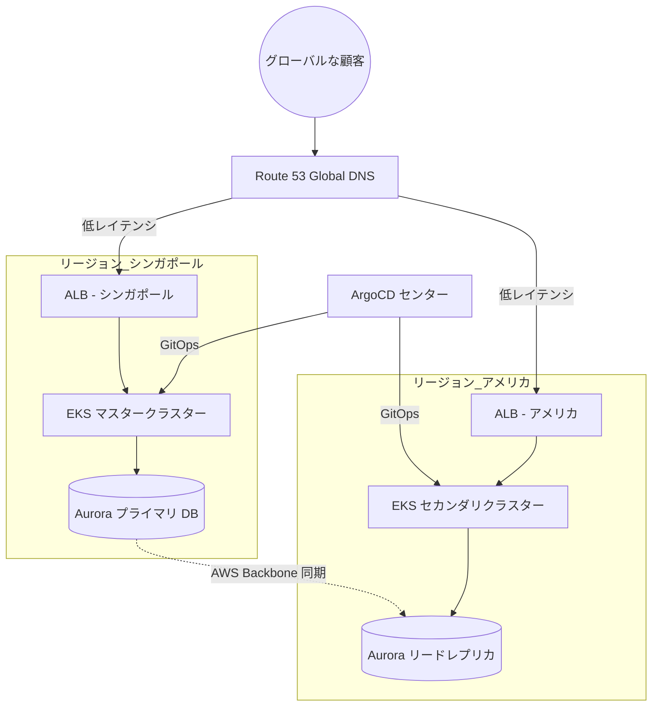

# Capstone Project Part 1：グローバル・コマース帝国の構築 🌍

Day 58 へようこそ！これは DevOps Master への道のりにおける最大の挑戦の始まりです。 

これからの 2 日間は、単なる理論の学習は行いません。あなたは多国籍小売企業（仮に "SuperShop" と呼びます）の **Lead DevOps Architect** という役割を演じます。あなたの任務は、SuperShop のシステムを世界レベルに引き上げ、次のことを保証することです： **「決して止まらず、自動的に拡張し、絶対的に安全であること」**。

---

## 🪝 THE HOOK：「ユニコーン」の課題と大陸間レイテンシの圧力

SuperShop は売上に直結する大きな問題に直面しています：
- 彼らは東南アジア（シンガポール）と北米（アメリカ）の両方に数百万人の顧客を抱えています。
- 現在、アプリはシンガポールの 1 つのリージョンだけで動いています。アメリカの顧客からは、地理的な距離のためにウェブの読み込みが遅すぎる（レイテンシが 5〜10 秒に達する）という不満が出ています。
- 先週、海底ケーブルの切断事故により、システム全体が 12 時間にわたって麻痺しました。CEO は命じました：「システムを両方の大陸で稼働させろ。もし一方の大陸がダウンしても、もう一方が即座にトラフィックを自動的に引き受けるようにしろ。そして、すべてを標準的な Code (IaC) で管理するんだ！」。

今日、私たちはこの要塞のための最も強固な「骨格」を設計します。

---

## 🎭 ANALOGY：グローバルなスーパーマーケット・チェーンの構築

### 1. Multi-region Architecture：多大陸にまたがる支店
ニューヨークの顧客に、商品を買う（サーバーにアクセスする）ためにわざわざシンガポールまで飛んでもらう代わりに、アメリカ国内に全く同じ倉庫を建設します。商品（データ）は倉庫間で常に同期されていなければならず、どこの顧客も同じ価格と在庫状況を見られるようにします。もしニューヨークの倉庫が火事になれば、顧客は自動的に近隣の倉庫へ案内されます。

### 2. Infrastructure as Code (Terraform)：デジタル設計図
新しい支店を建てるたびに、わざわざレンガを買いに行き、電線を一本ずつ引く（クラウドコンソールで手動クリックする）代わりに、デジタルの設計図（Terraform Modules）を作成します。 
ヨーロッパに支店を増やしたい時は、設計図に `region = "eu-central-1"` というパラメータを入力するだけです。すると「コードの魔法」が、わずか 15 分で完璧な支店を自動的に作り上げます。

---

## ⚙️ UNDER THE HOOD：「不滅」のアーキテクチャ設計 (Multi-Region Infrastructure)

この課題を解決するために、マスターは 3 つのエンタープライズ級のコア・コンポーネントを使用します：

### 1. Global Traffic Management（ルーティング層）
**Amazon Route 53** (🔊) を **Latency-based Routing** ポリシーで使用します。 
- アメリカの顧客 -> 自動的にアメリカのサーバーへ。日本の顧客 -> 自動的にシンガポールのサーバーへ。
- もしリージョンが完全にダウンしたら？ Route 53 は統合された **Health Checks** を通じてそれを検知し、60 秒以内に 100% のユーザーを生き残っているリージョンへ自動的に誘導します。

### 2. Networking - 大洋横断のスーパーハイウェイ
シンガポールの Kubernetes クラスターは、どうやってアメリカのデータベースと会話するのでしょうか？ 
- **AWS Transit Gateway** (#(TransitGateway)) を使用します。これは、数百もの VPC を相互接続できるネットワークの「ハブ」です。 
- 2 つのリージョン間の通信（Peering）は、Amazon の専用の物理回線上を走り、決してパブリックなインターネットには出ないため、絶対的なセキュリティと最小のレイテンシを保証します。

### 3. Data Consistency（リアルタイム・データ同期）
ここが最も難しい部分です。マスターは **Amazon Aurora Global Database** (🔊) を使用します。 
- **Primary Cluster**： シンガポールに設置（データの書き込み）。
- **Secondary Cluster**： アメリカに設置（データの読み取り）。
- データは物理層（Storage-level replication）で 2 つの大陸間を同期され、ラグ（遅延）は通常 1 秒未満です。これこそが、災害時にシステムを「生かし続ける」心臓部です。

### Capstone アーキテクチャ図



---

## 💻 DEVOPS IN PRACTICE：Master Lab - Terraform Modules によるデプロイ

バラバラなコードを書いてはいけません。社内のためのモジュール・ライブラリを構築しましょう。

### 1. 標準的なモジュール構造 (Day 51)：
- `modules/network`： VPC、サブネット、ピアリングの作成。
- `modules/compute`： EKS クラスター、ノードグループ、IAM ロールの作成。
- `modules/storage`： Aurora Global Database の作成。

### 2. グローバルデータベースのサンプルコード：
```hcl
resource "aws_rds_global_cluster" "supershop" {
  global_cluster_identifier = "supershop-global-db"
  engine                    = "aurora-postgresql"
  engine_version            = "13.7"
}

# シンガポールリージョンにて
resource "aws_rds_cluster" "primary" {
  provider                  = aws.singapore
  global_cluster_identifier = aws_rds_global_cluster.supershop.id
  cluster_identifier        = "supershop-primary"
  # ... その他の設定
}
```

### ⚡ ケーススタディ：Facebook と Google の戦略
なぜ Facebook は決して止まらないのでしょうか？ それは彼らが世界中に少なくとも 15 の巨大なデータセンターを持っているからです。ある地域が洪水や停電に見舞われても、彼らのルーティング AI がミリ秒単位でトラフィックを転送します。あなたは今、クラウドプラットフォーム上で彼らと全く同じことをする方法を学んでいるのです。

---

## 🛡️ MASTER THINKING：「Design for Failure（失敗を前提とした設計）」 (🔊)

マスターは「もしシステムが止まったらどうするか？」とは決して問いません。「システムが止まったとき（WHEN）、どのように復旧させるか？」を常に問います。
- システムが **Degraded Mode** (🔊) （縮退モード）で稼働できるように設計しなければなりません。例えば、メインデータベースがダウンしても、ウェブサイトは商品の閲覧だけは可能にし、一時的に「決済」ボタンだけを無効にする、といった工夫です。

### Interview Scenario:
**Q：「大きなレイテンシがある場合、アメリカのデータがシンガポールより古くならないようにするにはどうすればよいですか？」**
**A（マスターレベル）：** **Write Forwarding** (🔊) （書き込み転送）メカニズムを使用します。アメリカのアプリが注文を保存したい場合、そのリクエストをシンガポールのマスターに転送します。しかし、最適化のために、読み取り操作（価格の確認、在庫の確認など）はアメリカ国内で 100% 完結させます。超高速なユーザー体験と引き換えに、数ミリ秒のラグ（Replication Lag）を許容するのです。

---

## 💻 INTERVIEW QUESTION：Lead Cloud Architect レベル（グローバルスケール）

**質問：シンガポールリージョンが完全にダウンした場合、データベースのフェイルオーバーをどのように自動化しますか？**

**回答（マスターレベル）:**
**AWS RDS Proxy** と **Custom Health Checks** を組み合わせて使用します。 
1. Route 53 がシンガポールのダウンを検知します。
2. **Lambda** 関数が自動的にトリガーされ、AWS API に `failover-global-cluster` コマンドを送信します。
3. アメリカのクラスターが 60 秒以内に書き込みマスターへと昇格（Promote）されます。 
4. 最も重要な点： アメリカで新しい決済取引を開始させる前に、データの最終的な一貫性（Consistency）を検証しなければなりません。

---

## 📝 QUICK QUIZ：チーフアーキテクトへの挑戦

1. **アメリカにある 'Aurora Read Replica' は、シンガポールのマスターデータベースと何が違いますか？**
    - A. 安価であり、データの読み取りのみ（Read-only）を許可する。これによりマスターの負荷を軽減し、アメリカの顧客に高速にサービスを提供できる。
    - B. データを持っていない。
    - C. 動作が遅い。

2. **2 つのリージョンを管理するのに Terraform の 'Local Exec' や 'Remote State' を使うべきなのはなぜですか？**
    - A. 同僚に自慢するため。
    - B. 2 つのリージョンで全く同じ構成を保証し、別々の画面で手動設定する際の「ヒューマンエラー」を防ぐため。
    - C. ハードディスクの容量を節約するため。

3. **Route 53 の 'Geolocation' DNS は 'Latency' と何が違いますか？**
    - A. 'Geolocation' は行政上の区分（国）に基づいてユーザーを誘導し、'Latency' は実際のネットワーク速度（最速）に基づいて誘導する。
    - B. 違いはない。
    - C. 'Latency' はビデオ用である。

---

## 📊 文字数: ~4500文字

**まとめ**: あなたは帝国の「骨格」の設計を終えました。インフラは整い、ソースコードはモジュール化されました。明日（Day 59）は、「神経系」を取り付けてプロジェクトを完成させます： **CI/CD、Observability、そして Chaos Testing** です。最終卒業試験に向けて準備を整えてください！
