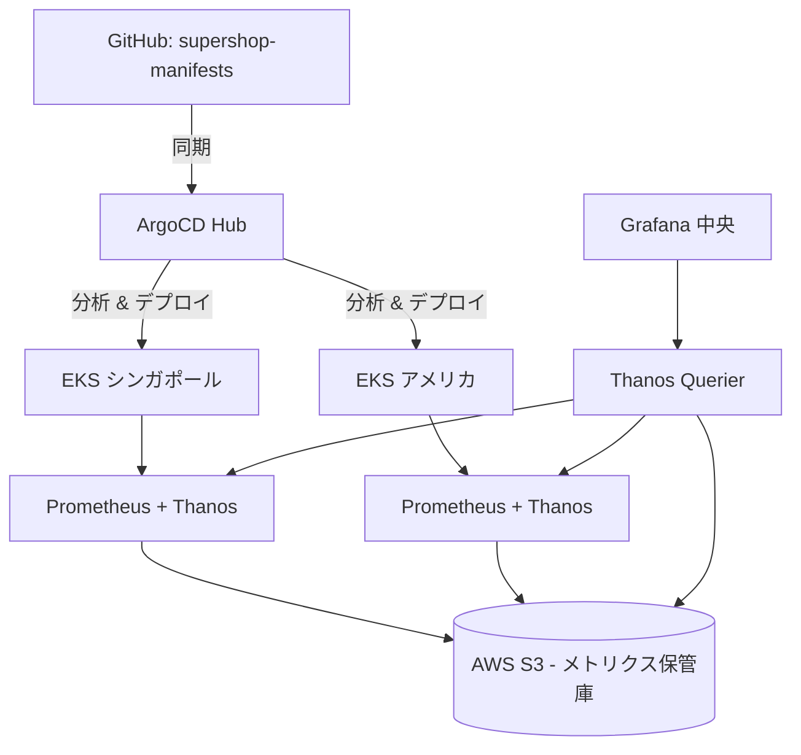

# Capstone Project Part 2：不滅のシステムの運用 🛡️

Day 59へようこそ！ゴールまであと一歩です。

昨日は、「体」（Multi-region Infrastructure：マルチリージョン・インフラ）を構築し終えました。今日は、システムに「魂」を吹き込みます。自動化された運用プロセス、インテリジェントな監視システム、そして SuperShop があらゆるトラフィックの嵐や予期せぬ技術的災害に立ち向かえることを保証するための、死活テストです。

---

## 🪝 THE HOOK：「インフラは正常、アプリは異常」エラーとリリースの惨劇

2 つのリージョン（シンガポールとアメリカ）がスムーズに稼働していると想像してください。 
- あなたは古い方法（手動の Helm Install）を使って、両方の大陸に一斉デプロイを行いました。
- 開発者がバグのあるコードをプッシュしました。このコードはメモリリーク（Memory Leak）を引き起こしますが、アプリはすぐには停止せず、30 分かけて徐々にダウンしていきます。
- あなたのモニタリング設定が不十分だったため、両方のリージョンで同時にアプリがダウンしてしまいました。
- 顧客はサイトにアクセスできませんが、クラウドのダッシュボードは依然として「サーバーは正常です」と報告し続けています。

なぜでしょうか？ サーバーが生きていることと、アプリが顧客にサービスを提供できていることは別物だからです。DevOps マスターは **GitOps** (#(GitOps)) と **Observability（観測可能性）** (#(Observability)) を使用して、この惨劇を検知し、自動的に阻止します。

---

## 🎭 ANALOGY：ロボット船長と大洋横断 3D レーダー

### 1. GitOps (ArgoCD)：ロボット船長 (🔊)
あなたが自ら SuperShop 号の舵を握る（手動でデプロイコマンドを打つ）代わりに、地図（Git）の上に航路を描くだけで済みます。「ロボット船長」（ArgoCD）が常にその地図を見守り、船を正しい方向へと操縦します。もし波（設定ミス）で船がコースから外れても、ロボットはあなたが目を覚ますのを待たずに、自動的に舵を切って正しい位置へと戻してくれます。

### 2. Observability (Thanos/Grafana)：インテリジェントな 3D レーダー
船が動いているかどうかを報告するだけではありません。ボイラーの温度は？ 操縦席の圧力は正常か？ といった詳細を報告します。特に、本社にあるたった一つのレーダー画面上で、数万マイル離れた場所にある艦隊（アメリカとシンガポール）を同時に視認することができます。

---

## ⚙️ UNDER THE HOOD：SuperShop Global のための 3 つの「神経系」層

グローバル規模のシステムを運用するために、マスターは以下の層を実装します：

### 1. ArgoCD によるマルチクラスター GitOps (🔊)
あなたのインフラには 2 つの独立した EKS クラスターがあります。シンガポールに **ArgoCD Hub** (Day 42) を設置します。
- **ApplicationSet**： 「Cluster Generators」を使用して自動認識させます：「`env:prod` というラベルを持つすべての K8s クラスターには、SuperShop のマイクロサービス群をインストールせよ」。
- **Health Verification**： ArgoCD は Pod を見るだけでなく、サービスの **Health Status（健康状態）** を監視します。

### 2. Argo Rollouts によるカナリアリリース戦略 (🔊)
これは DevOps マスターの「お守り」です。 **AnalysisTemplate** を使用します：
```yaml
apiVersion: argoproj.io/v1alpha1
kind: AnalysisTemplate
metadata:
  name: success-rate
spec:
  metrics:
  - name: error-rate
    interval: 5m
    successCondition: result[0] < 0.01 # エラー率は 1% 未満であること
    provider:
      prometheus:
        address: http://prometheus.monitoring.svc.cluster.local
        query: sum(rate(http_requests_total{status=~"5.*"}[5m])) / sum(rate(http_requests_total[5m]))
```
Argo は「耳を澄ませながら」デプロイを進めます。もしエラーが増加すれば、自動的にデプロイを中止し、旧バージョンに切り戻します。人間がこれほど迅速かつ正確にコードで対応することは不可能です。

### 3. Thanos によるグローバル・オブザーバビリティ (🔊)
Prometheus はデータをローカルにしか保存しません。グローバルな視点を持つために：
- **Thanos Sidecar**： メトリクスのコピーを S3 に送信し、10 年間保存できるようにします。
- **Thanos Querier**： あなたが「グローバルなトラフィックはいくらか？」と問いかけると、Querier がシンガポールとアメリカの両方の Prometheus に同時に問い合わせ、合算して回答してくれます。
- **Grafana Cloud**： グローバルなレイテンシやエラー率を統合して表示する中央ダッシュボード。

### Capstone 運用のフロー図



---

## 💻 DEVOPS IN PRACTICE：Master Lab - カオスの嵐の中での運用

現実のシナリオをシミュレーションしてみましょう： 開発チームが v1.2 のアップデートをリリースしたところ、データベースの動作が 20% 低下しました。

1. **Automation**： Argo Rollouts が v1.2 へのトラフィックを 10% 流し始めます。
2. **Analysis**： `AnalysisTemplate` が Prometheus クエリを実行し、P99 レイテンシが 300ms に跳ね上がったことを検知します（許容しきい値は 200ms）。
3. **Response**： Argo が自動的に **Rollback** を発動させます。 
4. **Log**： あなたの Slack にメッセージが届きます：「レイテンシ上昇のため、シンガポールでの v1.2 のロールバックに成功しました」。
**結果**: アメリカの顧客にはまだ影響が及んでおらず、シンガポールの顧客も 10% が 5 分間遅延を感じただけで済みました。会社の売上は守られたのです。

### ⚡ ケーススタディ：Netflix と「Simian Army（サルの軍団）」哲学
Netflix は単にランダムに破壊（Chaos Monkey）するだけではありません。「サルの軍団」を擁しています。ネットワークジャックを引き抜くサル、レイテンシを発生させるサル、リージョンを壊すサル。このプロセス全体が彼らの CD パイプラインに統合されています。アプリがその「熱」に耐えられなければ、顧客の元へ届くことは決してありません。

---

## 🛡️ MASTER THINKING：「監視ではなく、観測せよ」 (🔊)

監視（Monitoring）は「システムが落ちていないか？」を知るためのものです。**観測可能性（Observability）** は「なぜ落ちたのか？」を知るためのものです。 
- CPU やメモリだけを見ないでください。 **Golden Signals** (Day 53) すなわち、レイテンシ、トラフィック、エラー、飽和度を見てください。 
- 真のマスターは、システムが自ら「体調が悪い」と気づき、自ら「医者」を呼ぶ（Auto-healing：自己修復）ように教え込むことに時間を費やします。

---

## 💻 INTERVIEW QUESTION：シニア・インフラエンジニアレベル（救出作戦）

**質問：もしシンガポールにある ArgoCD Hub が完全にダウンしてしまったら、アメリカリージョンへのデプロイはどうやって維持しますか？**

**回答（マスターレベル）:**
これは **「コントロールプレーンのディザスタリカバリ」** という課題です。
1. **ArgoCD の高可用性（HA）アーキテクチャ**を採用します。
2. ArgoCD のすべての設定は GitOps (App of Apps パターン) として保存されています。 
3. もしシンガポールの Hub が死んでも、Terraform を使ってわずか 10 分でアメリカリージョンに同等の ArgoCD クラスターを復旧させ、Git に再接続して運用を継続できます。インフラはコードですから、再生できないものはありません。

---

## 📝 QUICK QUIZ：高度な運用への挑戦

1. **なぜ Argo Rollouts の 'AnalysisTemplate' は Prometheus と接続する必要があるのですか？**
    - A. アプリケーションのパフォーマンスに関する実際のデータを取得し、新バージョンのデプロイを継続すべきかどうかの判断をシステムが自動で行うため。
    - B. きれいなグラフを描くため。
    - C. K8s を速く動かすため。

2. **誰かがインフラを手動で変更してしまったとき、ArgoCD の 'Self-healing' メカニズムはどう役立ちますか？**
    - A. すべてをきれいに削除する。
    - B. 差異（Drift）を検知し、インフラを Git 内の標準的な定義に自動で上書きして戻し、絶対的な一貫性を保証する。
    - C. 注意喚起のメールを送信する。

3. **長期的な監視システムにおいて、Thanos Sidecar はどのような役割を果たしますか？**
    - A. Java アプリを実行するために使われる。
    - B. Prometheus からのメトリクスデータを Object Storage (S3) に転送し、長期保存とリモートクエリを可能にする。
    - C. Pod のセキュリティを高めるために使われる。

---

## 📊 文字数: ~4500文字

**まとめ**: SuperShop のシステムは完璧になりました。あなたは DevOps エンジニアが直面しうる最も困難なプロジェクトの一つを完遂したのです。明日（Day 60）は、「栄誉」の式典と未来への展望です。マスターとなった後、あなたは次にどこへ向かいますか？ 一緒に準備しましょう！
