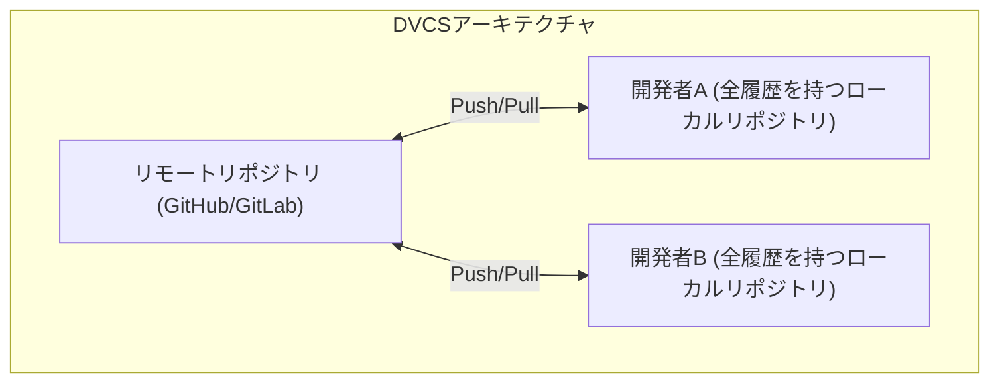

# Day 1: バージョン管理システムとは？ Gitの基礎知識

**Git & GitHub Mastery** コースの最初の日にようこそ！これから10日間で、Gitを「難解なコマンドの集まり」から「日々の開発プロセスに不可欠な強力なツール」へと変えていきましょう。

初日の今日は、いきなりコマンドを打ち始めることはしません。まずは最も重要な、これから使うツールの**本質**と概念を理解することから始めます。

---

## 1. バージョン管理システム（VCS）とは？

あなたが大学の卒業論文や、仕事の重要なプロジェクト報告書を作成していると想像してください。`Report.docx` というファイルがあります。数日間の編集を経て、プロジェクトのフォルダは以下のようになっているかもしれません。

*   `Report_Final.docx`（最終版）
*   `Report_Final_Actually.docx`（本当に最終版）
*   `Report_Final_Revised_LastOne.docx`（修正版_これで最後）
*   `Report_Final_Submitted.docx`（提出版）

このような手動によるバージョン管理は、深刻な混乱を引き起こします。
1.  `Revised_LastOne` と `Final` の間で、具体的に何を変更したのか思い出せない。
2.  後で必要になる段落を誤って削除してしまった場合、復元するのが極めて困難。
3.  他の人と共同作業をする際、お互いの変更を上書きすることなくファイルを統合する方法がない。

**バージョン管理システム（VCS: Version Control System）**は、まさにこれらの問題を解決するために誕生しました。ファイルや一連のファイルの変更を記録し、後から特定のバージョンを呼び出せるようにするソフトウェアユーティリティです。

### 1.1. バージョン管理システムの変遷

Gitが業界を支配する前、ソフトウェア開発はいくつかの世代のVCSアーキテクチャを経てきました。

**A. ローカルバージョン管理システム（Local VCS）**
このモデルは、ローカルマシン上のシンプルなデータベースにファイルの全変更履歴を保存します。手動でファイル名を変更するよりは少し安全ですが、ローカルハードドライブがクラッシュすると、すべてを失います。また、他のメンバーとの共同作業は事実上不可能です。

**B. 集中型バージョン管理システム（CVCS）**
*代表例：Subversion (SVN)、CVS*
異なるマシンを使用する開発者と共同作業を行うために、CVCSが導入されました。すべてのバージョン管理されたファイルを保存する単一の「中央サーバー」があり、複数のクライアントがその中央サーバーからファイルをチェックアウトします。
*   **メリット：** 管理が容易で、管理権限の統制が取りやすく、他の開発者が何をしているかを把握しやすい。
*   **デメリット（致命的な弱点）：** 単一障害点（Single Point of Failure）。中央サーバーが1時間ダウンすると、その間は誰も共同作業や変更の保存ができなくなります。サーバーのハードディスクが破損し、バックアップがない場合、プロジェクトの全履歴が失われます。

**C. 分散型バージョン管理システム（DVCS）**
*代表例：Git、Mercurial*
これが現代のバージョン管理の標準であり、Gitはその絶対的な王者です。DVCSでは、クライアントはファイルの最新のスナップショットをチェックアウトするだけでなく、**リポジトリ全体（全履歴を含む）を完全に複製（クローン）**します。
いずれかのサーバーが停止した場合でも、任意のクライアントリポジトリをサーバーにコピーし直すことで復元できます。すべてのクローンがデータの完全なバックアップとなります。



> 💡 **なぜGitはSVNに勝利したのか？**
> その理由は「分散型（Distributed）」という性質にあります。アクティブなインターネット接続がなくても、プロジェクトの履歴を表示し、機能（ブランチ）を切り替え、作業の進捗をローカルマシンに「コミット」として保存できます。接続が復旧したら、変更をリモートサーバーに同期（プッシュ）するだけで済みます。

---

## 2. Gitの内部構造：スナップショット vs デルタ

これは、Gitユーザーの上位20%に入るための基礎知識です。

従来のバージョン管理システム（SVNなど）の多くは、情報をファイルベースの変更リスト、一般に**デルタ（差分）**として保存します。ベースとなるファイルを保存し、その後のバージョンごとに差分（追加または削除された行）を記録します。

しかし、Gitのデータの捉え方は異なります。Gitはデータをミニチュアファイルシステムのスナップショットのストリーム（流れ）としてモデル化します。

Gitでプロジェクトの状態をコミット（保存）するたびに、Gitはその瞬間のすべてのファイルの状態を「写真」に撮り、そのスナップショットへの参照を保存します。効率を高めるため、ファイルに変更がない場合、Gitはそのファイルを再度保存することはせず、すでに保存されている以前の同一ファイルへのリンクのみを保存します。

*これにより、Gitは単なるVCSというよりも、その上に構築された非常に強力なツール群を備えたミニファイルシステムのように機能します。*

---

## 3. Gitのインストール

始める前に、コンピューターにGitが正しくインストールされているか確認しましょう。

### すでにGitがインストールされているか確認する
ターミナル（macOS/Linux）またはコマンドプロンプト / PowerShell / Git Bash（Windows）を開き、以下を入力します。

```bash
git --version
```

`git version 2.45.0` のような結果が返されれば、すでにインストールされています。「グローバル設定」のセクションに進んでください。`command not found` エラーが発生した場合は、以下の手順に従ってインストールしてください。

### 🐧 Linux (Ubuntu/Debian) へのインストール
ターミナルを開き、以下を実行します。
```bash
sudo apt update
sudo apt install git
```

### 🍎 macOS へのインストール
最も簡単な方法は、ターミナルを開いて以下を実行することです。
```bash
git --version
```
インストールされていない場合、macOSは「コマンドライン・デベロッパー・ツール」をインストールするかどうかを尋ねるダイアログボックスを表示します。「インストール」をクリックします。

*(上級者向け: Homebrewを使用している場合は、`brew install git` を実行するだけです)*

### 🪟 Windows へのインストール
1.  Gitの公式サイトにアクセスします: [https://git-scm.com/download/win](https://git-scm.com/download/win)
2.  お使いのシステムアーキテクチャに適したスタンドアロンインストーラー（通常は64ビット版）をダウンロードします。
3.  `.exe` ファイルを実行します。インストール中は、デフォルト設定のまま「Next」をクリックし続けます（デフォルトの選択肢が初心者にとって最も安全です）。
4.  インストールが完了したら、Gitに同梱されている **Git Bash** を開いてコマンドを実行します。Windowsのデフォルトのコマンドプロンプトの使用は避けてください。

---

## 4. Gitの正しいグローバル設定

Gitをインストールした後、**一番最初**に行うべきアクションは、個人の識別情報の登録です。なぜでしょうか？Gitで保存するすべてのコミットに、この名前とメールアドレスが履歴として永続的に刻まれるからです。

ターミナルまたはGit Bashを開き、以下のコマンドを実行します（実際の名前とメールアドレスに置き換えてください）。

**表示名の設定:**
```bash
git config --global user.name "Taro Yamada"
```

**メールアドレスの設定:**
*(注: 今後GitHubアカウントを登録する際に使用する予定のメールアドレスを使用してください。)*
```bash
git config --global user.email "taroyamada@example.com"
```

**設定の確認:**
値が正しく設定されたか確認するには、以下を実行します。
```bash
git config --list
```
出力結果に `user.name` と `user.email` が表示されていることを確認します。

> 🛠️ **`--global` フラグの意味:**
> `--global` オプションは、コンピューター上の*すべて*のプロジェクトにこれらの設定を適用するよう、Gitに指示します。仕事用のプロジェクトで異なるメールアドレスを使用する必要がある場合は、特定のプロジェクトフォルダ内で `--global` フラグを除外して実行することで、ローカルな識別情報を上書き設定できます。

**デフォルトブランチ名の変更（現代のベストプラクティス）**
歴史的に、Gitはデフォルトブランチを `master` という名前で初期化していました。しかし、現在テック業界では多様性と包括性の観点から `main` を標準としています。新しいリポジトリが常に `main` で初期化されるように設定します。

```bash
git config --global init.defaultBranch main
```

---

## 5. 実践ハンズオン：最初のリポジトリ作成

それでは、新しいプロジェクトディレクトリを作成し、Gitで初期化してみましょう。

**ステップ 1: 新しいプロジェクトフォルダを作成する**
ターミナルまたはGit Bashを開き、デスクトップに移動してディレクトリを作成します。

```bash
cd ~/Desktop
mkdir git-fundamentals
cd git-fundamentals
```

**ステップ 2: Gitの初期化（通常のフォルダをGitリポジトリに変換）**
`git-fundamentals` フォルダの中で、最も重要なコマンドを入力します。

```bash
git init
```

出力は以下のようになります。
`Initialized empty Git repository in /Users/taroyamada/Desktop/git-fundamentals/.git/`

**ステップ 3: 隠しフォルダ `.git` の探索（Gitの秘密のエンジン）**
`git init` は実際に何をしたのでしょうか？プロジェクトのルート内に `.git` という名前の隠しディレクトリを作成しました。
ターミナルで確認するには、以下を実行します。
```bash
ls -a
```
出力一覧に `.git` フォルダが表示されているのがわかります。

> 🚨 **重要な警告：**
> `.git` フォルダは、バージョン管理システムの「魂」であり「頭脳」です。すべてのスナップショット、履歴、設定がここに保存されています。
> `.git` フォルダ内のファイルを手動で変更、編集、削除することは**絶対**に避けてください。誤って `.git` フォルダを削除すると、プロジェクトは通常のフォルダに戻り、これまでのバージョン履歴が永久に失われます（ただし、ハードディスク上の現在の作業ファイルは失われません）。

---

## Day 1 のまとめ

今日、あなたは以下の重要な基礎知識を習得しました。
1.  **VCSとは何か**、そしてなぜ**分散型VCS（Git）**が業界標準なのかを理解しました。
2.  Git独自の**スナップショットベース**のデータ保存メカニズムを学びました。
3.  グローバルな識別情報（`user.name`、`user.email`）をインストールして設定しました。
4.  `git init` を使って、最初のローカルGitリポジトリを初期化しました。

Day 2では、実際にコードを書き始め、コミットを使って進捗を追跡・保存する方法を学びます。ゆっくり休んでください！

---

### 📝 本日のミニ課題：
`git config --global --list` コマンドを使用して、グローバル設定を確認してください。名前とメールアドレスが、今後のコミットで表示したい通りに正しく登録されているか確認しましょう。
