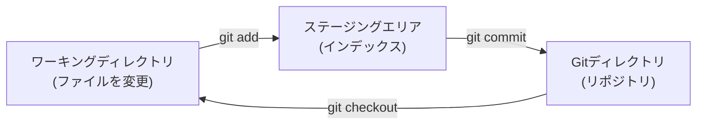

# Day 2: Gitにおけるファイルのライフサイクル (The Git File Lifecycle)

お帰りなさい！Day 1では「Gitとは何か」を学びました。今日は「Gitがどのように機能するのか」を学びます。

これは、コマンドを入力する際に行き詰まらないようにするための**最も重要な**レッスンです。Gitにおけるファイルのライフサイクルをマスターすれば、自分のコードが現在どこにあり、次に何をすべきかが常に明確になります。

---

## 1. Gitの3つのエリア (The Three Sections)

ファイルを効率的に管理するため、Gitはプロジェクトを3つの独立した作業エリアに分割します。これは、郵送するプレゼントを用意するプロセスに似ています。

1.  **ワーキングディレクトリ（Working Directory / 作業ツリー）：** あなたの物理的な「作業机」です。ここでコードを書き、ファイルを修正し、画像を追加します。ここにあるファイルは、まだGitによって「確定」されていません。
2.  **ステージングエリア（Staging Area / インデックス）：** 「ギフトボックス」です。変更したファイルの中から、保存したい特定のファイルを選んで箱に入れます。箱を密閉する前であれば、ファイルを自由に出し入れできます。
3.  **Gitディレクトリ（Git Directory / リポジトリ）：** 箱を密閉して宛名を書いた状態です。これで正式に歴史の永続的な記録となります。Gitはこのスナップショットを `.git` フォルダ内に安全に保存します。



> 💡 **簡単に言うと：** **ワーキングディレクトリ**でファイルを編集し、重要なファイルを `git add` で**ステージングエリア**に登録し、最後に `git commit` で**Gitディレクトリ**に永続的に保存します。

---

## 2. ファイルの4つの状態

Gitの目には、プロジェクトディレクトリ内のすべてのファイルは以下の4つの状態のいずれかとして映ります。

### 2.1. 追跡対象外 (Untracked)
作成したばかりの新規ファイルです。Gitはハードディスク上にそのファイルが存在することを認識していますが、まだ変更の追跡は開始していません。明示的に追跡を指示しない限り、プロジェクトの履歴に保存されることはありません。

### 2.2. 変更なし (Unmodified)
すでにGitの履歴に存在し（過去にコミット済み）、現在のセッションで編集や変更が一切行われていない状態です。

### 2.3. 変更あり (Modified)
ファイルを開いてコードを一部変更したものの、まだ保存の準備（ステージング）をしていない状態です。

### 2.4. ステージ済み (Staged)
変更が完了し、次のコミットスナップショットに含める準備ができているものとして、`git add` コマンドでマークした状態です。

---

## 3. 実践ハンズオン：ゼロからコミットまで

Day 1で作成した `git-fundamentals` フォルダを引き続き使用します。

### ステップ 1: ファイルを作成して状態を確認する
プロジェクトの紹介ファイルとなる `README.md` を新規作成します。

```bash
echo "# Learning Git with Sensei Hub" > README.md
```

ここで、ディレクトリの現在のステータスをGitに確認します。
```bash
git status
```

**以下のような出力が表示されます：**
`Untracked files: (use "git add <file>..." to include in what will be committed) README.md`
-> Gitは `README.md` が **Untracked**（追跡対象外）の状態であることを示しています。

### ステップ 2: ファイルをステージングエリアに追加する
Gitに変更の追跡を開始させるため、以下を実行します。
```bash
git add README.md
```

ステータスを再確認します。
```bash
git status
```
ファイル名が緑色でハイライトされ、`Changes to be committed` というメッセージが表示されます。無事に **Staged**（ステージ済み）の状態に移行しました。

### ステップ 3: プロジェクト履歴に保存する
これがプロジェクトの「スナップショット」を撮る瞬間です。コミットコマンドには、どのような変更を行ったかを要約したメッセージ（コミットメッセージ）が必要です。

```bash
git commit -m "feat: initialize first README file"
```

**出力結果：**
`1 file changed, 1 insertion(+)`
おめでとうございます！最初のコミットが記録されました。ファイルは再び **Unmodified**（変更なし）の状態に戻ります。

---

## 4. コミットメッセージの書き方（Conventional Commits）

`update` や `fix bug`、`aaaaa` といった適当なコミットメッセージを書くのは避けましょう。コードベースが大きくなると、これらのメッセージから変更内容を追跡することが不可能になります。
プロのソフトウェアエンジニアは、**Conventional Commits** という世界標準の規則に従います。

基本形式： `<type>: <description>`

*   **feat:** 新機能の追加（例: `feat: add login button`）
*   **fix:** バグの修正（例: `fix: login crash on iOS`）
*   **docs:** ドキュメントやコメントのみの変更（例: `docs: update readme`）
*   **style:** コードのロジックに影響を与えない、フォーマットやスペース、カンマなどの修正
*   **refactor:** バグ修正や機能追加ではない、コード構造の整理やリファクタリング
*   **chore:** ビルド構成やパッケージ追加、雑用タスク

> 🌟 **ヒント：** コミットメッセージを英語で書く習慣をつけると、グローバルな開発現場や外資系企業の採用担当者から高く評価されるキャリアポートフォリオを構築できます。

---

## 5. プロジェクト履歴の確認

プロジェクトに記録されたすべてのコミットを表示するには、以下を実行します。
```bash
git log
```

簡潔に1行で履歴を表示したい場合：
```bash
git log --oneline
```

コミットの横に `a1b2c3d` のような英数字の文字列が表示されます。これは **SHA-1 ハッシュ値**であり、そのコミット固有の識別IDです。将来的に過去のバージョンにロールバックしたり参照したりする際に、このハッシュ値を使用します。

---

## 6. 不要なファイルを `.gitignore` で除外する

実際のプロジェクトでは、Gitで管理すべきではないファイルが多数存在します。
*   パスワード、APIキー、機密情報を含むファイル（`.env`）
*   容量が大きく自動生成される依存関係フォルダ（`node_modules`）
*   OSが自動生成するキャッシュファイル（`.DS_Store`、`thumbs.db`）

これらを自動的に除外するために、`.gitignore` という特別な設定ファイルを作成します。

**実践ハンズオン：**
1.  ダミーの機密情報ファイルを作成します。
```bash
echo "DATABASE_PASSWORD=supersecret123" > .env
```
2.  `.gitignore` ファイルを作成し、`.env` を無視するようGitに指示します。
```bash
echo ".env" > .gitignore
```
3.  ステータスを確認します。
```bash
git status
```
Gitの追跡対象外一覧に `.gitignore` は表示されますが、`.env` ファイルは完全に無視されていることがわかります。素晴らしい！

---

## 7. `git add` のプロのコツ

*   `git add .` : 現在のディレクトリおよびサブディレクトリ内のすべての変更・新規ファイルを一括でステージングエリアに追加します。
*   `git add -p` : （対話型ステージング）修正したコードブロック（ハック）ごとに、ステージングするかどうかをGitが個別に尋ねてきます。複数の機能にまたがってコードを修正した際、特定の箇所だけを分けてコミットしたい場合に極めて有用です。

---

## Day 2 のまとめ

今日、あなたはGitのライフサイクルの核心をマスターしました。
1.  **3つのエリア**の役割を理解しました： ワーキングディレクトリ $\rightarrow$ ステagingエリア $\rightarrow$ リポジトリ。
2.  ファイルの**4つの状態**を学びました。
3.  `git status`、`git add`、`git commit` の実践的な使い方を習得しました。
4.  **Conventional Commits** に準拠したプロのコミットメッセージの書き方を学びました。
5.  `.gitignore` を使用して、機密ファイルをGitの追跡から保護する方法を実装しました。

**本日のミニ課題：**
新しくテキストファイルを2つ作成し、`README.md` の内容を編集した上で、Conventional Commitsに準拠したメッセージで2つの異なるコミットを作成してみましょう。

明日は、作成したローカルリポジトリを **GitHub** にアップロードして、世界中に公開する方法を学びます！お疲れ様でした。
