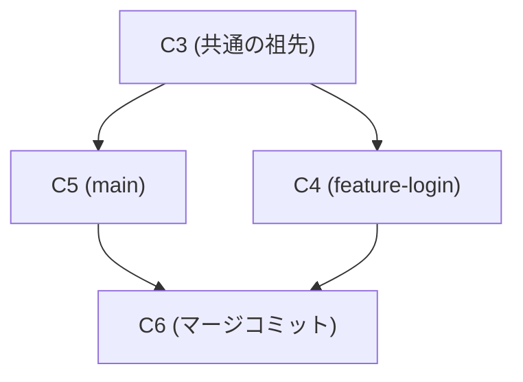

# Day 4: ブランチとマージの高度な操作 (Mastering Branches)

Day 4にようこそ！今日は、Gitの最も強力で画期的な機能の一つである **ブランチ（Branching / 分岐）** を攻略します。

Subversion (SVN) などの古いバージョン管理システムでは、ブランチを作成するとソースコード全体が物理的に新しいフォルダへ複製されるため、非常に重い処理でした。しかしGitにおけるブランチ作成は、一瞬で完了し、極めて軽量です。なぜでしょうか？その理由は、Gitの「ポインタ」というエレガントな設計にあります。Gitのブランチの仕組みを深く解き明かしていきましょう。

---

## 1. ブランチの本質：コピーではなく「ポインタ」！

Day 1を思い出してください。Gitはデータを **スナップショット** のストリームとして保存します。すべてのコミットが歴史的なスナップショットです。

Gitにおいて、ブランチとは実際にはこれらコミットのいずれかを指し示す **可動ポインタ（movable pointer）** にすぎません。リポジトリを初期化した際のデフォルトのブランチ名は通常 `main` です。

### 履歴のタイムライン図：
3つのコミットがある場合、`main` ブランチのポインタは最新のコミット（C3）を指しています。

```text
(C1) <---- (C2) <---- (C3) [mainブランチ]
                        ^
                      [HEAD]
```

**HEADとは何か？**
`HEAD` は、あなたが現在どのブランチに立っているかを示す「虫眼鏡（またはインジケータ）」のようなものだと考えてください。ブランチを切り替える際、Gitは単に `HEAD` という虫眼鏡を、切り替え先ブランチのポインタへと移動させます。

---

## 2. ブランチの基本操作

### 2.1. 新しいブランチを作成する (`git branch`)
`feature-login` という名前のブランチを新規作成します。
```bash
git branch feature-login
```
この時点で、Gitは C3 コミットを指す `feature-login` という新しいポインタを作成します。

### 2.2. ブランチを切り替える (`git switch`)
作成した新しいブランチで作業を開始するには、`HEAD` をそのブランチに移動させる必要があります。
```bash
git switch feature-login
```

`feature-login` ブランチに切り替えた状態で、新しくコミット（C4）を記録します。
```bash
echo "login code" > login.js
git add .
git commit -m "feat: implement login logic"
```

この時、`feature-login` ポインタは C4 に進みますが、`main` ポインタは C3 に留まったままです！

```text
(C1) <---- (C2) <---- (C3) [mainブランチ]
                        ^
                        +---- (C4) [feature-loginブランチ]
                                ^
                              [HEAD]
```

> 💡 **便利な合わせ技コマンド：** ブランチの作成と切り替えを同時に行うには、以下を実行します。
> `git switch -c feature-name`

---

## 3. マージ（Merging）：複数の歴史の統合

`feature-login` ブランチで機能実装が完了したら、その変更を `main` ブランチに統合（マージ）する必要があります。これには主に2つのシナリオがあります。

### 3.1. Fast-forwardマージ（早送りマージ）
ブランチを分岐させてから、マージ先である `main` ブランチに**新しいコミットが一切追加されていない**場合、マージは極めてシンプルです。Gitは `main` ブランチのポインタを `feature-login` の位置まで「早送り」で移動させるだけです。複雑なコード比較や新しいマージコミットは作成されません。

### 3.2. 3方向マージ（Three-way Merge）
あなたが `feature-login` で作業している間に、同僚が `main` ブランチに新しいコミット（C5）を追加していた場合、早送りマージはできません。

Gitは、両ブランチの先端（C4とC5）と、共通の祖先（C3）の3つを比較して自動マージを行います。そして、両方の歴史を繋ぐ新しい **マージコミット（Merge Commit: C6）** を自動的に作成します。



---

## 4. リベースの技術：履歴を美しく一直線に保つ

マージのほかに、履歴を同期・整理するための強力なコマンドとして `rebase` があります。

### マージ vs. リベース：何が違うのか？
*   **マージ（Merge）：** 2つのブランチを統合する新しいコミットを作成します。
    *   *メリット：* 歴史の事実をそのまま残せます。
    *   *デメリット：* 大規模開発では、コミット履歴が「地下鉄の路線図」のように複雑に入り組んでしまいます。
*   **リベース（Rebase）：** ブランチの「基点（ベース）」を書き換えます。`feature` ブランチで行ったコミットを一旦取り外し、`main` ブランチの最新コミットを適用してから、その上に自分のコミットを1つずつ再適用します。
    *   *メリット：* コミット履歴を一直線で非常に綺麗に保てます。

**リベースの実行手順：**
```bash
git switch feature-login
git rebase main
```

> ⚠️ **リベースの黄金律 (The Golden Rule of Rebase)：** すでに**リモートリポジトリ（GitHubなど）にプッシュしたコミットに対しては、絶対にリベースを行ってはいけません**。公開された履歴が書き換わってしまうため、他の開発者がコードをプルする際に深刻な同期エラーを引き起こします。

---

## 5. 競合（コンフリクト）の解決：サバイバルガイド

マージやリベースの際、自分と同僚（または別ブランチの自分）が**同じファイルの同じ行**を別々に変更して統合しようとすると、競合（コンフリクト）が発生します。

### 競合解決のステップ：
1.  **競合ファイルの特定：** マージを実行した際、Gitが処理を一時停止し `CONFLICT` が発生したファイル一覧を表示します。
2.  **ファイルを開く：** Gitが自動挿入した以下の競合マーカーを探します。
    *   `<<<<<<< HEAD`: あなたが現在いるローカルブランチの変更箇所
    *   `=======`: 境界線
    *   `>>>>>>> feature-name`: マージしようとしている相手側ブランチの変更箇所
3.  **手動で修正：** コードをどちらのロジックにするか（または両方を組み合わせるか）判断し、不要なマーカー行をすべて削除して綺麗なコードに書き換えます。
4.  **マージの完了：**
    ```bash
    git add <競合を解消したファイル>
    git commit -m "fix: resolve merge conflict in login controller"
    ```

---

## 6. リモートブランチとの連携

共同開発環境では、ローカルのGitはリモートリポジトリのブランチ状態を追跡しており、これらは通常 `origin/` という接頭辞が付きます。

*   `origin/main`：GitHub上の `main` ブランチの状態をローカルにキャッシュした、読み取り専用の参照ポインタです。このブランチに直接コードを書き込むことはできません。
*   このリモート追跡情報をローカルで最新に更新するには、`git fetch` を実行します。
*   更新された内容をローカルブランチに統合するには、`git merge origin/main` を実行します。
*   *(または、`git pull` を実行して上記2つのステップを一度に行います)*

---

## 7. 高度なブランチ管理コマンド

*   `git branch -vv`：ローカルブランチがリモートブランチのどちらを追跡しているか、何コミット進んでいるか（または遅れているか）の詳細を表示します。
*   `git branch --merged`：現在のブランチに安全にマージが完了したブランチ（削除しても安全なブランチ）の一覧を表示します。
*   `git remote prune origin`：GitHub上で既に削除された古いリモート追跡ブランチのキャッシュを、ローカル環境から一括でクリーンアップします。

---

## Day 4 のまとめ

1.  **ブランチは軽量なポインタである：** Gitでのブランチ作成は高速で、非常に安価かつ安全です。
2.  **マージ vs. リベース：** 開発の事実をそのまま残したい場合はMerge、マージ前に履歴を一直線に整理したい場合はRebaseを使用します。
3.  **競合は恐れるものではない：** 競合（コンフリクト）は、不整合なコード変更を安全にすり合わせるためのセーフティゲートです。
4.  **常にクリーンに：** マージが完了した開発用ブランチは、速やかにローカル・リモート双方から削除しましょう。

**本日のミニ課題：**
新しいブランチを作成して複数のコミットを行い、`git rebase -i`（インタラクティブ・リベース）を使用して、マージ前に3つのコミットを1つに統合（squash）する練習をしてみましょう。これは実務で非常に高く評価されるシニアエンジニアのスキルです！

明日は、このブランチ戦略をクラウドで活用する **GitHubのPull Request（プルリクエスト）** について学びます！お疲れ様でした。
