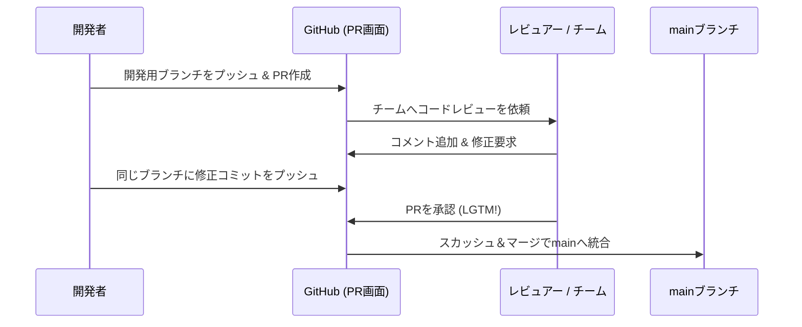

# Day 5: プロフェッショナルなワークフロー - プルリクエストと共同開発

Day 5にようこそ！ここまでで、ローカルマシン上での基本的なGit操作は完璧にマスターできました。しかし、実際のエンタープライズ開発の現場では、自分一人だけでコードを書くことはありません。

ソフトウェア開発はチームスポーツです。今日は、コードベースの品質を維持し、摩擦のないスムーズなチーム開発を実現するための最も強力なツールである **プルリクエスト（Pull Request: PR）** について学びます。

---

## 1. プルリクエスト（PR）の本質

プルリクエストを単に「GitHub上のボタンをクリックするだけの作業」だと思わないでください。PRの本質は **対話（ダイアログ）** です。

あなたがPRを送信する時、チームメンバーに対して次のように伝えています。
*「チームの皆さん、`feature-x` ブランチで新機能Xの実装が完了しました。こちらが変更箇所（差分）のクリーンな比較です。バグがないか、品質基準を満たしているかレビューをお願いします。問題がなければ、メインのコードベースに統合（プル）してください！」*



### なぜPRがそれほど重要なのでしょうか？
1.  **コードレビュー：** マージ前に他のメンバーがあなたのコードを検証することで、バグを早期に発見できます。自分以外の目（セカンドオピニオン）を通すことは常に有益です。
2.  **歴史的ドキュメント：** あらゆる設計上の決定、コードの修正理由、技術的背景がPRのディスカッションログとして永続的に記録されます。将来、別のエンジニアがレガシーコードの「なぜこのように実装したのか」を調査する際の強力な手がかりになります。
3.  **CI/CDによる自動化：** PRの作成は、自動化システムのトリガーとなります。自動テスト（GitHub Actionsなど）が即座に起動し、単体テストの実行、コードの自動整形（フォーマットチェック）、セキュリティスキャンなどを、人の手によるレビュー前に完了させます。

---

## 2. 標準的な共同開発6ステップワークフロー

以下の手順は、世界中のトップIT企業で標準的に使用されている「暗黙の了解」とも言える重要なワークフローです。必ず覚えましょう。

### ステップ 1: メインブランチの同期
新機能の実装を始める前に、必ず最新のコードベースをローカルに取得します。
```bash
git switch main
git pull origin main
```

### ステップ 2: 開発用の機能ブランチを作成
タスクは必ず専用のブランチで作業し、絶対に `main` ブランチに直接コミットしてはいけません。
```bash
git switch -c feature/login-page
```

### ステップ 3: ローカルでの開発とコミット
コードを書き、テストを行います。 Conventional Commits（規約に沿ったコミット）に従って、定期的かつ綺麗にコミットを記録します。
```bash
git add .
git commit -m "feat: design user login form UI"
```

### ステップ 4: ブランチをリモートサーバーにプッシュ
開発用ブランチをGitHub上のリモートリポジトリにアップロードします。
```bash
git push origin feature/login-page
```

### ステップ 5: GitHub上でプルリクエストを作成
GitHubのリポジトリページにアクセスすると、新しいブランチが自動検知されプロンプトが表示されます。「**Compare & pull request**」ボタンをクリックします。

### ステップ 6: レビュー、修正対応、そしてマージ
チームメンバーがコードをレビューしコメントを追加します。あなたは同じブランチに直接修正をコミット・プッシュでき、PRは自動的に更新されます。全員の承認が得られたら、ブランチを `main` にマージします。

---

## 3. プロフェッショナルなコードレビューの作法

コードレビューは他人のコードの「粗探し」をするものではありません。エンジニアがお互いの知識を共有し、チーム全体のスキルを底上げするための教育的かつ建設的なプロセスです。

### PR作成者（作成者）のチェックリスト：
*   **PRタイトル：** 簡潔で分かりやすく、適切なプレフィックスを付けます（例: `fix: resolve avatar profile image parsing error`）。
*   **PR説明欄：** 以下の点を分かりやすく記述します。
    *   今回何を実装したか？
    *   なぜこのアプローチをとったのか？
    *   レビュアーはどうやって動作確認（テスト）すればよいか？
    *   画面UIの変更がある場合は、変更後のスクリーンショットや画面録画を添付する。
*   **セルフレビュー：** レビュアーに割り当てる前に、一度自分でGitHub上の差分（diff）を確認します。このステップで記述ミスや不要なコンソール出力の50%以上を発見できます。

### レビュアーのチェックリスト：
*   **ロジックとエッジケース：** 例外処理、DB接続エラー、想定外の入力に対してコードが正しく対応できているか？
*   **パフォーマンス：** 無駄なネストループ、メモリリーク、非効率なデータベースクエリがないか？
*   **可読性：** 変数や関数の命名は適切で、チームの開発規約に従っているか？
*   **共感と敬意：** コメントは常に建設的かつ敬意を持って書きましょう。「このコードは完全に間違っています」と言う代わりに、「このループ処理はアプローチXを使用すると最適化できると思います。どう思いますか？」と提案します。

---

## 4. スカッシュマージ（Squash and Merge）

開発中、ローカルでは「タイポの修正」「CSSの調整」「再テスト」などの細かなコミットが20個ほど溜まることがあります。これらすべてをそのまま `main` にマージすると、本番の履歴が非常に見づらくなってしまいます。

**解決策：スカッシュマージ（Squash and Merge）**
GitHubでは、マージを行う際にそれまでの複数の細かなコミットを**1つのクリーンなコミットに圧縮統合**することができます。これにより、`main` ブランチの履歴を常に簡潔で綺麗に保つことができます。

---

## 5. Gitフックを使用した品質管理の自動化

コミットした後に、コードの自動整形（フォーマット）やテストの実行を忘れていたことに気づいたことはありませんか？ Gitフック（Git Hooks）を使用すれば、これらのチェックを自動化できます。

Gitフックは、プロジェクトの隠しフォルダ `.git/hooks/` 内にあるスクリプトファイルです。コミット直前（pre-commit）やプッシュ直前（pre-push）などの、Gitのライフサイクルイベントに合わせて自動実行されます。

*   **pre-commitフック：** コミット実行直前に構文チェッカー（Linter）やテストスクリプトを自動的に走らせます。もしエラーが検出された場合、Gitはコミット処理を中止し、ローカルでの修正を促します。
*   **メリット：** バグやフォーマット崩れのあるコードが誤ってリポジトリにコミットされるのを確実に防ぎます。

---

## 6. プロジェクトの保護：ブランチ保護ルール

新しく入ったメンバーや自分自身が、誤って `git push --force` を実行し、本番環境のソースコード全体を上書きして消去してしまうのを防ぐにはどうすればよいでしょうか？ GitHubは **ブランチ保護ルール（Branch Protection Rules）** を提供しています。

**設定方法：**
1.  GitHubのリポジトリ画面 $\rightarrow$ **Settings** $\rightarrow$ **Branches** に進みます。
2.  **Branch protection rules** の欄で、**Add rule** をクリックします。
3.  **Branch name pattern** に `main` と入力します。
4.  以下の主要なセキュリティ設定にチェックを入れます。
    *   **Require a pull request before merging：** `main` ブランチへの直接プッシュを完全に禁止します。
    *   **Require approvals：** マージを実行する前に、少なくとも1人以上のチームメンバーの承認を必須とします。
    *   **Require status checks to pass：** 自動テスト（CI/CD）がパスしていない限り、マージをブロックします。

---

## 7. Gitタグを使用したバージョン管理とリリース

ソフトウェアが安定した本番稼働マイルストーン（例: MVPやベータ版の完成）に達した際、その特定のコミット地点に「タグ」を付与して記録します。

```bash
git tag -a v1.0.0 -m "Release of official production v1.0.0"
git push origin v1.0.0
```

タグをプッシュすると、GitHub上に自動的に **Release（リリース）** が登録されます。そこにリリースノート（追加機能や修正プログラムの説明）を記述して公開できます。

---

## Day 5 のまとめ

1.  **PRは共同開発の文化そのもの：** プルリクエストは、ソフトウェアの品質を高めるために欠かせない強力なフィードバックループです。
2.  **スカッシュマージ：** 開発中の細かなコミットを1点に圧縮し、本番のリリース履歴を簡潔に維持します。
3.  **Gitフック：** ローカル環境で自動テストなどの品質チェックを実行し、不正なコードのコミットを未然に防ぎます。
4.  **ブランチの保護：** 誤った強制プッシュなどから本番のコードを強力に守るセキュリティガードです。

**本日のミニ課題：**
GitHubのリポジトリ設定にアクセスし、`main` ブランチのブランチ保護ルール（Branch Protection Rule）を設定してみましょう。その後、ターミナルから `main` ブランチに直接コミットをプッシュしようと試みてください。GitHubがプッシュを安全にブロックするのを確認しましょう！

明日は、コミットミスなどのトラブルが発生した際、コードを元通りに安全に救出する「Git救命救急コマンド」を学びます！お疲れ様でした。
