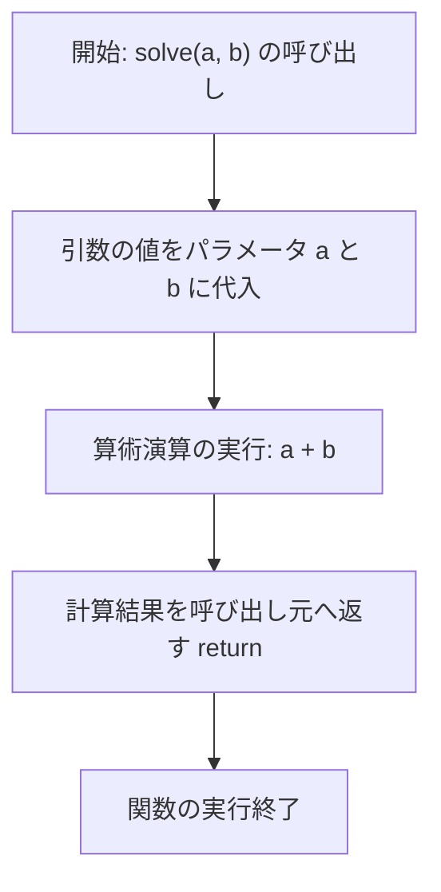
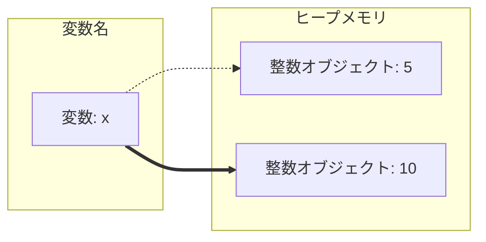

# Day 1: Pythonの紹介と基本演算

**Python・機械学習・深層学習**コースへようこそ！このカリキュラムは、プログラミング初心者から始めて、ブラウザ内だけで完結する高度な機械学習・深層学習モデルの構築までを体系的に学べるように設計されています。

---

### 🎯 学習目標
このレッスンを修了すると、以下のことができるようになります：
- Pythonが一般的な開発、データサイエンス、AIで最も選ばれる言語である理由を説明できる。
- 変数を宣言し、Pythonの「動的型付け」の動作を理解できる。
- 基本的な算術演算子（`+`, `-`, `*`, `/`, `//`, `%`, `**`）を使って数式を計算できる。
- 引数を受け取り、結果を返す簡単な関数を定義・呼び出しできる。

---

### 🧩 中核概念（なぜ）
#### 1. なぜ Python なのか？
Pythonは、可読性とシンプルさを追求して作られた高レベルのインタープリタ型プログラミング言語です。冗長な定型文（ボイラープレート）を書く必要がなく、C++やJavaと比較して非常に短い行数で意図を表現できます。データサイエンスやAIの分野では、強力なエコシステム（NumPy, Scikit-Learn, PyTorchなど）があるため、絶対的なデファクトスタンダードとなっています。

#### 2. 変数：メモリ上のプレースホルダー
**変数**とは、データを一時的に保存するためにコンピュータのメモリ上に用意された「名前付きの保管場所」です。Pythonでは、代入演算子（`=`）を使って値を変数に代入した瞬間に変数が作成されます。Pythonは**動的型付け（Dynamic Typing）**言語であるため、変数宣言時に関数や変数の型（`int` や `float` など）をあらかじめ指定する必要はありません。実行時（ランタイム）にインタープリタが自動で型を判定します。

#### 3. 関数：再利用可能な部品
**関数**とは、特定の処理をひとまとめにした、再利用可能なコードブロックです。関数を定義することで、プログラムの構成をモジュール化し、コードの重複を防ぎ、再利用性を劇的に高めることができます。

---

### 🔁 ロジックと動作
2つの数値を足し合わせる関数 `solve(a, b)` を呼び出すと、制御の流れ（コントロールフロー）は次のようになります。



この流れにより、入力された値が受け取られ、数学的に処理され、計算結果が関数を呼び出したコードへと返されます。

---

### 📝 注釈付きサンプル
以下は、変数、算術演算子、および簡単な関数定義についての注釈付きPythonサンプルコードです。

```python
# --- 変数と代入 ---
x = 15  # 整数 15 を変数 x に代入
y = 4.0  # 浮動小数点数 4.0 を変数 y に代入

# --- 算術演算子 ---
addition = x + y          # 19.0 (整数 + 小数は小数を返します)
subtraction = x - y       # 11.0
multiplication = x * y    # 60.0
division = x / y          # 3.75 (常に浮動小数点数を返します)
floor_division = x // y   # 3.0 (割り算の商を整数値に切り下げます)
modulo = x % y            # 3.0 (割り算の余りを返します)
exponentiation = x ** 2   # 225 (x の 2 乗)

# --- 関数の定義 ---
def calculate_area(width, height):
    """
    長方形の面積を計算します。
    このトリプルクォート内の文章は docstring と呼ばれ、関数の説明を記述します。
    """
    area = width * height  # 計算結果をローカル変数に格納
    return area           # 関数を終了し、結果を呼び出し元に返します

# 関数の呼び出しと戻り値の保存
result = calculate_area(5, 10)
print(result)  # 出力: 50
```

---

### ❌ よくある間違い
#### 間違い 1: インデント（字下げ）の誤り
```python
def solve(a, b):
# 関数の配下にある行にインデントがないためエラーになります
return a + b
```
```text
IndentationError: expected an indented block after function definition on line 1
```
```python
def solve(a, b):
    return a + b  # 半角スペース4つでインデントします
```
> Pythonは中括弧 `{}` の代わりにインデント（スペースやタブ）を使ってコードブロックを定義するため、インデントの欠落は構文エラー（IndentationError）を引き起こします。

#### 間違い 2: 異なる型どうしの演算 (TypeError)
```python
x = "5"
y = 3
result = x + y
```
```text
TypeError: can only concatenate str (not "int") to str
```
```python
# 文字列をあらかじめ整数型に変換（型変換）してから足します
result = int(x) + y  # result は 8
```
> Pythonは「強い型付け」を採用しているため、互換性のない型同士の暗黙的な型変換（この場合は文字列と整数の足し算）を自動で行いません。明示的な型キャストが必要です。

#### 間違い 3: ゼロ除算 (ZeroDivisionError)
```python
result = 10 / 0
```
```text
ZeroDivisionError: division by zero
```
```python
# 割る前に除数がゼロでないか確認します
divisor = 0
result = 10 / divisor if divisor != 0 else 0
```
> 数値をゼロで割ることは数学的に定義されておらず、プログラムがクラッシュします。演算を行う前に除数がゼロでないことを必ず確認してください。

---

### 💡 コツ・イディオム
- **複数変数への同時代入:** 1行で複数の変数に値を代入できます：
  ```python
  a, b, c = 1, 2, 3
  ```
- **累積代入演算子:** `x = x + 5` と書く代わりに、省略形の `+=` を使って簡潔に記述できます：
  ```python
  x = 10
  x += 5  # x は 15 になります
  ```
- **Docstrings（ドキュメンテーション文字列）:** 関数の定義直後に `"""` で囲んだ説明文を記述する習慣をつけましょう。これはコードの読みやすさを向上させ、エディタ上でのヒント表示に活用されます。

---

### 🧠 深掘り（内部の仕組み）
<details>
<summary>Pythonの変数とオブジェクトの管理（クリックで展開）</summary>

Pythonでは、すべての値が「オブジェクト」です。`x = 5` と書いたとき、Pythonの内部では以下の処理が行われます：
1. メモリ上に整数オブジェクト `5` が作成されます。
2. 変数名 `x` がそのオブジェクト `5` への参照（矢印）として紐付けられます。

その後、`x = 10` と再代入すると、`x` という名前が指すオブジェクトが新しい整数オブジェクト `10` に切り替わります。取り残された古いオブジェクト `5` は、他に参照する変数がなくなった場合、Pythonの自動ゴミ回収機能（ガベージコレクション）によってメモリから消去されます。


この参照ベースの仕組みこそが、Pythonが静的な型宣言なしで柔軟に変数を扱える理由です。
</details>

---

### 🏋️ 演習
2つの引数 `a` と `b` を受け取り、その和を返す `solve(a, b)` 関数を完成させてください。

```python
def solve(a, b):
    # ここにコードを書いてください
    return None
```

#### ヒント
1. 加算演算子 `+` を使用します。
2. 単に結果を画面に表示（print）するのではなく、`return` キーワードを使って値を返す必要があります。

---

### ✅ 自己チェック
1. `print(10 // 3)` の出力結果はどうなりますか？
2. `x = 2; x **= 3` を実行した後の `x` の値は？
3. 関数内のインデントを忘れた場合、どのようなエラーが発生しますか？

<details>
<summary>解答を表示</summary>

1. **`3`**: 切り捨て除算 `//` は、割り算を行った結果の小数点以下を切り捨てて整数にします。
2. **`8`**: `x **= 3` は `x = x ** 3`（2の3乗、つまり `2 * 2 * 2 = 8`）と同じです。
3. **`IndentationError`**: Pythonはインデントによってブロックを判別するため、インデントの欠落は構文エラーである `IndentationError` を引き起こします。
</details>

---

### 📌 まとめ
- Pythonは可読性が高く、動的型付けを採用しており、機械学習の強力なエコシステムを持っています。
- 変数はメモリ上のオブジェクトを指し示す参照（矢印）です。
- 基本的な算術演算子には、`+`, `-`, `*`, `/`, `//` (切り捨て除算), `%` (剰余), `**` (べき乗) があります。
- 関数は `def` キーワードを使って定義され、インデントされたブロックを持ち、`return` によって呼び出し元に結果を戻します。
