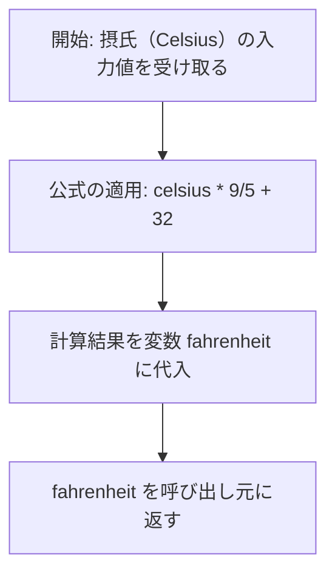

# Day 2: 変数と基本データ型

Pythonにおいて、変数とデータ型を正しく理解することは堅牢なプログラムを作成するための基盤となります。静的型付け言語とは異なり、Pythonは動的で柔軟な値の格納をサポートしていますが、その裏側（ランタイム）では論理的でない演算を防ぐための厳格なルールが働いています。

---

### 🎯 学習目標
このレッスンを修了すると、以下のことができるようになります：
- 4つの基本データ型（`int`、`float`、`str`、`bool`）を正しく識別して操作できる。
- Pythonの動的型付けとオブジェクトの参照メカニズムを説明できる。
- `int()`、`float()`、`str()`、`bool()` を用いて明示的に型を変換（キャスト）できる。
- f-strings（フォーマット文字列）を使って、文字列内に変数を動的に埋め込める。

---

### 🧩 中核概念（なぜ）
#### 1. データ型が必要な理由
コンピュータはすべての情報をバイナリ（1と0の組み合わせ）として保存します。コンピュータはそのバイナリ値が*何*を表現しているのか（数値なのか、テキストメッセージ内の文字なのか）を知る必要があります。データ型を明示または推論することで、Pythonはどのような演算が有効か（例：数値同士の足し算は可能だが、テキストの引き算は不可など）を判断します。

#### 2. 動的型付け：箱ではなく「ラベル」
C++やJavaなどの静的型付け言語では、変数は特定の型が決められた固定の「箱」です。一方、Pythonでは、変数はメモリ上のオブジェクトを指し示す**「ラベル（ポインタ）」**です。型は変数名ではなく、オブジェクト（値そのもの）に紐づいています。そのため、同じ変数名が最初は整数オブジェクトを指し、後から文字列オブジェクトを指すように変更することが可能です。

#### 3. 文字列補間（f-strings）
ユーザーインターフェースに文字を表示したり、ログを出力したりする際、文章の中に変数を埋め込みたいケースが頻繁にあります。`"気温は " + str(temp) + " 度です"` のような煩雑な文字列結合の代わりに、Pythonでは文字列の先頭に `f` をつけ、波括弧 `{}` を使うだけで変数を直感的に埋め込める **f-strings** が提供されています。

---

### 🔁 ロジックと動作
摂氏（Celsius）を華氏（Fahrenheit）に変換する際の流れは、数値を入力値として受け取り、変換公式を適用して、結果を返すシンプルなものです。



Pythonの内部では、入力された摂氏が整数であっても、割り算 `9/5` を行う時点で自動的に小数点数（`1.8`）へと変換（型プロモーション）され、最終的な `fahrenheit` の値は浮動小数点数（`float`）として評価されます。

---

### 📝 注釈付きサンプル
以下は、さまざまなデータ型の変数宣言、型の確認、キャスト、および文字列への埋め込み方法のサンプルです。

```python
# --- 1. 基本データ型の宣言 ---
age = 25                  # 'int' (整数型)
price = 19.99             # 'float' (浮動小数点数型)
course_name = "Python"    # 'str' (文字列型)
is_active = True          # 'bool' (真偽値型: True または False)

# --- 2. 変数の動的な再代入 ---
x = 42                    # 変数 x は整数型オブジェクトを指す
x = "Hello"               # 同じ変数 x に文字列型オブジェクトを代入可能（Pythonでは合法）

# --- 3. 明示的な型キャスト（型変換） ---
str_number = "100"
converted_int = int(str_number)      # 文字列 "100" を整数 100 に変換
converted_float = float(20)          # 整数 20 を浮動小数点数 20.0 に変換
to_string = str(3.14)                # 小数 3.14 を文字列 "3.14" に変換

# --- 4. 真偽値へのキャスト（真偽値の評価） ---
# Pythonではほとんどのオブジェクトを真偽値に変換できます。空の値や 0 のみ False になります。
print(bool(0))            # False
print(bool(""))           # False (空文字列)
print(bool(5))            # True
print(bool("Hello"))      # True

# --- 5. f-strings（フォーマット文字列）による出力 ---
name = "Alice"
score = 98.5
message = f"生徒 {name} のテストの得点は {score} 点でした。"
print(message)            # 出力: 生徒 Alice のテストの得点は 98.5 点でした。
```

---

### ❌ よくある間違い
#### 間違い 1: 暗黙的な型変換の誤り (TypeError)
文字列と整数型を `+` 演算子で直接結合しようとする間違い。
```python
current_year = 2026
message = "今年は " + current_year + " 年です。"
```
**実際のトレースバック（エラーメッセージ）:**
```text
TypeError: can only concatenate str (not "int") to str
```
**正しいコード:**
```python
# f-strings を使用する（推奨）
message = f"今年は {current_year} 年です。"

# または明示的にキャストする
message = "今年は " + str(current_year) + " 年です。"
```
> Pythonは「強い型付け」を採用しているため、`+` 演算子で自動的に数値から文字列への型変換を行いません。

#### 間違い 2: 予約語を変数名に使用する (SyntaxError)
Pythonの構文で特別な意味を持つ単語を変数名に使おうとする間違い。
```python
class = "AI入門コース"
```
**実際のトレースバック（エラーメッセージ）:**
```text
SyntaxError: invalid syntax
```
**正しいコード:**
```python
class_name = "AI入門コース"
```
> `class` や `def`、`if`、`import`、`for` などのキーワード（予約語）は変数名として使えません。

#### 間違い 3: 小数計算の丸め誤差
小数の計算結果が常に正確な十進数になると仮定してしまう間違い。
```python
result = (0.1 + 0.2) == 0.3
print(result)
```
**実際の出力結果:**
```text
False  (0.1 + 0.2 の計算結果は内部的に 0.30000000000000004 になります)
```
**正しいコード:**
```python
# 計算結果の差が極めて微小（許容誤差内）であるかを確認する
is_equal = abs((0.1 + 0.2) - 0.3) < 1e-9
```
> コンピュータは浮動小数点数をバイナリ（二進数）の小数として表現する（IEEE 754規格）ため、0.1 や 0.2 などの十進数の小数を完全には正確に表現できません。

---

### 💡 コツ・イディオム
- **定数（Constants）の宣言:** Pythonには値の書き換えを禁止する言語仕様上の「定数」はありません。慣例として、大文字とアンダースコア（`PI = 3.14159` や `MAX_USERS = 100`）で変数名を書くことで、「この値は変更すべきではない」ことを他の開発者に伝えます。
- **桁数の多い数値の可読性:** アンダースコアを使って、数値を区切って読みやすく記述できます：
  ```python
  one_billion = 1_000_000_000
  ```
- **型チェックのベストプラクティス:** 変数の型を確認するときは、`type(var) == type` よりも `isinstance(var, type)` を使うのが一般的で推奨されます：
  ```python
  is_integer = isinstance(age, int)  # True
  ```

---

### 🧠 深掘り（内部の仕組み）
<details>
<summary>オブジェクトの「値」と「同一性」（クリックで展開）</summary>

値を変数に代入するとき、Pythonはメモリ上にそのオブジェクト領域を確保し、そのアドレス（参照）を変数名に紐づけます。
- **値の比較 (`==`)**: 2つのオブジェクトが持つ「値」が等しいかどうかを調べます。
- **同一性の比較 (`is`)**: 2つの変数が指す「メモリのアドレス（ID）」が全く同じオブジェクトであるかを調べます。

Pythonでは最適化のため、`-5` から `256` までの小さな整数や短い文字列をメモリにキャッシュし、再利用する仕組み（インターニング）が存在します。

```python
a = 256
b = 256
print(a == b)  # True
print(a is b)  # True (キャッシュされた同じアドレスを指す)

c = 1000
d = 1000
print(c == d)  # True
print(c is d)  # False (値は同じだが、メモリ上の実体は別々)
```
オブジェクトのアドレス（メモリ上のID）は `id()` 関数で確認できます：
```python
print(id(c))  # 例: 140356230491024
```
</details>

---

### 🏋️ 演習
関数 `c_to_f(celsius)` を完成させて、引数として渡された摂氏温度（Celsius）を華氏温度（Fahrenheit）に変換して返してください。

摂氏（$C$）から華氏（$F$）への変換公式は以下の通りです：
$$F = \left(C \times \frac{9}{5}\right) + 32$$

```python
def c_to_f(celsius):
    # 摂氏(Celsius)を華氏(Fahrenheit)に変換する関数を完成させてください
    fahrenheit = None
    return fahrenheit
```

#### ヒント
1. `celsius` に `9/5`（または `1.8`）を掛け、それに `32` を足します。
2. 単に print で表示するのではなく、必ず `return` キーワードで結果を返してください。

---

### ✅ 自己チェック
1. `x = 5.8` のとき、`int(x)` を実行した結果はどうなりますか？
2. `type(True)` は何を返しますか？
3. 変数 `name` と `age` を f-string でメッセージに埋め込むには、どのように書けばよいですか？

<details>
<summary>解答を表示</summary>

1. **`5`**: 実数を `int()` でキャストすると、四捨五入ではなく、小数点以下が切り捨て（ゼロ方向への切り捨て）られます。
2. **`<class 'bool'>`**: `True` や `False` は `bool`（真偽値）クラスのオブジェクトです。
3. **`f"名前: {name}, 年齢: {age}"`**: 文字列の前に `f` をつけ、波括弧の中に変数名を配置します。
</details>

---

### 📌 まとめ
- Pythonは動的型付け（型は変数ではなく値に属する）かつ強い型付け（非互換な型同士の暗黙的な演算を行わない）言語です。
- 基本型には、整数型 (`int`)、浮動小数点数型 (`float`)、文字列型 (`str`)、真偽値型 (`bool`) があります。
- `type()` で型を確認し、`int()`, `float()`, `str()`, `bool()` を使って明示的にキャストできます。
- f-strings は波括弧 `{}` を用いて文字列に変数を埋め込む、現代的で読みやすい文字列整形方法です。
