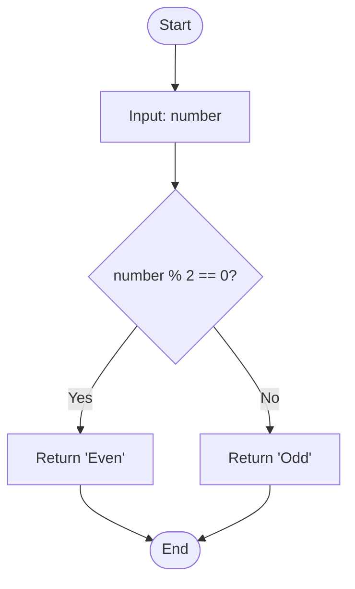

# Day 3: 制御フローと条件分岐

### 🎯 学習目標
- Pythonにおけるブール論理、比較演算子、論理演算子を理解する。
- `if`、`elif`、`else` ステートメントの構文と構造をマスターする。
- コードブロックを定義する上でのインデント（字下げ）の重要性を説明できる。
- 条件分岐のロジックを適用して、偶数・奇数の判定課題を解決する。

### 🧩 中核概念（なぜ）
プログラムは常に1本の直線のように実行されるべきではありません。実世界のアプリケーションでは意思決定ロジックが必要です。例えば、ユーザーのパスワードが正しいかどうかの検証、出金前に銀行残高が十分にあるかのチェック、あるいは数値の点数に基づいた成績の決定などです。条件分岐はプログラムの「意思決定を行う脳」として機能し、動的なデータに応じてどのコードの実行経路を通るかを決定します。

### 🔁 ロジックと動作
条件分岐は、ブール値（`True` または `False`）を返す式を評価することによって動作します。Pythonはこれらの条件を上から順に評価していきます。最初に `True` と評価された条件のコードブロックが実行され、条件チェーンの残りの部分はスキップされます。

以下は、数値の偶数・奇数判定（parity checking）のロジックを表すフローチャートです。



### 📝 注釈付きサンプル

```python
# 1. シンプルな if ステートメント
temperature = 25
if temperature > 20:
    print("It's a warm day.")  # temperature > 20 が True のため実行される

# 2. if-else チェーン
score = 75
if score >= 80:
    print("Pass with distinction")
else:
    print("Pass")  # score が 80 未満のため実行される

# 3. if-elif-else チェーン
age = 15
if age >= 18:
    ticket_price = 10  # 大人は10ドル
elif age >= 12:
    ticket_price = 7   # ティーンエイジャーは7ドル
else:
    ticket_price = 5   # 子供は5ドル
print(f"Ticket price: ${ticket_price}")

# 4. 入れ子（ネスト）になった条件分岐
username = "admin"
logged_in = True
if logged_in:
    if username == "admin":
        print("Welcome, administrator!")  # 実行される：logged_in の配下にネストされている
    else:
        print("Welcome, user!")
else:
    print("Please log in.")

# 5. 論理演算子 (and, or, not)
has_id = True
has_ticket = False
if has_id or has_ticket:
    print("Access granted.")  # 実行される：'or' はどちらか一方が True であれば成り立つ
```

### ❌ よくある間違い

Wrong code:
```python
x = 10
if x > 5
    print("Greater than 5")
```
Traceback:
```text
SyntaxError: expected ':'
```
Correct code:
```python
x = 10
if x > 5:
    print("Greater than 5")
```
> Pythonでは、新しいコードブロックを定義するために、条件文の末尾にコロン `:` が必要です。

Wrong code:
```python
x = 10
if x > 5:
print("Greater than 5")
```
Traceback:
```text
IndentationError: expected an indented block after 'if' statement on line 2
```
Correct code:
```python
x = 10
if x > 5:
    print("Greater than 5")
```
> Pythonは、条件ブロック内のステートメントをグループ化するために、インデント（通常はスペース4つ）を使用します。

Wrong code:
```python
x = 5
if x = 5:
    print("Five")
```
Traceback:
```text
SyntaxError: invalid syntax. Maybe you meant '==' or ':=' instead of '='?
```
Correct code:
```python
x = 5
if x == 5:
    print("Five")
```
> 単一の `=` は変数への代入に使用されます。等価性を比較するには、ダブルイコール `==` 比較演算子を使用する必要があります。

### 💡 コツ・イディオム
- **比較の連結（Chained comparisons）:** Pythonでは、比較演算子を自然に繋げることができます。例えば、`18 < age < 65` は `age` が18より大きく65未満であるかを判定します。これは `age > 18 and age < 65` と書くよりもシンプルで読みやすくなります。
- **三項演算子（条件式）:** 単純な代入の場合、1行で書ける三項演算子の形式を使用できます：`status = "Adult" if age >= 18 else "Minor"`。
- **真偽値の評価（Truthiness）:** Pythonのすべてのオブジェクトは、暗黙の真偽値を持っています。空のコンテナ（`[]`、`{}`、`()`）、ゼロ（`0`、`0.0`）、`None`、および空文字列（`""`）は `False` として評価されます。それ以外の値はすべて `True` となります。
- **真偽値の暗黙的な比較:** ブール変数を `True` や `False` と明示的に比較することは避けてください。`if is_valid == True:` ではなく、`if is_valid:` と書くのが Pythonic です。

### 🧠 深掘り（内部の仕組み）
<details><summary>短絡評価（クリックで展開）</summary>

論理演算子 `and` と `or` を評価する際、Pythonは**短絡評価（Short-Circuit Evaluation）**を採用しています。
- `and` 式では、左側のオペランドが `False` と評価された場合、Pythonは右側のオペランドを評価することなく、即座に `False` を返します。
- `or` 式では、左側のオペランドが `True` と評価された場合、Pythonは右側のオペランドを評価することなく、即座に `True` を返します。

この最適化により、実行速度が向上するだけでなく、属性にアクセスする前に存在確認を行うような安全なコーディングパターンが可能になります：
```python
# 安全：user が None の場合、2番目の条件は評価されないため、AttributeError を防ぐことができます
if user is not None and user.is_active:
    print("User is active")
```
</details>

### 🏋️ 演習
エディタ上の `is_even_or_odd(number)` 関数を完成させて、引数として受け取った数値が偶数の場合は `"Even"`、奇数の場合は `"Odd"` を返すようにしてください。

エディタの初期コードを参考に始めてください。

### ✅ 自己チェック
<details><summary>クリックして質問と回答を表示</summary>

1. **質問:** `bool("")` はどのように評価されますか？
   - **回答:** `False` です。Pythonでは空文字列は「偽（falsy）」とみなされます。
2. **Question:** `True or print("Hello")` という式において、"Hello" は出力されますか？
   - **回答:** いいえ、短絡評価のため出力されません。左側のオペランドが `True` であるため、`or` 式は右側のオペランドを評価せずに即座に `True` を返します。
</details>

### 📌 まとめ
- 条件分岐は、ブール値の評価に基づいて異なるコードパスを実行します。
- インデントはオプションではなく、コードブロックを定義するための必須の構文ルールです。
- 複数の条件分岐は、`if`、`elif`、`else` を使用して構築します。
- 真偽値の評価（Truthiness）により、リストが空かどうかの判定などに非ブール値を条件として利用できます。
- 短絡評価は、パフォーマンスと安全性のために条件式を遅延評価します。

