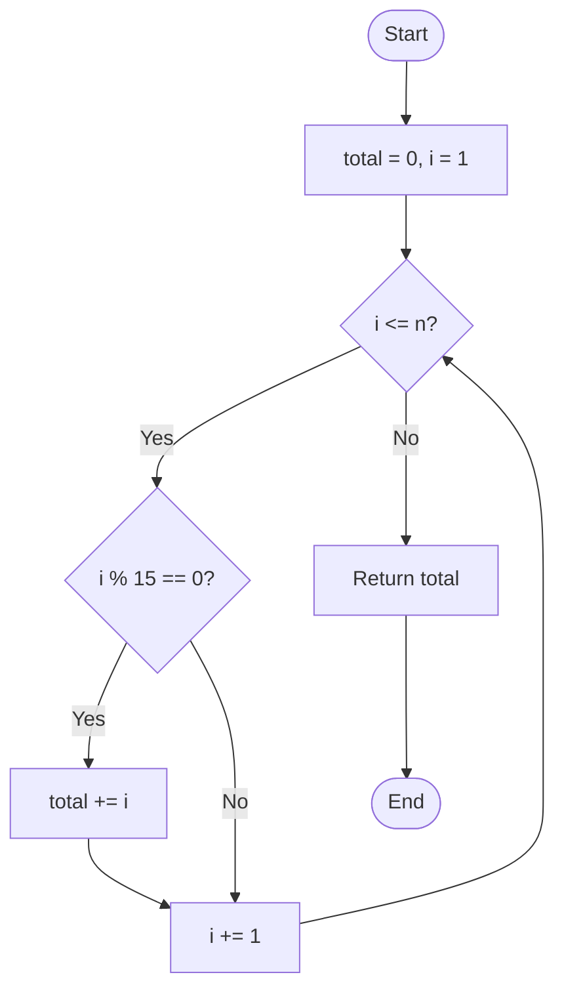

# Day 4: ループと繰り返し処理

### 🎯 学習目標
- `for` ループ（確定反復）と `while` ループ（不確定反復）の違いを説明できる。
- `range()` 関数を利用して数値シーケンスを生成できる。
- `break` と `continue` を使用してループの実行フローを制御できる。
- 条件フィルターを組み合わせたループを実装し、累積和の計算課題を解決する。

### 🧩 中核概念（なぜ）
コンピュータは、疲れることなく何百万回も繰り返しタスクを実行することに長けています。手動で繰り返しの命令を書くのは非効率的で、メンテナンスが難しく、バグの原因になります。ループを使用することで、同じコードブロックを複数回繰り返し実行できます。
- **`for` ループ**は「確定反復」に使用されます。これは、ループが実行される回数があらかじめ分かっている場合（例：名前のリストや数値の範囲を走査する場合）に適しています。
- **`while` ループ**は「不確定反復」に使用されます。これは、特定の条件が `False` に変わるまでループを実行し続けたい場合（例：ユーザーが「終了」と入力するのを待つ場合や、ファイルが空になるまで行を読み込む場合）に適しています。

### 🔁 ロジックと動作
ループは条件式を繰り返しテストします。条件が満たされている（`True` と評価される）間、ループ内のコードブロックが実行されます。条件が満たされなくなると、プログラムはループを抜けて、それに続くコードを実行します。

以下は、`1` から `n` まで反復処理し、15の倍数である数値を累積加算する課題 `sum_multiples(n)` のロジックを表すフローチャートです。



### 📝 注釈付きサンプル

```python
# 1. range() と for ループを使用した確定反復
# range(5) は 0 から 4 までの数値を生成します（5は含まれません）
for i in range(5):
    print(f"Iteration {i}")

# 2. シーケンス（リスト）の走査
fruits = ["apple", "banana", "cherry"]
for fruit in fruits:
    print(f"I like {fruit}")

# 3. while ループを使用した不確定反復
countdown = 3
while countdown > 0:
    print(countdown)
    countdown -= 1  # 重要: 無限ループを避けるためにカウントダウンを減らす
print("Blast off!")

# 4. ループ実行の制御: break
# break はループを即座に終了します
for num in range(1, 10):
    if num == 5:
        break  # num が 5 になったらループを停止
    print(num)  # 1, 2, 3, 4 を出力

# 5. ループ実行の制御: continue
# continue は現在のイテレーションの残りの処理をスキップし、次のイテレーションに進みます
for num in range(1, 6):
    if num == 3:
        continue  # 3 の出力をスキップ
    print(num)  # 1, 2, 4, 5 を出力
```

### ❌ よくある間違い

Wrong code:
```python
n = 5
for i in n:
    print(i)
```
Traceback:
```text
TypeError: 'int' object is not iterable
```
Correct code:
```python
n = 5
for i in range(n):
    print(i)
```
> 整数はイテラブル（反復可能オブジェクト）ではありません。特定の回数だけ反復処理を行うには、整数を `range()` 関数でラップする必要があります。

Wrong code:
```python
i = 1
while i <= 3:
    print(i)
    # カウンタのインクリメント（i += 1）が抜けている
```
Traceback:
```text
TimeoutError: Execution exceeded maximum time limit of 5.0 seconds
```
Correct code:
```python
i = 1
while i <= 3:
    print(i)
    i += 1
```
> `while` ループの条件は、最終的に False になる必要があります。条件式で使用される変数を更新し忘れると、無限ループが発生します。

Wrong code:
```python
# 1から5までを出力しようとする
for i in range(1, 5):
    print(i)
```
Traceback:
```text
1
2
3
4
```
Correct code:
```python
# 上限は排他的であるため、5を含めるには6を使用する
for i in range(1, 6):
    print(i)
```
> Pythonの `range(start, stop)` 関数は、`stop` の値を含みません。`n` まで含めたい場合は、制限値を `n + 1` に設定する必要があります。

### 💡 コツ・イディオム
- **インデックスと要素を同時に取得する `enumerate()`:** リストを走査する際、要素とそのインデックスの両方が必要な場合は `enumerate()` を使用します。
  ```python
  names = ["Alice", "Bob"]
  for index, name in enumerate(names):
      print(f"{index}: {name}")
  ```
- **複数のリストを並行して走査する `zip()`:** 同じ長さの2つのリストを同時に走査するには、`zip()` を使用してペアにします。
  ```python
  items = ["Apple", "Phone"]
  prices = [1.2, 800]
  for item, price in zip(items, prices):
      print(f"{item} costs ${price}")
  ```
- **ループの `else` 節:** Pythonのループには `else` ブロックを記述できます。これは、ループが `break` ステートメントに遭遇せずに正常に終了した場合に*のみ*実行されます。これは検索処理などに非常に便利です。
  ```python
  for x in range(3):
      print(x)
  else:
      print("Success!")  # break が発生しなかったため実行される
  ```

### 🧠 深掘り（内部の仕組み）
<details><summary>イテレータとイテラブル（クリックで展開）</summary>

Pythonの `for` ループは、内部的には単純なインデックスカウンタを使用していません。それは **イテラブル（Iterable）** と **イテレータ（Iterator）** の概念に基づいています：
1. **イテラブル**とは、要素を1つずつ返せるオブジェクトのことです（例：リスト、タプル、文字列、または `range` オブジェクト）。イテラブルは `__iter__` メソッドを実装しています。
2. `for` ループが開始されると、`iter(iterable)` を呼び出して**イテレータ**オブジェクトを取得します。
3. その後、ループは `next(iterator)` を繰り返し呼び出して、次の要素を取得します。
4. 取得する要素がなくなると、イテレータは `StopIteration` 例外を発生させます。`for` ループは内部でこの例外を捕捉し、ループを安全に終了させます。

この仕組みは手動でシミュレートすることもできます：
```python
nums = [10, 20]
it = iter(nums)      # イテレータを取得
print(next(it))      # 出力: 10
print(next(it))      # 出力: 20
# print(next(it))    # これを実行すると StopIteration が発生する
```
</details>

### 🏋️ 演習
エディタ上の `sum_multiples(n)` 関数を完成させて、`1` から `n` までの整数のうち、`3` の倍数かつ `5` の倍数（つまり `15` の倍数）であるすべての数値の合計値を計算して返してください。

エディタの初期コードを参考に始めてください。

### ✅ 自己チェック
<details><summary>クリックして質問と回答を表示</summary>

1. **質問:** `list(range(2, 10, 3))` の出力は何ですか？
   - **回答:** `[2, 5, 8]` です。範囲は2から始まり、10未満で終了し、3ずつ増加します。
2. **質問:** `break` と `continue` の違いは何ですか？
   - **回答:** `break` はループ処理を完全に終了し、ループの次のコードにジャンプします。`continue` は現在のイテレーションの残りの処理をスキップし、ループの次のサイクルへ進みます。
</details>

### 📌 まとめ
- `for` ループは、既知のシーケンスまたは範囲を反復処理します。
- `while` ループは、条件が `True` である限りコードを繰り返します。
- `range(start, stop, step)` は数値シーケンスを生成しますが、`stop` の値は含まれません。
- ループを途中で抜けるには `break` を使用し、現在の反復処理の残りをスキップするには `continue` を使用します。
- Pythonのループは、内部でイテレータを利用し、`StopIteration` 例外を処理して終了します。

