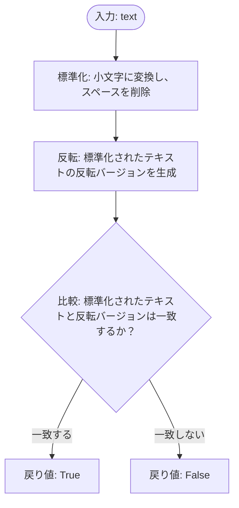

# Day 5: 関数の定義と活用

### 🎯 学習目標
- `def` キーワードを使用したカスタム関数の定義、引数の処理、および `return` ステートメントの使用ができるようになる。
- 明示的な戻り値がない場合に、Python がデフォルトで `None` を返す挙動を説明できるようになる。
- ローカルスコープとグローバルスコープの違いを理解し、名前空間がどのように変数を隔離するかを説明できるようになる。
- 堅牢でモジュール化されたコードを作成し、コードの実行フローを追跡できるようになる。

### 🧩 中核概念（なぜ）
プログラミングにおいて、異なる入力に対して同じコードブロックを何度も実行しなければならないことがよくあります。同じコードを繰り返し書くとコードの重複が発生し、プログラムの保守やデバッグ、更新が困難になります。

関数は、コードのブロックを名前の付いた再利用可能な単位にまとめることで、この問題を解決します。関数は「ブラックボックス」のように機能し、入力（引数）を受け取り、処理を行い、結果（戻り値）を出力します。関数を使用することで、複雑な問題を小さく、管理しやすく、テスト可能なサブタスクに分解できます。

### 🔁 ロジックと動作
Python の関数は、`def` キーワードで定義され、関数名、括弧内のパラメータ（引数）、およびコロン（`:`）が続きます。関数の本体はインデントされます。

以下は、回文判定プロセスの論理的なフローです。



- **パラメータ（仮引数）と引数（実引数）**: パラメータは関数定義に記述される変数です（例：`is_palindrome(text)` における `text`）。引数は、関数を呼び出すときに実際に渡される値です（例：`is_palindrome("radar")` における `"radar"`）。
- **Return ステートメント**: `return` は関数を即座に終了し、呼び出し元に値を返します。`return` ステートメントが記述されていない場合、または値のない単なる `return` の場合、Python は自動的に `None` を返します。

### 📝 注釈付きサンプル
```python
# 1. デフォルト引数を持つシンプルな関数の定義
def greet(name="Guest"):
    # 引数が渡されない場合、デフォルト値として "Guest" が使用されます
    return f"Hello, {name}!"

print(greet("Alice"))  # 出力: Hello, Alice!
print(greet())         # 出力: Hello, Guest! (デフォルト値を使用)

# 2. return を省略した場合の暗黙的な None の返却
def print_sum(a, b):
    result = a + b
    print(f"Sum is: {result}")
    # return ステートメントがありません！

value = print_sum(3, 4)
print(value)  # 出力: None (暗黙的な戻り値)

# 3. ローカルスコープとグローバルスコープ
message = "I am global"  # グローバル変数

def check_scope():
    message = "I am local"  # グローバル変数を隠蔽（シャドウイング）するローカル変数
    print(f"Inside function: {message}")

check_scope()           # 出力: Inside function: I am local
print(f"Outside function: {message}")  # 出力: Outside function: I am global
```

### ❌ よくある間違い
**間違い 1: ローカル変数をグローバルスコープで参照しようとする**
```python
def calculate_area(radius):
    area = 3.14 * radius * radius
    return area

calculate_area(5)
print(area)
```
```text
NameError: name 'area' is not defined
```
```python
def calculate_area(radius):
    area = 3.14 * radius * radius
    return area

my_area = calculate_area(5)
print(my_area)
```
> 関数内で定義された変数（ローカルスコープ）は、関数の外からはアクセスできません。結果を使用するには、関数から値を返し、呼び出し元のスコープで新しい変数に代入する必要があります。

**間違い 2: デフォルトで返される None 値を操作しようとする**
```python
def add_five(number):
    result = number + 5

output = add_five(10)
print(output * 2)
```
```text
TypeError: unsupported operand type(s) for *: 'NoneType' and 'int'
```
```python
def add_five(number):
    result = number + 5
    return result

output = add_five(10)
print(output * 2)
```
> 関数内に明示的な `return` ステートメントがない場合、関数は暗黙的に `None` を返します。`None` に対して算術演算を行うことはできません。

**間違い 3: global 宣言をせずにグローバル変数を変更しようとする**
```python
count = 0

def increment():
    count = count + 1

increment()
```
```text
UnboundLocalError: cannot access local variable 'count' where it is not associated with a value
```
```python
count = 0

def increment():
    global count
    count = count + 1

increment()
```
> Python は関数内で代入（アサイン）された変数をローカル変数として扱います。`global` 宣言をせずにグローバル変数を変更しようとすると、代入前に参照されたとみなされ、UnboundLocalError が発生します。

### 💡 コツ・イディオム
- **スライスによる反転**: Python では、`[::-1]` というスライス機能を使って、文字列やシーケンスを非常に簡潔に反転させることができます。
- **単一責任の原則**: 1つのことだけを実行する、小さく焦点を絞った関数を作成しましょう。関数が複数の異なる処理を行っている場合は、ヘルパー関数に分割することを検討してください。
- **早期リターン (Return Early)**: 特殊なケースや例外的な条件は最初に戻り値を出して処理を終わらせることで、メインロジックのインデントを浅くし、読みやすいコードに保つことができます。
- **ドキュメンテーション文字列 (Docstrings)**: 関数の定義ヘッダーの直後に3重引用符（`"""`）で囲んだ文字列を記述することで、関数の仕様（説明文）をコード内に文書化できます。

### 🧠 深掘り（内部の仕組み）
<details>
<summary>名前空間と再帰</summary>

- **名前空間とスコープ (LEGBルール)**: Python は変数を管理するために名前空間を使用します。変数の検索を行う際、Python は以下の順序（LEGB）でスコープを探します。
  1. **L**ocal（ローカル）: 現在の関数内。
  2. **E**nclosing（エンクロージング）: ネストされた関数の外側の関数内。
  3. **G**lobal（グローバル）: モジュールレベル。
  4. **B**uilt-in（ビルトイン）: Python の組み込み関数や例外など（`print`, `len` など）。
- **再帰とコールスタック**: 関数が自分自身を呼び出すことを「再帰（Recursion）」と呼びます。関数が呼び出されるたびに、Python のコールスタック上に新しいスタックフレームが作成され、ローカル変数や実行状態が記録されます。再帰関数に終了条件（ベースケース）が正しく設定されていないと、無限にスタックフレームが作成され、最大スタックサイズを超えて `RecursionError` （スタックオーバーフロー）が発生します。
</details>

### 🏋️ 演習
エディタ上の `is_palindrome(text)` 関数を完成させて、与えられた文字列 `text` が回文（前から読んでも後ろから読んでも同じ文字列）であるかどうかを判定してください。大文字と小文字は区別せず、スペースは無視するように実装してください。

**ヒント:**
1. `lower()` メソッドを使用して、入力文字列をすべて小文字に変換します。
2. `replace(" ", "")` メソッドを使用して、文字列内のすべてのスペースを削除します。
3. スライス表記の `[::-1]` を使用して、クリーンアップした文字列を反転させ、元のクリーンアップした文字列と比較します。

### ✅ 自己チェック
<details>
<summary>クリックして問題と回答を表示</summary>

**問い 1:** 関数内で明示的な `return` が記述されていない場合、関数は何を返しますか？
- **回答:** `None`（`NoneType` クラスのインスタンス）を返します。

**問い 2:** ローカルスコープとグローバルスコープの違いは何ですか？
- **回答:** 関数内で定義された変数はローカルスコープに属し、その関数内でのみアクセス可能です。一方、関数の外で定義された変数はグローバルスコープに属し、プログラムのどこからでも参照できます。ただし、関数内でグローバル変数を変更するには、`global` キーワードを使用して宣言する必要があります。
</details>

### 📌 まとめ
- 関数は `def` で定義し、引数を受け取って `return` で値を返します。
- `return` がない関数は、デフォルトで `None` を返します。
- 関数内で定義された変数は、ローカルな名前空間（ローカルスコープ）に属し、外部からは参照できません。
- 再帰関数は自分自身を呼び出す関数であり、無限ループを防ぐために必ず終了条件（ベースケース）が必要です。
