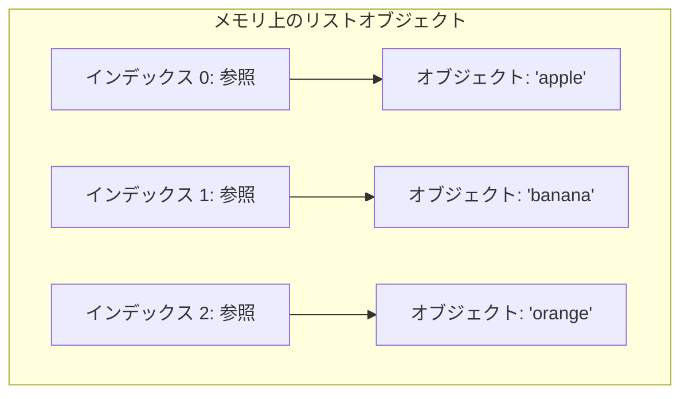

# Day 6: リストとタプル

### 🎯 学習目標
- リスト（可変/ミュータブル）とタプル（不変/イミュータブル）の違いを理解し、適切に使い分けられるようになる。
- 0番目のインデックスおよび負のインデックスを使用して、要素の取得と変更ができるようになる。
- スライス表記（`start:stop:step`）を使用して、シーケンスの一部を安全に抽出できるようになる。
- 要素の追加（`append`）、削除（`remove`）、ソート（`sorted`, `sort`）などの基本的なシーケンス操作を実行できるようになる。

### 🧩 中核概念（なぜ）
プログラムを書く際、単一の値だけでなく、関連する複数のデータをまとめて（コレクションとして）保存したいことがよくあります。

Python は、コレクションを格納するために主に2つの組み込みシーケンス型を提供しています。
1. **リスト (`list`)**: 順序があり、変更可能なコレクションです。要素の追加、削除、ソート、値の書き換えなどを自由に実行できます。ショッピングリストやタスク一覧のように、時間の経過とともに内容が変わるデータの管理に適しています。
2. **タプル (`tuple`)**: 順序があり、変更不可能なコレクションです。一度作成すると、要素の追加、削除、再配置、書き換えなどは一切行えません。緯度経度のような座標情報 `(latitude, longitude)` や、システムの設定値などを誤って変更されるのを防ぐための「データの安全性の確保」に適しており、リストよりもメモリ使用量が小さく、動作がわずかに高速です。

### 🔁 ロジックと動作
いくつかの低レベル言語の配列（要素がメモリ上に連続して配置される）とは異なり、Python のリストは、メモリ上の別の場所（ヒープ領域）に格納されている Python オブジェクトへの参照（ポインタ）の配列として機能します。



- **インデックス指定**: 要素は `0` から始まるインデックス（添字）を使って参照できます。また、末尾の要素から順に指定できる負のインデックス（末尾は `-1`）もサポートされています。
- **スライス指定**: `シーケンス[start:stop:step]` 表記を使うことで、元のシーケンスを変更することなく、その一部を新しいシーケンスとして抽出できます。

### 📝 注釈付きサンプル
```python
# 1. リストは可変（ミュータブル）
fruits = ["apple", "banana"]
fruits.append("orange")  # 末尾に追加: ['apple', 'banana', 'orange']
fruits[1] = "mango"      # インデックス 1 の要素を変更: ['apple', 'mango', 'orange']
print(fruits)

# 2. タプルは不変（イミュータブル）
coordinates = (40.7128, -74.0060)
# coordinates[0] = 34.0522  # これは TypeError になります！

# 3. インデックス指定とスライス
numbers = [10, 20, 30, 40, 50]
print(numbers[0])    # 出力: 10 (先頭要素)
print(numbers[-1])   # 出力: 50 (末尾要素)
print(numbers[1:4])  # 出力: [20, 30, 40] (インデックス 1 以上 4 未満)
print(numbers[::-1]) # 出力: [50, 40, 30, 20, 10] (リストを反転)
```

### ❌ よくある間違い
**間違い 1: 範囲外のインデックス指定**
```python
fruits = ["apple", "banana"]
print(fruits[2])
```
```text
IndexError: list index out of range
```
```python
fruits = ["apple", "banana"]
print(fruits[-1])
```
> 有効なインデックスの範囲は `0` から `len(list) - 1` までです。リストの長さ以上のインデックスを指定してアクセスしようとすると IndexError が発生します。

**間違い 2: タプルを変更しようとする**
```python
point = (1, 2)
point[0] = 9
```
```text
TypeError: 'tuple' object does not support item assignment
```
```python
point = (9, 2)
```
> タプルは不変データ型です。要素を変更したい場合は、新しい値を使って新しいタプルを再作成する必要があります。

**間違い 3: リストをインプレースで変更するメソッドの戻り値を代入してしまう**
```python
numbers = [3, 1, 2]
sorted_numbers = numbers.sort()
print(sorted_numbers[0])
```
```text
TypeError: 'NoneType' object is not subscriptable
```
```python
numbers = [3, 1, 2]
sorted_numbers = sorted(numbers)
print(sorted_numbers[0])
```
> `list.sort()` や `list.append()` などのメソッドは、リストをインプレース（破壊的）に変更し、戻り値として `None` を返します。新しいソート済みリストを取得したい場合は、組み込み関数 `sorted()` を使用してください。

### 💡 コツ・イディオム
- **安全なスライス指定**: スライスは例外を発生させません。範囲外のインデックスを指定してもエラーにはならず、取得可能な要素のみを返します（例: `fruits[1:100]`）。
- **アンパック（展開）**: リストやタプルの要素を個別の変数に一括代入できます（例: `x, y = coordinates`）。また、アスタリスクを使って残りの要素をまとめて受け取ることもできます（例: `first, *rest = [1, 2, 3, 4]`）。
- **メンバーシップテスト**: `in` 演算子を使用して、要素がリストやタプルに存在するかどうかを簡単に判定できます（例: `if "apple" in fruits:`）。
- **重複排除**: リストから重複した要素を排除するには、一時的にセット（集合型）に変換してから再びリストに戻すのが一般的です（例: `unique_list = list(set(original_list))`）。

### 🧠 深掘り（内部の仕組み）
<details>
<summary>参照セマンティクス、エイリアス、および計算量</summary>

- **参照としての変数（エイリアス）**: Python では、`list_b = list_a` と代入してもリストそのものはコピーされず、メモリ上の同じリストオブジェクトを指す参照（矢印）がコピーされるだけです。そのため、`list_b` を変更すると `list_a` も変更されます。独立した複製を作成するには、`list_a.copy()` を使用する必要があります。
- **時間計算量 (Big O)**:
  - **インデックス参照**: $O(1)$（定数時間）。リストはポインタの連続した配列として格納されているため、インデックス番号から即座にメモリ番地を特定できます。
  - **末尾への追加 (append)**: ならし計算量（Amortized）$O(1)$。メモリ領域はあらかじめ余裕を持って確保されているためです。
  - **先頭または中間への挿入/削除 (insert/remove)**: $O(n)$（線形時間）。挿入または削除された位置より後ろにあるすべての要素をメモリ上で前後にずらす必要があるためです。
  - **存在確認 (`in` 演算子)**: $O(n)$。最悪の場合、リストの先頭から末尾まで順番にスキャンして探す必要があるためです。
</details>

### 🏋️ 演習
エディタ上の `unique_sort(numbers)` 関数を完成させて、受け取ったリスト `numbers` から重複する数値を排除し、昇順でソートされたリストを返してください。

**ヒント:**
1. `set()` 関数を使用して、重複する要素を簡単に排除します。
2. `list()` を使用して、セットを再びリストに変換します。
3. 組み込み関数 `sorted()` を使用してリストを昇順にソートし、返却します。

### ✅ 自己チェック
<details>
<summary>クリックして問題と回答を表示</summary>

**問い 1:** リストの末尾に要素を追加する（append）操作と、先頭に挿入する（insert）操作の時間計算量の違いを説明してください。
- **回答:** 末尾への追加（append）は要素のシフトが発生しないため定数時間 $O(1)$ です。一方、先頭への挿入（insert）はリスト内の既存の全要素を1つずつ右にずらす必要があるため線形時間 $O(n)$ になります。

**問い 2:** 要素が1つだけ含まれるタプルを作成するにはどうすればよいですか？
- **回答:** 要素の後ろに必ずカンマを付けます（例：`single_element_tuple = (5,)`）。カンマを付けずに `(5)` と書くと、括弧で囲まれた通常の整数 `5` として評価されます。
</details>

### 📌 まとめ
- リストは可変（ミュータブル）なシーケンスであり、タプルは不変（イミュータブル）なシーケンスです。
- インデックスを使用して要素を参照します（0から $N-1$、または逆から指定する場合は $-1$ から $-N$）。
- スライスを使用すると、元のオブジェクトを変更することなくサブシーケンスを抽出できます。
- リストの複製時のエイリアス（別名参照）に注意し、append（$O(1)$）と insert/remove（$O(n)$）の計算量の違いを意識しましょう。
