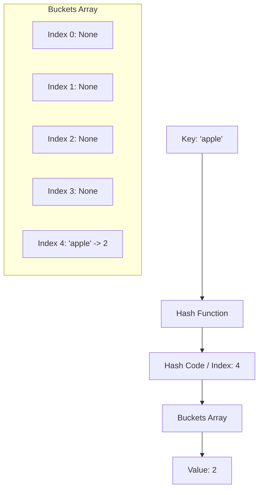

# Day 7: 辞書と集合

辞書 (Dictionary) は **キーと値** のペアでデータを保存します。集合 (Set) は重複しない **一意な要素** を順序なしで管理するコレクションです。

### 🎯 学習目標
- キーと値の関連付けと、辞書がリスト検索よりも効率的である理由を説明できる。
- `get()` を使用して辞書の値を安全に取得し、実行時エラーを防ぐことができる。
- 集合のユニークさ（一意性）を理解し、集合演算（和集合、積集合、差集合）を実行できる。
- 内部のハッシュメカニズムと、要素がハッシュ可能（hashable）でなければならない理由を分析できる。

### 🧩 中核概念（なぜ）
- **辞書 (Dictionary)**: リストコレクションでは、特定の項目を探すために要素を1つずつスキャンする必要があり、大規模なコレクションでは処理が遅くなります。辞書は、一意のキーと値を関連付けることでこれを解決します（単語を調べて定義を見つける実際の辞書のようなものです）。
- **集合 (Set)**: 順序は関係なく、一意性とメンバーシップの確認（要素が含まれているか）だけが必要な場合があります。集合は重複しない一意の要素を保存し、数学的な集合演算（2人のユーザーの共通の友人を見つけるなど）をサポートします。

### 🔁 ロジックと動作
高速なルックアップを可能にするハッシュルックアップのプロセスは次のとおりです。

集合（Set）の場合も同様のハッシュテーブル構造を使用しますが、値を持たずキーのみを格納することで、$O(1)$ のメンバーシップテストと一意性を保証します。

### 📝 注釈付きサンプル
```python
# 1. 辞書の作成と変更
student = {
    "name": "Alice",
    "grade": "A",
    "skills": ["Python", "Git"]
}
student["age"] = 20  # 新しいキーと値のペアを追加
student["grade"] = "A+"  # 既存のキーの値を更新

# 2. 安全な値の取得
# 存在しないキーに対して通常の角括弧を使用すると KeyError が発生します
# student["major"]  # エラー！
major = student.get("major", "Undecided")  # デフォルト値 "Undecided" を安全に返します

# 3. 集合と一意性
unique_numbers = {1, 2, 3, 3, 2, 1}
print(unique_numbers)  # 出力: {1, 2, 3} (重複は自動的に削除されます)

# 4. 集合演算
group_a = {"Python", "SQL", "HTML"}
group_b = {"Python", "Git", "C++"}

# 和集合（Union）: どちらかの集合に含まれる要素
print(group_a | group_b)  # {'Python', 'SQL', 'HTML', 'Git', 'C++'}

# 積集合（Intersection）: 両方の集合に含まれる要素
print(group_a & group_b)  # {'Python'}

# 差集合（Difference）: group_a に含まれ、group_b には含まれない要素
print(group_a - group_b)  # {'SQL', 'HTML'}
```

### ❌ よくある間違い
**間違い 1: 存在しないキーに直接アクセスする**
```python
info = {"name": "Bob"}
print(info["age"])
```
```text
KeyError: 'age'
```
```python
info = {"name": "Bob"}
print(info.get("age", 0))  # 正しい: get() を使用してデフォルト値（フォールバック）を指定する
```
> 角括弧を使用して存在しないキーにアクセスすると、KeyError が発生します。`get()` を使用すると、`None` または指定したデフォルト値を返すことでエラーを回避できます。

**間違い 2: 可変オブジェクト（リストなど）を辞書のキーまたは集合の要素として使用する**
```python
bad_dict = {[1, 2]: "numbers"}
```
```text
TypeError: unhashable type: 'list'
```
```python
good_dict = {(1, 2): "numbers"}  # 正しい: タプル（不変オブジェクト）を使用する
```
> 辞書のキーと集合の要素は、ハッシュ可能である必要があります。リストなどの可変オブジェクトは変更される可能性があり、ハッシュ値が不安定になるため、Python ではキーとしての使用が禁止されています。

**間違い 3: 反復処理（ループ）中に辞書を変更する**
```python
data = {"a": 1, "b": 2}
for key in data:
    if data[key] == 1:
        del data[key]
```
```text
RuntimeError: dictionary changed size during iteration
```
```python
data = {"a": 1, "b": 2}
for key in list(data.keys()):  # 正しい: キーのコピーに対して反復処理を行う
    if data[key] == 1:
        del data[key]
```
> 反復処理中に辞書の構造（キーの追加や削除）を変更すると、内部イテレータの状態が無効になり、実行時エラーが発生します。

### 💡 コツ・イディオム
- **辞書内包表記**: 辞書を簡潔に作成します: `{x: x**2 for x in range(5)}`
- **デフォルト値の設定**: `if key not in dict` で確認する代わりに、`dict.setdefault(key, default)` や `collections.defaultdict` を使用します。
- **メンバーシップテストの速度**: 集合はハッシュルックアップを使用するため、`item in set` はリストの `item in list` （計算量 $O(n)$）に比べて極めて高速（計算量 $O(1)$）です。

### 🧠 深掘り（内部の仕組み）
<details><summary>ハッシュ可能性、ハッシュアルゴリズム、および検索の計算量</summary>

Pythonの辞書と集合は、**ハッシュテーブル**として実装されています。
1. キーを挿入すると、Pythonは `hash(key)` を使用してハッシュ値を計算します。この整数値が内部配列のインデックスにマッピングされます。
2. 2つのキーが同じインデックスにマッピングされた場合（ハッシュ衝突）、Pythonはオープンアドレス法（具体的には疑似乱数プロービング）を使用して、次の空きスロットを探します。
3. ハッシュ関数を介してインデックスを直接計算して検索するため、挿入、削除、検索の平均時間計算量は **$O(1)$** です。
4. オブジェクトがハッシュ可能であるためには、**不変（immutable）**であること（あるいはオブジェクトの生存期間中にハッシュ値が変わらないこと）、および等価比較（`__eq__`）をサポートしている必要があります。これが、`tuple` はキーになれる一方で `list` はキーになれない理由です。
</details>

### 🏋️ 演習
エディタ上の `count_words(words)` 関数を完成させて、引数として受け取った単語のリスト `words` を処理し、それぞれの単語の出現回数を記録した辞書オブジェクトを返してください。

```python
def count_words(words):
    # 与えられた単語のリスト(words)における各単語の出現頻度をカウントしてください。
    # 単語がキー、カウント数が値となる辞書を返してください。
    freq = {}
    return freq
```

### ✅ 自己チェック
1. `{"a": 1}.get("b", 0)` は何を返しますか？
2. `s = {1, 2}` に対して `s.add(2)` を実行した場合、`s` の長さはどうなりますか？
<details><summary>解答を表示</summary>

1. キー `"b"` は辞書内に存在しないため、デフォルト値である `0` を返します。
2. 長さは `2` のままです（集合は `{1, 2}`）。集合は一意の要素のみを格納するため、すでに存在する要素を追加しても変化はありません。
</details>

### 📌 まとめ
- 辞書は一意のキーと値をマッピングします。集合は重複のない一意の要素を格納します。
- `KeyError` を防ぐために、辞書の値の安全な取得には `get()` を使用します。
- 集合は数学的な演算をサポートします: 和集合 (`|`)、積集合 (`&`)、差集合 (`-`)。
- 辞書と集合はどちらもハッシュに依存して $O(1)$ の検索パフォーマンスを実現するため、キーは不変（ハッシュ可能）である必要があります。
