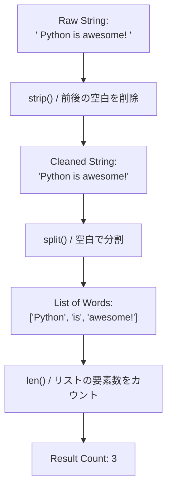

# Day 8: 文字列の操作

Pythonは、テキストデータを直感的に処理するための強力な文字列メソッドを備えています。

### 🎯 学習目標
- 分割 (split)、結合 (join)、余分な空白の削除 (strip)、置換 (replace) を含む、一般的な文字列操作を実行できる。
- 文字列のスライスを適用して、文字列の特定の部分を抽出できる。
- Pythonにおける文字列の不変性（イミュータビリティ）の概念と、それがメモリに与える影響を説明できる。
- パフォーマンス最適化のための文字列インターン（キャッシュ）メカニズムを説明できる。

### 🧩 中核概念（なぜ）
- **文字列 (String)** は文字のシーケンス（並び）です。私たちは日常的に文字列の読み込み、検証、クリーニング、フォーマットを行っています。
- Pythonは文字列を **不変（immutable / 変更不可）** なオブジェクトとして扱います。一度メモリ上に作成された文字列は、その場で書き換えることはできません。文字列を変更したい場合は、常に新しい文字列を作成する必要があります。これにより、スレッドの安全性、セキュリティ（辞書のキーとして使用する場合など）、およびパフォーマンスの最適化が保証されます。

### 🔁 ロジックと動作
以下は、`strip()` と `split()` を使用して文章内の単語数をカウントする処理フローです。


### 📝 注釈付きサンプル
```python
# 1. 分割と結合
text = "apple,banana,orange"
fruits = text.split(",")  # カンマで分割: ['apple', 'banana', 'orange']
joined = " - ".join(fruits)  # 要素を結合: 'apple - banana - orange'

# 2. 余分な空白の削除と置換
dirty = "   hello world! \n"
clean = dirty.strip()  # 先頭と末尾の空白や改行を削除: 'hello world!'
replaced = clean.replace("world", "Python")  # 部分文字列の置換: 'hello Python!'

# 3. 文字列のスライス
# string[開始:終了:ステップ]
message = "PythonProgram"
print(message[0:6])   # 'Python'（インデックス0から5までの文字）
print(message[6:])    # 'Program'（インデックス6から末尾までの文字）
print(message[::-1])  # 'margorPnohtyP'（ステップ-1による文字列の反転）

# 4. 不変性（イミュータビリティ）のデモ
s = "cat"
# s[0] = "b" # TypeError が発生します！
s = "b" + s[1:] # 新しい文字列を作成: "bat"
```

### ❌ よくある間違い
**間違い 1: 文字列内の特定の文字を直接書き換えようとする**
```python
name = "Jello"
name[0] = "H"
```
```text
TypeError: 'str' object does not support item assignment
```
```python
name = "Jello"
name = "H" + name[1:]  # 正しい: 新しい文字列を構築する
```
> Pythonの文字列は不変（immutable）です。その場で変更することはできないため、必要な変更を加えた新しい文字列を作成する必要があります。

**間違い 2: 文字列をその場で変更するメソッドであると誤解して `split()` を呼び出す**
```python
line = "one two three"
line.split()
print(line)  # 分割された結果を期待するが、元の文字列がそのまま出力される
```
```text
one two three
```
```python
line = "one two three"
words = line.split()  # 正しい: 返されたリストを変数に代入する
print(words)
```
> `split()` などの文字列メソッドは、元の文字列をその場で変更しません（文字列が不変であるため）。これらは新しいリストや文字列を返すため、変数に保存する必要があります。

**間違い 3: `join()` を使用する際の構文の順序の間違い**
```python
words = ["Python", "is", "fun"]
joined = words.join(" ")
```
```text
AttributeError: 'list' object has no attribute 'join'
```
```python
words = ["Python", "is", "fun"]
joined = " ".join(words)  # 正しい: 区切り文字オブジェクトに対して join を呼び出す
```
> `join()` メソッドは list クラスではなく、str（文字列）クラスに属しています。区切り文字となる文字列がメソッドを呼び出すオブジェクトとなり、引数として文字列のリストを渡します。

### 💡 コツ・イディオム
- **部分文字列の確認**: `in` 演算子を使用して、文字列に特定の文字列が含まれているかを確認します: `"Py" in "Python"`（`True` を返します）。
- **メソッドチェーン**: 文字列メソッドは新しい文字列を返すため、チェーンさせて記述できます: `text.strip().lower().replace(" ", "-")`。
- **f-strings（フォーマット済み文字列リテラル）**: 可読性とパフォーマンス向上のために f-strings を使用します: `f"Hello {name}, you are {age} years old."`。

### 🧠 深掘り（内部の仕組み）
<details><summary>メモリにおける不変性と文字列インターン（キャッシュ）</summary>

Pythonの文字列は、内部で高度に最適化されています。
1. **不変性（イミュータビリティ）**: 文字列を変更できないため、Pythonはメモリ上で同じオブジェクトを安全に再利用できます。
2. **文字列インターン (String Interning)**: コンパイル時に決定される短い定数文字列（変数名や英数字のみのシーケンスなど、識別子に類似したもの）について、Pythonはグローバルな内部辞書（インターンプール）にそのコピーを1つだけ保存します。
3. 値が `"hello"` である2つの別々の変数を作成した場合、それらはメモリ上のまったく同じアドレスを指します。これは `is` 演算子で検証できます: `a = "hello"; b = "hello"; a is b` は `True` を返します。
4. この最適化により、メモリを節約できるだけでなく、文字列の比較を文字単位の比較（$O(n)$）ではなく、高速なポインタ比較（$O(1)$）で行うことができるため、比較処理が大幅に高速化されます。
</details>

### 🏋️ 演習
エディタ上の `count_words_in_sentence(sentence)` 関数を完成させて、受け取った文章を空白文字で分割し、そこに含まれる合計単語数をカウントして返してください。

```python
def count_words_in_sentence(sentence):
    # 与えられた文章(sentence)に含まれる単語の数をカウントしてください。
    # 単語はスペース(空白)で区切られています。空の文章は 0 を返してください。
    count = 0
    return count
```

### ✅ 自己チェック
1. `"  hello  ".strip()` は何を返しますか？
2. `text = "Python"` のとき、`text[1:4]` は何ですか？
<details><summary>解答を表示</summary>

1. 先頭と末尾の余分な空白が削除された `"hello"` を返します。
2. `"yth"` を返します（インデックス 1, 2, 3 の文字）。
</details>

### 📌 まとめ
- Pythonの文字列は文字の不変なシーケンスです。文字列の変更操作はすべて新しい文字列を返します。
- よく使われるメソッドには、`split()`、`join()`、`strip()`、`replace()` があります。
- スライス (`[開始:終了:ステップ]`) を使用して、文字列の一部を抽出したり、順序を反転させたりできます。
- Pythonは文字列インターンを使用してメモリを最適化し、同一の不変文字列の比較を高速化します。
