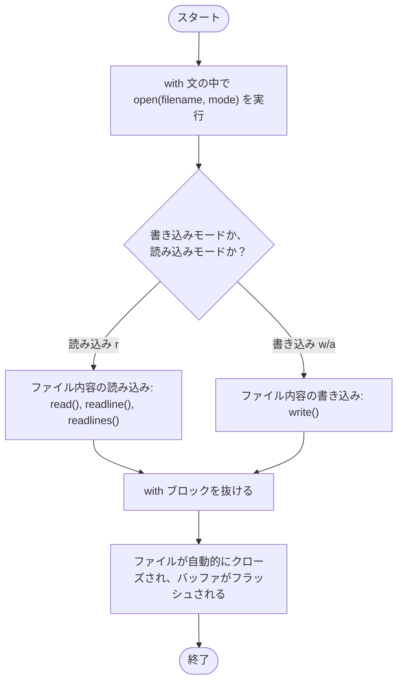

# Day 9: ファイルの入出力 (File I/O)

プログラミングにおいて、変数はメモリ（RAM）上にデータを保持しますが、このデータはプログラムが終了するとすぐに消えてしまいます。プログラムの実行をまたいでデータを永続化したり、外部のデータソースとやり取りしたりするには、ストレージ（ディスク）上のファイルの読み書きを行います。

### 🎯 学習目標
- 組み込みの `open()` 関数を使用して、ファイルのオープン、読み込み、書き込み、および追記（アペンド）を行えるようにする。
- Pyodideにおける仮想メモリファイルシステムの役割とセキュリティ上の制限を説明できる。
- コンテキストマネージャ（`with` 文）を使用して、安全かつ自動的なリソース解放を保証する。
- ファイルの読み込みメソッド（`read()`、`readline()`、`readlines()`）を、パフォーマンスとメモリ最適化の観点から比較・選択できるようにする。

### 🧩 中核概念（なぜ）
ファイル入出力を使用することで、プログラムはレコードや設定オプション、分析結果を永続的に保存できます。

Pythonにおけるファイル操作は、「開く（オープン）」「読み書き（リード／ライト）」「閉じる（クローズ）」というシンプルなライフサイクルに従います。従来、ファイルを開いた後に閉じ忘れると、リソース漏れ（リーク）やファイルロック、データの消失が発生していました。Pythonでは、**コンテキストマネージャ**（`with` キーワード）を使用することで、プログラムがエラーで中断した場合であっても、ブロックを抜ける際にファイルが自動的に閉じられるようになり、この問題を解決しています。

#### ⚠️ Pyodideの仮想ファイルシステムに関する注意
このコースは、ブラウザ上でPyodide（WebAssemblyにコンパイルされたPython）を使用して実行されるため、セキュリティ上の理由から、Pythonはコンピュータの実際のハードディスクには直接アクセスできません。代わりに、Pyodideは**ブラウザの一時メモリ（RAM）上にマウントされた仮想ファイルシステム**を使用します。このエディタでファイルを作成・保存すると、この仮想ディスク上に保存されます。ファイルはページが開いている限り存在しますが、ブラウザのタブを更新したり閉じたりすると削除されます。

### 🔁 ロジックと動作
以下の図は、ファイルアクセスのライフサイクルを示しています。ファイルを開くと、オペレーティングシステムにファイルハンドルを要求し、操作を行い、`with` ブロックを抜ける際にコンテキストマネージャがファイルを閉じ、バッファをフラッシュします。



### 📝 注釈付きサンプル

Pythonでのファイルの読み書きの基本例は以下の通りです。

```python
# --- データの書き込み ---
# 'user_logs.txt' を書き込みモード ('w') で開きます。ファイルが存在しない場合は新規作成され、存在する場合は上書きされます。
with open("user_logs.txt", "w") as file:
    file.write("User: Alice, Status: Active\n")  # 文字列を書き込みます。末尾に明示的に改行 '\n' を指定します。
    file.write("User: Bob, Status: Inactive\n")  # 2行目を書き込みます。

# --- データの読み込み (一括) ---
# 'user_logs.txt' を読み込みモード ('r') で開きます。モードを省略した場合はこれがデフォルト値になります。
with open("user_logs.txt", "r") as file:
    content = file.read()  # ファイルの全内容を1つの文字列として読み込みます。
    print("--- ファイル全体 ---")
    print(content)

# --- データの読み込み (1行ずつ - メモリ効率的) ---
# ファイルオブジェクトをループで回すことで、ファイル全体を一度にRAMへ読み込まずに動的に行を取得します。
with open("user_logs.txt", "r") as file:
    print("--- 1行ずつ処理 ---")
    for line in file:
        # 各行にはファイル内の改行文字 '\n' が含まれています。
        # rstrip() を使用して、文字列の右側から改行文字やスペースを取り除きます。
        print(f"ログ記録: {line.rstrip()}")

# --- データの追記 ---
# 'user_logs.txt' を追記モード ('a') で開き、既存のデータを消さずに末尾にコンテンツを追加します。
with open("user_logs.txt", "a") as file:
    file.write("User: Charlie, Status: Active\n")
```

### ❌ よくある間違い

**間違い 1: クローズ後のファイルに対する操作**
```python
with open("note.txt", "w") as f:
    f.write("Hello")
f.write(" World")
```
```text
ValueError: I/O operation on closed file.
```
```python
with open("note.txt", "w") as f:
    f.write("Hello")
    f.write(" World")
```
> `with` 文は、インデントされたブロックを抜けると自動的にファイルオブジェクトをクローズします。クローズされたファイルオブジェクトに対して読み書きを試みると `ValueError` が発生します。

**間違い 2: 読み込み専用モードで書き込もうとする**
```python
with open("data.txt", "r") as f:
    f.write("Hello")
```
```text
UnsupportedOperation: not writable
```
```python
with open("data.txt", "w") as f:
    f.write("Hello")
```
> ファイルを開くときのデフォルトモードは `"r"`（読み込み専用）です。書き込みを行う場合は、明示的に `"w"`（書き込み）または `"a"`（追記）モードを指定する必要があります。

**間違い 3: 存在しないファイルを読み込もうとする**
```python
with open("non_existent.txt", "r") as f:
    content = f.read()
```
```text
FileNotFoundError: [Errno 2] No such file or directory: 'non_existent.txt'
```
```python
import os
if os.path.exists("non_existent.txt"):
    with open("non_existent.txt", "r") as f:
        content = f.read()
else:
    content = ""
```
> 存在しないファイルを読み込もうとすると `FileNotFoundError` が発生します。ファイルの存在を `os.path.exists()` で確認するか、例外処理（`try-except`）を用いて対処してください。

### 💡 コツ・イディオム
- **`rstrip('\r\n')` を使用する**: 単なる `.strip()` は先頭のスペースやタブも削除してしまうため、フォーマットされたデータが壊れる可能性があります。改行文字だけを狙って削除するには、`.rstrip('\r\n')` を使用するのが最適です。
- **イテレータによる読み込み**: ギガバイト単位の巨大なログファイルなどを処理する際、`read()` や `readlines()` は絶対に使わないでください。`for line in file:` と書くことで、必要なときに1行ずつメモリにロードするため、非常に効率的です。
- **エンコーディングの指定**: 日本語やベトナム語などの非ASCII文字を含むテキストファイルを扱う場合は、文字化けを防ぐためにエンコーディングを明示的に指定します：`open("file.txt", "r", encoding="utf-8")`。

### 🧠 深掘り（内部の仕組み）
<details>
<summary>バッファリングと仮想ファイルシステムの内部仕様</summary>

#### ファイルバッファリング
`file.write()` を呼び出しても、データは即座に物理ディスクやSSDに書き込まれるわけではありません。OSは遅いディスクへのアクセスを最小限にするため、データを一時的にシステムRAM上のバッファ領域に保持します。データが実際に書き込まれるのは、バッファがいっぱいになったとき、明示的に `flush()` が呼び出されたとき、またはファイルが閉じられたときです。ファイルを閉じずに放置すると、プログラムが突然終了した際にバッファ内の未書き込みデータが失われる原因になります。

#### Pyodideでの仮想ディスクのマウント
標準のPythonでは、`open()` はローカルOSのシステムAPIを呼び出します。一方、Pyodideでは、これらのAPI呼び出しはEmscriptenの仮想ファイルシステム（MEMFS）によってインターセプトされます。MEMFSは、標準のPOSIXファイル操作をWebAssemblyのメモリ構造へとマッピングします。つまり、ファイルを書き込むという行為は、ブラウザがWebAssemblyに割り当てたメモリ空間上にバイト配列を動的に作成していることに他なりません。これにより、既存のPythonコードをそのままブラウザで動かせる一方、データは揮発性であり、ブラウザタブを再読み込みすると消去されます。
</details>

### 🏋️ 演習
以下の機能を持つ `reverse_file_lines(filename, text)` 関数を完成させてください：
1. 与えられた文字列 `text` を `filename` で指定されたファイルに書き込む。
2. そのファイルを読み込み直す。
3. 各行の末尾の改行文字を削除し、すべての行を**逆順（逆順リスト）**にして返す。

右側のコードエリアの初期コードをもとに実装を進めてください。

### ✅ 自己チェック
<details>
<summary>1. 既存のファイルに対して "w" (書き込み) モードでオープンするとどうなりますか？</summary>
ファイルを書き込みモード ("w") で開くと、そのファイルの既存の中身は即座にすべて削除（切り捨て）されます。元の内容を残したまま末尾に新しいデータを追加したい場合は、追記モード ("a") でファイルを開いてください。
</details>

<details>
<summary>2. なぜ "with" 文を使うとメモリやリソースのリークを防げるのですか？</summary>
"with" 文はPythonのコンテキストマネージャプロトコルを実装しています。ブロックを抜ける際、Pythonはファイルオブジェクトの `__exit__` メソッドを確実に呼び出します。これにより、ブロック内で例外が発生してクラッシュした場合でも、OSのファイル記述子（ファイルハンドル）が自動的にクローズされ、バッファにたまっていた未書き込みデータがフラッシュされます。
</details>

### 📌 まとめ
- ファイルを安全に閉じるために、常に `with open(filename, mode) as file:` を使用する。
- **モード**: 読み込みは `"r"`（デフォルト）、書き込み（新規作成・上書き）は `"w"`、追記は `"a"`。
- **仮想ストレージ**: Pyodide内でのファイル操作はブラウザの一時メモリ上で行われるため、リロードで消失する。
- **メモリ効率化**: 大容量のファイルを処理する際は、ループ処理（`for line in file`）で1行ずつ読み込む。
