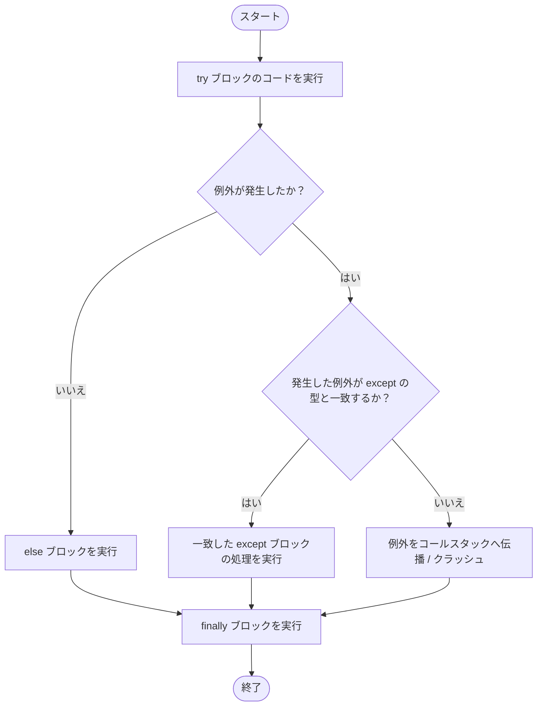

# Day 10: 例外処理 (try-except)

どんなに優れたコードであっても、エラーは発生します。ユーザーが不正な入力を行ったり、必要なファイルが見つからなかったり、ゼロ除算（0での割り算）が発生したりすることがあります。これらを処理せずに放置すると、プログラムは途中で強制終了（クラッシュ）してしまいます。Pythonではこれを**例外（Exception）**と呼び、例外処理を行うことでエラーを予測し、安全に処理してプログラムの実行を継続させることができます。

### 🎯 学習目標
- 構文エラー（Syntax Error）と実行時例外（Runtime Exception）の違いを理解する。
- `try-except` ブロックを用いて、特定の例外（`ValueError`、`ZeroDivisionError`、`TypeError`）を捕捉・処理する。
- `else` ブロックと `finally` ブロックを活用し、正常系ルートとリソース解放などの終了処理を適切に制御する。
- `raise` キーワードを使用して、プログラムから意図的に例外を発生させる。
- 独自の例外クラス（カスタム例外）を定義し、ドメイン固有のエラーハンドリングを行えるようにする。

### 🧩 中核概念（なぜ）
**例外**とは、プログラムの実行中に発生する、命令の正常な流れを妨げるイベントのことです。

例外処理を行わない場合、Pythonは実行を即座に停止し、エラー情報（トレースバック）を出力します。しかし、Webサーバーやモバイルアプリといった実際のプロダクション環境では、クラッシュすることは許されません。そこで、エラーが発生しそうなコードを `try` ブロックで囲みます。エラーが発生すると、対応する `except` ブロックに制御が移り、プログラムの強制終了を回避できます。

Pythonは、エラー管理のために4つの重要なブロックを提供しています：
1. `try`: 例外が発生する可能性のあるコードを記述します。
2. `except`: 指定された例外が発生したときにエラー処理を実行します。
3. `else`: `try` ブロックで例外が発生**しなかった**場合のみ実行されます。
4. `finally`: エラーの有無にかかわらず**必ず最後**に実行されます（クローズ処理やクリーンアップに最適）。

### 🔁 ロジックと動作
以下のフローチャートは、例外が発生した際、またはスキップされた際に、Pythonがどのように `try-except-else-finally` 構造をたどって制御を移すかを示しています。



### 📝 注釈付きサンプル

複数の例外をハンドリングし、クリーンアップ処理を行う実装例は以下の通りです。

```python
def process_data(val):
    # try-except-else-finally をすべて含んだ構造
    try:
        # 入力値を整数に変換。ここで ValueError が発生する可能性あり。
        num = int(val)
        # 割り算を実行。ここで ZeroDivisionError が発生する可能性あり。
        result = 100 / num
    except ValueError as e:
        # ValueError が発生した場合のみ実行 (例: 'abc' などの文字列が渡された場合)
        print(f"変換エラー: {e}")
        result = None
    except ZeroDivisionError as e:
        # ZeroDivisionError が発生した場合のみ実行 (0 が渡された場合)
        print(f"計算エラー: {e}")
        result = None
    else:
        # try ブロックが例外を出さずに正常終了した場合のみ実行
        print(f"計算成功。結果: {result}")
    finally:
        # エラーの有無に関係なく必ず実行。状態のリセットなどに使用。
        print("データ処理の試行が終了しました。")
    return result

# --- 例外の発生 (raise) ---
def set_age(age):
    if age < 0:
        # ビジネスルールに違反した入力に対して、意図的に例外を発生させる
        raise ValueError("年齢に負の値を指定することはできません！")
    print(f"年齢を設定しました: {age}")
```

### ❌ よくある間違い

**間違い 1: 何も指定しない except ブロック（Bare except）の使用**
```python
try:
    # print 関数のスペルミス（typo）
    prnt("Hello")
except:
    print("An error occurred")
```
```text
NameError: name 'prnt' is not defined
```
```python
try:
    print("Hello")
except Exception as e:
    print(f"An unexpected error occurred: {e}")
```
> 例外の型を指定しない `except:` は、構文エラーのタイポや、システム停止のシグナル（`KeyboardInterrupt` など）を含むすべての例外をキャッチしてしまうため、デバッグを非常に困難にします。常に特定の例外タイプを指定するか、一般的な実行時エラーのみをキャッチする `except Exception as e` を使用し、システム系や構文のエラーは伝播させるようにしてください。

**間違い 2: エラー箇所より後ろで初期化される変数へのアクセス**
```python
try:
    value = int("invalid")
    result = value + 10
except ValueError:
    print(f"Failed. Result was: {result}")
```
```text
NameError: name 'result' is not defined
```
```python
result = None
try:
    value = int("invalid")
    result = value + 10
except ValueError:
    print("Failed to convert value.")
```
> `try` ブロック内で例外が発生すると、実行はその行で中断され、即座に `except` ブロックにジャンプします。そのため、例外発生行よりも後ろで定義される予定だった変数（この例では `result`）は存在せず、ハンドラ内で `NameError` が発生してしまいます。

### 💡 コツ・イディオム
- **EAFP (Easier to Ask for Forgiveness than Permission)**: Pythonでは「あらかじめ `if` 文で安全かを確認してから実行する (LBYL)」よりも、「まず実行してみて、エラーが出たら `try-except` で対処する (EAFP)」というスタイルが好まれます。コードがシンプルになり、例外的なケースが少ない場合に高速に動作し、競合状態も防止できます。
- **具体的なエラーから順に書く**: 複数の例外を並べる場合は、より具体的な子クラスの例外（`ZeroDivisionError` など）を上に、一般的な親クラス（`Exception` など）を下に配置します。
- **`finally` で確実に後処理**: データベースの接続解除、ファイルのクローズ、ネットワークソケットの解放などは、コードが途中でクラッシュしたり `return` で早期終了したりした場合でも確実に実行されるよう、必ず `finally` ブロックに記述します。

### 🧠 深掘り（内部の仕組み）
<details>
<summary>例外の伝播（プロパゲーション）とカスタム例外</summary>

#### コールスタックと例外の伝播
関数内で例外が発生した際、Pythonのランタイムはその関数内に一致する `try-except` ハンドラがないかを探します。見つからない場合、その関数は途中で終了し、例外は呼び出し元（コール元）の関数へと「伝播」します。この伝播は、呼び出し元のチェーン（コールスタック）を遡って繰り返されます。最終的にプログラムの最上位（ルート）に到達しても捕捉されなかった場合、Pythonは実行を停止してエラー（トレースバック）を出力します。この仕組みにより、すべてのヘルパー関数にエラー処理を書く必要がなくなり、上位レベルで一括してエラーをハンドリングできます。

#### カスタム例外（独自の例外）
大規模なシステムでは、標準の例外だけでは原因の特定が難しい場合があります。その場合、Pythonの組み込みの `Exception` クラスを継承して、独自の例外を定義できます：
```python
class InsufficientFundsError(Exception):
    """銀行口座の残高不足による引き出しエラー"""
    def __init__(self, balance, amount):
        super().__init__(f"引き出し額 ${amount} に対して残高が不足しています。現在の残高: ${balance}")
        self.balance = balance
        self.amount = amount
```
このようにカスタム例外を定義して発生させることで、他のモジュールに対してビジネスロジック上のエラーを明示的に伝えることができます。
</details>

### 🏋️ 演習
以下の機能を持つ `safe_divide(a, b)` 関数を完成させてください：
1. `a / b` の計算結果を返す。
2. もし `b` が `0` の場合は、`ZeroDivisionError` をキャッチして文字列 `"ZeroDivisionError"` を返す。
3. もし `a` または `b` が数値でない場合（型の不一致が発生した場合）、`TypeError` をキャッチして文字列 `"TypeError"` を返す。

右側のコードエリアの初期コードをもとに実装を進めてください。

### ✅ 自己チェック
<details>
<summary>1. "try" ブロックの中で関数が早期リターンした場合、"finally" ブロックは実行されますか？</summary>
はい、実行されます。`try` や `except` ブロックの中に `return` 文がある場合でも、Pythonは呼び出し元に値を返す処理の *直前* に `finally` ブロックの内容を必ず実行します。
</details>

<details>
<summary>2. "except Exception as e" と、例外を指定しない "except:" の違いは何ですか？</summary>
`except Exception as e` は、一般的なプログラムの実行時エラーを表す `Exception` クラスとそのサブクラスをキャッチします。一方、例外を指定しない `except:` は、システム終了エラーの `SystemExit` やキーボードでの強制終了シグナル `KeyboardInterrupt` (Ctrl+C) を含む、文字通りすべての例外をキャッチしてしまいます。通常、これらのシステムシグナルを横取りするとスクリプトが強制終了できなくなるため、`except:` は使うべきではありません。
</details>

### 📌 まとめ
- 例外をキャッチし、プログラムのクラッシュを防ぐために `try-except` を使用する。
- **構文**: `try`（コード実行）、`except`（エラー処理）、`else`（成功時のみ実行）、`finally`（必ず実行）。
- **発生**: 手動で例外をトリガーするには `raise ValueError("msg")` を使用する。
- **伝播**: 未処理の例外は、キャッチされるかクラッシュするまでコールスタックを遡って伝播する。
