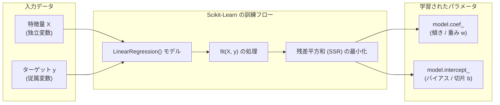

# Day 11: NumPy と Scikit-Learn による線形回帰

### 🎯 学習目標
- 線形回帰の基本的な概念と、変数間の関係をどのようにモデル化するかを説明できる。
- 線形回帰モデルの構成要素：特徴量（$X$）、ターゲット（$y$）、傾き・回帰係数（`coef_`）、切片（`intercept_`）を特定できる。
- Scikit-Learn を使用して、単純線形回帰モデルの実装と訓練ができる。
- 訓練されたモデルパラメータを解釈し、新しいデータに対して予測を行える。

### 🧩 中核概念（なぜ）
現実世界の多くのシナリオにおいて、特徴量（データの特徴）に基づいて連続的な数値（住宅価格、気温、売上など）を予測したい場合があります。これは**回帰（Regression）**問題と呼ばれます。
**線形回帰（Linear Regression）**は、回帰問題において最もシンプルで基礎的なアルゴリズムです。これは、ターゲット変数 $y$ が入力特徴量 $X$ の線形結合（直線的な関係）としてモデル化できると仮定します。
なぜ線形回帰を使うのでしょうか？
1. **解釈性の高さ**: 複雑なブラックボックスモデルとは異なり、特徴量が変化したときにターゲットがどれだけ変化するかが明確に分かります。
2. **計算効率の良さ**: 数学的に明快で、高速に訓練を行うことができます。
3. **基準（ベースライン）**: より複雑なアルゴリズムを評価する際の出発点として機能します。

### 🔁 ロジックと動作
線形回帰アルゴリズムは、実際のデータ点と予測直線の間の垂直距離（誤差）を最小化することによって、「最もフィットする直線」を見つけます。このプロセスは **最小二乗法（Ordinary Least Squares: OLS）** と呼ばれます。



単純線形回帰の数学的な方程式は次のとおりです：
$$y = w \cdot x + b$$
- $y$ は予測されたターゲットです。
- $x$ は入力特徴量です。
- $w$ （傾き/回帰係数）は直線の傾きを決定します。Scikit-Learn では、これは `model.coef_` に格納されます。
- $b$ （y切片）は、$x = 0$ のときの $y$ の値です。Scikit-Learn では、これは `model.intercept_` に格納されます。

### 📝 注釈付きサンプル
以下は、データセットを作成し、モデルを訓練し、そのパラメータを確認する方法です。
```python
import numpy as np
from sklearn.linear_model import LinearRegression

# 1. 訓練データの準備（Xは2次元、yは1次元にする必要があります）
# X: 住宅の面積（千平方フィート単位）
X = np.array([[1.2], [1.6], [2.1], [2.4], [2.9]])
# y: 住宅の価格（10万ドル単位）
y = np.array([2.5, 3.2, 4.1, 4.9, 5.8])

# 2. モデルのインスタンス化
model = LinearRegression()

# 3. モデルをデータに適合させる（訓練フェーズ）
model.fit(X, y)

# 4. 訓練されたパラメータへのアクセス
print("傾き (coef_):", model.coef_)       # 出力: array([1.947]) -> 面積が 1000 sqft 増えるごとに、価格は約 19.5 万ドル上昇します
print("切片 (intercept_):", model.intercept_) # 出力: ~0.142 -> 面積が 0 のときのベース価格

# 5. 新しいデータでの予測（入力は2次元にする必要があります）
new_houses = np.array([[1.8], [2.5]])
predictions = model.predict(new_houses)
print("予測値:", predictions) # 出力: array([3.647, 5.010])
```

### ❌ よくある間違い

**間違い 1: 特徴量 X に 1 次元配列を渡してしまう**
```python
import numpy as np
from sklearn.linear_model import LinearRegression
X = np.array([1.0, 1.5, 2.0, 2.5, 3.0]) # 1次元配列
y = np.array([2.0, 3.1, 3.8, 5.0, 6.2])
model = LinearRegression()
model.fit(X, y)
```
```text
ValueError: Expected 2D array, got 1D array instead:
array=[1.  1.5 2.  2.5 3. ].
Reshape your data either using array.reshape(-1, 1) if your data has a single feature or array.reshape(1, -1) if it contains a single sample.
```
```python
import numpy as np
from sklearn.linear_model import LinearRegression
X = np.array([[1.0], [1.5], [2.0], [2.5], [3.0]]) # 2次元配列
y = np.array([2.0, 3.1, 3.8, 5.0, 6.2])
model = LinearRegression()
model.fit(X, y)
```
> Scikit-Learn の推定器（estimator）は、特徴量行列 `X` が `(n_samples, n_features)` の形状を持つ 2 次元配列であることを期待します。特徴量が 1 つだけであっても、2 次元の列ベクトルとして構築する必要があります。

**間違い 2: モデルの訓練前に予測を行おうとする**
```python
import numpy as np
from sklearn.linear_model import LinearRegression
model = LinearRegression()
model.predict(np.array([[2.0]]))
```
```text
sklearn.exceptions.NotFittedError: This LinearRegression instance is not fitted yet. Call 'fit' with appropriate arguments before using this estimator.
```
```python
import numpy as np
from sklearn.linear_model import LinearRegression
X = np.array([[1.0], [2.0], [3.0]])
y = np.array([2.0, 4.0, 6.0])
model = LinearRegression()
model.fit(X, y) # 最初に訓練を行う
model.predict(np.array([[2.0]]))
```
> モデルがデータから最適な重みを学習できるように、`predict()` を呼び出す前に必ず `fit(X, y)` を実行する必要があります。

**間違い 3: X と y のサンプル数が一致していない**
```python
import numpy as np
from sklearn.linear_model import LinearRegression
X = np.array([[1.0], [2.0], [3.0]])
y = np.array([2.0, 4.0]) # サンプル数が2つだけ
model = LinearRegression()
model.fit(X, y)
```
```text
ValueError: Found input variables with inconsistent numbers of samples: [3, 2]
```
```python
import numpy as np
from sklearn.linear_model import LinearRegression
X = np.array([[1.0], [2.0], [3.0]])
y = np.array([2.0, 4.0, 6.0]) # サンプル数が一致している
model = LinearRegression()
model.fit(X, y)
```
> `X` の行数（サンプル数）は、`y` の要素数と完全に一致している必要があります。

### 💡 コツ・イディオム
- **列ベクトルへの変換**: 1 次元の NumPy 配列 `arr` を Scikit-Learn 用に 2 次元の列ベクトルに変換するには、`arr.reshape(-1, 1)` を使用します。`-1` は、配列の長さに応じて行数を自動計算するよう NumPy に指示します。
- **決定係数 (R-squared)**: `model.score(X, y)` を使用して、訓練データに対するモデルの性能を簡単に評価できます。線形回帰の場合、これは決定係数（$R^2$）を返し、特徴量によって説明されるターゲットの分散の割合（0〜1の範囲）を示します。
- **複数特徴量への拡張**: 同じ `LinearRegression` クラスで複数の特徴量をシームレスに処理できます。$X$ の形状が `(n_samples, 3)` の場合、`model.coef_` には各特徴量に対応する 3 つの傾きの値が含まれます。

### 🧠 深掘り（内部の仕組み）
<details><summary>最小二乗法 (OLS) の損失関数と方程式（クリックで展開）</summary>

線形回帰は、予測値と実際の値の差の二乗和、すなわち **残差平方和 (RSS)** または **平均二乗誤差 (MSE)** 損失関数を最小化することによってパラメータ $w$ と $b$ を最適化します。

$$J(w, b) = \frac{1}{2m} \sum_{i=1}^{m} \left( (w x^{(i)} + b) - y^{(i)} \right)^2$$

ここで、$m$ はサンプル数、$x^{(i)}$ は $i$ 番目のサンプルの特徴量、$y^{(i)}$ は $i$ 番目のサンプルの実際のターゲット値です。

#### 解析解（正規方程式）
バイアス（切片）を含むすべての係数を $\theta$ で表す一般的な線形回帰の場合、**正規方程式 (Normal Equation)** を使用して、最適なパラメータを 1 ステップで解析的に求めることができます：

$$\theta = (X^T X)^{-1} X^T y$$

この式は数学的にエレガントですが、行列の逆行列計算 $(X^T X)^{-1}$ は特徴量の数が非常に大きい場合（例：10,000以上）に計算量が膨大（約 $\mathcal{O}(n^3)$）になります。そのような場合は、勾配降下法などの反復的最適化アルゴリズムが好まれます。
</details>

### 🏋️ 演習
`train_model(X, y)` 関数を完成させて、Scikit-Learn の `LinearRegression` モデルを作成し、提供された特徴量 `X` とターゲット `y` を使用して適合（学習）させ、訓練済みのモデルオブジェクトを返してください。

```python
import numpy as np
from sklearn.linear_model import LinearRegression

# 特徴量: 面積（千平方フィート単位）
X = np.array([[1.0], [1.5], [2.0], [2.5], [3.0]])
# ターゲット: 住宅価格（10万ドル単位）
y = np.array([2.0, 3.1, 3.8, 5.0, 6.2])

def train_model(X, y):
    # LinearRegression インスタンスを作成し、X と y に適合させて、訓練済みモデルを返してください
    model = None
    return model
```

### ✅ 自己チェック
1. 特徴量が 1 つだけの場合、`model.coef_` の形状と `model.intercept_` のデータ型はどうなりますか？
2. `model.coef_` が `[2.5]`、`model.intercept_` が `1.0` である場合、入力特徴量の値が `4.0` のときの予測ターゲット値はいくつになりますか？
<details><summary>解答</summary>

1. `model.coef_` は形状が `(1,)` の 1 次元 NumPy 配列になり、`model.intercept_` は float 型になります。
2. 予測式は $y = w \cdot x + b$ です。ここでは、$y = 2.5 \cdot (4.0) + 1.0 = 10.0 + 1.0 = 11.0$ となります。
</details>

### 📌 まとめ
- **線形回帰**は、連続的な数値を予測するために直線 $y = w x + b$ をデータに適合させます。
- Scikit-Learn は特徴量 `X` が 2 次元配列、ターゲット `y` が 1 次元配列であることを要求します。
- 学習されたモデル係数は `model.coef_` に、切片は `model.intercept_` に格納されます。
- モデルの訓練には `model.fit(X, y)` を使用し、予測には `model.predict(X_new)` を使用します。
