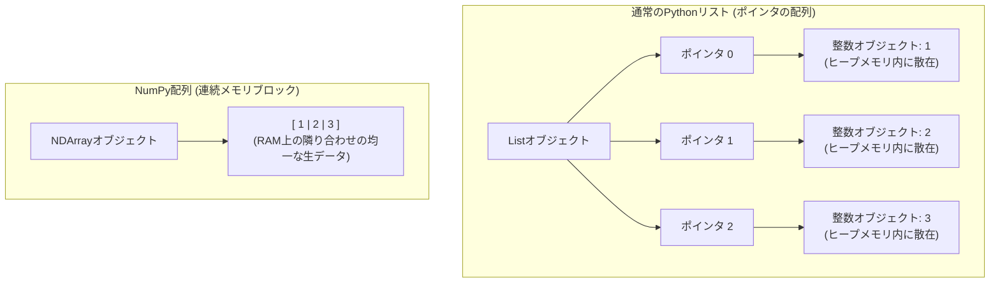

# Day 12: NumPy配列とベクトル演算

### 🎯 学習目標
- NumPyとは何か、なぜ数値計算において通常のPythonリストよりも優れているかを説明できる。
- NumPy配列の主要な属性である `shape`、`ndim`、および `dtype` について説明できる。
- `np.zeros()`、`np.ones()`、`np.eye()` などの補助関数を使用してNumPy配列を作成できる。
- ベクトル化された算術演算、ブロードキャスト、および行列乗算を実行できる。

### 🧩 中核概念（なぜ）
データサイエンスや機械学習では、数値の集まり（行列、ベクトル、テンソル）を頻繁に扱います。
通常のPythonリストでも数値を集めることはできますが、高性能な数学的計算には設計されていません。
Pythonのリストは、メモリ上に散らばったオブジェクトへのポインタの配列であるため、型検査やメモリ参照のオーバーヘッドが発生します。
**NumPy** (Numerical Python) は **ndarray**（N次元配列）を提供し、以下の特徴を持っています：
1. **高速性**: C言語で実装されており、連続したメモリ配置とCPUレベルの最適化（ベクトル化とSIMD）を利用しています。
2. **高いメモリ効率**: 均一なデータ型（Homogeneous）でデータを格納し、余計なオブジェクトのオーバーヘッドを避けます。
3. **利便性**: ループ処理を明示的に書くことなく、配列全体に対する数学的演算をサポートします。

### 🔁 ロジックと動作
NumPyが高速である主な理由は、ポインタベースであるPythonリストと比較して、**連続したメモリ配置（Contiguous Memory Layout）**を採用しているためです。



メモリ上でデータを隣り合わせに配置することで、CPUはキャッシュメモリにデータをはるかに高速にロードできます。さらに、NumPyの演算は**ベクトル化（Vectorized）**されており、Python側ではなくC言語でコンパイルされたループを実行するため、ハードウェアはSIMD（Single Instruction Multiple Data）の並列処理を行うことができます。

### 📝 注釈付きサンプル

以下は、NumPy配列の作成、属性確認、および計算の実行方法です：

```python
import numpy as np

# 1. 作成と属性の確認
arr = np.array([[1, 2, 3], [4, 5, 6]], dtype=np.float32)
print("配列:\n", arr)
print("形状 (shape):", arr.shape)    # 出力: (2, 3) -> 2行3列
print("次元数 (ndim):", arr.ndim)   # 出力: 2 -> 2次元配列
print("データ型 (dtype):", arr.dtype) # 出力: float32

# 2. 配列作成用の補助関数
zeros_arr = np.zeros((2, 2))  # すべての要素が 0 の 2x2 行列を作成
ones_arr = np.ones((3, 1))    # すべての要素が 1 の 3x1 列ベクトルを作成
identity_matrix = np.eye(3)   # 3x3 の単位行列を作成

# 3. ベクトル化演算 (ループ不要！)
a = np.array([1, 2, 3])
b = np.array([10, 20, 30])
print("足し算:", a + b)       # 出力: [11, 22, 33]
print("掛け算 (スカラー倍):", a * 3) # 出力: [3, 6, 9]

# 4. ブロードキャスト (形状が異なる配列間の算術演算)
matrix = np.array([[1, 2, 3], [4, 5, 6]]) # 形状 (2, 3)
row_vector = np.array([10, 20, 30])      # 形状 (3,)
# row_vector は自動的に (2, 3) に引き伸ばされ、matrix に加算されます
print("ブロードキャスト加算:\n", matrix + row_vector) 
# 出力:
# [[11, 22, 33]
#  [14, 25, 36]]

# 5. 行列の乗算 (積)
A = np.array([[1, 2], [3, 4]])
B = np.array([[5, 6], [7, 8]])
# 行列の積を求めるには @ 演算子または np.dot() を使用します
print("行列の積:\n", A @ B)
# 出力:
# [[19, 22]
#  [43, 50]]
```

### ❌ よくある間違い

**間違い 1: 行列の乗算を期待して要素ごとの乗算（*）を使用する**
```python
import numpy as np
A = np.array([[1, 2], [3, 4]])
B = np.array([[5, 6], [7, 8]])
# 行列の乗算を意図したコード
result = A * B
```
```text
# エラーは発生しませんが、意図しない要素ごとの乗算結果が返されます：
# [[ 5, 12]
#  [21, 32]]
```
```python
import numpy as np
A = np.array([[1, 2], [3, 4]])
B = np.array([[5, 6], [7, 8]])
# 正しい行列の乗算
result = A @ B
```
> NumPyにおいて、アスタリスク `*` は要素ごとの乗算（アダマール積）を行います。本来の行列の乗算（内積）を行うには、`@` 演算子または `np.dot(A, B)` を使用する必要があります。

**間違い 2: NumPy配列に対してリストのメソッドである .append() を呼び出す**
```python
import numpy as np
arr = np.array([1, 2, 3])
arr.append(4)
```
```text
AttributeError: 'numpy.ndarray' object has no attribute 'append'
```
```python
import numpy as np
arr = np.array([1, 2, 3])
arr = np.append(arr, 4) # 新しい配列を作成して返す
```
> NumPy配列はメモリ上で固定サイズです。インプレース（元のオブジェクトのまま）で要素を追加することはできません。`np.append()` などの関数は、新しく確保されたメモリ上に配列を作成して返すため、コストが高い操作です。

**間違い 3: ブロードキャストで形状が適合しない配列同士を演算する**
```python
import numpy as np
matrix = np.array([[1, 2], [3, 4]]) # 形状 (2, 2)
vec = np.array([10, 20, 30])        # 形状 (3,)
result = matrix + vec
```
```text
ValueError: operands could not be broadcast together with shapes (2,2) (3,) 
```
```python
import numpy as np
matrix = np.array([[1, 2], [3, 4]]) # 形状 (2, 2)
vec = np.array([10, 20])            # 形状 (2,)
result = matrix + vec
```
> ブロードキャストが機能するためには、配列の末尾の次元が一致しているか、いずれかの次元が 1 である必要があります。

### 💡 コツ・イディオム
- **ループを避ける**: NumPy配列の要素に対して `for` ループを書いている場合は、書き方を再検討してください。Pythonのループは低速ですが、ベクトル化された演算はコンパイル・最適化されているため非常に高速です。
- **NumPyにおける軸 (axis)**: 多くの集計・削減関数（`np.sum()` や `np.mean()` など）は `axis` 引数を受け取ります。`axis=0` は列に沿って演算（行を潰す）を行い、`axis=1` は行に沿って演算（列を潰す）を行います。
- **ビューとコピー**: 配列をスライスしたとき（例: `sub_arr = arr[0:2]`）、返されるのはデータの**ビュー**であり、コピーではありません。`sub_arr` を変更すると元の `arr` も変更されます。完全に独立したコピーが必要な場合は、`arr[0:2].copy()` を使用してください。

### 🧠 深掘り（内部の仕組み）
<details><summary>メモリレイアウトのストライド（Strides）: 行優先（C）と列優先（Fortran）（クリックで展開）</summary>

内部的には、多次元の ndarray はフラットな 1 次元の連続したメモリブロックとして保存されています。この 1 次元ブロックを 2 次元や 3 次元として扱うために、NumPy は **ストライド (Strides)** を使用します。
ストライドとは、各次元で次の要素に移動するためにジャンプ（スキップ）する必要があるバイト数を表す整数のタプルです。

例えば、形状 `(3, 3)` の 32ビット浮動小数点数（それぞれ4バイト）の 2 次元配列の場合：
- **C-Contiguous (行優先)**: 行の要素がメモリ上に隣接して配置されます。
  - メモリ順序: `[0,0], [0,1], [0,2], [1,0], [1,1], [1,2], [2,0], [2,1], [2,2]`
  - ストライド: `(12, 4)` -> 下の行（同じ列）に移動するには 12 バイト（3要素分）ジャンプし、右の列（同じ行）に移動するには 4 バイト（1要素分）ジャンプします。
- **F-Contiguous (列優先)**: 列の要素がメモリ上に隣接して配置されます。
  - メモリ順序: `[0,0], [1,0], [2,0], [0,1], [1,1], [2,1], [0,2], [1,2], [2,2]`
  - ストライド: `(4, 12)` -> 下の行に移動するには 4 バイトジャンプし、右の列に移動するには 12 バイトジャンプします。

ストライドの概念を理解すると、なぜ NumPy において転置操作（`arr.T`）が瞬時に行われるのかが分かります。NumPy はメモリ上のデータを移動するのではなく、単にストライドのタプルを入れ替えるだけで転置を実現しているのです！
</details>

### 🏋️ 演習
以下の操作を実行する `matrix_operations(n)` 関数を完成させてください：
1. `np.eye(n)` を使用して $n \times n$ の単位行列を作成します。
2. その行列に 5 を乗算してスケールします。
3. `np.sum(..., axis=1)` を使用して、スケールされた行列の各行の和を計算し、返します。

```python
import numpy as np

def matrix_operations(n):
    # 1. np.eye(n) を使用して n x n の単位行列を作成します
    # 2. 行列を 5 倍にしてスケールします
    # 3. np.sum(..., axis=1) を使用して、スケールされた行列の各行の和を計算し、返します
    row_sums = None
    return row_sums
```

### ✅ 自己チェック
1. 配列の形状が `(3, 4, 5)` の場合、`arr.ndim` は何を返しますか？
2. `arr = np.array([1, 2])` に対して `arr + 10` を実行すると、出力はどうなりますか？また、それはなぜですか？
<details><summary>解答</summary>

1. 形状に 3 つの次元があるため、`3` を返します。
2. `[11, 12]` を返します。ブロードキャストの機能により、スカラーの `10` が配列の形状に合わせて `[10, 10]` に引き伸ばされ、要素ごとの加算が行われるためです。
</details>

### 📌 まとめ
- **NumPy**は、メモリが連続して配置され、C言語によるベクトル化された処理を行うため、Pythonのリストよりも高速です。
- `shape` 属性は配列の次元数を表し、`dtype` は一連の均一なデータ型を指定します。
- ベクトル化された演算と**ブロードキャスト**により、異なるサイズの配列間でループなしで算術演算を行うことができます。
- 行列の乗算には `@` を使用し、次元に沿った計算の方向を制御するには縮小（リダクション）操作で `axis` を指定します。
