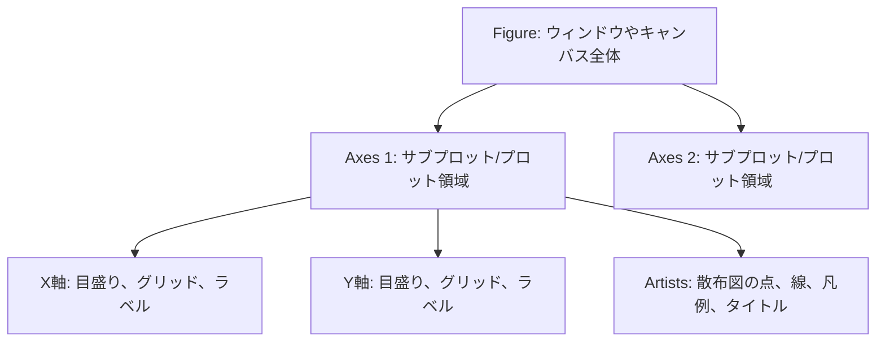

# Day 14: Matplotlibによるデータの可視化

### 🎯 学習目標
- Matplotlib における状態ベース（`pyplot`）とオブジェクト指向（OO）の描画アプローチの違いを説明できる。
- 散布図、折れ線グラフ、棒グラフを作成できる。
- カスタムラベル、タイトル、グリッド、凡例を使用してグラフをカスタマイズできる。
- `savefig()` を使用して、グラフを画像ファイルとしてディスクに保存できる。

### 🧩 中核概念（なぜ）
データの可視化とは、情報やデータを視覚的な表現に変換することです。チャート、グラフ、マップなどの視覚的な要素を使用することで、データ内の傾向、外れ値、パターンを直感的に発見し、理解することができます。

機械学習やデータサイエンスにおいて、可視化は以下の目的で不可欠です：
1. **探索的データ解析 (EDA)**: モデルにデータを入力する前に、特徴量間の関係（例：2つの特徴量が線形に相関しているか）を把握する必要があります。
2. **モデルの診断**: エポックごとの訓練損失と検証損失をプロットすることで、過学習（オーバーフィッティング）や学習不足（アンダーフィッティング）を検出できます。
3. **インサイトの共有**: 数値だけの生データや行列を見るよりも、視覚的なチャートを見る方が、関係者へ迅速に結果を伝えることができます。

Matplotlib は、Python における最も基盤となるグラフ描画ライブラリです。Seaborn や Pandas の内部描画メソッドなど、Python の他の描画ライブラリの多くは Matplotlib の上に構築されています。Matplotlib を学ぶことで、グラフ内のすべての要素に対してきめ細かな制御を行うことができるようになります。

### 🔁 ロジックと動作
Matplotlib では、Figure（ウィンドウやキャンバス全体）と Axes（座標系を持つ個々のプロット領域）を切り離して管理します。



Matplotlib には、これらのグラフを構築するための 2 つの主要なインターフェースが用意されています：
1. **Pyplot 状態ベースのインターフェース (`plt.plot`)**: 自動的に現在「アクティブ」な Figure や Axes を追跡し、描画コマンドをそれらへ割り振ります。シンプルで、対話的（インタラクティブ）に素早く描画するのに適しています。
2. **オブジェクト指向 (OO) インターフェース (`fig, ax = plt.subplots()`)**: 明示的に Figure オブジェクトと Axes オブジェクトを作成し、それらのメソッドを呼び出します。状態の競合を防ぐことができるため、複雑なグラフやマルチプロットを構築する際に推奨されるスタイルです。

### 📝 注釈付きサンプル
状態ベースのアプローチとオブジェクト指向アプローチを比較しながら、さまざまな種類のグラフを作成してみましょう。

```python
import matplotlib.pyplot as plt

# --- 1. Pyplot 状態ベースのインターフェース (折れ線グラフ) ---
plt.clf()  # 新しく描画を開始するために、アクティブな Figure をクリア

# データの座標
x_line = [1, 2, 3, 4, 5]
y_line = [2, 4, 6, 8, 10]

plt.plot(x_line, y_line, color="blue", marker="o", label="Linear growth")
plt.xlabel("Input values")
plt.ylabel("Output values")
plt.title("Line Chart (State-Based)")
plt.grid(True)
plt.legend()
plt.savefig("pyplot_line.png")  # グラフを PNG として保存

# --- 2. オブジェクト指向インターフェース (散布図) ---
# subplots は Figure オブジェクトと Axes オブジェクト（またはその配列）を返す
fig, ax = plt.subplots()

x_scatter = [5, 7, 8, 7, 2, 17, 2, 9, 4, 11]
y_scatter = [99, 86, 87, 88, 111, 86, 103, 87, 94, 78]

# Axes オブジェクト 'ax' に対して散布図を作成
ax.scatter(x_scatter, y_scatter, color="orange", label="Data Points")

# オブジェクト指向スタイルでは、メソッドの先頭に通常 'set_' が付く
ax.set_xlabel("Age of Car (years)")
ax.set_ylabel("Max Speed (mph)")
ax.set_title("Car Age vs Speed (OO Style)")
ax.grid(True)
ax.legend()

# Figure オブジェクトを介して保存
fig.savefig("oo_scatter.png")

# --- 3. 棒グラフの作成 ---
plt.clf()
categories = ["A", "B", "C", "D"]
values = [15, 24, 9, 32]

plt.bar(categories, values, color="green")
plt.title("Bar Chart Example")
plt.savefig("bar_chart.png")
```

### ❌ よくある間違い

**間違い 1: フィギュアをクリアしないことによるグラフの重なり**
```python
import matplotlib.pyplot as plt
plt.plot([1, 2], [10, 20])
plt.savefig("plot1.png")
plt.plot([1, 2], [30, 40]) # plot1 の上に重ねて描画されてしまう！
plt.savefig("plot2.png")
```
```text
（エラーのトレースバックは発生しませんが、plot2.png には 2 つ目のデータだけでなく両方のデータが含まれてしまいます）
```
```python
import matplotlib.pyplot as plt
plt.plot([1, 2], [10, 20])
plt.savefig("plot1.png")
plt.clf() # 現在の Figure をクリア
plt.plot([1, 2], [30, 40])
plt.savefig("plot2.png")
```
> Matplotlib は `pyplot` の中にグローバルな状態を保持しています。`plt.clf()` や `plt.close()` を呼び出さない限り、その後に呼び出された `plot()` は同じアクティブな Axes 上に重ねて描画を続けます。

**間違い 2: 状態ベースの Pyplot インターフェースに対してオブジェクト指向のメソッドを混在させてしまう**
```python
import matplotlib.pyplot as plt
plt.set_xlabel("X-Axis")
```
```text
AttributeError: module 'matplotlib.pyplot' has no attribute 'set_xlabel'
```
```python
import matplotlib.pyplot as plt
plt.xlabel("X-Axis") # オブジェクト指向インターフェースを使う場合は ax.set_xlabel()
```
> `pyplot` に対するプロパティの設定は関数（例：`plt.xlabel()`）を直接使用するのに対し、`Axes` オブジェクトに対しては `set_` が付いたメソッド（例：`ax.set_xlabel()`）を使用します。

### 💡 コツ・イディオム
- **ラベルの見切れ防止**: タイトルや軸ラベルが長すぎると、保存した画像の外側にはみ出して見切れてしまうことがあります。常に `plt.tight_layout()` を実行するか、`savefig` 内で `bbox_inches='tight'` を指定して自動調整してください：
  ```python
  plt.savefig("plot.png", bbox_inches="tight")
  ```
- **印刷品質を高める DPI 指定**: デフォルトの設定では保存した画像がぼやけて見えることがあります。解像度を上げるには `dpi`（dots per inch）引数を使用します：
  ```python
  plt.savefig("high_res.png", dpi=300)
  ```
- **棒グラフの背後にグリッド線を引く**: 棒グラフを作成する際、デフォルトではグリッド線が棒の上に描画されてしまうことがあります。`ax.set_axisbelow(True)` を使用して、描画要素の下にグリッド線が表示されるようにします。

### 🧠 深掘り（内部の仕組み）
<details><summary>Matplotlib のアーキテクチャと Pyodide / ヘッドレス環境でのバックエンド描画（クリックで展開）</summary>

Matplotlib は次の 3 つのレイヤーで構成されるアーキテクチャを採用しています：
1. **スクリプティング（Scripting）レイヤー**: ユーザーが簡単にグラフを構築できるように設計された `matplotlib.pyplot` モジュールです。
2. **アーティスト（Artist）レイヤー**: フィギュア内のすべての視覚要素（`Figure`、`Axes`、`Axis`、`Line2D`、`Rectangle` など）を表すクラス階層です。Artist レイヤーは、各要素がどのように配置され、レイアウトされるかを把握しています。
3. **バックエンド（Backend）レイヤー**: 描画コマンドを特定のデバイスやファイル形式に変換して出力するエンジンです。

#### インタラクティブバックエンド vs 非インタラクティブバックエンド
通常のデスクトップ PC では、Matplotlib は OS のウィンドウマネージャを検出し、対話型（インタラクティブ）の GUI バックエンド（`TkAgg` や `QtAgg` など）をロードして、グラフを表示するポップアップウィンドウを生成します。

しかし、画面出力のない（ヘッドレス）環境（Cron ジョブを実行しているクラウドサーバーや、WebAssembly によるブラウザサンドボックス環境（Pyodide）など）では次のようになります：
- ウィンドウを開くためのディスプレイサーバーやシステムが存在しません。
- Matplotlib は非インタラクティブなバックエンド（通常は **Agg**: Anti-Grain Geometry エンジン）に切り替わります。
- Agg バックエンドは、描画命令（線、円、テキストなど）をメモリ（RAM）上のピクセルバッファに直接レンダリングします。
- `plt.savefig(filename)` が呼び出されると、バックエンドはこのバッファを圧縮ファイル形式（PNG など）に変換し、バイトストリームを直接ディスク（または Pyodide の仮想メモリファイルシステム MEMFS）に書き込みます。

これにより、ディスプレイ出力ハードウェアを用意することなく、自動化されたパイプラインやブラウザ内の Python 実行環境でスムーズにグラフを作成・保存することが可能になります。
</details>

### 🏋️ 演習
`save_scatter_plot(x, y, filename)` 関数を完成させて、以下の処理を実装してください：
1. `plt.clf()` を使用して、現在のアクティブな Figure をクリアする。
2. `plt.scatter(x, y)` を使用して、`x` に対する `y` の散布図を作成する。
3. 以下のタイトルとラベルを追加する：
   - X軸ラベル: `'X-Axis'`
   - Y軸ラベル: `'Y-Axis'`
   - グラフのタイトル: `'Scatter Plot'`
4. `plt.savefig(filename)` を使用して、図をディスクに保存する。
5. 処理が成功した場合は `True` を返す。

```python
import matplotlib.pyplot as plt

def save_scatter_plot(x, y, filename):
    # ここにコードを記述してください
    return False
```

### ✅ 自己チェック
1. Matplotlib でサブプロットを作成し、Figure オブジェクトと Axes オブジェクトの両方を返す関数はどれですか？
2. 異なるグラフ同士が重なるのを防ぐために、Matplotlib でフィギュアをクリアするにはどうすればよいですか？
<details><summary>解答</summary>

1. `plt.subplots()` です（例：`fig, ax = plt.subplots()`）。
2. 現在の Figure をクリアするには `plt.clf()` を使用し、Figure を完全に閉じるには `plt.close()` を使用します。
</details>

### 📌 まとめ
- Matplotlib では、キャンバスとして **Figure** を使用し、個々のプロット領域として 1 つ以上の **Axes** を使用します。
- **Pyplot** インターフェースは状態ベースであるのに対し、**Subplots** API はオブジェクト指向です。
- 散布図には `plt.scatter()`、折れ線グラフには `plt.plot()`、棒グラフには `plt.bar()` を使用します。
- 状態ベースの API では、連続して描画する際にプロットが重なるのを防ぐため、必ず `plt.clf()` でフィギュアをクリアしてください。
