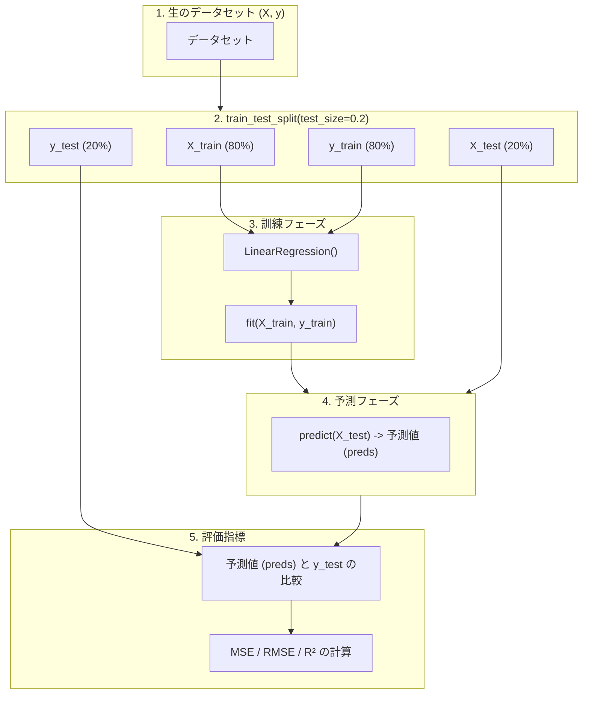

# Day 15: データの分割とモデルの評価

### 🎯 学習目標
- モデルの汎化性能を評価するために、なぜデータを訓練データとテストデータに分割する必要があるのかを説明できる。
- 過学習（過適合）と学習不足（過小適合）の違いを特定できる。
- 主要な回帰評価指標：平均二乗誤差（MSE）、二乗平均平方根誤差（RMSE）、決定係数（$R^2$）を計算し、解釈できる。
- Scikit-Learn の `train_test_split` を使用したモデルの訓練と評価のフローを実装できる。

### 🧩 中核概念（なぜ）
機械学習モデルを訓練する際、私たちの主な目標は、**新しく見たことのないデータ**に対して正確な予測を行うことです。もしモデルを訓練に使ったのと同じデータで評価してしまうと、その性能を過剰に見積もってしまうことになります。これは**データ漏洩（データリーク）**と呼ばれる重大な間違いです。

現実世界でのモデルの動作を現実的に測定するために、データセットを主に次の2つの部分に分割します：
1. **訓練データ（トレーニングセット）**: モデルが特徴量とターゲットの関係性を学習し、パラメータを最適化するために使用します。
2. **テストデータ（テストセット）**: 訓練中は完全に隠しておきます。モデルが新しいデータにどれだけ対応できるか（汎化できるか）を測定する独立した評価役として機能します。

この分割を行わないと、次の2つの重大な問題が発生するリスクがあります：
- **過学習（Overfitting / 高バリアンス）**: モデルが訓練データの実際のパターンだけでなく、ノイズやランダムな変動まで学習してしまいます。訓練データに対しては非常に優れた性能を示しますが、テストデータに対しては極めて低い性能になります。
- **学習不足（Underfitting / 高バイアス）**: モデルがシンプルすぎて、データ内の本質的なパターンを捉えられません（例：曲線のデータに直線を無理やり当てはめようとする）。訓練データとテストデータの両方で性能が悪くなります。

### 🔁 ロジックと動作
標準的な評価フローでは、生のデータを分割し、訓練用サブセットでモデルを訓練し、テスト用サブセットで予測値を生成し、評価指標を計算して誤差を測定します。



#### 評価指標
モデルの予測値（$\hat{y}$）が実際のターゲット（$y$）にどれだけ近いかを測定するために、定量的な指標を使用します：

1. **平均二乗誤差（MSE: Mean Squared Error）**: 予測値（$\hat{y}$）と実際の値（$y$）の差（残差）を二乗したものの平均です。二乗する処理が入るため、大きな誤差に対してより大きなペナルティを与えます。
   $$MSE = \frac{1}{n} \sum_{i=1}^{n} (y_i - \hat{y}_i)^2$$
2. **二乗平均平方根誤差（RMSE: Root Mean Squared Error）**: MSE の平方根です。誤差の単位をターゲット変数の元の単位に戻すため、直感的に解釈しやすくなります。
   $$RMSE = \sqrt{MSE}$$
3. **決定係数（$R^2$）**: モデルがターゲット変数の分散をどれだけ説明できているかを示す指標です。$R^2$ が 1.0 であれば完璧な予測を意味し、0.0 であれば単にターゲットの平均値を予測し続けるモデルと同等の性能であることを示します。

### 📝 注釈付きサンプル
以下は、Scikit-Learn を使用してデータセットを分割し、モデルを訓練し、3つの評価指標をすべて計算する方法です。
```python
import numpy as np
from sklearn.model_selection import train_test_split
from sklearn.linear_model import LinearRegression
from sklearn.metrics import mean_squared_error, r2_score

# 1. 擬似データの作成
np.random.seed(42)
X = np.random.rand(100, 1) * 10  # 100サンプル、1特徴量
y = 3.5 * X.squeeze() + np.random.randn(100) * 3  # ノイズを少し加えたターゲット

# 2. データセットを訓練データ（80%）とテストデータ（20%）に分割
X_train, X_test, y_train, y_test = train_test_split(X, y, test_size=0.2, random_state=42)

# 3. モデルの初期化と、訓練データのみによる適合（学習）
model = LinearRegression()
model.fit(X_train, y_train)

# 4. テスト用の特徴量で予測を実行
predictions = model.predict(X_test)

# 5. テストデータでの評価指標の計算
mse = mean_squared_error(y_test, predictions)
rmse = np.sqrt(mse)
r2 = r2_score(y_test, predictions)

print(f"平均二乗誤差 (MSE): {mse:.4f}")       # 誤差の二乗のばらつきを測定
print(f"二乗平均平方根誤差 (RMSE): {rmse:.4f}") # ターゲット y と同じ単位での誤差
print(f"決定係数 (R2 Score): {r2:.4f}")        # 適合度の良さ (0 から 1)
```

### ❌ よくある間違い

**間違い 1: テストデータではなく、訓練データで評価を行ってしまう**
```python
from sklearn.metrics import mean_squared_error
model.fit(X_train, y_train)
preds = model.predict(X_train)
mse = mean_squared_error(y_train, preds)
```
```text
（トレースバックは発生しませんが、算出される MSE は不自然に低くなり、未知のデータに対する汎化性能を正しく表しません）
```
```python
model.fit(X_train, y_train)
preds = model.predict(X_test) # 未知のテスト特徴量で予測します
mse = mean_squared_error(y_test, preds) # テスト用のターゲットを使用して評価します
```
> 訓練データでの評価は、試験前に試験問題をあらかじめ見ておくようなものです。過学習に気づくことができず、見かけの精度が高くなってしまいます。

**間違い 2: 指標計算時のサンプル数が一致していない**
```python
from sklearn.metrics import mean_squared_error
preds = model.predict(X_test)
mse = mean_squared_error(y_train, preds)
```
```text
ValueError: Found input variables with inconsistent numbers of samples: [80, 20]
```
```python
preds = model.predict(X_test)
mse = mean_squared_error(y_test, preds)
```
> 予測値 `preds`（`X_test` から計算されたもの）は、必ずそれに対応するテストデータの正解値（`y_test`）と比較してください。

**間違い 3: 特徴量とターゲットをバラバラに分割してしまい、行の対応が崩れる**
```python
from sklearn.model_selection import train_test_split
X_train, X_test = train_test_split(X, test_size=0.2, random_state=42)
y_train, y_test = train_test_split(y, test_size=0.2, random_state=24) # 異なるシード値！
```
```text
（分割時にエラーは発生しませんが、行の対応関係が崩れるため、モデルの学習や評価の段階でデタラメな結果が出ます）
```
```python
X_train, X_test, y_train, y_test = train_test_split(X, y, test_size=0.2, random_state=42)
```
> 特徴量 `X` とターゲット `y` は、サンプルのペア関係が維持されるように、必ず1つの `train_test_split` 呼び出しに同時に渡してください。

### 💡 コツ・イディオム
- **シード値の固定**: 分割を再現可能にするために、`random_state` には常に固定の整数（例：`42`）を設定してください。これを省略すると、スクリプトを実行するたびに異なる分割が行われ、評価スコアが変化してしまいます。
- **層化分割（Stratification）**: 分類タスクでは、`train_test_split` の中で `stratify=y` を指定することで、訓練データとテストデータのクラス（カテゴリ）の割合が同じになるように分割できます。
- **RMSE の計算**: Scikit-Learn 1.4以降では、`sklearn.metrics` から `root_mean_squared_error` を直接インポートして計算することも可能ですが、`np.sqrt(mean_squared_error(y_test, preds))` も普遍的な互換性があるため広く使われています。

### 🧠 深掘り（内部の仕組み）
<details><summary>バイアスとバリアンスのトレードオフ（クリックで展開）</summary>

未知のデータに対する機械学習モデルの予測誤差は、数学的に次の3つの要素に分解できます：

$$\text{期待されるテスト誤差} = \text{バイアス}^2 + \text{バリアンス} + \text{削減不可能な誤差}$$

#### 1. バイアス（単純すぎる仮定による誤差）
- **高バイアス**は**学習不足（Underfitting）**を引き起こします。
- モデルがデータの複雑さを捉えきれていない状態です。たとえば、複雑な波型のデータに対して線形モデルを当てはめようとすると、高バイアスになります。
- **兆候**: 訓練データとテストデータの両方で性能が低い。

#### 2. バリアンス（訓練データの微小な変動に対する感度による誤差）
- **高バリアンス**は**過学習（Overfitting）**を引き起こします。
- モデルの柔軟性が高すぎて、訓練データに含まれるノイズまでモデリングしてしまっている状態です。訓練データを少し変えるだけで、モデルのパラメータが大きく変化してしまいます。
- **兆候**: 訓練データの誤差は非常に低いが、テストデータの誤差が非常に高い。

#### 3. 削減不可能な誤差（Irreducible Error）
- 測定エラーなど、データ生成プロセス自体に内在するノイズです。どのようなモデルを使用しても、この誤差をゼロにすることはできません。

#### トレードオフの調整
モデルの複雑さを上げるとバイアスは下がりますが、バリアンスは上がります。機械学習の目標は、これら両方の誤差の和を最小化する「最適な複雑さ」を見つけることです。

```text
誤差 (Error)
  ^
  |      \             /  総誤差 (バイアス^2 + バリアンス)
  |       \  *----*   /
  |        \         /
  |   高    \       /     高
  | バイアス \     /  バリアンス
  |(学習不足) \   /   (過学習)
  |            \_/ <--- 最適なバランス（スイートスポット）
  +--------------------------------------> モデルの複雑さ
```
</details>

### 🏋️ 演習
データセット `X` と `y` を訓練データとテストデータに分割（テストサイズは20%、`random_state=42` とする）し、訓練データを使用して `LinearRegression` モデルを学習させ、テストデータに対する予測値を計算し、そのテストデータにおける平均二乗誤差（MSE）を返す関数 `split_and_evaluate(X, y)` を完成させてください。

```python
import numpy as np
from sklearn.model_selection import train_test_split
from sklearn.linear_model import LinearRegression
from sklearn.metrics import mean_squared_error

def split_and_evaluate(X, y):
    # 1. データを訓練データとテストデータに分割します (test_size=0.2, random_state=42)
    # 2. 訓練データを使用して LinearRegression モデルを学習させます
    # 3. テストデータに対してターゲットを予測します
    # 4. テストデータにおける平均二乗誤差 (MSE) を計算して返します
    mse = 0.0
    return mse
```

### ✅ 自己チェック
1. モデルが訓練データでは99%の精度を達成したのに対し、テストデータでは60%の精度にとどまった場合、この現象を何と呼びますか？
2. MSE と RMSE のうち、ターゲット変数と同じ単位で表される指標はどちらですか？
<details><summary>解答</summary>

1. この現象は**過学習（オーバーフィッティング）**と呼ばれます（モデルのバリアンスが高く、未知のデータに適合できていません）。
2. **RMSE**（二乗平均平方根誤差）です。平方根をとることにより、二乗された誤差の単位がターゲットの元の単位に戻るためです。
</details>

### 📌 まとめ
- **データの分割**は、データリークを防ぎ、モデルの未知のデータに対する汎化性能をバイアスのない状態で評価するために不可欠です。
- **過学習**はモデルが訓練データのノイズまで学習してしまうことであり、**学習不足**はモデルが単純すぎることです。
- **平均二乗誤差（MSE）**は残差の二乗の平均を測定し、**RMSE**はその平方根をとって元のスケールに戻したものです。
- **決定係数（$R^2$）**は、特徴量がターゲット変数のばらつきをどれだけ説明できているかの割合を示します。
