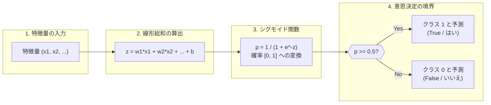

# Day 16: ロジスティック回帰（分類）

### 🎯 学習目標
- 回帰タスクと分類タスクの根本的な違いを説明できる。
- シグモイド関数がどのようにして任意の実数を 0 から 1 の範囲の確率値にマッピングするかを説明できる。
- Scikit-Learn の `LogisticRegression` を使用して二値分類モデルの構築と訓練ができる。
- クラスの予測確率を取得し、任意の判定閾値を適用できる。
- 分類精度（Accuracy）指標を計算し、解釈できる。

### 🧩 中核概念（なぜ）
これまでのレッスンでは、線形回帰を使用して連続的な数値（価格など）を予測してきました。しかし、現実世界の多くの問題では、**カテゴリ**や**不連続なラベル**を予測する必要があります。これが**分類（Classification）**タスクです：
- メールが迷惑メール（1）か通常メール（0）かを予測する。
- 腫瘍が悪性（1）か良性（0）かを診断する。
- 取引が不正（1）か正当（0）かを分類する。

二値分類（ラベル 0 と 1）に通常の線形回帰を使おうとすると、予測値が $[0, 1]$ の範囲を外れてしまうほか、外れ値に対して非常に敏感に影響を受けてしまいます。

**ロジスティック回帰（Logistic Regression）**はこの問題を解決します。名前に「回帰」という言葉が入っていますが、実際は分類アルゴリズムです。まず線形方程式のスコア（$z = w x + b$）を計算し、そのスコアを**シグモイド関数（Sigmoid function）**に通します。シグモイド関数は出力を 0 から 1 の範囲に収めるため、その結果を「クラス 1 に属する**確率**」として解釈することができます。

### 🔁 ロジックと動作
ロジスティック回帰のフローでは、入力特徴量を処理し、線形総和を算出し、それをシグモイド曲線で確率に変換し、判定閾値と比較して最終的なクラスの予測を行います。



#### シグモイド関数
シグモイド関数（またはロジスティック曲線）は数学的に次のように定義されます：

$$\sigma(z) = \frac{1}{1 + e^{-z}}$$

- $z$ が非常に大きい正の数の場合、$e^{-z}$ は 0 に近づくため、$\sigma(z)$ は 1 に近づきます。
- $z$ が非常に小さい負の数の場合、$e^{-z}$ は極めて大きな数になるため、$\sigma(z)$ は 0 に近づきます。
- $z = 0$ のとき、$\sigma(z) = 0.5$ となります。

#### 判定閾値
デフォルトでは、Scikit-Learn は予測確率 $p \ge 0.5$ のサンプルをクラス 1 に、$p < 0.5$ のサンプルをクラス 0 に分類します。

### 📝 注釈付きサンプル
以下は、分類データセットを作成し、ロジスティック回帰モデルを訓練し、クラスラベルを予測し、予測確率を取得する方法です。
```python
import numpy as np
from sklearn.linear_model import LogisticRegression
from sklearn.metrics import accuracy_score

# 1. 分類データの準備（2つの特徴量、二値のターゲットラベル）
# 特徴量: 勉強時間、睡眠時間
X = np.array([
    [1.0, 5.0], [1.5, 6.0], [2.0, 5.5],  # クラス 0: 試験に不合格
    [5.0, 7.0], [6.0, 8.0], [5.5, 7.5]   # クラス 1: 試験に合格
])
y = np.array([0, 0, 0, 1, 1, 1])

# 2. 分類モデルのインスタンス化と適合（学習）
model = LogisticRegression()
model.fit(X, y)

# 3. クラスラベルの予測（出力は 0 または 1）
class_predictions = model.predict(X)
print("予測されたクラスラベル:", class_predictions) # 出力: [0 0 0 1 1 1]

# 4. 確率の予測（クラス 0 とクラス 1 それぞれの確率を返します）
probabilities = model.predict_proba(X)
print("\n予測確率 (クラス0の確率, クラス1の確率):\n", probabilities)
# 1列目がクラス0である確率、2列目がクラス1である確率を示します

# 5. 精度指標 (Accuracy) によるモデルの評価
accuracy = accuracy_score(y, class_predictions)
print(f"\nモデルの分類精度 (Accuracy): {accuracy * 100:.2f}%") # 100.00% (線形分離可能なため)
```

### ❌ よくある間違い

**間違い 1: 精度（Accuracy）の計算時に predict() と predict_proba() を混同する**
```python
from sklearn.metrics import accuracy_score
preds_proba = model.predict_proba(X)
acc = accuracy_score(y, preds_proba)
```
```text
ValueError: Classification metrics can't handle a mix of binary and continuous-multioutput targets
```
```python
preds = model.predict(X) # 予測クラスラベルを使用します
acc = accuracy_score(y, preds)
```
> `predict()` はクラスラベル（0 または 1）を出力するのに対し、`predict_proba()` は各クラスに対する連続値の確率を出力します。`accuracy_score` はクラスラベルを必要とします。

**間違い 2: 単一サンプルの予測時に predict() に 1 次元配列を渡してしまう**
```python
# 特徴量: [勉強時間, 睡眠時間]
prediction = model.predict([2.5, 6.0])
```
```text
ValueError: Expected 2D array, got 1D array instead:
array=[2.5 6. ].
Reshape your data either using array.reshape(1, -1) if it contains a single sample or array.reshape(-1, 1) if it contains a single feature.
```
```python
prediction = model.predict([[2.5, 6.0]]) # 入れ子のリストにして2次元配列にします
```
> Scikit-Learn の推定器は、特徴量を `(n_samples, n_features)` の形状の 2 次元配列で渡す必要があります。1件だけの予測であっても、2次元のリスト `[[...]]` として渡してください。

**間違い 3: 回帰係数（傾き）を直接 float 値として取り出そうとする**
```python
weight = model.coef_ # これを単一の float の重みとして使おうとする
```
```text
（エラーは発生しませんが、model.coef_ は (1, n_features) の形状の 2 次元配列であるため、その後の数学計算で次元のエラーを引き起こす可能性があります）
```
```python
weight_for_feature_0 = model.coef_[0][0]
```
> 二値分類であっても、Scikit-Learn は多クラス分類や複数特徴量をサポートするように設計されているため、`model.coef_` は常に 2 次元配列として返されます。

### 💡 コツ・イディオム
- **予測確率の解釈**: `model.predict_proba(X)` は `(n_samples, 2)` の形状の配列を返します。0列目はクラス0である確率、1列目はクラス1である確率に対応します。どのサンプル `i` においても、`prob[i, 0] + prob[i, 1] == 1.0` となります。
- **カスタム閾値の適用**: より慎重な判定が必要なアプリケーション（例：希少な疾患の予測など）では、クラス1である確率が0.3以上であれば陽性と判定したい場合があります。これは手動で実装できます：
  ```python
  prob_class_1 = model.predict_proba(X)[:, 1]
  custom_preds = (prob_class_1 >= 0.3).astype(int)
  ```
- **線形分離可能なデータ**: クラスが直線で完全に分割できる場合、演習にあるように、擬似データに対する精度は 1.0 になります。

### 🧠 深掘り（内部の仕組み）
<details><summary>対数損失 (Log Loss) / 二値交差エントロピー損失関数（クリックで展開）</summary>

線形回帰では、平均二乗誤差（MSE）を最小化することでパラメータを最適化しました。しかし、ロジスティック回帰において非線形なシグモイド関数を MSE 損失関数に代入すると、その関数は**非凸関数（Non-convex）**になってしまいます。これは損失の曲面に多くの局所的最小値（ローカルミニマ）が存在することを意味し、標準的な勾配降下法が途中でスタックしてしまいます。

これを解決するために、凸関数であり、誤った予測に対して指数関数的なペナルティを与える**対数損失（Log Loss）**（または**二値交差エントロピー損失**）を使用します：

$$J(w, b) = -\frac{1}{n} \sum_{i=1}^{n} \left[ y_i \log(\hat{y}_i) + (1 - y_i) \log(1 - \hat{y}_i) \right]$$

ここで：
- $y_i$ は実際の二値ラベル（0 または 1）です。
- $\hat{y}_i$ はサンプルがクラス 1 に属する予測確率です（シグモイド関数から計算されます）。

#### なぜうまく機能するのか？
- 実際のクラス $y_i = 1$ の場合：右側の項 $(1 - y_i) \log(1 - \hat{y}_i)$ は 0 になり、損失は $-\log(\hat{y}_i)$ になります。予測確率 $\hat{y}_i \to 1$ となると、損失は $-\log(1) = 0$ に近づきます。逆に $\hat{y}_i \to 0$ となると、損失は $-\log(0) \to \infty$ に近づきます。
- 実際のクラス $y_i = 0$ の場合：左側の項が 0 になり、損失は $-\log(1 - \hat{y}_i)$ になります。予測確率 $\hat{y}_i \to 0$ となると損失は 0 に近づき、$\hat{y}_i \to 1$ となると損失は $\infty$ に近づきます。

この損失関数は、モデルが自信満々に間違った予測（例：実際のラベルが 0 なのに確率 0.99 で 1 と予測する）をした場合に、モデルに極めて大きなペナルティを課します。
</details>

### 🏋️ 演習
データ `X` とラベル `y` を使用して Scikit-Learn の `LogisticRegression` モデルを学習させ、同じデータ `X` に対してラベルを予測し、その分類精度（Accuracy）を計算して返す関数 `classify_logistic(X, y)` を完成させてください。

```python
import numpy as np
from sklearn.linear_model import LogisticRegression
from sklearn.metrics import accuracy_score

def classify_logistic(X, y):
    # 1. データ X とラベル y を使用して LogisticRegression モデルを学習（適合）させます
    # 2. 同じデータ X に対してラベルを予測します
    # 3. 分類精度（Accuracy）を計算して返します
    accuracy = 0.0
    return accuracy
```

### ✅ 自己チェック
1. 正しいか誤りか：ロジスティック回帰は、連続的な数値変数の予測に使用される。
2. サンプルに対して計算された線形スコア（$z$）がちょうど $0.0$ であるとき、シグモイド関数から出力される予測確率（$p$）はいくつですか？
<details><summary>解答</summary>

1. **誤り**。名前に「回帰」と付いていますが、ロジスティック回帰は分類タスク（不連続なクラスラベルの予測）に使用されます。
2. 予測確率はちょうど **0.5** になります（$\sigma(0) = \frac{1}{1 + e^{0}} = \frac{1}{1 + 1} = 0.5$）。
</details>

### 📌 まとめ
- **分類**は、連続する数値ではなく、不連続なクラスラベルを予測します。
- **ロジスティック回帰**は、線形方程式の出力を**シグモイド関数**に通すことで、0 から 1 の間の確率値を出力します。
- **シグモイド関数**は $\sigma(z) = \frac{1}{1 + e^{-z}}$ と定義されます。
- Scikit-Learn はデフォルトで **0.5** の判定閾値を使用して、確率をクラス 0 と 1 にマッピングします。
- **分類精度 (Accuracy)** は、正しく予測されたラベルの割合を測定します。
