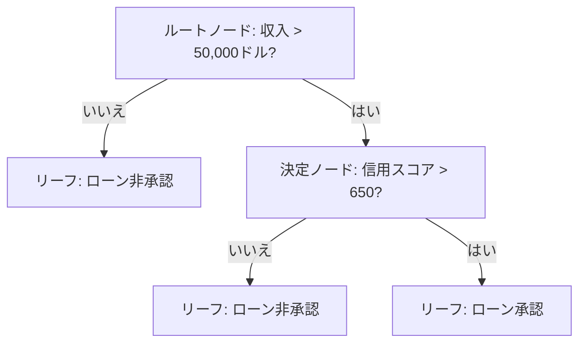

# Day 17: 決定木とランダムフォレスト

### 🎯 学習目標
- ルートノード、内部ノード、ブランチ、リーフノードを含む決定木の構造を理解する。
- 分割の指標としてのジニ不純度（Gini Impurity）とエントロピー（Entropy）の違いを説明できる。
- アンサンブル学習の概念と、ランダムフォレストが単一の決定木をどのように改善するかを理解する。
- Scikit-Learn を使用して決定木分類器を訓練・評価する。
- 訓練された木モデルから特徴量の重要度（Feature Importances）を取得し解釈する。

### 🧩 中核概念（なぜ）
人間が意思決定を行うとき、多くの場合、「はい/いいえ」で答えられる一連の質問を繰り返します。例えば、「雨は降っているか？ はい → 傘を持つ。いいえ → 晴れているか？ はい → サングラスをかける」といった具合です。
**決定木（Decision Tree）**は、このような論理的なフローチャートの構造を模倣して、データの分類や値の予測を行う機械学習モデルです。

#### 主な構造要素:
1. **ルートノード（Root Node）**: データセット全体を表す最上部のノード。ある特徴量に基づいて2つ以上の均質なセットに分割されます。
2. **決定ノード（Decision Node / Internal Node）**: 特徴量に基づく判断によってデータが分割される中間のノード。
3. **ブランチ（Branches）**: 判断の経路（例: はい/いいえ）を表すノード間のリンク。
4. **リーフノード（Leaf Node）**: これ以上分割されない最終的な末端ノード。予測された出力クラスや値を含みます。

#### 分割基準の決定: ジニ不純度 vs エントロピー
木を構築する際、*どの特徴量*の*どの閾値*でデータを分割するのが最適かを決める必要があります。分割後の子ノードができるだけ「純粋」（ほぼ単一のクラスだけで構成されている状態）になるようにします。この純度を測定するために、以下の指標が使われます。
- **ジニ不純度（Gini Impurity）**: サブセットからランダムに選んだ要素に、そのサブセット内のラベル分布に従ってランダムにラベルを割り当てたとき、誤って分類される確率を表します。ジニ不全度が `0` のとき、ノードは完全に純粋（すべての要素が1つのクラスに属する）です。
- **エントロピー（Entropy / 情報獲得）**: 情報理論に由来する指標で、データ内の乱雑さや不確実性の度合いを測定します。分割後のエントロピーの減少量を「情報獲得（Information Gain）」と呼びます。

#### アンサンブル学習とランダムフォレスト
単一の決定木は**過学習（Overfitting）**を起こしやすいという弱点があります。訓練データのノイズまで学習してしまい、新しいデータに対する予測性能（汎化性能）が低下します。
この問題を解決するために、**ランダムフォレスト（Random Forest）**という手法が用いられます。これは**アンサンブル学習（Ensemble Learning）**と呼ばれる分類に属し、複数の決定木（フォレスト＝森）を構築して予測を行います。
- **バギング（Bagging / Bootstrap Aggregating）**: 重複を許してデータをランダムにサンプリングし、木ごとに異なるデータで訓練します。
- **特徴量のランダム選択（Feature Randomness）**: 分割の際にすべての特徴量から選ぶのではなく、ランダムに選択された一部の特徴量候補の中から最適な分割を選びます。
最終的な予測は、すべての木による多数決（分類の場合）または平均（回帰の場合）によって決定されます。

### 🔁 ロジックと動作
以下は、収入と信用スコアに基づいてローンの申請を承認するかどうかを決定するシンプルな決定木の論理構造です。



### 📝 注釈付きサンプル
Scikit-Learn を使って、合成データセットで決定木分類器を訓練し、予測を行い、各特徴量の重要度を確認してみましょう。

```python
import numpy as np
from sklearn.tree import DecisionTreeClassifier

# 1. 合成データセットの準備
# 特徴量: [収入（千ドル単位）, 信用スコア]
X = np.array([
    [45, 600],
    [55, 700],
    [30, 580],
    [80, 640],
    [70, 720],
    [90, 680]
])
# ラベル: 0 (非承認), 1 (承認)
y = np.array([0, 1, 0, 0, 1, 1])

# 2. DecisionTreeClassifier の初期化
# max_depth=3 を指定して、木が無限に成長して過学習するのを防ぎます
# random_state=42 を指定して分割の再現性を確保します
model = DecisionTreeClassifier(max_depth=3, random_state=42)

# 3. モデルを訓練データに適合（学習）
model.fit(X, y)

# 4. 新しい申請者のクラスを予測
# 新しい申請者: 収入=60,000ドル, 信用スコア=660
new_applicant = np.array([[60, 660]])
prediction = model.predict(new_applicant)
print("予測値 (0=非承認, 1=承認):", prediction[0]) # 出力: 1

# 5. 特徴量の重要度の確認
# 分割を構築する際に各特徴量がどれだけ役立ったかを示します
for name, importance in zip(["収入", "信用スコア"], model.feature_importances_):
    print(f"特徴量: {name}, 重要度: {importance:.4f}")
```

### ❌ よくある間違い

**間違い 1: 数値化されていないカテゴリカルなテキスト特徴量を直接適合させようとする**
```python
from sklearn.tree import DecisionTreeClassifier
import numpy as np
X = np.array([['Low'], ['High'], ['Low']])
y = np.array([0, 1, 0])
model = DecisionTreeClassifier()
model.fit(X, y)
```
```text
ValueError: could not convert string to float: 'Low'
```
```python
from sklearn.tree import DecisionTreeClassifier
import numpy as np
# 正しい: テキストカテゴリを数値表現にエンコードする
X = np.array([[0], [1], [0]]) # 0 = Low, 1 = High
y = np.array([0, 1, 0])
model = DecisionTreeClassifier()
model.fit(X, y)
```
> Scikit-Learn のモデルはすべての入力特徴量が数値であることを求めています。カテゴリカルなテキスト変数は、訓練前に数値にエンコード（ワンホットエンコーディングやラベルエンコーディングなど）する必要があります。

**間違い 2: 1次元の特徴量配列で予測を要求する**
```python
from sklearn.tree import DecisionTreeClassifier
import numpy as np
X = np.array([[1, 2], [3, 4]])
y = np.array([0, 1])
model = DecisionTreeClassifier()
model.fit(X, y)
model.predict([1, 2])
```
```text
ValueError: Expected 2D array, got 1D array instead:
array=[1 2].
Reshape your data either using array.reshape(-1, 1) if your data has a single feature or array.reshape(1, -1) if it contains a single sample.
```
```python
from sklearn.tree import DecisionTreeClassifier
import numpy as np
X = np.array([[1, 2], [3, 4]])
y = np.array([0, 1])
model = DecisionTreeClassifier()
model.fit(X, y)
model.predict([[1, 2]]) # 2次元のリスト/配列として渡す
```
> Scikit-Learn の予測メソッドは、たとえ1つのサンプルに対する予測であっても、`(サンプル数, 特徴量数)` の形状を持つ2次元配列を期待します。

### 💡 コツ・イディオム
- **`max_depth` による正則化**: 制限のない決定木は、すべてのリーフが純粋になるまで分割を続け、過学習する複雑な境界を作ります。常に `max_depth` や `min_samples_leaf` を設定してモデルの汎化性能を保ちましょう。
- **特徴量の重要度**: `model.feature_importances_` を確認することで、どの変数が予測に最も寄与しているかを特定できます。重要度の合計は 1 になります。
- **木の可視化**: Scikit-Learn は `sklearn.tree.plot_tree(model)` を提供しており、matplotlib を使って分割、閾値、リーフの内容を視覚的に表示できます。

### 🧠 深掘り（内部の仕組み）
<details><summary>ジニ不純度とエントロピーの数学的公式（クリックで展開）</summary>

#### ジニ不純度（Gini Impurity）
$C$ 個の異なるクラスのサンプルを含むノードにおいて、クラス $i$ に属するサンプルの確率（割合）を $p_i$ とします。ジニ不純度 $I_G(p)$ は次のように定義されます。

$$I_G(p) = 1 - \sum_{i=1}^{C} p_i^2$$

- **完全に純粋なノード**: すべてのサンプルが1つのクラスに属する場合（例: $p_1 = 1$, その他は $0$）、ジニ不純度は $I_G = 1 - 1^2 = 0$ となります。
- **均等な分布**: 2クラス分類でデータが均等に分かれている場合（$p_1 = 0.5, p_2 = 0.5$）、$I_G = 1 - (0.5^2 + 0.5^2) = 0.5$ となります。これは2クラス分類におけるジニ不純度の最大値です。

#### エントロピー（Entropy）
エントロピー $H(p)$ は、ノードのクラス分布における乱雑さや不確実性の平均的な度合いを測定します。

$$H(p) = - \sum_{i=1}^{C} p_i \log_2(p_i)$$

ただし、$p_i = 0$ の場合は $0 \log_2(0) = 0$ と定義します。
- **完全に純粋なノード**: すべてのサンプルが1つのクラスに属する場合（$p_1 = 1$）、$H = - (1 \log_2 1) = 0$ となります。
- **均等な分布**: 2クラス分類でデータが均等に分かれている場合（$p_1 = 0.5, p_2 = 0.5$）、$H = - (0.5 \log_2 0.5 + 0.5 \log_2 0.5) = 1.0$ となります。これは2クラス分類におけるエントロピー의 最大値です。

決定木の構築アルゴリズムは、分割後の子ノードの不純度の加重平均が最小になる（あるいはエントロピーが最も減少する＝情報獲得が最大になる）分割を探索します。
</details>

### 🏋️ 演習
関数 `train_tree(X, y)` を完成させ、最大深度 3 の決定木分類器を構築し、特徴量 `X` とラベル `y` で訓練して、訓練済みモデルを返してください。

```python
import numpy as np
from sklearn.tree import DecisionTreeClassifier

def train_tree(X, y):
    # 1. max_depth=3, random_state=42 を指定して DecisionTreeClassifier インスタンスを作成する
    # 2. 特徴量 X とラベル y に分類器を適合させる
    # 3. 訓練済みモデルを返す
    model = None
    return model
```

### ✅ 自己チェック
1. より大きな `max_depth` を設定した場合、決定木の訓練データでの精度とテストデータでの精度にどのような影響を与えますか？
2. ランダムフォレストにおいて、個々の決定木同士の相関を低く（独立に）保つために使用される2つの主な技術は何ですか？
<details><summary>解答</summary>

1. `max_depth` を大きくすると、木はより複雑なパターンを捉えることができるため、訓練データでの精度は向上します。しかし、深くなりすぎるとノイズまで学習して過学習を起こし、テストデータでの精度は低下します。
2. 個々の決定木を独立にするために、**バギング**（重複を許したランダムなデータサンプリング）と**特徴量のランダム選択**（分割時の特徴量のサブセット選択）の2つを使用します。
</details>

### 📌 まとめ
- **決定木**は、特徴量に基づいてデータを再帰的に分割し、ターゲットが類似したデータ同士のグループを作ります。
- 最適な分割は、リーフの純度を最大化するために**ジニ不純度**または**エントロピー**を用いて評価されます。
- **ランダムフォレスト**は、過学習を減らすために、バギングと特徴量のランダム選択を用いて複数の決定木を組み合わせたアンサンブル学習モデルです。
- モデルを正則化して汎化性能を向上させるために、`max_depth` などで木の成長を制限します。
