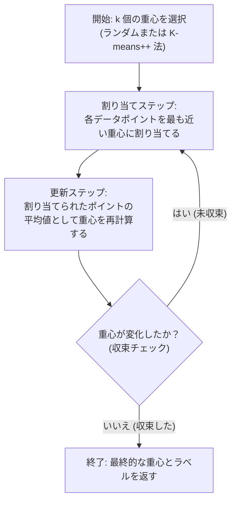

# Day 18: K-meansクラスタリング

### 🎯 学習目標
- 教師あり学習と教師なし学習の違いを説明できる。
- K-means クラスタリングアルゴリズムの反復的なステップを説明できる。
- Scikit-Learn を使用して K-means クラスタリングモデルを訓練する。
- クラスタの重心（Centroids）とラベル（Labels）を取得し解釈する。
- 特徴量スケーリング（前処理）の重要性を理解し、エルボー法（Elbow Method）を用いて適切なクラスタ数を選択する。

### 🧩 中核概念（なぜ）
これまでに学習した機械学習アルゴリズム（線形回帰や決定木など）は、モデルの訓練を導くための明示的なターゲットやラベル（$y$）がデータセットに含まれている「教師あり学習」でした。
しかし、現実世界の多くの状況では、ラベルが存在しないデータも多くあります。例えば、購買履歴データはあるが、事前に定義された顧客カテゴリがないといった場合です。私たちの目的は、データに隠されたパターンやグループを自然に発見することです。これを**教師なし学習（Unsupervised Learning）**と呼びます。

**クラスタリング（Clustering）**は最も一般的な教師なし学習タスクであり、**K-means**は最も広く使用されているクラスタリングアルゴリズムです。これは、データセットを重複のない $k$ 個の異なるグループ（クラスタ）に分割します。

#### K-means の反復プロセス:
このアルゴリズムは、以下の3つの基本ステップを繰り返すことでクラスタを見つけます。
1. **初期化（Initialization）**: 特徴空間内にクラスタの重心（中心点）となる初期点 $k$ 個を選択します。
2. **割り当て（Assignment Step）**: 各データポイントを最も近い重心に割り当てます（通常はユークリッド距離に基づいて計算します）。
3. **更新（Update Step）**: 現在そのクラスタに割り当てられているすべてのデータポイントの平均（平均位置）を計算し、各クラスタの新しい重心とします。
重心の位置がほとんど変化しなくなる（収束する）か、最大反復回数に達するまで、ステップ2と3を繰り返します。

### 🔁 ロジックと動作
以下は、K-means 訓練における反復的な最適化ループを表すフローチャートです。



### 📝 注釈付きサンプル
Scikit-Learn を使用して、2次元の合成データセットで K-means モデルを訓練し、学習されたクラスタ割り当てとクラスタの中心点を抽出してみましょう。

```python
import numpy as np
from sklearn.cluster import KMeans

# 1. 2次元合成データセットの準備
# 明確に3つのグループを形成するデータポイント
X = np.array([
    [1.0, 2.0], [1.5, 1.8], [1.2, 2.2], # グループ 1
    [8.0, 8.0], [8.5, 8.2], [9.0, 8.5], # グループ 2
    [1.0, 8.0], [1.2, 7.8], [0.8, 8.2]  # グループ 3
])

# 2. KMeans のインスタンス化
# n_clusters=3 を指定して、3つの異なるクラスタを予測します
# n_init='auto' を指定して、アルゴリズムが異なるシード値で実行する回数を自動決定させます
# random_state=42 を指定して再現性を確保します
kmeans = KMeans(n_clusters=3, n_init='auto', random_state=42)

# 3. モデルをデータに適合（教師なしのためラベル y は渡さない）
kmeans.fit(X)

# 4. 訓練データポイントのクラスタ割り当て（ラベル）を取得
labels = kmeans.labels_
print("クラスタラベル:", labels) # 出力: 各グループに対応する 0, 1, 2 の配列

# 5. 3つのクラスタ重心の座標を取得
centroids = kmeans.cluster_centers_
print("重心座標:\n", centroids)

# 6. 新しいデータポイントのクラスタを予測
new_point = np.array([[2.0, 2.0]])
predicted_cluster = kmeans.predict(new_point)
print("[2.0, 2.0] の予測クラスタ:", predicted_cluster[0])
```

### ❌ よくある間違い

**間違い 1: KMeans の fit メソッドに1次元配列を渡す**
```python
from sklearn.cluster import KMeans
import numpy as np
X = np.array([1.2, 2.3, 8.9, 9.5])
kmeans = KMeans(n_clusters=2, n_init='auto', random_state=42)
kmeans.fit(X)
```
```text
ValueError: Expected 2D array, got 1D array instead:
array=[1.2 2.3 8.9 9.5].
Reshape your data either using array.reshape(-1, 1) if your data has a single feature or array.reshape(1, -1) if it contains a single sample.
```
```python
from sklearn.cluster import KMeans
import numpy as np
# 正しい: 列ベクトルの2次元配列に変換する
X = np.array([[1.2], [2.3], [8.9], [9.5]])
kmeans = KMeans(n_clusters=2, n_init='auto', random_state=42)
kmeans.fit(X)
```
> 教師なしのクラスタリングモデルであっても、Scikit-Learn の推定器は特徴量行列 X が2次元であることを要求します。特徴量が1つだけの場合でも同様です。

**間違い 2: 訓練データと異なる特徴量数を持つテストデータで予測を行う**
```python
from sklearn.cluster import KMeans
import numpy as np
X = np.array([[1, 2], [2, 3], [8, 8], [9, 9]])
kmeans = KMeans(n_clusters=2, n_init='auto', random_state=42)
kmeans.fit(X)
kmeans.predict([[1]])
```
```text
ValueError: X has 1 features, but KMeans is expecting 2 features as input.
```
```python
from sklearn.cluster import KMeans
import numpy as np
X = np.array([[1, 2], [2, 3], [8, 8], [9, 9]])
kmeans = KMeans(n_clusters=2, n_init='auto', random_state=42)
kmeans.fit(X)
kmeans.predict([[1, 2]]) # 正確に 2 つの特徴量を渡す
```
> `predict()` や `transform()` に渡すテストデータの次元数（特徴量の列数）は、モデルの訓練（`fit`）時に使用したデータの次元数と完全に一致している必要があります。

### 💡 コツ・イディオム
- **エルボー法（Elbow Method）**: 適切なクラスタ数 $k$ をどのように選択すればよいでしょうか？ クラスタ数 $k$（例: 1から10）を変えながら、モデルの**慣性（Inertia）**（各サンプルから最も近い重心までの距離の2乗和、`kmeans.inertia_` から取得可能）をプロットします。慣性の減少率が急激に緩やかになるポイント（「エルボー（肘）」のような形状をなす部分）が、通常は最適なクラスタ数です。
- **特徴量のスケーリング**: K-means はユークリッド距離に依存してクラスタを決定するため、特徴量のスケールに対して非常に敏感です。1つの特徴量の範囲が 0〜1 で、もう1つの特徴量の範囲が 0〜1,000,000 である場合、2つ目の特徴量が距離計算を支配してしまいます。訓練前に必ず特徴量を標準化（例: `StandardScaler` の使用）してください。
- **n_init パラメータ**: K-means は初期重心の選択によって、局所最適な悪い解（局所解）に陥ることがあります。`n_init` を設定すると、異なる初期重心でアルゴリズムを複数回実行し、最も慣性の小さい最適な結果を出力します。

### 🧠 深掘り（内部の仕組み）
<details><summary>K-means++ の初期化メカニズム（クリックで展開）</summary>

標準的な K-means アルゴリズムでは、初期重心をランダムに選択します。もし2つの初期重心が同じ自然なグループ内の非常に近い位置に選ばれてしまうと、アルゴリズムが局所最適解に収束し、クラスタリングの品質が低下する可能性があります。

この問題を解決するため、Scikit-Learn ではデフォルトで **K-means++** 初期化法が使用されます。K-means++ アルゴリズムは、以下の確率的なステップを通じて、互いに離れた初期重心を選択します。

1. **最初の重心**: データセット $X$ から一様ランダムに最初の重心 $c_1$ を選択します。
2. **距離の計算**: 各データポイント $x_i$ について、これまでに選択された中で最も近い重心までのユークリッド距離 $D(x_i)$ を計算します。
3. **次の重心の選択**: 次の重心 $c_j$ を、データポイント $x_i$ から距離の2乗に比例する確率で選択します。
   
   $$P(x_i) = \frac{D(x_i)^2}{\sum_{y \in X} D(y)^2}$$
   
   このステップにより、既存の重心から遠く離れた位置にあるデータポイントが、新しい重心として選択されやすくなります。
4. **反復**: 重心が $k$ 個選ばれるまで、ステップ2と3を繰り返します。

この賢い初期化方法により、訓練時間が大幅に短縮され、より堅牢で高品質なクラスタリング結果が得られることが数学的・実験的に示されています。
</details>

### 🏋️ 演習
関数 `cluster_kmeans(X, k)` を完成させ、クラスタ数 `k`、`n_init='auto'`、および `random_state=42` を指定して Scikit-Learn の `KMeans` モデルを作成してください。データ `X` にモデルを適合させ、訓練されたクラスタの重心を返してください。

```python
import numpy as np
from sklearn.cluster import KMeans

def cluster_kmeans(X, k):
    # 1. クラスタ数 k、n_init='auto'、random_state=42 を指定して KMeans インスタンスを作成する
    # 2. データ X に KMeans モデルを適合させる
    # 3. クラスタの重心（cluster_centers_）を返す
    centers = None
    return centers
```

### ✅ 自己チェック
1. なぜ K-means クラスタリングを適用する前に特徴量のスケーリングを行うことが重要なのですか？
2. 訓練済みの `KMeans` インスタンスの `inertia_` 属性にはどのような指標が格納され、それはどのように活用されますか？
<details><summary>解答</summary>

1. K-means はクラスタの割り当てにユークリッド距離を使用するためです。特徴量のスケールが大きく異なると、スケールの大きい特徴量が距離計算を支配してしまい、スケールの小さい特徴量が無視されてしまいます。スケーリングにより、すべての特徴量が均等に寄与するようになります。
2. `inertia_` には、各サンプルから最も近い重心までの距離の2乗和（誤差平方和: SSE）が格納されます。クラスタ数 $k$ の変化に対する `inertia_` の値をプロットし、「エルボー」ポイントを見つけることで、データに適した最適なクラスタ数を決定できます。
</details>

### 📌 まとめ
- **教師なし学習**は、基礎となるパターンを発見するために、ターゲットラベル（$y$）を持たないデータをモデル化します。
- **K-means クラスタリング**は、データポイントを最も近い重心に割り当て、クラスタ内の平均に基づいて重心を再計算するプロセスを反復します。
- 距離測定が特徴量のスケールに強く影響を受けるため、K-means を適用する前に特徴量を標準化する必要があります。
- Scikit-Learn でデフォルトで採用されている **K-means++** 初期化法を使用することで、互いに離れた初期重心を選択し、局所解に陥るのを防ぎます。
