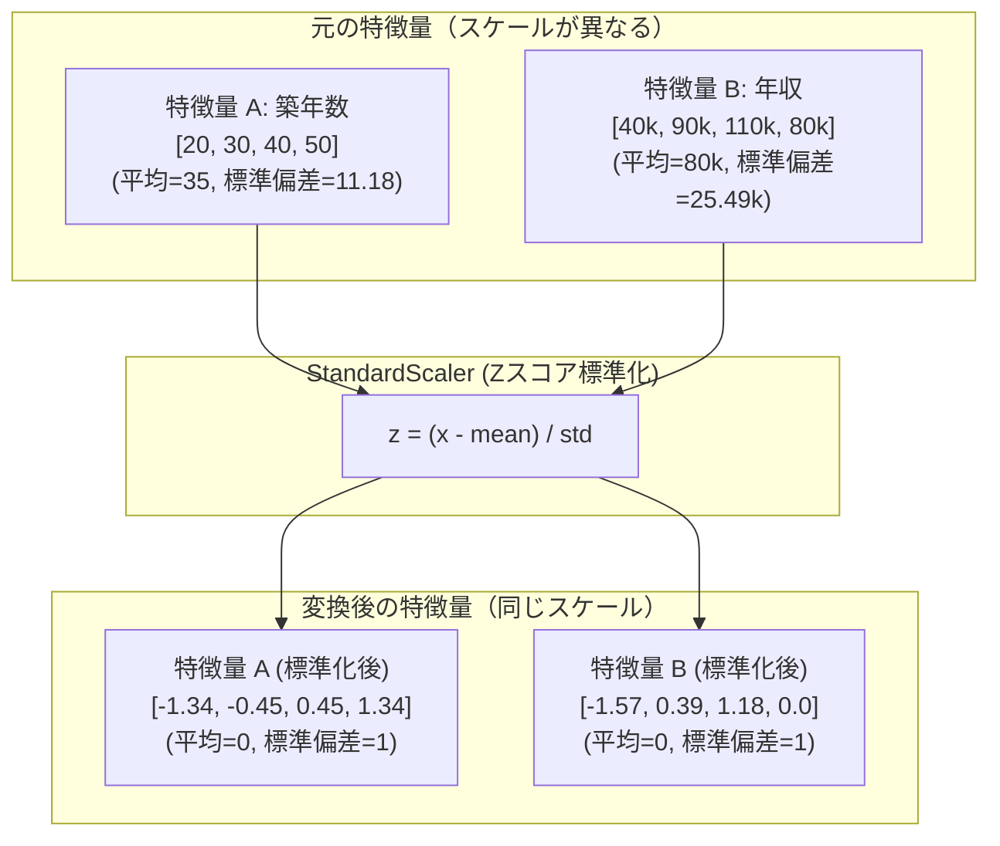

# Day 19: 特徴量のスケーリングと前処理

### 🎯 学習目標
- 距離に敏感なアルゴリズムや勾配降下法最適化において、なぜ特徴量のスケーリングが必要なのかを説明できる。
- 標準化（Zスコア標準化）と正規化（Min-Maxスケーリング）の違いを理解する。
- Scikit-Learn の `StandardScaler` を用いて特徴量スケーリングを実装できる。
- 訓練データとテストデータで適合（fit）と変換（transform）の工程を正しく分離し、データリークを防ぐ。

### 🧩 中核概念（なぜ）
機械学習において、データセットには全く異なる単位やスケールで測定された特徴量が含まれることがよくあります。例えば、住宅データセットに `築年数`（0〜50年）と `価格`（100,000〜1,000,000ドル）がある場合です。

これらの生のデータをそのまま機械学習モデルに入力すると、主に次の2つの問題が発生します。
1. **距離の支配**: データ点間の空間的距離を計算するアルゴリズム（K-Means、K近傍法（KNN）、サポートベクターマシン（SVM）など）は、値の範囲が大きい特徴量に大きく影響されます。価格の 100,000 ドルの差は、築年数の 10 年の差を完全に圧倒してしまいます。
2. **勾配降下法の収束の遅れ**: 勾配降下法を使用する最適化アルゴリズム（線形回帰、ロジスティック回帰、ニューラルネットワークなど）は、コスト関数の最小値を見つけるまでに非常に時間がかかります。これは、コスト関数の等高線が引き伸ばされた楕円状になり、パラメータ更新のステップが激しく振動するためです。

これを解決するために、元のデータの分布や情報特性を損なうことなく、すべての数値特徴量を同様の範囲に揃える**特徴量スケーリング（Feature Scaling）**を行います。

主に以下の2つの手法があります。
- **標準化（Standardization / Zスコア標準化）**: 平均（$\mu$）が 0、標準偏差（$\sigma$）が 1 になるようにスケールします。データが正規分布に従っていると仮定するアルゴリズムに適しており、外れ値の影響を受けにくい特徴があります。
- **正規化（Normalization / Min-Maxスケーリング）**: 特徴量を通常 0 から 1 の固定範囲に変換します。値の境界を固定したい場合に有用ですが、外れ値に非常に敏感であるという欠点があります。

### 🔁 ロジックと動作
標準化処理は、任意の生のデータ分布を標準正規分布へとマッピングします。



### 📝 注釈付きサンプル
Scikit-Learn の `StandardScaler` を使用して特徴量を標準化する方法は次のとおりです。

```python
import numpy as np
from sklearn.preprocessing import StandardScaler

# 1. 生のデータを用意する: 4サンプル、2特徴量 (年齢, 年収)
X = np.array([
    [25.0, 50000.0],
    [35.0, 75000.0],
    [45.0, 110000.0],
    [20.0, 45000.0]
])

# 2. StandardScaler のインスタンスを作成
scaler = StandardScaler()

# 3. 適合 (平均と標準偏差の計算) と変換 (スケーリング式の適用) を同時に実行
X_scaled = scaler.fit_transform(X)

print("標準化された特徴量:\n", X_scaled)
# 各列の平均は 0、標準偏差は 1 になります。
print("特徴量の平均値:", np.round(X_scaled.mean(axis=0), 2)) # [0. 0.]
print("特徴量の標準偏差:", np.round(X_scaled.std(axis=0), 2))   # [1. 1.]

# 4. 新しいデータに対しては、すでに学習したパラメータで変換のみを実行
new_data = np.array([[30.0, 60000.0]])
new_data_scaled = scaler.transform(new_data)
print("新しいデータの変換後:", new_data_scaled)
```

### ❌ よくある間違い

**間違い 1: スケーラーの適合（fit）前に変換（transform）を呼び出す**
```python
from sklearn.preprocessing import StandardScaler
scaler = StandardScaler()
X_scaled = scaler.transform(X)
```
```text
sklearn.exceptions.NotFittedError: This StandardScaler instance is not fitted yet. Call 'fit' with appropriate arguments before using this estimator.
```
```python
from sklearn.preprocessing import StandardScaler
scaler = StandardScaler()
X_scaled = scaler.fit_transform(X)
```
> スケーラーを適用する前に、まず `fit()` または `fit_transform()` を呼び出して、特徴量の平均と標準偏差を計算させておく必要があります。

**間違い 2: 1次元配列をスケーラーに渡す**
```python
import numpy as np
from sklearn.preprocessing import StandardScaler
X = np.array([1.0, 2.0, 3.0, 4.0])
scaler = StandardScaler()
X_scaled = scaler.fit_transform(X)
```
```text
ValueError: Expected 2D array, got 1D array instead:
array=[1. 2. 3. 4.].
Reshape your data either using array.reshape(-1, 1) if your data has a single feature or array.reshape(1, -1) if it contains a single sample.
```
```python
import numpy as np
from sklearn.preprocessing import StandardScaler
X = np.array([[1.0], [2.0], [3.0], [4.0]])
scaler = StandardScaler()
X_scaled = scaler.fit_transform(X)
```
> Scikit-Learn の変換器は、入力 `X` が `(サンプル数, 特徴量数)` の形状を持つ2次元配列であることを期待します。単一の特徴量であっても、2次元の列ベクトルに整形する必要があります。

**間違い 3: テストデータに対してスケーラーを新しく適合させる（データリーク）**
```python
from sklearn.preprocessing import StandardScaler
scaler = StandardScaler()
X_train_scaled = scaler.fit_transform(X_train)
X_test_scaled = scaler.fit_transform(X_test)
```
```text
(論理エラー: テストデータ独自の統計情報でスケールされてしまい、訓練データから学習した情報との整合性が取れなくなり、モデル評価が不正確になります)
```
```python
from sklearn.preprocessing import StandardScaler
scaler = StandardScaler()
X_train_scaled = scaler.fit_transform(X_train)
X_test_scaled = scaler.transform(X_test)
```
> テストデータや未知の予測データは、訓練データから計算された平均と標準偏差「のみ」を使用して変換する必要があります。テストデータで適合（fit）を行うと、データリーク（Data Leakage）が発生します。

### 💡 コツ・イディオム
- **ターゲット（目的変数）はスケールしない**: 一般的な分類や回帰では、ターゲット（$y$）をスケールする必要はありません。予測値の解釈が難しくなるためです。
- **逆変換 (Inverse Transform)**: 標準化されたデータを元のスケールに戻すには、`scaler.inverse_transform(X_scaled)` を使用します。
- **Pipeline の活用**: 実際の開発では、Scikit-Learn の `Pipeline` を使用して、スケーラーと推定器を一つにまとめると、適合・変換の処理を自動的かつ安全に行うことができます。

### 🧠 深掘り（内部の仕組み）
<details><summary>StandardScaler と MinMaxScaler の数学的公式（クリックで展開）</summary>

#### StandardScaler（標準化）
特徴量 $x$ の標準化値 $z$ は次のように計算されます。

$$z = \frac{x - \mu}{\sigma}$$

ここで、
- $\mu$ は特徴量の平均値: $\mu = \frac{1}{n} \sum_{i=1}^n x_i$
- $\sigma$ は特徴量の標準偏差: $\sigma = \sqrt{\frac{1}{n} \sum_{i=1}^n (x_i - \mu)^2}$

これにより、特徴量の分布は平均が 0、分散が 1 に変換されます。値の範囲自体には上限や下限はありません。

#### MinMaxScaler（正規化）
特徴量 $x$ の正規化値 $x_{norm}$ は次のように計算されます。

$$x_{norm} = \frac{x - x_{min}}{x_{max} - x_{min}} \cdot (\text{max} - \text{min}) + \text{min}$$

デフォルトでは、特徴量は $[0, 1]$ の範囲にマッピングされます。

$$x_{norm} = \frac{x - x_{min}}{x_{max} - x_{min}}$$

データに外れ値が含まれている場合（例: ほとんどの値が 10 付近であるのに対し、1件だけ 1000 がある場合）、$x_{max}$ が極端に大きくなり、外れ値以外の値がすべて非常に狭い範囲（例: 0.0〜0.01 の間）に圧縮されてしまい、特徴量の差異が失われます。そのため、外れ値が存在するデータには、標準偏差に基づく標準化（StandardScaler）のほうがより頑健（ロバスト）です。
</details>

### 🏋️ 演習
関数 `scale_features(X)` を完成させて、Scikit-Learn の `StandardScaler` を作成し、特徴量行列 `X` に適合させ、データを変換して、スケーリングされた NumPy 配列を返してください。

```python
import numpy as np
from sklearn.preprocessing import StandardScaler

def scale_features(X):
    # 1. StandardScaler インスタンスを作成する
    # 2. 特徴量 X にスケーラーを適合（fit）させ、変換（transform）する
    # 3. スケーリングされた特徴量配列を返す
    scaled_X = None
    return scaled_X
```

### ✅ 自己チェック
1. 特徴量配列 `[[1.0], [3.0], [5.0]]` に対して `StandardScaler` を適合させたとき、スケーリング後の配列の平均値はどうなりますか？
2. 極端な外れ値が含まれるデータに対して `MinMaxScaler` を使用する際の主な欠点は何ですか？
<details><summary>解答</summary>

1. スケーリング後の特徴量の平均値は正確に `0.0` になり、標準偏差は `1.0` になります。
2. 外れ値によって最小値や最大値が極端な値に引っ張られるため、他の大半のデータが非常に狭い範囲に圧縮され、データ内の有効なばらつき（情報）が失われてしまうことです。
</details>

### 📌 まとめ
- **特徴量のスケーリング**は、大スケールの特徴量が距離計算を支配するのを防ぎ、最適化アルゴリズム（勾配降下法）の収束を高速化させます。
- **標準化** (`StandardScaler`) は、特徴量の平均を 0、標準偏差を 1 に揃えます。
- **正規化** (`MinMaxScaler`) は、特徴量を一定範囲（通常 0〜1）に収めますが、外れ値に弱いです。
- **データリーク**を防ぐため、必ず訓練セットで `fit_transform` を行い、テストセットや新規データには `transform` のみを適用します。
