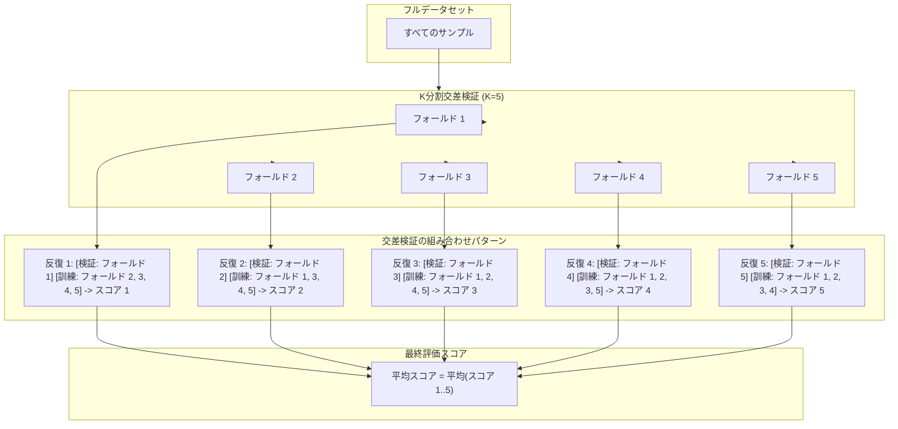

# Day 20: ハイパーパラメータ調整

### 🎯 学習目標
- モデルパラメータ（訓練中に学習される値）とハイパーパラメータ（訓練前に設定される値）の違いを説明できる。
- $K$分割交差検証（$K$-fold Cross Validation）の概念と、それがモデル選択における過学習をどのように防ぐかを説明できる。
- Scikit-Learn の `GridSearchCV` を使用して、最適なハイパーパラメータの網羅的探索を実装できる。
- 探索結果を解釈し、最良のパラメータや最良モデルを取得できる。

### 🧩 中核概念（なぜ）
機械学習モデルを訓練する際、2種類の設定を扱います。
1. **モデルパラメータ (Model Parameters)**: 訓練データからモデル自身が学習する値。例えば、回帰モデルやニューラルネットワークの重み（$w$）やバイアス（$b$）など。
2. **ハイパーパラメータ (Hyperparameters)**: モデルの学習プロセスを制御するために、訓練*前*に人間が手動で設定する値。例えば、ランダムフォレストの決定木の数、勾配降下法の学習率、決定木の最大深度（`max_depth`）など。

適切なハイパーパラメータを選択しないと、モデルはうまく機能しません。モデルが単純すぎてパターンを捉えられない「過小適合（Underfitting）」や、訓練データのノイズまで過剰に暗記してしまう「過剰適合（Overfitting）」が起きるためです。

最適な設定はどうやって見つけるのでしょうか？ テストデータに対して何度も異なる設定を試すことはできません。それをすると、テストデータが設定選択に影響を与え、「データリーク（Data Leakage）」が発生して正しいモデル評価ができなくなるからです。

そこで、次の2つの技術を組み合わせて使用します。
- **K分割交差検証 (K-Fold Cross-Validation)**: 訓練データを $K$ 個の等しいグループ（「フォールド」）に分割します。そして、毎回 1 つのフォールドを評価用（検証用）に残し、残りの $K-1$ 個のフォールドでモデルを訓練する、という処理を計 $K$ 回繰り返します。最終的な性能は $K$ 回のスコアの平均として算出されます。これにより、すべてのデータが一度は訓練と検証の両方に使われるため、非常に信頼性の高いモデル性能の見積もりが可能になります。
- **グリッドサーチ (Grid Search)**: 探索したいハイパーパラメータの値のリスト（格子状の組み合わせ）をあらかじめ定義します。アルゴリズムは、交差検証を利用しながら、これらすべての組み合わせを順に評価し、最も高い性能を示したパラメータのセットを見つけ出します。

### 🔁 ロジックと動作
以下の図は、$K$分割交差検証の仕組みを示しており、データの各フォールドがどのように順繰りに検証用として使われ、最終的な平均スコアが計算されるかを視覚化しています。



### 📝 注釈付きサンプル
`GridSearchCV` を使用して決定木のハイパーパラメータを調整する方法は次のとおりです。

```python
import numpy as np
from sklearn.tree import DecisionTreeClassifier
from sklearn.model_selection import GridSearchCV

# 1. サンプルデータを用意する（二値分類タスク）
X = np.array([[1, 2], [2, 3], [1, 1], [10, 12], [11, 13], [12, 10]])
y = np.array([0, 0, 0, 1, 1, 1])

# 2. ベースとなるモデルオブジェクトを作成
dt = DecisionTreeClassifier(random_state=42)

# 3. 探索するハイパーパラメータの組み合わせ（キーはモデルの引数名と一致させる）
param_grid = {
    'max_depth': [2, 4, 6],
    'criterion': ['gini', 'entropy']
}

# 4. GridSearchCV のインスタンスを作成
# cv=3 は3分割の交差検証を意味し、scoring で評価指標を指定する
grid_search = GridSearchCV(estimator=dt, param_grid=param_grid, cv=3, scoring='accuracy')

# 5. グリッドサーチの実行 (すべての組み合わせでモデルを訓練し評価する)
grid_search.fit(X, y)

# 6. 最適な組み合わせの抽出
print("最高のパラメータ:", grid_search.best_params_)
# 出力例: {'criterion': 'gini', 'max_depth': 2}

print("最高のスコア (交差検証の平均正解率):", grid_search.best_score_)
# 出力例: 1.0

# 7. 最適なモデルオブジェクト自体を直接取得
best_model = grid_search.best_estimator_
print("最適モデルによる予測:", best_model.predict([[5, 5]]))
```

### ❌ よくある間違い

**間違い 1: パラメータグリッドにリスト以外の値を直接渡す**
```python
from sklearn.model_selection import GridSearchCV
from sklearn.tree import DecisionTreeClassifier
param_grid = {'max_depth': 4} # リストではなく整数をそのまま指定
grid = GridSearchCV(DecisionTreeClassifier(), param_grid, cv=3)
```
```text
ValueError: Parameter values for parameter (max_depth) need to be a sequence(list, ndarray, etc.) or a distribution. OrderedDict([('max_depth', 4)]) was passed.
```
```python
from sklearn.model_selection import GridSearchCV
from sklearn.tree import DecisionTreeClassifier
param_grid = {'max_depth': [4]} # リスト（シーケンス）に包んで指定する
grid = GridSearchCV(DecisionTreeClassifier(), param_grid, cv=3)
```
> パラメータグリッドの値は、たとえ単一の値しか試さない場合であっても、リストや NumPy 配列などのイテレータ（シーケンス）である必要があります。

**間違い 2: モデルの適合（fit）前に最適パラメータにアクセスしようとする**
```python
from sklearn.model_selection import GridSearchCV
from sklearn.tree import DecisionTreeClassifier
grid = GridSearchCV(DecisionTreeClassifier(), {'max_depth': [2, 4]}, cv=3)
best = grid.best_params_
```
```text
AttributeError: 'GridSearchCV' object has no attribute 'best_params_'
```
```python
from sklearn.model_selection import GridSearchCV
from sklearn.tree import DecisionTreeClassifier
grid = GridSearchCV(DecisionTreeClassifier(), {'max_depth': [2, 4]}, cv=3)
grid.fit(X, y)
best = grid.best_params_
```
> `best_params_` などの属性は、`fit()` メソッドを呼び出して探索処理が実際に完了した後にのみ生成されます。

**間違い 3: 不正な評価指標名（Scorer名）を指定する**
```python
from sklearn.model_selection import GridSearchCV
from sklearn.tree import DecisionTreeClassifier
grid = GridSearchCV(DecisionTreeClassifier(), {'max_depth': [2, 4]}, scoring='acc')
grid.fit(X, y)
```
```text
ValueError: 'acc' is not a valid scoring value. Use sorted(sklearn.metrics.SCORERS.keys()) to get valid options.
```
```python
from sklearn.model_selection import GridSearchCV
from sklearn.tree import DecisionTreeClassifier
grid = GridSearchCV(DecisionTreeClassifier(), {'max_depth': [2, 4]}, scoring='accuracy')
grid.fit(X, y)
```
> Scikit-Learn は評価用の指標名を特定の厳密な文字列で判別しています。分類の正解率（Accuracy）を指定する場合は、`'acc'` ではなく、フルネームの `'accuracy'` を指定しなければなりません。

### 💡 コツ・イディオム
- **組み合わせの爆発に注意**: グリッドサーチはすべての組み合わせを評価します。パラメータAで5個、パラメータBで5個、パラメータCで4個の値を指定し、交差検証の分割数が `cv=5` の場合、訓練されるモデル数は $5 \times 5 \times 4 \times 5 = 500$ 回になります。探索候補は絞り込みましょう！
- **並列処理の有効化**: `GridSearchCV` の引数に `n_jobs=-1` を設定すると、マシンのすべての CPU コアを利用して各モデルの訓練を並列実行し、処理時間を大幅に短縮できます。
- **自動再学習機能 (Refit)**: `GridSearchCV` はデフォルトで、最適なパラメータを特定した後、全訓練データを使ってそのモデルを再学習させます。そのため、サーチ完了後の `grid_search` オブジェクトに対して直接 `.predict()` を呼び出すことができます。

### 🧠 深掘り（内部の仕組み）
<details><summary>グリッドサーチ vs. ランダムサーチの比較（クリックで展開）</summary>

パラメータの探索空間が広い場合、すべての組み合わせを試すグリッドサーチは膨大な時間を要します。その代替として、指定した確率分布からパラメータをランダムに指定回数サンプリングする**ランダムサーチ** (`RandomizedSearchCV`) が広く使われます。

それぞれの特徴比較は以下の通りです。

| 特徴 | グリッドサーチ (`GridSearchCV`) | ランダムサーチ (`RandomizedSearchCV`) |
| :--- | :--- | :--- |
| **探索手法** | 指定された全組み合わせを網羅的に検証。 | 指定した回数分だけ、ランダムに組み合わせを抽出して検証。 |
| **計算コスト** | パラメータ数が増えるにつれて指数関数的に増大する。 | 設定した `n_iter`（試行回数）によって実行時間を制御可能。 |
| **解の解像度** | 定めた格子点上のみ。細かい最適値を見落とす可能性あり。 | 連続的な分布からサンプリングするため、格子点の間にある値も発見可能。 |
| **用途** | 探索範囲が狭い場合（目安として合計 100 通り未満）。 | 探索範囲が非常に広い場合や、初期の大まかな探索段階。 |

例えば、学習率を調整する際、グリッドサーチは `[0.001, 0.01, 0.1]` のように検証します。一方、ランダムサーチは `0.001` から `0.1` の対数一様分布からランダムにサンプリングするため、`0.054` のような中間の最適値を引き当てる可能性があります。
</details>

### 🏋️ 演習
関数 `tune_parameters(X, y)` を完成させて、`random_state=42` を設定した決定木分類器 (`DecisionTreeClassifier`) を作成し、`max_depth` の候補 `[2, 4, 6]` を探索するパラメータグリッドを定義してください。次に、3分割の交差検証 (`cv=3`) と正解率基準 (`'accuracy'`) を使用した `GridSearchCV` を作成してデータ `X`, `y` に適合させ、最終的に最適なパラメータの辞書を返してください。

```python
import numpy as np
from sklearn.tree import DecisionTreeClassifier
from sklearn.model_selection import GridSearchCV

def tune_parameters(X, y):
    # 1. random_state=42 を指定して DecisionTreeClassifier インスタンスを作成する
    # 2. 'max_depth': [2, 4, 6] を含む param_grid を定義する
    # 3. cv=3、scoring='accuracy' を指定して GridSearchCV インスタンスを作成する
    # 4. データ X と y に対して GridSearchCV モデルを適合（fit）させる
    # 5. 最適なパラメータの辞書（best_params_）を返す
    best_params = None
    return best_params
```

### ✅ 自己チェック
1. パラメータグリッドに `max_depth` で 3 通り、`criterion` で 2 通りのパラメータを設定し、`cv=5`（5分割交差検証）で探索を実行した場合、決定木モデルは合計で何回訓練されますか？
2. 適合済みの `GridSearchCV` オブジェクトから、学習済みの最適モデル自体を取得するにはどの属性を使用しますか？
<details><summary>解答</summary>

1. $3 \times 2 \times 5 = 30$ 回訓練されます。
2. `.best_estimator_` 属性を使用します。
</details>

### 📌 まとめ
- **パラメータ**はモデルがデータから学習するものであり、**ハイパーパラメータ**は学習プロセスを制御するために訓練前にあらかじめ設定するものです。
- **K分割交差検証**は、データを $K$ 個に分割し、検証用フォールドを循環させることで、過学習を防ぎつつ高精度にモデル性能を見積もります。
- **グリッドサーチ** (`GridSearchCV`) は、指定した組み合わせ候補すべてに対して交差検証を行い、最適な設定を特定します。
- サーチ終了後は、`.best_params_` で最適なパラメータの辞書を、`.best_estimator_` で訓練済みの最適モデルをそれぞれ取得できます。
