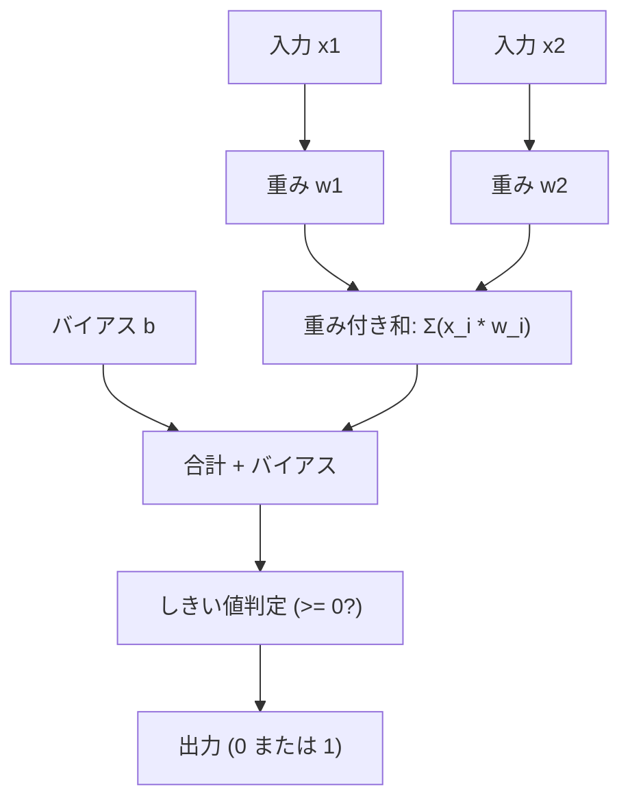

# Day 21: ニューラルネットワーク入門とパーセプトロン

### 🎯 学習目標
- 人工ニューロンおよびパーセプトロンモデルの生物学的な着想について説明できる。
- 入力、重み、バイアス、および活性化関数（しきい値処理）の役割を説明できる。
- NumPyのベクトル化演算を使用して、単層パーセプトロンを実装できる。
- パーセプトロンモデルを用いて基本的な論理ゲート（AND、OR）を構築できる。

### 🧩 中核概念（なぜ）
現代のディープラーニングの中心にあるのは**人工ニューロン**です。私たちの脳内にある生物学的なニューロンが電気信号を受け取り、それを処理して発火するかどうかを決定するのと同じように、人工ニューロンは数値入力を受け取り、それを処理して出力を生成します。

**パーセプトロン**は、1958年にフランク・ローゼンブラットによって提案された、最も単純かつ最古の人工ニューロンの形式です。
なぜパーセプトロンを学ぶ必要があるのでしょうか？
1. **ディープラーニングの基礎**: 多層パーセプトロン（MLP）は、現代のディープニューラルネットワークの構成要素です。それらを積み重ねる前に、単一ユニットの仕組みを理解することが不可欠です。
2. **二値分類**: 線形境界を使用してデータを2つのクラスに分割するという概念を導入します。
3. **パラメータ学習**: 機械学習モデルがパラメータ（重みとバイアス）を使用して入力を出力にマッピングする方法を示します。

### 🔁 ロジックと動作
パーセプトロンは、以下の3つの主要なステップを通じて入力を処理します。
1. **重み付き和**: 各入力 $x_i$ に対応する重み $w_i$ を掛け合わせ、それらを合計します。この合計に**バイアス** ($b$) を加えます。バイアスは、活性化関数のしきい値をシフトさせる役割を持ちます。
   $$z = \sum_{i=1}^{n} x_i w_i + b = \mathbf{w} \cdot \mathbf{x} + b$$
2. **しきい値処理 / 活性化**: 重み付き和 $z$ が0以上の場合は出力が1（ニューロンが発火）になり、それ以外の場合は出力が0になります。
   $$\hat{y} = \begin{cases} 1 & \text{if } z \geq 0 \\ 0 & \text{if } z < 0 \end{cases}$$

パーセプトロンのデータの流れは以下のようになります。



### 📝 注釈付きサンプル
以下は、基本的なパーセプトロンの実装と、論理演算（AND、OR）のモデル化の例です。
```python
import numpy as np

# 1. 入力特徴量を定義（例: ANDゲートの入力）
inputs = np.array([1, 0])

# 2. ANDゲート用の重みとバイアスを定義
# 出力を1にするには、両方の入力が1である必要があります。合計値がしきい値を超える必要があります。
weights_and = np.array([1.0, 1.0])
bias_and = -1.5

# 3. NumPyのドット積を使用して重み付き和を計算
weighted_sum = np.dot(inputs, weights_and) + bias_and
print("Weighted Sum:", weighted_sum)  # 出力: -0.5

# 4. ステップ活性化関数を適用
output = 1 if weighted_sum >= 0 else 0
print("Perceptron Output:", output)  # 出力: 0 (1 AND 0 として正しい動作)
```

### ❌ よくある間違い

**間違い 1: バイアス項の加算を忘れる**
```python
import numpy as np
x = np.array([0.0, 1.0])
w = np.array([1.0, 1.0])
b = -1.5
# バイアスの加算が抜けている
weighted_sum = np.dot(x, w)
output = 1 if weighted_sum >= 0 else 0
```
```text
AssertionError: Should output 0 for AND logic when input is 0, 1
```
```python
import numpy as np
x = np.array([0.0, 1.0])
w = np.array([1.0, 1.0])
b = -1.5
# 正しくバイアス項を加算する
weighted_sum = np.dot(x, w) + b
output = 1 if weighted_sum >= 0 else 0
```
> バイアスは、決定境界を移動させるために必要です。バイアスがない場合、決定境界は常に原点を通ることになり、パーセプトロンが表現できる能力が大幅に制限されます。

**間違い 2: ベクトル化されたNumPy関数の代わりにループを使用する**
```python
import numpy as np
x = np.array([0.5, 0.8])
w = np.array([0.2, 0.4])
b = -0.1
# ループによる遅いアプローチ
weighted_sum = 0.0
for i in range(len(x)):
    weighted_sum += x[i] * w[i]
weighted_sum += b
```
```text
(エラーは発生しませんが、大規模なデータセットでは非効率的です)
```
```python
import numpy as np
x = np.array([0.5, 0.8])
w = np.array([0.2, 0.4])
b = -0.1
# 効率的なベクトル化アプローチ
weighted_sum = np.dot(x, w) + b
```
> NumPyの `np.dot` は、内部で高度に最適化されたCライブラリを使用しています。大規模なネットワークや入力に対してループを使用すると、深刻なパフォーマンスのボトルネックが発生します。

### 💡 コツ・イディオム
- **ドット積**: 重み付き和の計算には、常に `np.dot(x, w)` または `@` 演算子（例: `x @ w`）を使用することをお勧めします。クリーンで高速です。
- **バイアスの表現**: 高度なニューラルネットワークでは、バイアスは値が常に `1.0` に固定された追加の入力 $x_0$ に対応する重み $w_0$ として扱われることがよくあります。これにより、バイアスを同じドット積の計算に含めることができます。

### 🧠 深掘り（内部の仕組み）
<details><summary>パーセプトロンの歴史と線形分離可能性問題（クリックで展開）</summary>

パーセプトロンは当初、絶大な熱狂を持って迎えられました。ローゼンブラットは、パーセプトロンが間もなく歩き、話し、書くことができるようになると主張しました。しかし、1969年にマービン・ミンスキーとシーモア・パパートが書籍『Perceptrons』を出版し、単層パーセプトロンは**線形分離不可能**な関数を学習できないことを数学的に証明しました。

データセットが線形分離可能であるとは、直線（2次元の場合）、平面（3次元の場合）、または超平面（より高次元の場合）を1本引くだけで、クラスを完全に分割できる状態を指します。

#### XOR問題
単一のパーセプトロンは、AND、OR、NOTなどの論理ゲートは簡単に表現できますが、**XOR（排他的論理和）**ゲートを表現することはできません。
| 入力 1 | 入力 2 | XOR 出力 |
| :--- | :--- | :--- |
| 0 | 0 | 0 |
| 0 | 1 | 1 |
| 1 | 0 | 1 |
| 1 | 1 | 0 |

これらの点をグラフ上にプロットすると、出力が `0` の点と `1` の点を完璧に分ける1本の直線を引くことは不可能であることがわかります。この証明により、ニューラルネットワーク研究への資金提供が途絶える最初の**AIの冬（AI Winter）**が訪れました。この問題は、数年後に解決策が発見されました。複数のパーセプトロンを多層に積み重ね（多層パーセプトロン）、非線形活性化関数を組み合わせることで、非線形な決定境界を解決できるようになりました。
</details>

### 🏋️ 演習
入力 `x` と重み `w` の重み付き和にバイアス `b` を加えた値を計算し、その結果が0以上の場合は `1` を、それ以外の場合は `0` を返す関数 `perceptron(x, w, b)` を完成させてください。

```python
import numpy as np

def perceptron(x, w, b):
    # x: np.ndarray, w: np.ndarray, b: float
    # Calculate weighted sum and return 1 or 0
    return None
```

### ✅ 自己チェック
1. パーセプトロンにおいて、なぜバイアス項が必要なのですか？
2. 単一のパーセプトロンでXOR論理関数を解決することはできますか？その理由も説明してください。
<details><summary>解答</summary>

1. バイアスがない場合、すべての入力が0のとき、重み付き和 $\sum x_i w_i$ は必ず0になります。バイアスを加えることで、活性化のしきい値を0からずらすことができ、入力が0または0付近の場合でもニューロンを発火させることが可能になります。
2. いいえ、XORの出力は線形分離可能ではないためです。単一の直線で $(0,0), (1,1)$ （出力0）のグループと、 $(0,1), (1,0)$ （出力1）のグループを分けることはできません。
</details>

### 📌 まとめ
- **パーセプトロン**は最も単純な人工ニューロンモデルであり、入力の重み付き和にバイアスを加えた値を計算します。
- 重み付き和は、数学的に $z = \mathbf{w} \cdot \mathbf{x} + b$ と定式化されます。
- パーセプトロンの活性化関数はステップ関数であり、 $z \geq 0$ の場合は1を、それ以外の場合は0を返します。
- 単一のパーセプトロンは**線形分離可能**な問題しか解決できないため、XOR問題を解くことはできません。
