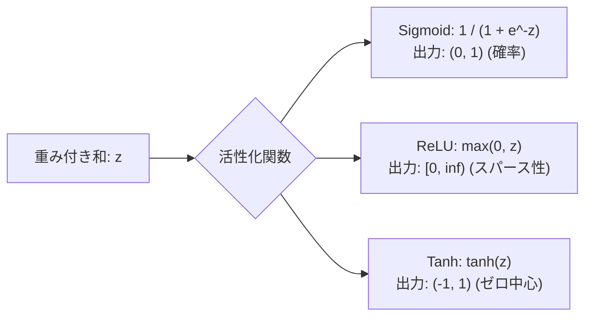

# Day 22: 活性化関数

### 🎯 学習目標
- なぜ非線形活性化関数がディープニューラルネットワークにとって不可欠なのかを説明できる。
- Sigmoid、ReLU、Tanhの数学的定義、出力範囲、および特徴を説明できる。
- 勾配消失問題（Vanishing Gradient）と、ReLUがそれをどのように解決するかを理解できる。
- NumPyを使用して、これらの活性化関数のベクトル化されたバージョンを実装できる。

### 🧩 中核概念（なぜ）
もし入力に重みを掛けてバイアスを加えることしかしない場合、ニューラルネットワークは単なる線形変換の連続のままです。複数の線形層を重ね合わせた合成関数は、数学的には単一の線形層と等価です。
$$y = w_2(w_1 x + b_1) + b_2 = (w_2 w_1)x + (w_2 b_1 + b_2) = Wx + B$$

**非線形活性化関数**がなければ、たとえ1,000層重ねたニューラルネットワークであっても、単層の線形モデルと同じ表現力しか持ちません。画像、テキスト、あるいはXORゲートのような複雑な非線形関係を学習することはできません。

活性化関数は非線形性を導入することで、ニューラルネットワークをほぼすべての複雑なマッピングを近似できる**万能関数近似器（Universal Function Approximator）**にします。

### 🔁 ロジックと動作
ディープラーニングにおける最も基本的な3つの活性化関数は以下の通りです。
1. **Sigmoid（シグモイド）**: 入力を $(0, 1)$ の範囲にマッピングします。出力が確率を表す二値分類の出力層で役立ちます。
2. **Tanh（双曲線正接）**: 入力を $(-1, 1)$ の範囲にマッピングします。出力値が0を中心に対称（ゼロ中心）となるため、最適化が容易になります。
3. **ReLU（整流線形ユニット）**: 負の入力を $0$ にマッピングし、正の入力はそのままの値（ $x$ ）を出力します。計算が非常に単純で、勾配消失を防ぐことができます。

重み付き和 $z$ が異なる活性化関数によってどのように変換されるかを以下に示します。



### 📝 注釈付きサンプル
NumPyを使用して、Sigmoid、ReLU、およびTanhの出力を計算し、その出力範囲を確認してみましょう。
```python
import numpy as np

# 負の値、ゼロ、正の値を含むサンプル配列
z = np.array([-3.0, -1.0, 0.0, 1.0, 3.0])

# 1. Sigmoidの実装
# 値を0から1の間に収めます。0未満の値は0.5未満になり、0より大きい値は0.5より大きくなります。
sigmoid_outputs = 1 / (1 + np.exp(-z))
print("Sigmoid:", sigmoid_outputs)
# 出力: [0.047 0.268 0.5   0.731 0.952]

# 2. Tanhの実装
# 値を-1から1の間に収めます。ゼロは正確に0.0になります。
tanh_outputs = np.tanh(z)
print("Tanh:", tanh_outputs)
# 出力: [-0.995 -0.761  0.     0.761  0.995]

# 3. ReLUの実装
# 負の値を0に置き換え、正の値はそのまま維持します。
relu_outputs = np.maximum(0, z)
print("ReLU:", relu_outputs)
# 出力: [0. 0. 0. 1. 3.]
```

### ❌ よくある間違い

**間違い 1: np.expの代わりにmath.expを使用してSigmoidを実装する**
```python
import math
import numpy as np
def sigmoid(x):
    # xがNumPy配列の場合にエラーになります
    return 1 / (1 + math.exp(-x))

x = np.array([-1.0, 0.0, 2.0])
print(sigmoid(x))
```
```text
TypeError: only size-1 arrays can be converted to Python scalars
```
```python
import numpy as np
def sigmoid(x):
    # 正しい: np.expは配列の要素ごとの演算（ベクトル化）をサポートしています
    return 1 / (1 + np.exp(-x))

x = np.array([-1.0, 0.0, 2.0])
print(sigmoid(x))
```
> 標準のPython `math` モジュールの関数はスカラー入力に対してのみ機能します。ニューラルネットワークを構築する際は、配列全体を一度に処理するために、NumPyのベクトル化された関数（ `np.exp` など）を使用する必要があります。

**間違い 2: 配列に対して組み込みのmax()を使用してReLUを実装する**
```python
import numpy as np
def relu(x):
    # 要素が複数あるNumPy配列ではエラーになります
    return max(0, x)

x = np.array([-1.0, 0.0, 2.0])
print(relu(x))
```
```text
ValueError: The truth value of an array with more than one element is ambiguous. Use a.any() or a.all()
```
```python
import numpy as np
def relu(x):
    # 正しい: np.maximumはxの各要素と0を比較します
    return np.maximum(0, x)

x = np.array([-1.0, 0.0, 2.0])
print(relu(x))
```
> Python組み込みの `max()` はスカラー値を想定しており、配列を要素ごとに比較することはできません。 `np.maximum(0, x)` は配列全体にわたって要素ごとの最大値演算を行います。

### 💡 コツ・イディオム
- **np.maximum と np.max**: 要素ごとの比較には `np.maximum(a, b)` を使用します。単一の配列の全体での最大値を計算する `np.max()` と混同しないようにしてください。
- **Tanhのゼロ中心性**: Tanhは出力の平均値が0に近いため（ゼロ中心）、ニューラルネットワークの隠れ層においてSigmoidよりも好まれることが多いです。これにより勾配の方向が偏りにくくなり、学習が加速します。

### 🧠 深掘り（内部の仕組み）
<details><summary>数学的導関数と勾配消失問題（クリックで展開）</summary>

トレーニング中、ニューラルネットワークは誤差逆伝播法（Backpropagation）によって学習します。誤差逆伝播法は、微分の**連鎖律（チェインルール）**を使用して、各重みに対する損失の傾き（勾配）を計算します。活性化関数の導関数は、この連鎖律において重要な項となります。

#### 数学的導関数
各関数の導関数（勾配）を確認してみましょう。
- **Sigmoidの導関数**:
  $$\frac{d}{dz}\sigma(z) = \sigma(z)(1 - \sigma(z))$$
  この導関数の取り得る最大値は **0.25** です（ $z = 0$ のとき、 $\sigma(0) = 0.5$ ）。
- **Tanhの導関数**:
  $$\frac{d}{dz}\tanh(z) = 1 - \tanh^2(z)$$
  この導関数の取り得る最大値は **1.0** です（ $z = 0$ のとき、 $\tanh(0) = 0$ ）。
- **ReLUの導関数**:
  $$f'(z) = \begin{cases} 1 & \text{if } z > 0 \\ 0 & \text{if } z < 0 \end{cases}$$

#### 勾配消失問題（Vanishing Gradient）
Sigmoid活性化関数を使用して非常に深いネットワークをトレーニングする場合、逆伝播の過程で導関数が層ごとに掛け合わされます。
$$\text{Gradient} \propto \frac{\partial f_n}{\partial z_n} \cdot \frac{\partial f_{n-1}}{\partial z_{n-1}} \cdots \frac{\partial f_1}{\partial z_1}$$

Sigmoidの導関数は最大でも $0.25$ であるため、 $0.25$ 未満の数値を何回も掛け合わせると、勾配はゼロに向かって指数関数的に減衰（消失）します。
$$(0.25)^5 \approx 0.00097, \quad (0.25)^{10} \approx 0.00000095$$

勾配が初期の層（入力に近い層）に到達する頃には、ほぼゼロになってしまいます。結果として、初期の層の重みが極めて遅くしか更新されなくなり、ネットワーク全体の学習が失敗します。
**ReLU**は、正の入力に対して導関数が正確に $1.0$ となるため、この問題を解決します。活性化されたニューロンを通じて、勾配は縮小されることなく前の層へと伝播していきます。
</details>

### 🏋️ 演習
与えられたNumPy配列 `x` に対して、それぞれの活性化関数の出力を返す関数 `sigmoid(x)`、`relu(x)`、`tanh(x)` を完成させてください。

```python
import numpy as np

def sigmoid(x):
    return None

def relu(x):
    return None

def tanh(x):
    return None
```

### ✅ 自己チェック
1. 出力範囲が $(-1, 1)$ になる活性化関数はどれですか？
2. なぜReLUは勾配消失問題を防止できるのですか？
<details><summary>解答</summary>

1. Tanh（双曲線正接）活性化関数です。
2. ReLUの導関数は、正の入力（ $z > 0$ ）に対して常に正確に $1.0$ となるためです。これにより、何層重ねても、アクティブなニューロンを通過する勾配が減衰することはありません。
</details>

### 📌 まとめ
- **活性化関数**は非線形性を導入し、ニューラルネットワークが複雑な非線形マッピングを学習できるようにします。
- **Sigmoid**は出力を $(0, 1)$ にマッピングし、一般的に二値分類の最終出力層で使用されます。
- **Tanh**は出力を $(-1, 1)$ にマッピングし、ゼロ中心であるため最適化を容易にします。
- **ReLU**は $\max(0, x)$ を出力し、計算効率が高く、勾配消失問題を解決します。
