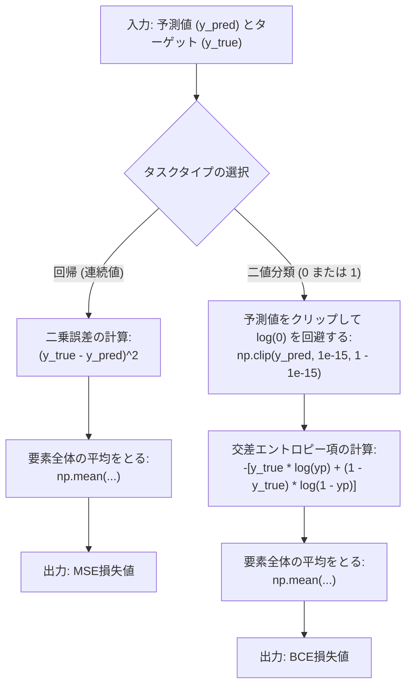
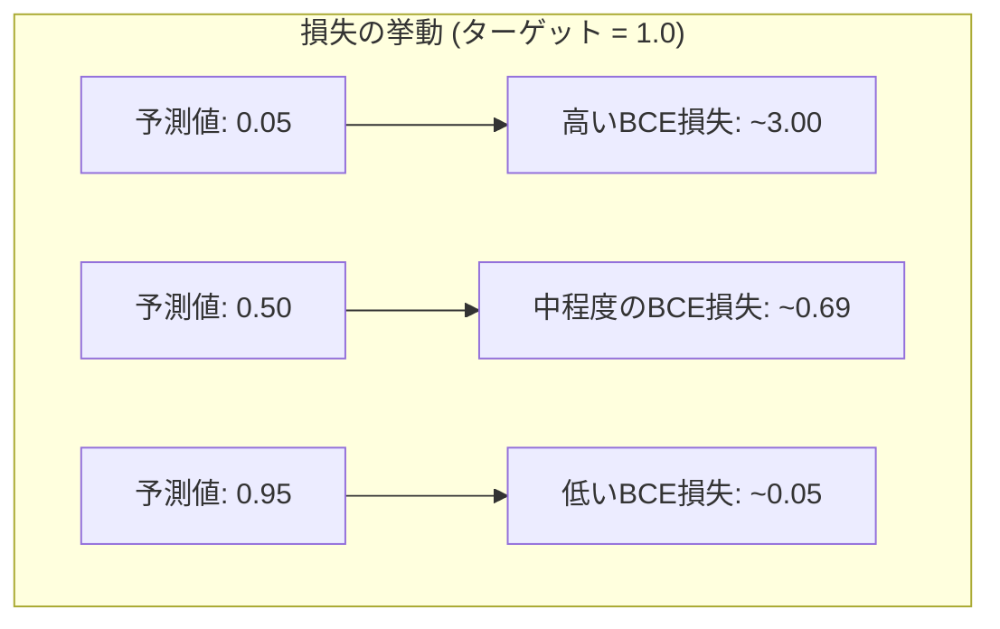

# Day 23: 損失関数

### 🎯 学習目標
- トレーニング中のモデルの誤差を定量化する損失関数の役割を説明できる。
- NumPyを使用して、回帰タスク用の平均二乗誤差（MSE）を実装できる。
- NumPyを使用して、分類タスク用の二値交差エントロピー（BCE）を実装できる。
- クリップ手法を適用して、`log(0)` エラーなどの数値的不安定性を防止できる。
- 予測精度が向上または低下したときに、損失値がどのように変化するかを説明できる。

### 🧩 中核概念（なぜ）
ディープラーニングにおいて、ニューラルネットワークは入力を層に通すことで予測を行います。しかし、これらの予測がどれだけ良いか、あるいは悪いかをどうやって判断すればよいでしょうか？モデルの予測（$\hat{y}$ または $y_{pred}$）と実際のターゲットラベル（$y$ または $y_{true}$）の差を定量化する数学的な指標が必要です。この指標を**損失関数**（誤差関数、またはコスト関数とも呼ばれます）と呼びます。

損失関数がなければ、最適化アルゴリズムは最小化すべき数値的な目標を持てません。適切な損失関数の選択は、機械学習タスクの種類に完全に依存します。
1. **回帰タスク**: 連続的な値（例: 住宅価格、気温）を予測する場合、予測値とターゲットの平均二乗差を測定します。このために**平均二乗誤差（MSE）**を使用します。誤差を二乗することで、小さな誤差よりも大きな乖離をはるかに厳しくペナルティとして課します。
2. **二値分類タスク**: 0から1の間の確率（例: スパム検出、疾患の診断）を予測する場合、予測された確率分布と実際の二値ラベルを比較します。このために**二値交差エントロピー（BCE）**を使用します。自信を持って間違った予測をした場合に、非常に大きなペナルティを課します（予測が間違ったラベルに近づくほど、損失は無限大に近づきます）。

### 🔁 ロジックと動作
以下の図は、MSEとBCEの損失を計算するプロセスを示しています。



また、予測に対して損失値がどのように動作するかを視覚化してみましょう。
- ターゲットが $y_{true} = 1.0$ の場合、予測値 $y_{pred}$ が $1.0$ に近づくにつれて、損失は $0$ に減少します。逆に $0.0$ に近づくにつれて、損失は指数関数的に増加します。



### 📝 注釈付きサンプル
NumPyを使用して両方の損失関数を計算する方法は以下の通りです。

```python
import numpy as np

# --- 1. 平均二乗誤差 (MSE) の例 ---
y_true_reg = np.array([3.0, -0.5, 2.0, 7.0])
y_pred_reg = np.array([2.5,  0.0, 2.0, 8.0])

# ステップごとの分解:
# 差分:             [0.5, -0.5, 0.0, -1.0]
# 二乗差分:         [0.25, 0.25, 0.0, 1.0]
# 二乗差分の平均:   (0.25 + 0.25 + 0.0 + 1.0) / 4 = 0.375
mse = np.mean((y_true_reg - y_pred_reg) ** 2)
print(f"MSE 損失: {mse}")  # 出力: 0.375


# --- 2. 二値交差エントロピー (BCE) の例 ---
y_true_cls = np.array([1, 0, 1])
y_pred_cls = np.array([0.9, 0.1, 0.8])

# log(0) を防ぐために予測値をクリップする
epsilon = 1e-15
y_pred_clipped = np.clip(y_pred_cls, epsilon, 1 - epsilon)

# 要素ごとの交差エントロピー項:
# サンプル 1: -(1 * ln(0.9) + 0 * ln(0.1)) = 0.10536
# サンプル 2: -(0 * ln(0.1) + 1 * ln(0.9)) = 0.10536
# サンプル 3: -(1 * ln(0.8) + 0 * ln(0.2)) = 0.22314
# 平均 BCE: (0.10536 + 0.10536 + 0.22314) / 3 = 0.14462
bce = -np.mean(y_true_cls * np.log(y_pred_clipped) + (1 - y_true_cls) * np.log(1 - y_pred_clipped))
print(f"BCE 損失: {bce}")  # 出力: ~0.14462
```

### ❌ よくある間違い

**間違い 1: BCEでのクリッピングの欠落**
```python
import numpy as np

def bce_unstable(y_true, y_pred):
    # クリッピングせずに直接BCEを計算する
    return -np.mean(y_true * np.log(y_pred) + (1 - y_true) * np.log(1 - y_pred))

yt = np.array([1, 0])
yp = np.array([1.0, 0.0]) # 完璧な予測
print(bce_unstable(yt, yp))
```
```text
RuntimeWarning: divide by zero encountered in log
RuntimeWarning: invalid value encountered in multiply
nan
```
```python
import numpy as np

def bce_stable(y_true, y_pred):
    yp_clipped = np.clip(y_pred, 1e-15, 1 - 1e-15)
    return -np.mean(y_true * np.log(yp_clipped) + (1 - y_true) * np.log(1 - yp_clipped))

yt = np.array([1, 0])
yp = np.array([1.0, 0.0])
print(bce_stable(yt, yp)) # 出力: 9.992007221626415e-16 (実質的に 0)
```
> `y_pred` にちょうど `0.0` または `1.0` が含まれている場合、ゼロの対数を取ると負の無限大になります。NumPyで `0 * -inf` を掛け合わせると `nan` (Not a Number) が返されます。予測値を 0 と 1 に極めて近い値にクリップすることで、この数値的破綻を防ぎます。

**間違い 2: 単一のスカラではなく、要素ごとの差分配列を返す**
```python
import numpy as np

def incorrect_mse(y_true, y_pred):
    # 平均（mean）の計算が漏れている
    return (y_true - y_pred) ** 2

yt = np.array([3.0, 2.0])
yp = np.array([2.0, 2.0])
loss = incorrect_mse(yt, yp)
print(float(loss))
```
```text
TypeError: only size-1 arrays can be converted to Python scalars
```
```python
import numpy as np

def correct_mse(y_true, y_pred):
    return np.mean((y_true - y_pred) ** 2)

yt = np.array([3.0, 2.0])
yp = np.array([2.0, 2.0])
loss = correct_mse(yt, yp)
print(float(loss)) # 出力: 0.5
```
> 最適化アルゴリズムは、パラメータ更新を行うために、トレーニングバッチ全体の総誤差を表す単一のスカラ値を必要とします。誤差の配列をそのまま返すと、後続の計算でエラーになります。

### 💡 コツ・イディオム
- **ベクトル化による高速化**: Pythonの `for` ループは使用せず、常にNumPyのベクトル化された操作（引き算、掛け算、`np.mean` など）を使用してください。NumPyは高度に最適化されたC言語で処理を行うため、処理速度が何倍も速くなります。
- **浮動小数点の比較**: テストを作成する際、浮動小数点の精度の限界があるため、`==` 演算子で結果を比較しないでください。`np.isclose()` または `np.allclose()` を使用して、一定の許容誤差の範囲内で等しいか確認します。
- **厳密な確率の境界**: Sigmoidなどの活性化関数が、BCE損失に渡される前に、出力値が確実に $(0, 1)$ の範囲内にあるようにしてください。

### 🧠 深掘り（内部の仕組み）
<details><summary>数学的定式化と勾配（クリックで展開）</summary>

#### 数学的公式
- **平均二乗誤差（MSE）**:
  $$MSE = \frac{1}{N} \sum_{i=1}^{N} (y_i - \hat{y}_i)^2$$
- **二値交差エントロピー（BCE）**:
  $$BCE = -\frac{1}{N} \sum_{i=1}^{N} \left[ y_i \log(\hat{y}_i) + (1 - y_i) \log(1 - \hat{y}_i) \right]$$

#### 分類にMSEを使用しない理由
1. **数学的根拠**: BCEは、ベルヌーイ分布のもとでの最大尤度推定（MLE）から導出されます。
2. **勾配消失・飽和**: シグモイド活性化関数 $a = \sigma(z)$ を使用した分類に MSE を組み合わせると、勾配に $\sigma'(z) = a(1-a)$ という項が含まれます。予測が自信を持って間違っているとき（$a \to 0$ または $1$）、導関数 $\sigma'(z)$ が 0 に近づき、パラメータの学習が極端に遅くなります（勾配飽和）。
3. **BCEの利点**: BCE損失 $L$ の活性化前入力 $z$ に対する微分は以下のようになります。
   $$\frac{\partial L}{\partial z} = a - y$$
   この式はシンプルで線形であり、飽和しません。モデルの予測が完全に間違っていても、強力な勾配が得られるため、学習が速く進みます。
</details>

### 🏋️ 演習
エディタ内の NumPy を使用して、`mean_squared_error` と `binary_cross_entropy` の実装を完成させてください。

```python
import numpy as np

def mean_squared_error(y_true, y_pred):
    # y_true: np.ndarray, y_pred: np.ndarray
    return None

def binary_cross_entropy(y_true, y_pred):
    # y_true: np.ndarray, y_pred: np.ndarray (0から1の間の確率)
    # np.clip(y_pred, 1e-15, 1 - 1e-15) を使用して y_pred をクリップし、log(0) を回避する
    return None
```

### ✅ 自己チェック
1. ターゲットが `1.0` で、予測確率がちょうど `0.0` の場合、BCEはどのような値を出力しますか？（クリッピング範囲を `1e-15` とする）
2. 絶対誤差だけでなく、MSEで誤差を二乗することが重要なのはなぜですか？
<details><summary>回答の表示</summary>

1. $y_{true} = 1.0$、およびクリップ後の $y_{pred} = 10^{-15}$ の場合、損失項は $-\log(10^{-15}) \approx -(-34.54) = 34.54$ となります。この大きな損失値により、モデルが自信を持って間違った予測を行った場合に厳しいペナルティが課されます。
2. 誤差を二乗することの重要性:
   - 負の符号が消えるため、誤差同士が相殺されなくなります。
   - 小さな誤差に比べて、大きな誤差に対してより厳しいペナルティを課します（例: 誤差が 2 のときのペナルティは 4 ですが、誤差が 4 のときは 16 になります）。これにより、モデルは外れ値の修正を優先するようになります。
</details>

### 📌 まとめ
- **損失関数**は、モデルパラメータの更新をガイドする数学的なフィードバックシステムとして機能します。
- **平均二乗誤差（MSE）**は、連続値を予測する回帰タスクの標準的な指標です。
- **二値交差エントロピー（BCE）**は、二値分類で確率を予測するための標準的な指標です。
- **数値的安定性**: 対数計算を行う際は、ゼロ除算や未定義の出力を避けるために、必ず予測値をクリップしてください。
