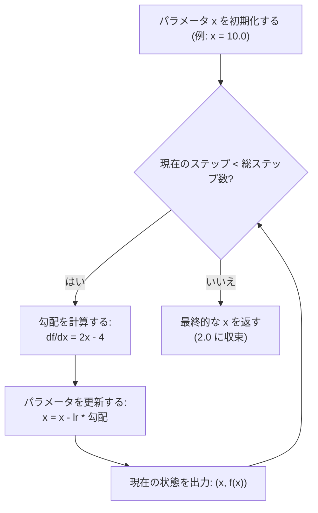
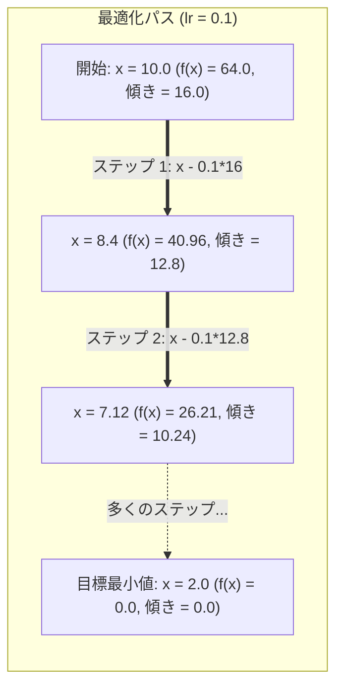

# Day 24: 勾配降下法をゼロから

### 🎯 学習目標
- 最適化における勾配降下法、傾き、および微分の直感的な意味を説明できる。
- 学習率の役割と、それが高すぎる場合または低すぎる場合の影響を説明できる。
- 凸二次関数を下る勾配降下法の最適化パスを視覚化し、追跡できる。
- 数学的関数の最小値を見つけるために、Pythonで基本的な勾配降下法オプティマイザをゼロから実装できる。

### 🧩 中核概念（なぜ）
機械学習やディープラーニングでは、損失関数（MSEやBCEなど）を定義した後、次の課題は、その損失をできるだけ小さくするモデルパラメータ（重みとバイアス）を見つけることです。ニューラルネットワークには数百万個のパラメータが含まれることがあるため、解析的（代数的）に最小値を解くことはできません。その代わりに、**勾配降下法**と呼ばれる反復的な最適化アルゴリズムを使用します。

勾配降下法を理解するために、濃い霧の中の山に立っていると想像してください。あなたの目標は、最も低い谷（最小値）に到達することです。道が見えないため、足元の傾きを確認し、最も急な下り坂の方向に一歩踏み出します。このプロセスを繰り返すことで、最終的に谷底に到達します。

数学的には以下のようになります。
- **微分 / 傾き**: どちらの方向が「上」か「下」かを示します。勾配は最も急な「上り」の方向を指します。最小値を見つけるには、逆の「下り」方向に進む必要があります。
- **学習率（$lr$ または $\eta$）**: 移動のステップサイズです。学習率が小さすぎると、下山に非常に長い時間がかかります。学習率が大きすぎると、最小値を飛び越えて（オーバーシュート）、谷の反対側に跳ね返されてしまう可能性があります。
- **局所最小値（ローカルミニマ）と大域最小値（グローバルミニマ）**: 局所最小値は特定の領域で最も低い点であり、大域最小値は関数全体の中で最も低い点です。

### 🔁 ロジックと動作
以下のフローチャートは、関数 $f(x) = x^2 - 4x + 4$ を最小化するためにパラメータ $x$ を更新する最適化ループを示しています。



これがどのように動作するかをステップバイステップで確認するために、学習率 $lr = 0.1$、初期値 $x_{init} = 10.0$ から開始する最適化パスを追跡してみましょう。$f(x) = x^2 - 4x + 4$ の最小値は $x = 2.0$ にあり、そこでの傾きはちょうど 0 です。



### 📝 注釈付きサンプル
以下は、$f(x) = x^2 - 4x + 4$ を最小化する勾配降下法を実装した Python スクリプトです。

```python
def f(x):
    # 最小化したい数学的関数
    return x**2 - 4*x + 4

def df(x):
    # 関数 f(x) の微分（傾き）
    # d/dx (x^2 - 4x + 4) = 2x - 4
    return 2*x - 4

# 変数の初期化
x = 10.0
learning_rate = 0.1
steps = 10

print(f"開始点: x = {x:.4f}, f(x) = {f(x):.4f}")

# 最適化ループ
for step in range(1, steps + 1):
    gradient = df(x)               # 現在の傾きを計算
    x = x - learning_rate * gradient  # 傾きと逆方向に x を更新
    print(f"ステップ {step:2d}: x = {x:.4f}, f(x) = {f(x):.4f}, 勾配 = {gradient:.4f}")

print(f"最終最適化値: x = {x:.4f}") # 2.0 に極めて近くなります
```

### ❌ よくある間違い

**間違い 1: 勾配を引き算する代わりに足し算してしまう**
```python
def bad_optimizer(x_init, lr, steps):
    x = x_init
    for _ in range(steps):
        grad = 2 * x - 4
        # 間違い: 勾配を足すと、関数値が最大化する方向に移動してしまう
        x = x + lr * grad
    return x

print(bad_optimizer(x_init=3.0, lr=0.1, steps=20))
```
```text
OverflowError: (34) Result too large
```
```python
def good_optimizer(x_init, lr, steps):
    x = x_init
    for _ in range(steps):
        grad = 2 * x - 4
        # 正しい: 勾配を引くことで、最小値に向かって下山する
        x = x - lr * grad
    return x

print(good_optimizer(x_init=3.0, lr=0.1, steps=20)) # 出力: 2.0115
```
> 勾配は最も急な増加方向（上り）を示します。したがって、最も急な減少方向（下り）に移動するためには、勾配を*引く*必要があります。

**間違い 2: ループの外側で勾配を計算してしまう**
```python
def bad_loop(x_init, lr, steps):
    x = x_init
    grad = 2 * x - 4 # 間違い: 勾配が一度しか計算されていない！
    for _ in range(steps):
        x = x - lr * grad
    return x

print(bad_loop(x_init=10.0, lr=0.1, steps=50))
```
```text
# 2.0に収束せず、-70.0を返してテストが失敗する
AssertionError: Gradient descent did not converge to the minimum at x=2.0
```
```python
def good_loop(x_init, lr, steps):
    x = x_init
    for _ in range(steps):
        grad = 2 * x - 4 # 正しい: 更新された x を使って毎ステップ勾配を再計算する
        x = x - lr * grad
    return x

print(good_loop(x_init=10.0, lr=0.1, steps=50)) # 出力: 2.0
```
> パラメータ $x$ の移動に伴い、傾きも変化します。方向と歩幅を調整するために、新しい $x$ の値を使用して毎ステップ勾配を再計算する必要があります。

### 💡 コツ・イディオム
- **学習率の減衰（Decay）**: 最初は大きめの学習率で開始し、徐々に小さくしていくことで、学習初期の進捗を早めつつ、後半に最小値付近で振動するのを防ぐことができます。
- **勾配クリッピング**: ニューラルネットワークでは、勾配が極端に大きくなり、パラメータが `NaN` にオーバーフローすることがあります。勾配にしきい値（例: 最大値 1.0）を設定してクリップすることで、これを防止できます。
- **鞍点（サドルポイント）**: 高次元の最適化（ディープラーニング）では、単純な局所最小値よりも、ある方向では極小だが別の方向では極大となる「鞍点」（傾きがゼロの平坦な領域）が問題になります。これらを脱出するために、MomentumやAdamなどの高度なオプティマイザが使用されます。

### 🧠 深掘り（内部の仕組み）
<details><summary>凸性、収束性、および学習率の限界値（クリックで展開）</summary>

#### 凸最適化と非凸最適化
- **凸関数 (Convex)**: グラフ上の任意の 2 点を結ぶ線分が、グラフの曲線よりも上側（または同じ位置）に位置する関数です。凸関数（$f(x) = x^2 - 4x + 4$ など）は、数学的に大域最小値が 1 つだけ存在することが保証されています。
- **非凸関数 (Non-Convex)**: ニューラルネットワークの損失平面は高度に非凸であり、無数の山、谷、局所最小値、鞍点が存在します。そのため、重みのランダム初期化を行い、異なる開始地点から最適化を試みることが重要になります。

#### 学習率の限界値の数学的証明
二次関数 $f(x)$ について、収束するための学習率の限界値を数学的に求めることができます。
- 更新式: $x_{k+1} = x_k - \eta f'(x_k)$
- 今回の関数では、 $f'(x) = 2x - 4$ です。
- 最小値 ($x^* = 2$) との距離の変化を分析します。
  $$x_{k+1} - 2 = (x_k - \eta(2x_k - 4)) - 2 = x_k - 2\eta x_k + 4\eta - 2 = (1 - 2\eta)(x_k - 2)$$
- 距離が縮まるためには、乗数が以下の条件を満たす必要があります。
  $$|1 - 2\eta| < 1 \implies -1 < 1 - 2\eta < 1 \implies 0 < \eta < 1$$
- **結果**:
  - $\eta = 0.5$ の場合、わずか 1 ステップで完全に最小値に到達します（$1 - 2(0.5) = 0$）。
  - $0 < \eta < 1.0$ の範囲内であれば、正常に収束します。
  - $\eta \ge 1.0$ の場合、値は振動するか、無限大に発散します。
</details>

### 🏋️ 演習
関数 $f(x) = x^2 - 4x + 4$ の最小値を見つけるために、`gradient_descent` 関数を完成させてください。

```python
def gradient_descent(x_init, lr, steps):
    # f(x) = x^2 - 4x + 4 の最小値を見つける
    # df/dx = 2x - 4
    x = x_init
    for _ in range(steps):
        # x を更新する
        pass
    return x
```

### ✅ 自己チェック
1. $x = 2.0$ のとき、関数 $f(x) = x^2 - 4x + 4$ の勾配の値はいくつですか？
2. 学習率を $0.1$ に固定した場合、勾配降下法が最小値に近づくにつれてステップサイズ（更新量）はどう変化しますか？
<details><summary>回答の表示</summary>

1. $x = 2.0$ のとき、勾配は $2(2) - 4 = 0$ です。勾配が 0 であるため、更新式は $x = x - lr \times 0 = x$ となり、パラメータの移動が停止します。これが極値（最小値）です。
2. ステップサイズは徐々に小さくなります。谷の平らな底に近づくにつれて傾き（勾配）が小さくなるため、更新量である $lr \times 勾配$ も自然に小さくなり、滑らかに最小値へと落ち着きます。
</details>

### 📌 まとめ
- **勾配降下法**は、勾配の逆方向にパラメータを移動させることで、関数を最小化する反復アルゴリズムです。
- **勾配**は関数の傾きを表し、局所最小値や大域最小値では 0 になります。
- **学習率**はステップサイズを制御します。小さすぎると学習が遅くなり、大きすぎると発散します。
- 凸最適化では大域最小値の発見が保証されます。ニューラルネットワークのような非凸最適化では、鞍点や局所最小値を避けるための工夫が必要です。
