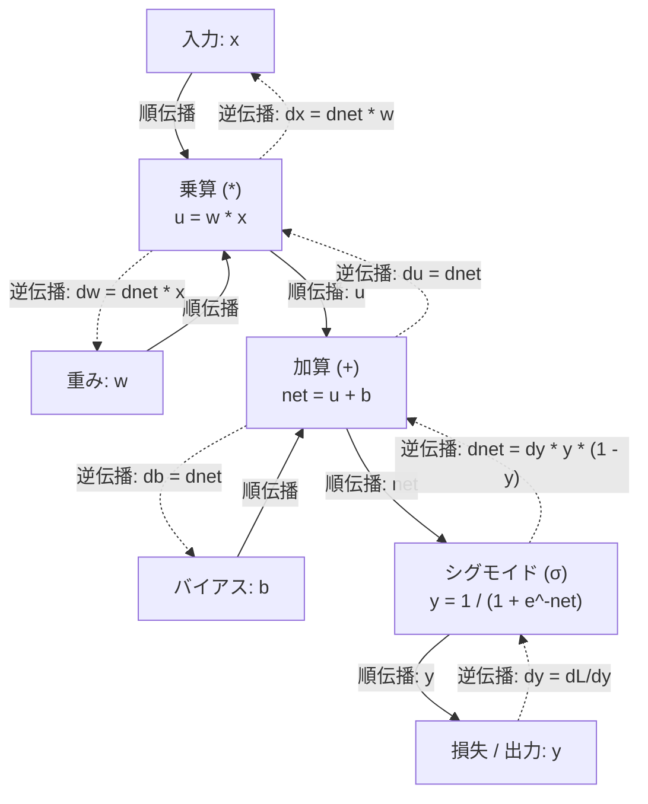
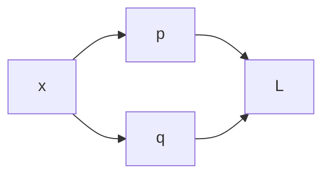

# Day 25: 誤差逆伝播を手で

### 🎯 学習目標
- 微分におけるチェインルール（連鎖律）と、それが誤差逆伝播法にどのように適用されるかを説明できる。
- 計算グラフ内の中間変数に関する偏微分を計算できる。
- シグモイド活性化関数を持つ単一ニューロンノードの逆伝播処理を追跡・実装できる。
- ローカルな微分値を用いて、重みとバイアスの勾配を手動で計算できる。

### 🧩 中核概念（なぜ）
ニューラルネットワークでは、複数の数式による演算層が積み重なっています。勾配降下法を用いてネットワークを最適化するには、最終的な損失（$L$）が個々のパラメータ（重み $w$ やバイアス $b$）の変更に対してどのように変化するか（すなわち勾配）を計算する必要があります。

もし個々の重みに対して勾配をゼロから別々に計算しようとすると（数値微分）、パラメータの数と同じ回数だけネットワークの順伝播を実行しなければなりません。数億〜数千億のパラメータを持つ現代のネットワークにおいて、これは計算量的に不可能です。

そこで、微分の**チェインルール（連鎖律）**を利用して効率的に勾配を計算する**誤差逆伝播法（Backpropagation）**を使用します。複雑な数式をシンプルな演算の組み合わせ（計算グラフ）に分解することで、各演算は自身の「ローカルな勾配（局所微分）」のみを知っていればよくなります。このローカルな勾配と、次の層から送られてくる「上流からの勾配（Upstream Gradient）」を掛け合わせることで、順伝播に対して $O(1)$ の時間計算量（1回の逆伝播パス）ですべての勾配を後ろ向きに伝播させることができます。

チェインルールによれば、変数 $y$ が $u$ に依存し、$u$ が $x$ に依存しているとき、$x$ に対する $y$ の変化率は次のように表されます：
$$\frac{\partial y}{\partial x} = \frac{\partial y}{\partial u} \cdot \frac{\partial u}{\partial x}$$

### 🔁 ロジックと動作
以下の計算グラフは、単一ニューロンにおける順伝播（実線）と逆伝播（点線）の流れを示しています：
$$y = \sigma(w \cdot x + b)$$



#### 1. 順伝播
1. 入力と重みの積を計算: $u = w \cdot x$
2. バイアスを加えて活性化前の値を計算: $net = u + b$
3. シグモイド活性化関数を適用: $y = \sigma(net) = \frac{1}{1 + e^{-net}}$

#### 2. 逆伝播
逆伝播中、上流の勾配 $dy = \frac{\partial L}{\partial y}$ を受け取ります。ここから後ろ向きに戻りながら各パラメータの勾配を計算します：
1. **シグモイドノード**: 局所的な微分は $\frac{\partial y}{\partial net} = y(1 - y)$ です。これに $dy$ を掛け合わせてチェインさせます：
   $$dnet = \frac{\partial L}{\partial net} = dy \cdot y(1 - y)$$
2. **加算ノード**: 入力 $u$ および $b$ に対する局所微分はともに $1$ です。したがって、上流からの勾配をそのまま下流に流します：
   $$db = \frac{\partial L}{\partial b} = dnet \cdot 1 = dnet$$
   $$du = \frac{\partial L}{\partial u} = dnet \cdot 1 = dnet$$
3. **乗算ノード**: $u = w \cdot x$ の局所微分は、$\frac{\partial u}{\partial w} = x$ および $\frac{\partial u}{\partial x} = w$ です。したがって：
   $$dw = \frac{\partial L}{\partial w} = du \cdot \frac{\partial u}{\partial w} = dnet \cdot x$$
   $$dx = \frac{\partial L}{\partial x} = du \cdot \frac{\partial u}{\partial x} = dnet \cdot w$$

### 📝 注釈付きサンプル
具体的な数値を使用して順伝播と逆伝播を計算してみましょう：
- 入力: $x = 2.0$
- 重み: $w = 0.5$
- バイアス: $b = -1.0$
- 上流からの損失の勾配: $dy = 1.0$

#### ステップ・バイ・ステップ計算：
1. **順伝播：**
   - $u = w \cdot x = 0.5 \cdot 2.0 = 1.0$
   - $net = u + b = 1.0 + (-1.0) = 0.0$
   - $y = \sigma(0.0) = \frac{1}{1 + e^0} = 0.5$
2. **逆伝播：**
   - $dnet = dy \cdot y(1 - y) = 1.0 \cdot 0.5 \cdot (1 - 0.5) = 0.25$
   - $db = dnet = 0.25$
   - $dw = dnet \cdot x = 0.25 \cdot 2.0 = 0.5$

コードでは以下のように追跡されます：
```python
import numpy as np

# 入力値の設定
x = 2.0
w = 0.5
b = -1.0
dy = 1.0  # 上流から伝わってきた勾配 dL/dy

# --- 順伝播 (FORWARD PASS) ---
u = w * x
net = u + b
y = 1 / (1 + np.exp(-net))
print(f"順伝播の出力 y: {y}")  # 出力: 0.5

# --- 逆伝播 (BACKWARD PASS) ---
# シグモイドの局所微分: dy/dnet = y * (1 - y)
dy_dnet = y * (1 - y)

# 活性化前の値 net に対する勾配 (チェインルール): dL/dnet = dL/dy * dy/dnet
dnet = dy * dy_dnet

# 加算ノードの局所微分: dnet/db = 1 -> dL/db = dL/dnet * 1
db = dnet

# 乗算ノードの局所微分: dnet/dw = x -> dL/dw = dL/dnet * x
dw = dnet * x

print(f"計算された db (dL/db): {db}")  # 出力: 0.25
print(f"計算された dw (dL/dw): {dw}")  # 出力: 0.5
```

### ❌ よくある間違い

**間違い 1: 上流の勾配を掛け忘れる**
```python
def backprop_step(x, w, b, dy):
    net = w * x + b
    y = 1 / (1 + np.exp(-net))
    dy_dnet = y * (1 - y)
    # 間違い: db と dw がローカルの勾配のみになっており、連鎖していない
    db = dy_dnet
    dw = dy_dnet * x
    return dw, db
```
```text
Traceback (most recent call last):
  File "exercise.py", line 12, in <module>
    assert np.isclose(db, 0.25), "db gradient incorrect"
AssertionError: db gradient incorrect
```
```python
def backprop_step(x, w, b, dy):
    net = w * x + b
    y = 1 / (1 + np.exp(-net))
    dy_dnet = y * (1 - y)
    # 正しい: 上流の勾配 dy を掛け合わせてチェインを維持する
    db = dy * dy_dnet
    dw = dy * dy_dnet * x
    return dw, db
```
> チェインルールでは、局所勾配に上流からの勾配を掛け合わせる必要があります。これを怠るとノードが隔離され、最終損失に対する正しいパラメータの傾きが得られません。

**間違い 2: 局所微分の変数を逆にしてしまう**
```python
def backprop_step(x, w, b, dy):
    net = w * x + b
    y = 1 / (1 + np.exp(-net))
    dy_dnet = y * (1 - y)
    db = dy * dy_dnet
    # 間違い: dw の計算に x ではなく w を掛けてしまっている
    dw = dy * dy_dnet * w
    return dw, db
```
```text
Traceback (most recent call last):
  File "exercise.py", line 13, in <module>
    assert np.isclose(dw, 0.5), "dw gradient incorrect"
AssertionError: dw gradient incorrect
```
```python
def backprop_step(x, w, b, dy):
    net = w * x + b
    y = 1 / (1 + np.exp(-net))
    dy_dnet = y * (1 - y)
    db = dy * dy_dnet
    # 正しい: w*x + b を w で偏微分すると x になる
    dw = dy * dy_dnet * x
    return dw, db
```
> $u = w \cdot x$ であるため、重み $w$ に対する $u$ の変化率は入力 $x$ です（すなわち $\frac{\partial u}{\partial w} = x$）。したがって、$dw$ は $w$ ではなく $x$ の値に比例します。

### 💡 コツ・イディオム
- **シグモイド出力の再利用**: シグモイド関数の微分は $\sigma'(z) = \sigma(z)(1 - \sigma(z))$ です。順伝播の出力 $y = \sigma(z)$ を保存しておき、逆伝播で再利用することで、計算コストの高い指数関数 (`np.exp`) の再計算を避けることができます。
- **中間変数の保持**: 順伝播時の `net` や `y` は必ず変数に格納しておきましょう。順伝播と逆伝播を一気に1行の難解な式にまとめようとすると、バグの原因になります。
- **勾配の命名規則**: ディープラーニングの実装では、変数に対応する勾配（損失に対する偏微分値）の変数名には頭に `d` をつけるのが標準的なイディオムです（例: $\frac{\partial L}{\partial w}$ を `dw`、$\frac{\partial L}{\partial b}$ を `db`、$\frac{\partial L}{\partial net}$ を `dnet` と命名する）。

### 🧠 深掘り（内部の仕組み）
<details><summary>シグモイド微分の数式的導出と多変数チェインルール（クリックで展開）</summary>

#### シグモイド関数の微分の導出
$\sigma(z) = \frac{1}{1 + e^{-z}} = (1 + e^{-z})^{-1}$ と置きます。
チェインルールとべき乗の微分公式を適用して、$z$ で微分します：
$$\frac{d}{dz} \sigma(z) = -1 \cdot (1 + e^{-z})^{-2} \cdot \frac{d}{dz}(1 + e^{-z})$$
$$\frac{d}{dz} \sigma(z) = -(1 + e^{-z})^{-2} \cdot (-e^{-z})$$
$$\frac{d}{dz} \sigma(z) = \frac{e^{-z}}{(1 + e^{-z})^2}$$

この式を $\sigma(z)$ 自身を用いて表現できるように変形します：
$$\frac{d}{dz} \sigma(z) = \frac{1}{1 + e^{-z}} \cdot \frac{e^{-z}}{1 + e^{-z}}$$
$$\frac{d}{dz} \sigma(z) = \sigma(z) \cdot \left( \frac{(1 + e^{-z}) - 1}{1 + e^{-z}} \right)$$
$$\frac{d}{dz} \sigma(z) = \sigma(z) \cdot \left( \frac{1 + e^{-z}}{1 + e^{-z}} - \frac{1}{1 + e^{-z}} \right)$$
$$\frac{d}{dz} \sigma(z) = \sigma(z)(1 - \sigma(z))$$
このシンプルな形になるため、ディープラーニングにおける計算効率が非常に高くなります。

#### 多変数チェインルール（グラフの分岐）
計算グラフにおいて、1つの変数が分岐して複数の下流ノードに影響を与えることがあります。例えば、変数 $x$ が $p$ と $q$ の両方に影響を与え、それらが最終損失 $L$ に影響を与える場合を考えます：

この場合、$x$ を変化させると2つの異なる経路を通じて $L$ が変化します。多変数チェインルールによれば、これらすべての分岐から逆伝播してくる勾配を**加算**する必要があります：
$$\frac{\partial L}{\partial x} = \frac{\partial L}{\partial p}\frac{\partial p}{\partial x} + \frac{\partial L}{\partial q}\frac{\partial q}{\partial x}$$
そのため、出力を複数のパスに分配するノードの逆伝播を実装する際は、届いたすべての勾配を累積（足し算）する必要があります。
</details>

### 🏋️ 演習
シグモイド活性化関数を持つ単一ニューロンの順伝播および逆伝播を実装する `backprop_step(x, w, b, dy)` を完成させてください。戻り値として `dw` ($\frac{\partial L}{\partial w}$) と `db` ($\frac{\partial L}{\partial b}$) を返してください。

```python
import numpy as np

def backprop_step(x, w, b, dy):
    # Forward pass: y = sigmoid(w * x + b)
    # backward pass: calculate dw (dL/dw) and db (dL/db) given dy (dL/dy)
    dw = None
    db = None
    return dw, db
```

### ✅ 自己チェック
1. 活性化前の値 $net = w \cdot x + b$ が非常に大きい場合（例：$10.0$）、出力勾配 $dw$ はどうなりますか？
2. 計算グラフにおいて、乗算ノード $u = a \cdot b$ の $a$ に対する局所勾配は何ですか？
<details><summary>解答</summary>

1. $net = 10.0$ のとき、シグモイド活性化は $y = \sigma(10.0) \approx 0.99995$ となります。シグモイドの局所微分は $y(1 - y) \approx 0.99995 \times (0.00005) \approx 0.00005$ となり、ほぼ $0$ になります。その結果、勾配 $db$ や $dw$ もほぼ $0$ になります。これは**勾配消失問題 (vanishing gradient problem)**として知られ、活性化関数が飽和すると学習が進まなくなる原因になります。
2. $u = a \cdot b$ を $a$ で偏微分すると $\frac{\partial u}{\partial a} = b$ になります。つまり、乗算ノードの逆伝播では、上流の勾配に「もう一方の入力値」を掛け合わせて反対側に流すことになります。
</details>

### 📌 まとめ
- **誤差逆伝播法**は、微分の**チェインルール**を用いて、すべての重みとバイアスに対する損失の勾配を計算します。
- 計算をグラフに分解することで、各ノードが自身の局所的な勾配を独立して計算できます。
- シグモイド関数 $\sigma(z)$ の微分は $\sigma(z)(1 - \sigma(z))$ という極めてシンプルな数式で計算できます。
- 逆伝播では、勾配は後ろ向きに進み、各ステップで上流の勾配と局所勾配を掛け合わせます。
