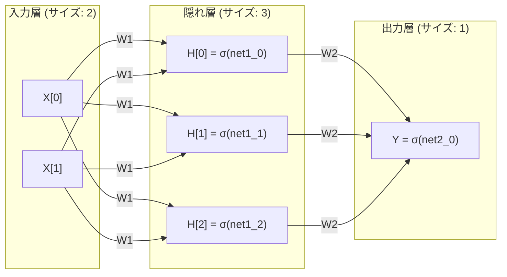

# Day 26: 2層ニューラルネット構築

### 🎯 学習目標
- ニューラルネットワークにおける隠れ層と非線形活性化関数の役割を説明できる。
- 複数層にわたる重み行列とバイアスベクトルの互換性がある形状（シェイプ）を決定できる。
- NumPyを使用して、多層ニューラルネットワークの順伝播処理をクラス内で実装できる。
- 重みのランダム初期化を適用し、なぜ重みをゼロ初期化してはならないのかを理解できる。

### 🧩 中核概念（なぜ）
単層ネットワーク（単一のパーセプトロンなど）は、線形分離可能なデータしか分類できません。XOR問題のような単純な非線形関係に対して、完全に破綻してしまいます。

複雑な現実世界の問題を解決するために、複数のニューロン層を積み重ねます。これにより、**多層パーセプトロン（MLP: Multi-Layer Perceptron）**または順伝播型ニューラルネットワークが形成されます。

多層ネットワークの中核概念は以下の通りです：
1. **隠れ層 (Hidden Layers)**: 入力層と出力層の間に位置する層。これらの層は**隠れ表現（中間表現）**を構築し、生の入力から抽象的な特徴量を自動的に抽出します（例：画像ピクセルから輪郭を検出する）。
2. **活性化関数（非線形性）**: 各層の後に非線形関数（シグモイドやReLUなど）を適用しないと、何層積み重ねてもネットワーク全体が単一の線形方程式に縮退してしまいます。非線形性があることで、ネットワークは複雑に湾曲した境界線を学習できるようになります。
3. **層の次元 (Layer Dimensions)**: 各層は、入力次元を出力次元にマッピングする重みを持っています。バグのない実装を行うためには、これらの行列の形状を正確に管理することが不可欠です。

### 🔁 ロジックと動作
以下の図は、入力サイズ 2（例：2つの特徴量）、隠れ層サイズ 3、出力層サイズ 1 を持つ2層ニューラルネットワークの構成を示しています：



バッチサイズ $N$ の入力サンプルに対する数式的次元と演算を追跡してみましょう：
1. **入力行列 $X$**: 形状 $(N, 2)$ （$N$ はサンプル数）。
2. **隠れ層 1 のパラメータと演算**:
   - 重み $W_1$：形状 $(2, 3)$（入力サイズ 2 を隠れサイズ 3 に写像）。
   - バイアス $b_1$：形状 $(1, 3)$（3つの隠れノードそれぞれに加算）。
   - 活性化前: $net_1 = X \cdot W_1 + b_1$ (形状: $(N, 3)$)
   - 活性化: $H = \sigma(net_1) = \frac{1}{1 + e^{-net_1}}$ (形状: $(N, 3)$)
3. **出力層 2 のパラメータと演算**:
   - 重み $W_2$：形状 $(3, 1)$（隠れサイズ 3 を出力サイズ 1 に写像）。
   - バイアス $b_2$：形状 $(1, 1)$（出力ノードに加算）。
   - 活性化前: $net_2 = H \cdot W_2 + b_2$ (形状: $(N, 1)$)
   - 活性化: $Y = \sigma(net_2) = \frac{1}{1 + e^{-net_2}}$ (形状: $(N, 1)$)

### 📝 注釈付きサンプル
以下は、クラスを定義し、重みをランダムに初期化して、順伝播を実行する方法です：
```python
import numpy as np

class TwoLayerNet:
    def __init__(self, input_size, hidden_size, output_size):
        # np.random.seed により、重みの初期値が再現可能になります
        np.random.seed(42)
        
        # 標準正規分布から生成した乱数に極めて小さな係数を掛けて重みを初期化
        self.W1 = np.random.randn(input_size, hidden_size) * 0.01
        self.b1 = np.zeros((1, hidden_size))
        
        self.W2 = np.random.randn(hidden_size, output_size) * 0.01
        self.b2 = np.zeros((1, output_size))

    def forward(self, X):
        # 1. 隠れ層の活性化量を計算
        net1 = np.dot(X, self.W1) + self.b1
        H = 1 / (1 + np.exp(-net1))  # シグモイド活性化
        
        # 2. 出力層の活性化量を計算
        net2 = np.dot(H, self.W2) + self.b2
        Y = 1 / (1 + np.exp(-net2))  # シグモイド活性化
        
        return H, Y

# インスタンス生成: 入力サイズ 2, 隠れサイズ 3, 出力サイズ 1
net = TwoLayerNet(input_size=2, hidden_size=3, output_size=1)

# 2サンプルのバッチを入力:
X_batch = np.array([[0.5, 0.8], 
                    [0.1, 0.4]])

hidden_act, output_act = net.forward(X_batch)

print("入力の形状:  ", X_batch.shape)        # 出力: (2, 2)
print("隠れ層の形状:", hidden_act.shape)     # 出力: (2, 3)
print("出力の形状:  ", output_act.shape)     # 出力: (2, 1)
print("出力結果:\n", output_act)
```

### ❌ よくある間違い

**間違い 1: 行列積で次元の並び順を逆にしてしまう**
```python
def forward(self, X):
    # 間違い: np.dot(self.W1, X) は (2,3) x (1,2) となり次元が一致しない
    net1 = np.dot(self.W1, X) + self.b1
    H = 1 / (1 + np.exp(-net1))
    net2 = np.dot(self.W2, H) + self.b2
    Y = 1 / (1 + np.exp(-net2))
    return H, Y
```
```text
Traceback (most recent call last):
  File "exercise.py", line 15, in <module>
    H, Y = net.forward(X)
  File "exercise.py", line 11, in forward
    net1 = np.dot(self.W1, X) + self.b1
ValueError: shapes (2,3) and (1,2) not aligned: 3 (dim 1) != 1 (dim 0)
```
```python
def forward(self, X):
    # 正しい: X は (N, D)、W1 は (D, H) なので、np.dot(X, W1) は (N, H) になる
    net1 = np.dot(X, self.W1) + self.b1
    H = 1 / (1 + np.exp(-net1))
    net2 = np.dot(H, self.W2) + self.b2
    Y = 1 / (1 + np.exp(-net2))
    return H, Y
```
> 行列の積は非可換です（$A \cdot B \neq B \cdot A$）。左側の行列の列数と右側の行列の行数が一致している必要があります。したがって、入力 $X \in \mathbb{R}^{N \times D}$ と重み $W \in \mathbb{R}^{D \times H}$ については、$X \cdot W$ の順に乗算します。

**間違い 2: 行列積（np.dot）の代わりに要素ごとの乗算（*）を使ってしまう**
```python
def forward(self, X):
    # 間違い: '*' は要素ごとの掛け算であり、行列の積ではない
    net1 = X * self.W1 + self.b1
    H = 1 / (1 + np.exp(-net1))
    net2 = H * self.W2 + self.b2
    Y = 1 / (1 + np.exp(-net2))
    return H, Y
```
```text
Traceback (most recent call last):
  File "exercise.py", line 15, in <module>
    H, Y = net.forward(X)
  File "exercise.py", line 11, in forward
    net1 = X * self.W1 + self.b1
ValueError: operands could not be broadcast together with shapes (1,2) (2,3) 
```
```python
def forward(self, X):
    # 正しい: 行列同士の積には np.dot() または '@' 演算子を使用する
    net1 = np.dot(X, self.W1) + self.b1
    H = 1 / (1 + np.exp(-net1))
    net2 = np.dot(H, self.W2) + self.b2
    Y = 1 / (1 + np.exp(-net2))
    return H, Y
```
> NumPy では、通常の `*` 演算子は要素ごとの積（アダマール積）を実行するため、配列の形状が完全に一致するかブロードキャスト可能である必要があります。全結合層では、次元の変換のために行列積（`np.dot` または `@`）を呼ぶ必要があります。

### 💡 コツ・イディオム
- **`@` 演算子**: Python 3.5以降では、行列積の省略記法として `@` を使用できます: `net1 = X @ self.W1 + self.b1`。
- **NumPy のブロードキャスト**: 形状 $(N, H)$ の行列に対して、形状 $(1, H)$ のバイアスベクトル $b_1$ を加算すると、NumPy は自動的に $b_1$ をバッチサイズ方向（$N$ 行分）に複製して加算を行います。これを**ブロードキャスト**と呼びます。
- **バイアスはゼロ初期化でよい**: 重みのゼロ初期化は対称性の問題から避ける必要がありますが、バイアスはすべてゼロで初期化（`np.zeros`）しても全く問題ありません。これは実務における標準的な実装です。

### 🧠 深掘り（内部の仕組み）
<details><summary>行列の互換性と重みの各種初期化戦略（クリックで展開）</summary>

#### 行列の次元互換性ルール
ニューラルネットワークにおける一連の線形変換では、隣接するインターフェースの内側（Inner）の次元が一致している必要があります：
$$\text{入力: } X \in \mathbb{R}^{N \times D}$$
$$\text{重み 1: } W_1 \in \mathbb{R}^{D \times H} \implies X \cdot W_1 \in \mathbb{R}^{N \times H}$$
$$\text{重み 2: } W_2 \in \mathbb{R}^{H \times M} \implies H \cdot W_2 \in \mathbb{R}^{N \times M}$$
ここで：
- $N$ はバッチサイズ（独立したサンプル数）。
- $D$ は入力特徴量の次元数。
- $H$ は隠れ層のユニット数。
- $M$ は出力層のユニット数。
層を $K$ 個積み重ねる場合、重み行列 $W_i$ の列数は次の重み行列 $W_{i+1}$ の行数と完全に一致していなければなりません。

#### ゼロ初期化の問題点（対称性の破壊）
なぜすべての重みを 0 で初期化（`np.zeros`）してはいけないのでしょうか？
仮にすべての重みが 0 で初期化されると：
1. 隠れ層のすべてのユニットが全く同じ出力を計算します: $h_j = \sigma(0) = 0.5$（シグモイドの場合）。
2. 逆伝播時にも、すべてのユニットが全く同じ勾配を算出します。
3. パラメータを更新する際、すべてのユニットが同じ値で更新されます。
結果として、隠れ層にいくつのニューロンを配置しても単一のニューロンと全く同じ挙動になってしまい、異なる特徴を分担して学習することができなくなります。これを**重みの対称性（symmetry）**と呼び、ランダムな初期値を与えることでこの**対称性を破壊（break symmetry）**する必要があります。

#### 高度な初期化手法
浅いネットワークでは `randn * 0.01` でも十分に動作しますが、ディープネットワークになると順伝播で値が減衰しきってしまったり、逆に無限大に発散したりします。そのため、分散のスケールを自動調整する以下の初期化手法が用いられます：
1. **Xavier (Glorot) 初期化**: Sigmoid や Tanh 活性化関数向け。重みの分散が $\sigma^2 = \frac{2}{n_{in} + n_{out}}$ になるように初期化します。
   ```python
   limit = np.sqrt(6 / (input_size + output_size))
   W = np.random.uniform(-limit, limit, (input_size, output_size))
   ```
2. **He (Kaiming) 初期化**: ReLU 活性化関数向け。重みの分散が $\sigma^2 = \frac{2}{n_{in}}$ になるように初期化します。
   ```python
   W = np.random.randn(input_size, output_size) * np.sqrt(2.0 / input_size)
   ```
これにより、層を通過してもデータの分散が保たれ、安定して学習を進めることができます。
</details>

### 🏋️ 演習
`TwoLayerNet` クラスの `forward(self, X)` メソッドを完成させてください。行列積とシグモイド関数を用いて、隠れ層の活性化量 `H` と最終出力 `Y` を計算し返してください。

```python
import numpy as np

class TwoLayerNet:
    def __init__(self, input_size, hidden_size, output_size):
        np.random.seed(42)
        self.W1 = np.random.randn(input_size, hidden_size) * 0.01
        self.b1 = np.zeros((1, hidden_size))
        self.W2 = np.random.randn(hidden_size, output_size) * 0.01
        self.b2 = np.zeros((1, output_size))

    def forward(self, X):
        # 順伝播処理をここに実装してください
        H = None
        Y = None
        return H, Y
```

### ✅ 自己チェック
1. 入力 $X$ の形状が $(5, 4)$、出力 $Y$ の形状が $(5, 2)$ であり、隠れ層のサイズを $10$ とする場合、重み $W_1$ と $W_2$ の形状はどうなるべきですか？
2. `TwoLayerNet` のすべての層からシグモイド活性化関数を取り除くとどうなりますか？
<details><summary>解答</summary>

1. 入力の次元 $D = 4$、隠れ層のサイズ $H = 10$、出力の次元 $M = 2$ となります。
   - $W_1$ は $D$ から $H$ への写像であるため、形状は $(4, 10)$。
   - $W_2$ は $H$ から $M$ への写像であるため、形状は $(10, 2)$。
2. 活性化関数を適用しない場合、順伝播は以下のようになります：
   $$Y = (X \cdot W_1 + b_1) \cdot W_2 + b_2 = X \cdot (W_1 \cdot W_2) + (b_1 \cdot W_2 + b_2)$$
   ここで $W_{eff} = W_1 \cdot W_2$、$b_{eff} = b_1 \cdot W_2 + b_2$ と置くと、式は $Y = X \cdot W_{eff} + b_{eff}$ と簡略化できます。これは単一の線形変換と完全に等価であり、層を深くした意味が失われてしまいます。
</details>

### 📌 まとめ
- **多層ニューラルネットワーク**は、隠れ層を導入することで非線形な境界線を学習できるようにします。
- **非線形活性化関数**は、重ねた層が単純な1つの線形変換に崩退するのを防ぐために不可欠です。
- 重み行列は層と層の間をつなぐ役割を持ち、行列積の次元互換性を保つ必要があります。
- **重みのランダム初期化**は対称性を破壊し、各ニューロンがそれぞれ異なる特徴を学習するために必要です。
