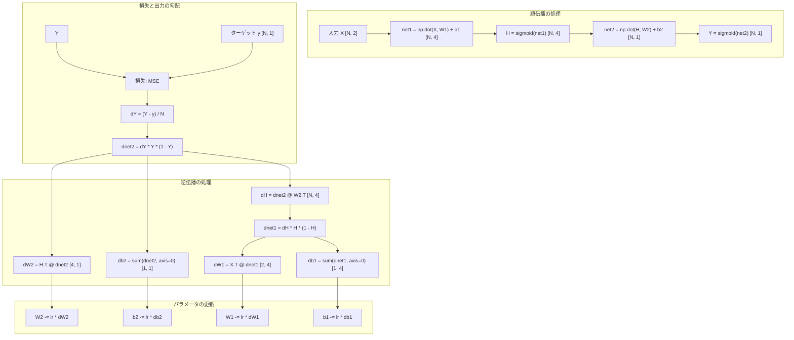

### 🎯 学習目標
- 単層パーセプトロンでは XOR ゲート問題を解決できない理由を説明できる。
- 2層順伝播型ニューラルネットワーク（マルチレイヤーパーセプトロン）のアーキテクチャを理解する。
- NumPy を使用して、2層ネットワークの順伝播、逆伝播、およびパラメータ更新を一から実装できる。
- 線形非分離な分類問題を解決するためにニューラルネットワークをトレーニングできる。

### 🧩 中核概念（なぜ）
単層パーセプトロンは、データポイントを分離するために直線（線形決定境界）しか引くことができません。分類タスクにおいて、AND ゲートや OR ゲートのように、1本の直線で完全にクラスを分割できる問題は**線形分離可能**（linearly separable）と呼ばれます。

しかし、**XOR（排他的論理和）ゲート**は、**線形非分離**（non-linearly separable）な問題の古典的な例です。XOR の入力をプロットすると、以下のようになります。
- `(0, 0) -> 0` (クラス A)
- `(1, 1) -> 0` (クラス A)
- `(0, 1) -> 1` (クラス B)
- `(1, 0) -> 1` (クラス B)

クラス A とクラス B を分離できる直線が1本も存在しないことがわかります。これを解決するには、非線形活性化関数を持つ**隠れ層（hidden layer）**を少なくとも1つ導入する必要があります。この隠れ層が、入力空間を新しい特徴空間に変換し、出力層で直線的に分離できるようにします。

### 🔁 ロジックと動作
XOR データセットでの2層ニューラルネットワークの学習プロセスは、以下のように構成されます。
1. **パラメータ初期化**: 重み行列 $W_1, W_2$ に小さなランダムな値、バイアス $b_1, b_2$ にゼロを代入します。
2. **順伝播（Forward Propagation）**:
   - 隠れ層の活性化前入力を計算: $net_1 = X \cdot W_1 + b_1$
   - 活性化関数（シグモイド）を適用: $H = \sigma(net_1)$
   - 出力層の活性化前入力を計算: $net_2 = H \cdot W_2 + b_2$
   - 活性化関数（シグモイド）を適用: $Y = \sigma(net_2)$
3. **損失（Loss）の計算**: Mean Squared Error（MSE：平均二乗誤差）を用いて予測 $Y$ とターゲット $y$ の差を測定します。
4. **逆伝播（Backward Propagation）**: 連鎖律（Chain Rule）を用いて、すべてのパラメータ（$W_2, b_2, W_1, b_1$）の勾配を計算します。
5. **パラメータ更新**: 勾配降下法を使用して重みとバイアスを調整します。



### 📝 注釈付きサンプル
事前に初期化された重みを用いて、順伝播を実行し、最終出力を計算する方法は以下の通りです。

```python
import numpy as np

# 入力: 2つの特徴量を持つ4つのサンプル (XOR 入力)
X = np.array([[0, 0], [0, 1], [1, 0], [1, 1]])

# レイヤーサイズ: 入力=2, 隠れ層=4, 出力=1
# デモ用に手動で重みを初期化
W1 = np.array([[ 0.5, -0.2,  0.8, -0.5],
               [-0.3,  0.6, -0.7,  0.9]])
b1 = np.zeros((1, 4))

W2 = np.array([[ 0.3], [-0.8], [ 0.5], [ 0.2]])
b2 = np.zeros((1, 1))

# ヘルパー: シグモイド活性化関数
def sigmoid(x):
    return 1 / (1 + np.exp(-x))

# 1. 隠れ層への順伝播
net1 = np.dot(X, W1) + b1    # 形状: (4, 2) @ (2, 4) + (1, 4) = (4, 4)
H = sigmoid(net1)            # 形状: (4, 4)

# 2. 出力層への順伝播
net2 = np.dot(H, W2) + b2    # 形状: (4, 4) @ (4, 1) + (1, 1) = (4, 1)
Y = sigmoid(net2)            # 形状: (4, 1)

print("予測値:\n", Y)
```

### ❌ よくある間違い

**間違い 1: 隠れ層の損失勾配（$dH$）を計算する際の行列の次元の不一致**
```python
# 間違ったコード
dH = np.dot(W2, dnet2)
```
```text
ValueError: shapes (4,1) and (4,1) not aligned: 1 (dim 1) != 4 (dim 0)
```
```python
# 正しいコード
dH = np.dot(dnet2, W2.T)
```
> 変数 `dnet2` は出力層の活性化前入力の勾配を表し、形状は `(N, 1)` です。出力の重み `W2` は形状 `(4, 1)` です。エラーを隠れ層 `H` （形状 `(N, 4)`）に逆伝播するには、`dnet2` に `W2` の転置行列（`W2.T`）を掛け合わせる必要があり、結果として `(N, 1) @ (1, 4) = (N, 4)` になります。

**間違い 2: バイアス勾配の合計計算時に次元を維持し忘れる**
```python
# 間違ったコード
db1 = np.sum(dnet1, axis=0) # 行の次元が失われ、1次元配列になる
```
```text
ValueError: operands could not be broadcast together with shapes (1,4) (4,)
```
```python
# 正しいコード
db1 = np.sum(dnet1, axis=0, keepdims=True)
```
> NumPy の `np.sum` は指定された軸を圧縮します。`keepdims=True` を指定しない場合、形状は `(1, 4)` ではなく `(4,)` に変更されてしまいます。バイアス `b1`（形状 `(1, 4)`）を更新する際、ブロードキャストを正しく実行するためには形状が一致している必要があります。

### 💡 コツ・イディオム
- **行列演算**: Python で行列演算を行うには、`np.dot(A, B)` または `@` 演算子（`A @ B`）を使用します。デバッグ中は頻繁に `.shape` をプリントして形状を確認するようにしましょう。
- **シグモイド関数の微分**: $a = \sigma(z)$ とおくと、微分は $\frac{\partial a}{\partial z} = a(1 - a)$ となります。逆伝播の際、再度指数関数を計算する必要はなく、順伝播の出力 `H` や `Y` を再利用できます。
- **再現性**: 初期ランダム状態を異なる実行間でも一致させるため、重みの初期化前に必ず `np.random.seed(seed_number)` を呼び出します。

### 🧠 深掘り（内部の仕組み）
<details><summary>行列計算における逆伝播勾配の導出（クリックで展開）</summary>

行列計算を用いた方程式をステップごとに導出します。
定義:
$$H = \sigma(X W_1 + b_1)$$
$$Y = \sigma(H W_2 + b_2)$$

サンプル数 $N$ に対する損失関数（平均二乗誤差：MSE）を定義します。
$$L = \frac{1}{2N} \sum_{i=1}^{N} (Y_i - y_i)^2$$

1. **出力層の勾配**:
   出力予測 $Y$ に関する損失関数の勾配は以下の通りです。
   $$\frac{\partial L}{\partial Y} = \frac{1}{N} (Y - y)$$
   
   連鎖律を用いると、出力層の活性化前入力 $net_2 = H W_2 + b_2$ の勾配は以下のようになります。
   $$\text{dnet}_2 = \frac{\partial L}{\partial net_2} = \frac{\partial L}{\partial Y} \odot \sigma'(net_2) = \text{dY} \odot Y \odot (1 - Y)$$
   *(ただし $\odot$ は要素ごとの積を表す)*。

2. **出力層の重みとバイアスの勾配**:
   $$dW_2 = H^T \cdot \text{dnet}_2$$
   $$db_2 = \sum \text{dnet}_2 \quad \text{(バッチ全体での合計)}$$

3. **隠れ層の勾配**:
   次に、勾配を隠れ層の活性化値 $H$ に逆伝播します。
   $$dH = \frac{\partial L}{\partial H} = \text{dnet}_2 \cdot W_2^T$$
   
   隠れ層の活性化前入力 $net_1 = X W_1 + b_1$ の勾配は以下の通りです。
   $$\text{dnet}_1 = \frac{\partial L}{\partial net_1} = dH \odot H \odot (1 - H)$$

4. **隠れ層の重みとバイアスの勾配**:
   $$dW_1 = X^T \cdot \text{dnet}_1$$
   $$db_1 = \sum \text{dnet}_1 \quad \text{(バッチ全体での合計)}$$
</details>

### 🏋️ 演習
関数 `train_xor(epochs, lr)` 内に順伝播と逆伝播のループを実装し、XOR 論理を解決できるようにモデルを学習させてください。

```python
import numpy as np

def train_xor(epochs=1000, lr=0.1):
    # XOR 入力とターゲット
    X = np.array([[0, 0], [0, 1], [1, 0], [1, 1]])
    y = np.array([[0], [1], [1], [0]])
    
    # パラメータ初期化
    np.random.seed(42)
    W1 = np.random.randn(2, 4)
    b1 = np.zeros((1, 4))
    W2 = np.random.randn(4, 1)
    b2 = np.zeros((1, 1))
    
    for epoch in range(epochs):
        # TODO: 順伝播、逆伝播、パラメータ更新を実装してください
        pass
        
    return W1, b1, W2, b2
```

### ✅ 自己チェック
1. なぜ隠れ層には非線形活性化関数が必要なのですか？線形活性化関数のみを使用した場合、XOR を解決できますか？
2. 入力層が 2 ノード、隠れ層が 8 ノード、出力層が 1 ノードである場合、重み $W_1$ と $W_2$ の形状はどうなりますか？
<details><summary>解答</summary>
1. 線形活性化関数（または活性化関数なし）を使用する場合、線形関数の合成は依然として線形関数になります: $Y = (X W_1 + b_1) W_2 + b_2 = X (W_1 W_2) + (b_1 W_2 + b_2) = X W_{eff} + b_{eff}$。ネットワークは単一の線形モデルに崩壊し、XOR のような非線形境界を学習することはできなくなります。
2. $W_1$ の形状は `(2, 8)` となり、$W_2$ の形状は `(8, 1)` となります。
</details>

### 📌 まとめ
- XOR 問題は**線形非分離**であり、非線形活性化関数を持つ隠れ層が少なくとも 1 つ必要です。
- 逆伝播では、連鎖律（**チェインルール**）を用いて損失関数の各パラメータに対する微分を計算します。
- 行列演算時の転置は、誤差逆伝播における次元を一致させるために必要です。
