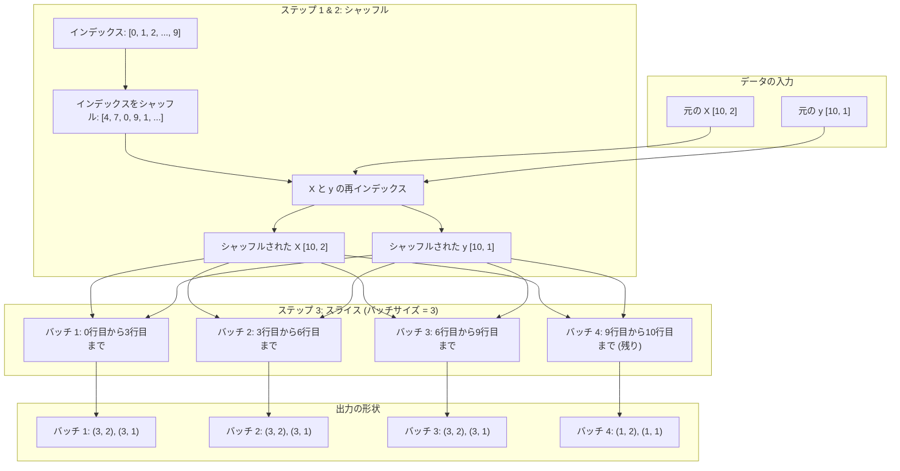

### 🎯 学習目標
- バッチ勾配降下法、確率的勾配降下法（SGD）、ミニバッチ勾配降下法の違いを説明できる。
- バッチサイズが学習の収束速度と勾配の安定性に与える影響を説明できる。
- バッチを作成する前にデータをシャッフルすることがなぜ重要であるかを理解する。
- NumPy を使用して、カスタムミニバッチジェネレータを一から実装できる。

### 🧩 中核概念（なぜ）
ニューラルネットワークの学習では、損失関数の勾配を計算して重みを更新します。モデルにデータをどのように供給するかによって、学習の速度と精度が決定されます。

1. **バッチ勾配降下法（Batch Gradient Descent）**: データセット*全体*を使用して勾配を計算します。安定していますが、大規模なデータセットでは処理が非常に遅くなり、大量のメモリを消費します。
2. **確率的勾配降下法（SGD）**: 一度に*1つ*のランダムなサンプルを使用して勾配を計算します。非常に高速ですが、更新時のノイズが非常に大きくなり、損失が激しく変動します。
3. **ミニバッチ勾配降下法（Mini-Batch Gradient Descent）**: データを小さなサブセット（例：32、64、128サンプルなど）に分割して勾配を計算します。これは、バッチ勾配降下法の安定性と SGD の速度を両立させ、ベクトル化されたハードウェアアクセラレーションを利用できるため、現代の深層学習における標準となっています。

データセットをミニバッチに分割することで、1つの**エポック**（データセット全体を1回通して学習すること）の中で複数回のパラメータ更新を実行でき、学習の収束を加速させることができます。

### 🔁 ロジックと動作
ミニバッチを生成する手順は以下の通りです。
1. **インデックスの生成**: データセットの各行を表すインデックス配列を作成します。
2. **インデックスのシャッフル**: インデックスをランダムにシャッフルし、各バッチにクラスやサンプルが偏りなく混合されるようにします。
3. **シャッフルされたデータの再インデックス**: シャッフルされたインデックスを用いて、特徴量 $X$ とラベル $y$ の行を並べ替えます。
4. **バッチへのグループ化**: シャッフルされたデータを `batch_size` ごとにスライスします。サンプル総数が `batch_size` で割り切れない場合、最後のバッチには残りのサンプルが含まれます。



### 📝 注釈付きサンプル
NumPy を使用してインデックスをシャッフルし、シンプルなデータセットをミニバッチにグループ化する方法は以下の通りです。

```python
import numpy as np

# ダミーデータセットの作成 (10サンプル, 2特徴量)
X = np.arange(20).reshape(10, 2)
y = np.arange(10).reshape(10, 1)

# パラメータ設定
batch_size = 3
N = X.shape[0]

# 1. インデックスのシャッフル
indices = np.arange(N)
np.random.shuffle(indices) # 配列をインプレースで書き換え

# 2. 特徴量とラベルの再インデックス
X_shuffled = X[indices]
y_shuffled = y[indices]

# 3. ミニバッチの作成
batches = []
for i in range(0, N, batch_size):
    # i から i + batch_size までスライス
    X_batch = X_shuffled[i : i + batch_size]
    y_batch = y_shuffled[i : i + batch_size]
    batches.append((X_batch, y_batch))

# バッチの確認
for idx, (xb, yb) in enumerate(batches):
    print(f"バッチ {idx+1}: Xの形状 {xb.shape}, yの形状 {yb.shape}")
```

### ❌ よくある間違い

**間違い 1: 特徴量 $X$ とラベル $y$ をそれぞれ独立してシャッフルしてしまう**
```python
# 間違ったコード
np.random.shuffle(X)
np.random.shuffle(y)
```
```text
(トレースバックエラーは発生しませんが、特徴量とラベルの対応が崩れるため、モデルが学習できなくなります)
```
```python
# 正しいコード
indices = np.arange(X.shape[0])
np.random.shuffle(indices)
X_shuffled = X[indices]
y_shuffled = y[indices]
```
> $X$ と $y$ を別々にシャッフルすると、特徴量とそれに対応するラベルの対応関係が失われてしまいます。たとえば、クラス 1 の特徴量ベクトルがクラス 0 のラベルとペアになってしまう可能性があります。共通のインデックスリストをシャッフルし、そのインデックスを使用して両方の配列を再配置する必要があります。

**間違い 2: データセットのサイズがバッチサイズで割り切れない場合に最後の余りバッチを落としてしまう**
```python
# 間違ったコード
batches = []
for i in range(0, X.shape[0] - batch_size, batch_size):
    X_batch = X_shuffled[i:i+batch_size]
    y_batch = y_shuffled[i:i+batch_size]
    batches.append((X_batch, y_batch))
```
```text
(コードは実行されますが、len(batches) が 4 ではなく 3 になり、最後のサンプルが破棄されます)
```
```python
# 正しいコード
batches = []
for i in range(0, X.shape[0], batch_size):
    X_batch = X_shuffled[i:i+batch_size]
    y_batch = y_shuffled[i:i+batch_size]
    batches.append((X_batch, y_batch))
```
> range の終了値に `X.shape[0] - batch_size` を使用すると、ループが途中で終了してしまい、データセット全体のサイズがバッチサイズで割り切れない場合に、末尾の残りのサンプルが切り捨てられてしまいます。Python のスライス構文は、インデックスが配列長を超えても自動的に処理してくれます。

### 💡 コツ・イディオム
- **ステップ指定付きの range ループ**: バッチごとにインデックスを増やすには `range(0, limit, step)` を使用するのが Python の一般的なイディオムです。
- **2のべき乗数**: バッチサイズは伝統的に 2 のべき乗（32、64、128、256 など）に設定されます。これは、現代のコンピュータメモリの構成や GPU スレッドが 2 のべき乗サイズで最も効率的に動作するためです。
- **スライスの安全性**: Python では、`array[start:end]` において `end` が配列の長さを超えていてもエラーにならず、配列の末尾までの要素を適切に返してくれます。

### 🧠 深掘り（内部の仕組み）
<details><summary>ミニバッチにおけるハードウェアベクトル化と並列処理（クリックで展開）</summary>

ハードウェアの観点から、なぜ単一サンプル（SGD）の更新よりもミニバッチの更新が好まれるのでしょうか？
現代のプロセッサ（SIMDユニットを搭載したCPUや、数千の計算コアを持つGPU）は、**ベクトル化**と**並列命令の実行**に依存しています。

バッチサイズ 1 で行列演算を実行する場合：
- プロセッサは実際の計算よりも、メモリから命令や重みをロードするオーバーヘッドに多くの時間を費やしてしまいます。演算器の利用効率が低下します。

バッチサイズ 64 で行列演算を実行する場合：
- 同じ重み行列に対して、64個の入力が同時に計算されます。
- メモリへのアクセスが統合され、メモリから一度読み込まれた重みはレジスタ内で並列に64回再利用されます。
- これにより、メモリ帯域幅の効率と計算コアの稼働率が劇的に向上します。

ただし、バッチサイズが大きすぎると（例：バッチ勾配降下法）：
- データセット全体がキャッシュや GPU メモリの制限を超え、システム RAM やディスクからの低速な読み込みが発生します。
- 勾配から「ランダムなノイズ」が失われ、最適化中に局所最適解（ローカルミニマム）や鞍点から脱出する能力が低下します。
</details>

### 🏋️ 演習
関数 `get_mini_batches(X, y, batch_size)` を実装し、入力をシャッフルした上で、指定したバッチサイズごとにスライスされた入力特徴量とターゲットラベルのタプルのリストを返してください。

```python
import numpy as np

def get_mini_batches(X, y, batch_size):
    # 再現性確保のためシードを設定
    np.random.seed(42)
    
    batches = []
    # TODO: インデックスをシャッフルし、データを再インデックスし、バッチを作成してください
    return batches
```

### ✅ 自己チェック
1. 1,000 サンプルのデータセットがあり、バッチサイズを 64 に設定した場合、1 エポックで何個のミニバッチが生成されますか？また、最後のミニバッチのサイズはいくつですか？
2. 毎エポックの開始時にデータセットの順番を固定するのではなく、シャッフルすることが重要なのはなぜですか？
<details><summary>解答</summary>
1. $1000 / 64 = 15.625$ となり、合計 16 個のバッチが生成されます。最初の 15 個のバッチにはそれぞれ 64 サンプルが含まれ、16番目（最後）のバッチには残りの 40 サンプルが含まれます（$1000 - 15 \times 64 = 40$）。
2. シャッフルしない場合、データセットの並び順による偏りをモデルが学習してしまう恐れがあります。たとえば、データセットがクラス順（すべての 0 のあとにすべての 1 が並ぶなど）でソートされている場合、バッチ内の更新が毎回特定のクラスのみに偏ってしまい、学習が不安定になります。
</details>

### 📌 まとめ
- **ミニバッチ勾配降下法**は、計算速度、学習の安定性、およびハードウェアの稼働率のバランスをとる方法です。
- クラスや順序による偏りを避けるため、データを分割する前に、対応するインデックスを用いて特徴量とラベルを**同時にシャッフル**する必要があります。
- `range(0, N, batch_size)` とスライスを用いたステップごとの反復により、割り切れない残りのデータも漏れなくバッチ化できます。
