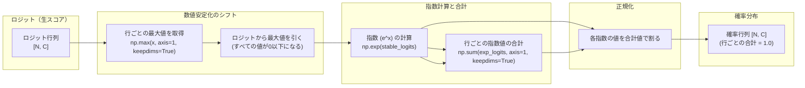

### 🎯 学習目標
- 二値分類と多クラス分類の違いを説明できる。
- Softmax（ソフトマックス）活性化関数の役割を理解し、ロジット（Logits）を確率分布に変換できる。
- 指数計算における数値的なオーバーフロー問題の発生理由と、それを防ぐ安定化数式を説明できる。
- 多クラス分類モデルの訓練における「カテゴリカル交差エントロピー損失関数」の役割と勾配の単純さを理解する。

### 🧩 中核概念（なぜ）
これまでのレッスンでは、出力が「クラス1に属する確率」を表す1つの値である二値分類問題（XORゲートなど）を扱ってきました。しかし、**手書き数字分類**（0から9までの数字画像を分類する）のような実世界のタスクでは、多数の選択肢から1つを予測する必要があります。これが**多クラス分類（Multi-class classification）**問題です。

多クラスニューラルネットワークでは、出力層がクラスごとに「ロジット（Logits）」と呼ばれる未正規化の生スコアを出力します。これらのロジットを確率（0から1の間であり、すべてのクラスの合計が1になる値）として解釈するために、**Softmax（ソフトマックス）関数**を通します。
$$\sigma(z)_i = \frac{e^{z_i}}{\sum_{j=1}^{C} e^{z_j}}$$
ここで、$z$ はロジットのベクトル、$C$ はクラスの総数を示します。

#### 数値的安定性の問題
コンピュータは固定精度の浮動小数点数（float）を使用します。ロジット $z_i$ の値が大きすぎる（例えば $z_i > 709$）と、$e^{z_i}$ の計算結果が**数値オーバーフロー**（Pythonでは `inf`）を引き起こします。これを防ぐために、指数計算を行う前に、そのサンプルの最大ロジット値をすべてのロジットから引く処理を行います。
$$\sigma(z)_i = \frac{e^{z_i - \max(z)}}{\sum_{j=1}^{C} e^{z_j - \max(z)}}$$
定数 $\max(z)$ を引いても、分母と分子で相殺されるため数学的な出力は同じですが、引き算後の最大値が $e^0 = 1$ になるため、指数計算の結果は必ず0から1の間に収まり、オーバーフローを完全に回避できます。

### 🔁 ロジックと動作
安定したSoftmax関数を用いて、生スコア（ロジット）を確率に変換する処理の流れです。



### 📝 注釈付きサンプル
PythonとNumPyを用いて、安定したSoftmaxを段階的に実装する例です。

```python
import numpy as np

# 2サンプル、3クラスのロジットバッチ
# 1000.0 は標準の np.exp(1000.0) を計算するとオーバーフロー（inf）になります
logits = np.array([
    [1000.0, 1000.0, 998.0],
    [1.0, 2.0, 3.0]
])

# 1. 各行の最大値を取得 (2次元形状を維持するために keepdims=True を指定)
row_max = np.max(logits, axis=1, keepdims=True)
print("各行の最大値:\n", row_max)

# 2. 最大値を引いて安定化させる (最大の要素が0になります)
stable_logits = logits - row_max
print("安定化したロジット:\n", stable_logits)

# 3. 指数 (e^x) を計算
exp_logits = np.exp(stable_logits)
print("指数計算後の値:\n", exp_logits)

# 4. 行ごとに指数値を合計
sum_exp = np.sum(exp_logits, axis=1, keepdims=True)
print("指数の合計値:\n", sum_exp)

# 5. 各指数値を合計値で割り、確率分布を求める
probabilities = exp_logits / sum_exp
print("計算された確率分布 (合計が1):\n", probabilities)
```

### ❌ よくある間違い

**間違い 1: 最大値計算時の keepdims=True の指定漏れによる形状不一致**
```python
import numpy as np
x = np.array([[1.0, 2.0], [3.0, 4.0]])
# 誤り: 形状 (2,) の 1次元配列が返される
max_val = np.max(x, axis=1) 
x_stable = x - max_val
```
```text
ValueError: operands could not be broadcast together with shapes (2,2) and (2,)
```
```python
import numpy as np
x = np.array([[1.0, 2.0], [3.0, 4.0]])
# 正しい: keepdims=True で形状を (2,1) に保ちブロードキャスト可能にする
max_val = np.max(x, axis=1, keepdims=True)
x_stable = x - max_val
```
> 行列演算でのブロードキャスト（自動次元拡張）には形状の一致が必要です。 `(2,2)` 形状から `(2,)` 形状を引くことはできませんが、 `(2,1)` 形状であれば各列に対して自動的に適用されます。

**間違い 2: 正規化の軸の指定誤り（axis=1 ではなく axis=0 を指定）**
```python
import numpy as np
x = np.array([[1.0, 2.0, 3.0], [5.0, 5.0, 5.0]])
exp_x = np.exp(x - np.max(x, axis=1, keepdims=True))
# 誤り: axis=0（列方向の正規化）をしてしまっている
probs = exp_x / np.sum(exp_x, axis=0, keepdims=True)
assert np.allclose(np.sum(probs, axis=1), [1.0, 1.0])
```
```text
AssertionError
```
```python
import numpy as np
x = np.array([[1.0, 2.0, 3.0], [5.0, 5.0, 5.0]])
exp_x = np.exp(x - np.max(x, axis=1, keepdims=True))
# 正しい: axis=1（行方向＝サンプルごと）に合計して正規化する
probs = exp_x / np.sum(exp_x, axis=1, keepdims=True)
assert np.allclose(np.sum(probs, axis=1), [1.0, 1.0])
```
> バッチデータでは各行が1つのサンプルを表します。サンプルごとに「すべてのクラスの確率の和が 1.0」となる必要があるため、行方向 (`axis=1`) に合計を求める必要があります。

**間違い 3: 数値安定化処理を欠いたことによるオーバーフロー**
```python
import numpy as np
x = np.array([[1000.0, 1000.0]])
# 誤り: 大きな値に対して直接指数計算を行っている
exp_x = np.exp(x)
probs = exp_x / np.sum(exp_x, axis=1, keepdims=True)
assert not np.isnan(probs).any(), "Probabilities contain NaN values"
```
```text
RuntimeWarning: overflow encountered in exp
RuntimeWarning: invalid value encountered in divide
AssertionError: Probabilities contain NaN values
```
```python
import numpy as np
x = np.array([[1000.0, 1000.0]])
# 正しい: 事前に最大値を引いて安定化させる
x_stable = x - np.max(x, axis=1, keepdims=True)
exp_x = np.exp(x_stable)
probs = exp_x / np.sum(exp_x, axis=1, keepdims=True)
assert not np.isnan(probs).any(), "Probabilities contain NaN values"
```
> 最大値を引く安定化処理を省略すると、$e^{1000.0}$ が `inf` に発散します。 `inf / inf` の演算は定義できず、結果が `NaN`（欠損値）になってしまいます。

### 💡 コツ・イディオム
- **正解ラベルの表現形式**: 多クラス分類では、正解ラベル $y$ は整数インデックス（例: `[3, 0, 9]`）で与えられることが一般的です。これを交差エントロピー損失計算に用いたり予測確率と比較したりする際、該当インデックスのみを `1` とし、他を `0` とした **One-Hot（ワンホット）ベクトル**（形状 `(N, C)`）に変換することがよく行われます。
- **Log-Sum-Exp トリック**: Softmax関数の出力をそのまま `np.log(softmax(x))` のように対数計算すると、確率が極めて 0 に近い場合に対数アンダーフローを起こす可能性があります。これを防ぐため、対数ソフトマックス（Log-Softmax）を直接計算する以下の数式（Log-Sum-Exp）がよく用いられます。
$$\log(\sigma(z)_i) = z_i - \log \sum_{j} e^{z_j}$$

### 🧠 深掘り（内部の仕組み）
<details><summary>カテゴリカル交差エントロピー損失関数とその勾配の導出</summary>

多クラス分類問題において、標準的な損失関数として**カテゴリカル交差エントロピー（Categorical Cross-Entropy, CCE）**が使用されます。
$$L = -\frac{1}{N} \sum_{k=1}^{N} \sum_{i=1}^{C} y_{ki} \log(\hat{y}_{ki})$$
ここで、$y_{ki}$ はサンプル $k$ がクラス $i$ に属するかのOne-Hot正解ラベル（0または1）、$\hat{y}_{ki}$ はSoftmax層が出力した予測確率です。

#### 勾配の導出
単一のサンプルについて、出力層の生のロジット $z_i$ に対する損失 $L$ の偏微分（勾配）を求めます。
損失関数は以下の通りです。
$$L = -\sum_{c} y_c \log(\hat{y}_c) \quad \text{ただし、} \hat{y}_c = \frac{e^{z_c}}{\sum_j e^{z_j}}$$

連鎖律（Chain Rule）を適用して、ロジット $z_i$ による微分を計算します。
$$\frac{\partial L}{\partial z_i} = \sum_c \frac{\partial L}{\partial \hat{y}_c} \frac{\partial \hat{y}_c}{\partial z_i}$$

まず、予測確率 $\hat{y}_c$ に対する損失の微分は次のようになります。
$$\frac{\partial L}{\partial \hat{y}_c} = -\frac{y_c}{\hat{y}_c}$$

次に、ロジット $z_i$ に対するSoftmax出力 $\hat{y}_c$ の微分は、インデックスの一致によって2つのケースに分かれます。
1. **$c = i$ の場合**:
   $$\frac{\partial \hat{y}_i}{\partial z_i} = \hat{y}_i(1 - \hat{y}_i)$$
2. **$c \neq i$ の場合**:
   $$\frac{\partial \hat{y}_c}{\partial z_i} = -\hat{y}_c \hat{y}_i$$

これらを用いて、連鎖律の総和を展開します。
$$\frac{\partial L}{\partial z_i} = -\frac{y_i}{\hat{y}_i} \cdot \left( \hat{y}_i(1 - \hat{y}_i) \right) + \sum_{c \neq i} \left( -\frac{y_c}{\hat{y}_c} \right) \cdot \left( -\hat{y}_c \hat{y}_i \right)$$
$$\frac{\partial L}{\partial z_i} = -y_i(1 - \hat{y}_i) + \sum_{c \neq i} y_c \hat{y}_i$$
$$\frac{\partial L}{\partial z_i} = -y_i + y_i \hat{y}_i + \hat{y}_i \sum_{c \neq i} y_c$$
$$\frac{\partial L}{\partial z_i} = -y_i + \hat{y}_i \sum_{c} y_c$$

One-Hot化された正解ラベルのすべての要素の合計 $\sum_c y_c$ は、定義よりちょうど $1$ になります。したがって：
$$\frac{\partial L}{\partial z_i} = \hat{y}_i - y_i$$

驚くほど簡潔な式が導き出されました。Softmax層を介して逆伝播する誤差勾配は、単に**「予測確率からOne-Hot正解ラベルを引いたもの」**になります。
$$dZ = \hat{Y} - Y$$
この計算のシンプルさこそが、多クラス分類においてSoftmaxとカテゴリカル交差エントロピーのペアが標準的に選ばれる最大の理由です。
</details>

### 🏋️ 演習
関数 `softmax(x)` を完成させ、各行が1つのサンプルを表すロジットの2次元配列 `x` に対して、数値的に安定した方法でSoftmax確率を計算して返してください。

```python
import numpy as np

def softmax(x):
    # x: ロジットの2次元配列
    # 確率を返す（各行の合計が1）
    # 数値的安定性のために、xから各行の最大値を引くこと
    probs = None
    return probs
```

### ✅ 自己チェック
1. Softmax関数への入力スコアが `[2.5, 2.5, 2.5]` の場合、出力されるクラス確率はどのようになりますか？
2. 指数計算の前に各ロジットから最大値を引く操作 ($x - \max(x)$) は、なぜ数学的に結果（確率値）を変えないのでしょうか？
<details><summary>解答</summary>

1. 入力値がすべて等しいため、確率も均等に分配され、`[1/3, 1/3, 1/3]` になります。
2. 数学的に、指数関数の入力から定数 $C$ を引くことは、分母と分子を $e^C$ で割ることに相当します。これにより $e^C$ は以下のように分子と分母で相殺されます。
$$\frac{e^{z_i - C}}{\sum e^{z_j - C}} = \frac{e^{z_i}/e^C}{\sum (e^{z_j}/e^C)} = \frac{e^{z_i}}{\sum e^{z_j}}$$
</details>

### 📌 まとめ
- **多クラス分類**は、$C$ 個の異なる選択肢から1つのクラスを予測する問題です。
- **ロジット**は、ネットワークの出力層が得た、未正規化の生のスコアです。
- **Softmax関数**は、ロジットを指数計算して正規化し、確率分布へと変換します。
- **数値的安定性**を保つため、指数をとる前に行ごとの最大値を引くことで、浮動小数点のオーバーフロー（NaNの発生）を防ぎます。
- Softmax関数と**カテゴリカル交差エントロピー損失**を組み合わせることで、逆伝播の勾配が $\hat{Y} - Y$ という非常にシンプルな引き算の形になります。
