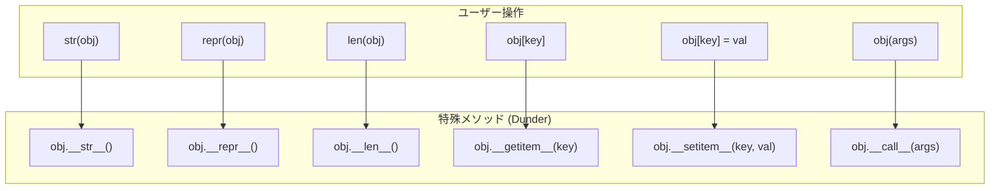

### 🎯 学習目標
- Pythonにおける「Dunder」（ダブルアンダースコア）メソッドの概念を理解する。
- `__str__` と `__repr__` を使用して、カスタムオブジェクトの文字列表現を実装する。
- `__getitem__`, `__setitem__`, `__len__` を使用して、独自のカプセル化コンテナ型クラスを設計する。
- `__call__` メソッドを使用して、関数のように呼び出し可能なオブジェクト（Callable）を作成する。

### 🧩 中核概念（なぜ）
Pythonの実行モデルは、そのオブジェクト指向機能と深く統合されています。カスタムデータ型に対して特別なキーワードベースの演算子や専用のAPIを用意する代わりに、Pythonは前後をダブルアンダースコアで囲まれた特殊なメソッドを使用します。これらは**Dunder（ダンダー）メソッド**または**特殊メソッド**（Magic Methods）と呼ばれます。

例えば、`+` 演算子を使用すると、Pythonは内部で `a + b` を `a.__add__(b)` に変換します。同様に、`len(obj)` の呼び出しは `obj.__len__()` を呼び出します。これらの特殊メソッドをオーバーライドすることで、作成したカスタムクラスをリスト、辞書、あるいは関数のマシンのようにネイティブ型と同様に動作させることができます。これにより、直感的で読みやすく、再利用性の高い「Pythonic（Pythonらしい）」コードを書くことが可能になります。

### 🔁 ロジックと動作
ユーザーによる通常の操作や関数呼び出しが、内部の特殊メソッド呼び出しに変換される流れを以下に示します。



### 📝 注釈付きサンプル
以下は、文字列表現メソッドを実装したカスタム `Vector` クラスと、辞書ラッパーのコンテナクラスの例です。

```python
class Vector:
    def __init__(self, x, y):
        self.x = x
        self.y = y

    # __repr__ はあいまいさのない表現を返し、可能ならオブジェクトを再生成できるコードを返します
    def __repr__(self):
        return f"Vector({self.x}, {self.y})"

    # __str__ はユーザー向けに読みやすい親切な文字列を返します
    def __str__(self):
        return f"({self.x}i + {self.y}j)"

# ベクトルのインスタンス化
v = Vector(3, 4)
print(repr(v)) # 出力: Vector(3, 4) (デバッグ時の確認に最適)
print(str(v))  # 出力: (3i + 4j)  (ユーザーへの画面表示に最適)
```

### ❌ よくある間違い

**間違い 1: `__str__` や `__repr__` から文字列以外の型を返す**
```python
class Point:
    def __init__(self, x, y):
        self.x = x
        self.y = y
    def __str__(self):
        return self.x # 整数型を返してしまっている
```
```text
TypeError: __str__ returned non-string (type int)
```
```python
class Point:
    def __init__(self, x, y):
        self.x = x
        self.y = y
    def __str__(self):
        return f"Point({self.x}, {self.y})" # 修正：文字列を返すようにする
```
> `__str__` と `__repr__` は常に文字列オブジェクト（`str`）を返さなければなりません。それ以外の型を返すと `TypeError` が発生します。

**間違い 2: `__getitem__` で値を返すのを忘れる**
```python
class CustomList:
    def __init__(self):
        self._items = [1, 2, 3]
    def __getitem__(self, index):
        self._items[index] # 戻り値の return を忘れている
```
```text
None
```
```python
class CustomList:
    def __init__(self):
        self._items = [1, 2, 3]
    def __getitem__(self, index):
        return self._items[index] # 修正：取得した値を return で返す
```
> `__getitem__` は指定されたインデックスやキーに対応する値を返す必要があります。`return` を書き忘れると、Pythonは暗黙的に `None` を返します。

### 💡 コツ・イディオム
- 常に最初に `__repr__` を実装しましょう。クラスに `__str__` が定義されていない場合、Pythonは自動的に `__repr__` を代替として呼び出します。
- `__call__` メソッドを使用すると、呼び出しごとに状態を保持できるため、クロージャや単一メソッドを持つクラスをシンプルに置き換えることができます（メモ化キャッシュやレートリミッターなどに便利です）。

### 🧠 深掘り（内部の仕組み）
<details><summary>特殊メソッドの検索プロセス</summary>

Pythonが特殊メソッド（`__len__` など）を実行するとき、インスタンスの辞書（`__dict__`）をバイパスして、直接クラスオブジェクトからメソッドを検索します。これは処理速度の向上と、組み込み処理での動作の整合性を保つための設計です。

例えば、`len(obj)` を実行する際、`obj.__dict__['__len__']` は探索されず、`type(obj).__len__(obj)` が取得されます。したがって、インスタンスに対して動的に `__len__` 関数を追加しても、クラス自体にそれが定義されていない限り、組み込みの `len()` 関数からは無視されます。
</details>

### 🏋️ 演習
`DictWrapper` クラスに対して `__getitem__`, `__setitem__`, `__len__`, `__call__` を実装し、辞書データをラップしてブラケットによるアクセス、要素数の取得、および直接の関数呼び出しによるキー検索をサポートしてください。

```python
class DictWrapper:
    def __init__(self):
        self._data = {}
    # Implement __getitem__, __setitem__, __len__ and __call__
```

### ✅ 自己チェック
1. クラスに `__str__` は実装されているが `__repr__` が実装されていない状態で `repr(obj)` を呼び出すとどうなりますか？
2. シーケンス型においてインデックスが範囲外の場合、`__getitem__` は例外として何を投げるべきですか？
<details><summary>回答</summary>

1. `__repr__` が未定義の場合、`repr(obj)` はデフォルトのオブジェクト表現（例: `<__main__.ClassName object at 0x...>`）を返します。なお、`__str__` がなく `__repr__` がある場合に `str(obj)` を呼び出すと、`__repr__` が代替実行されます。
2. リストのようなシーケンス型の場合は `IndexError` を、辞書のようなマッピング型の場合は `KeyError` を発生させるのが適切です。
</details>

### 📌 まとめ
- **特殊メソッド（Dunder）** は、カスタムオブジェクトをPythonの構文や組み込み関数とシームレスに統合します。
- `__str__` は一般ユーザー向けの読みやすさを重視し、`__repr__` は開発者向けの厳密な表現を提供します。
- コンテナプロトコル（`__getitem__`, `__setitem__`, `__len__`）を実装することで、クラスをリストや辞書のように扱えます。
- `__call__` を定義すると、オブジェクトのインスタンス自体を関数のように呼び出せます。
