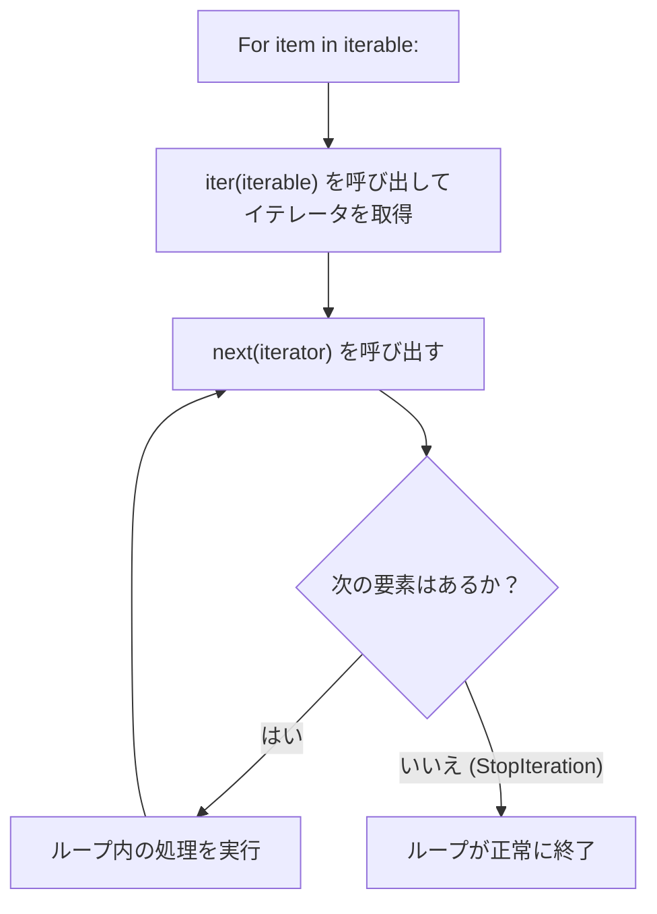

### 🎯 学習目標
- イテラブル（Iterable）とイテレータ（Iterator）の根本的な違いを理解する。
- `__iter__` と `__next__` を用いて、イテレーションプロトコルを実装する。
- 無限シーケンスや特殊コレクションを扱うカスタムイテレータを作成する。
- `yield` キーワードを使用したジェネレータ関数をマスターし、メモリ効率の高いデータフローを構築する。
- ジェネレータ式および `yield from` シンタックスによる委譲を理解する。

### 🧩 中核概念（なぜ）
数ギガバイトに及ぶログファイルの読み込みや、無限の数式シーケンスの生成など、膨大なデータや連続データを扱う際、全要素を一度にリスト（配列）に読み込むとコンピュータのメモリが枯渇してしまいます。

Pythonは、この課題を**イテレータ**と**ジェネレータ**によって解決します。これらの仕組みは「**遅延評価（Lazy Evaluation）**」をベースとしており、次の要素が明示的に要求されるまで生成を行いません。

- **イテラブル（Iterable）**：リスト、タプル、文字列などのように、ループ処理が可能なすべてのオブジェクト。
- **イテレータ（Iterator）**：状態を保持し、`next()` 関数を通じて要素を1つずつ順番に生成・返却するオブジェクト。
- **ジェネレータ（Generator）**：`yield` キーワードを含む関数として、イテレータをより簡潔に記述する仕組み。

### 🔁 ロジックと動作
イテレーションのライフサイクルと、Pythonがイテレーションプロトコルを自動制御する流れを以下に示します。



### 📝 注釈付きサンプル
以下は、カスタム範囲イテレータと、リストからエラーログ行を順次抽出するジェネレータ関数の例です。

```python
# 1. イテレーションプロトコルを実装したカスタムイテレータ
class Countdown:
    def __init__(self, start):
        self.current = start

    def __iter__(self):
        return self # イテレータは自身の __iter__ で自分自身を返さなければなりません

    def __next__(self):
        if self.current <= 0:
            raise StopIteration # イテレーションの終了を通知
        val = self.current
        self.current -= 1
        return val

# カスタムイテレータのテスト
for num in Countdown(3):
    print(num) # 出力: 3, 2, 1

# 2. yield キーワードを使用したジェネレータ関数
def read_logs(lines):
    for line in lines:
        if "ERROR" in line:
            yield line.strip()

log_data = ["INFO: System OK", "ERROR: DB Connection failed", "INFO: Job finished"]
error_generator = read_logs(log_data)
print(next(error_generator)) # 出力: ERROR: DB Connection failed
```

### ❌ よくある間違い

**間違い 1: 消費済みのイテレータを再利用しようとする**
```python
my_list = [1, 2, 3]
iterator = iter(my_list)
print(list(iterator)) # イテレータを消費
print(list(iterator)) # 再利用を試みる
```
```text
[1, 2, 3]
[]
```
```python
my_list = [1, 2, 3]
# もう一度ループを回したい場合は、新しいイテレータを生成する
iterator = iter(my_list)
print(list(iterator))
iterator_new = iter(my_list)
print(list(iterator_new))
```
> イテレータは状態を保持し、進むにつれて要素を消費します。一度 `StopIteration` に達するとイテレータは空になり、再度呼び出してもデータを返しません。

**間違い 2: カスタムイテレータの `__next__` で StopIteration を発生させるのを忘れる**
```python
class InfiniteOne:
    def __init__(self):
        self.count = 0
    def __iter__(self):
        return self
    def __next__(self):
        if self.count >= 2:
            pass # StopIterationを発生させ忘れている！
        self.count += 1
        return 1
print(list(InfiniteOne()))
```
```text
(実行タイムアウト / 無限ループ検出)
```
```python
class InfiniteOne:
    def __init__(self):
        self.count = 0
    def __iter__(self):
        return self
    def __next__(self):
        if self.count >= 2:
            raise StopIteration # 修正：終了をループに通知する
        self.count += 1
        return 1
print(list(InfiniteOne())) # 出力: [1, 1]
```
> `StopIteration` を発生させないと、ループ処理や `list()` による変換処理が終了条件を見つけられず、無限ループに陥ってプログラムがハングします。

### 💡 コツ・イディオム
- **ジェネレータ式**：リスト内包表記と同様に、丸括弧 `()` を使うことで簡潔にジェネレータを記述できます： `gen = (x * x for x in range(10))`。
- **`yield from`**：あるジェネレータの出力を別のジェネレータに委譲したい場合は、`yield from` を使用します。
  ```python
  def chain_generators(gen1, gen2):
      yield from gen1
      yield from gen2
  ```

### 🧠 深掘り（内部の仕組み）
<details><summary>ジェネレータ関数の「一時停止」と「再開」の仕組み</summary>

ジェネレータ関数を呼び出した時点では、関数内のコードはまだ実行されません。代わりに、ジェネレータオブジェクトが返されます。

ジェネレータオブジェクトに対して `next()` が呼び出された際の処理フロー：
1. 最初の `yield` ステートメントに到達するまで関数を実行します。
2. 到達すると、関数の実行状態（ローカル変数、インストラクションポインタ、およびスタックフレーム）がフリーズされ保存されます。
3. `yield` に指定された値を返します。
4. 次回 `next()` が呼び出されると、一時停止した全く同じ場所から実行を再開し、保存されていたローカル状態を復元します。このスタックフレームの永続化により、ジェネレータは状態変化を伴う複雑な制御フローを最小限のメモリ負荷で実現できます。
</details>

### 🏋️ 演習
`fibonacci_limit(limit)` というジェネレータ関数を実装し、指定された制限値（limit）以下のフィボナッチ数を出力してください。シーケンスは `0, 1, 1, 2, 3...` から開始するものとします。

```python
def fibonacci_limit(limit):
    # Yield fibonacci numbers up to (and including) limit
    pass
```

### ✅ 自己チェック
1. 通常の関数の `return` と、ジェネレータ関数の `yield` の最大の違いは何ですか？
2. `[x for x in range(10)]` はジェネレータ式ですか？
<details><summary>回答</summary>

1. 通常の関数は1回だけ値を返して自身のスタックフレームを破棄しますが、ジェネレータ関数はイテレータオブジェクトを返し、呼び出されるたびに複数回にわたって値を生成（yield）し、実行途中の状態やスタックフレームを保持します。
2. いいえ、大括弧 `[]` はリスト内包表記であり、すべての要素を即座にメモリ上に展開します。ジェネレータ式は丸括弧 `(x for x in range(10))` を用いて記述します。
</details>

### 📌 まとめ
- **イテラブル**はループ処理の対象となるオブジェクト、**イテレータ**は必要に応じて都度要素を生成するオブジェクトです。
- **イテレーションプロトコル**は、イテレータ自身を返す `__iter__` と、次の要素を返すか `StopIteration` を投げる `__next__` で構成されます。
- **ジェネレータ**は、`yield` キーワードを用いることで、イテレータの実装を劇的にシンプルにします。
- ジェネレータは内部状態を維持しつつ遅延処理を行うため、超巨大データセットに対しても極めてメモリ効率が良く動作します。
