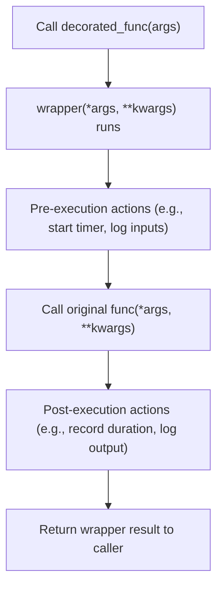

### 🎯 学習目標
- デコレータとは何か、また関数の動作をどのように変更できるかを説明できる。
- Pythonの関数が「ファーストクラスオブジェクト（第一級オブジェクト）」であることを理解する。
- 引数なしのデコレータを作成し、使用できる。
- 引数ありのデコレータを作成し、使用できる。
- 元の関数のメタデータを保持するために `functools.wraps` を適用できる。
- `__call__` メソッドを使用してクラスベースのデコレータを実装できる。

### 🧩 中核概念（なぜ）
ソフトウェア開発では、コアとなる業務ロジックのほかに、補助的なロジックを実行しなければならないことがよくあります。たとえば、関数の呼び出し履歴のログ出力、アクセス権限のチェック、時間のかかる計算結果のキャッシュ、パフォーマンス測定などです。これらのロジックをすべての関数にコピー＆ペーストしてしまうと、コードが重複し、メンテナンスが困難になり、バグの原因になります。

Pythonはこれを **デコレータ** で解決します。デコレータとは、別の関数を引数として受け取り、その関数を明示的に変更することなく機能を拡張し、新しい関数を返す関数のことです。

これが可能なのは、Pythonにおいて関数が **第一級オブジェクト（ファーストクラスオブジェクト）** だからです。
- 変数に関数を代入できます。
- 他の関数への引数として関数を渡せます。
- 他の関数の中で関数を定義できます（入れ子関数 / ネストされた関数）。
- 他の関数から関数を戻り値として返せます。

### 🔁 ロジックと動作
デコレータの構文である `@decorator` は、シンタックスシュガー（構文糖衣）です。次のように書くのは：
```python
@my_decorator
def my_func():
    pass
```
本質的に以下と全く同じ動作をします。
```python
my_func = my_decorator(my_func)
```

デコレータが適用された関数が呼び出されたときの実行フローは次のようになります。



### 📝 注釈付きサンプル

#### 1. 基本的なデコレータ（引数なし）
このデコレータは、ラップされた関数を実行する前後にメッセージを出力します。
```python
import functools

def my_logger(func):
    @functools.wraps(func) # 元の関数の名前とドキュメント文字列（docstring）を保持します
    def wrapper(*args, **kwargs):
        print(f"[LOG] Calling {func.__name__} with args: {args}, kwargs: {kwargs}")
        result = func(*args, **kwargs)
        print(f"[LOG] {func.__name__} finished execution.")
        return result
    return wrapper

@my_logger
def greet(name, greeting="Hello"):
    return f"{greeting}, {name}!"

print(greet("Alice"))
# 出力:
# [LOG] Calling greet with args: ('Alice',), kwargs: {}
# [LOG] greet finished execution.
# Hello, Alice!
```

#### 2. 引数を受け取るデコレータ
デコレータ自体に引数を渡すには、3層の入れ子関数が必要です。最外層の関数はデコレータ引数を受け取り、中間層の関数は対象の関数を受け取り、最内層の関数は実行処理を担当します。
```python
import functools

def repeat(num_times):
    def decorator_repeat(func):
        @functools.wraps(func)
        def wrapper(*args, **kwargs):
            for _ in range(num_times):
                result = func(*args, **kwargs)
            return result
        return wrapper
    return decorator_repeat

@repeat(num_times=3)
def greet_loudly(name):
    print(f"HELLO {name.upper()}!")

greet_loudly("Bob")
# 出力:
# HELLO BOB!
# HELLO BOB!
# HELLO BOB!
```

#### 3. クラスベースのデコレータ
デコレータをクラスとして実装することもできます。クラスは `__init__` コンストラクタで関数を受け取り、`__call__` 特殊メソッド内に関数の実行ロジックを実装します。
```python
class CountCalls:
    def __init__(self, func):
        self.func = func
        self.num_calls = 0

    def __call__(self, *args, **kwargs):
        self.num_calls += 1
        print(f"Function {self.func.__name__} has been called {self.num_calls} times")
        return self.func(*args, **kwargs)

@CountCalls
def say_hello():
    print("Hello")

say_hello() # 出力: Function say_hello has been called 1 times \n Hello
say_hello() # 出力: Function say_hello has been called 2 times \n Hello
```

### ❌ よくある間違い

**間違い 1: `functools.wraps` の使い忘れ**
```python
def bad_decorator(func):
    def wrapper(*args, **kwargs):
        return func(*args, **kwargs)
    return wrapper

@bad_decorator
def greet():
    """Greets the user."""
    return "Hello!"

print(greet.__name__)
print(greet.__doc__)
```
```text
wrapper
None
```
```python
import functools

def good_decorator(func):
    @functools.wraps(func)
    def wrapper(*args, **kwargs):
        return func(*args, **kwargs)
    return wrapper

@good_decorator
def greet():
    """Greets the user."""
    return "Hello!"

print(greet.__name__)
print(greet.__doc__)
```
> `@functools.wraps` を使用しない場合、デコレータを適用された関数は自身の識別情報（名前やdocstringなど）を失い、内部の wrapper 関数の識別情報に上書きされます。これにより、デバッグやイントロスペクションツールでの解析が困難になります。

**間違い 2: ラッパー関数内で関数の実行結果を return し忘れる**
```python
def log_only(func):
    def wrapper(*args, **kwargs):
        print(f"Executing {func.__name__}")
        func(*args, **kwargs)  # return し忘れている！
    return wrapper

@log_only
def add(a, b):
    return a + b

result = add(5, 5)
print(result)
```
```text
Executing add
None
```
```python
def log_only(func):
    def wrapper(*args, **kwargs):
        print(f"Executing {func.__name__}")
        return func(*args, **kwargs)  # 正解: 結果を return する
    return wrapper

@log_only
def add(a, b):
    return a + b

result = add(5, 5)
print(result)
```
> ラッパー関数が元の関数の呼び出し結果を明示的に返さない（return しない）場合、デコレータが適用された関数は、計算した値を破棄して常に `None` を返すようになります。

### 💡 コツ・イディオム
- **デコレータの連結（多重デコレータ）**: 1つの関数に複数のデコレータを適用できます。これらは、下から上（内側から外側）の順で適用されます。
  ```python
  @decorator_one
  @decorator_two
  def my_func():
      pass
  # これは次と同等です: my_func = decorator_one(decorator_two(my_func))
  ```
- **デコレータ適用前に関数を呼び出す**: デバッグの際などで、デコレータが適用される前の元の関数に直接アクセスしたい場合は、`@functools.wraps` を使用していれば `__wrapped__` 属性からアクセス可能です。
  ```python
  original_func = greet.__wrapped__
  ```

### 🧠 深掘り（内部の仕組み）
<details><summary>クロージャとスコープの名前解決</summary>

デコレータは、その内部で **クロージャ (Closure / 閉包)** と呼ばれる Python の機能を活用しています。クロージャとは、関数とその関数が定義された環境（スコープ内の自由変数の参照関係）をセットで保持する仕組みです。

外部関数が内部関数を返すとき、外部関数の実行が終了した後でも、内部関数は外部関数のローカル変数にアクセスし続けることができます。

Python は、関数の `__closure__` 属性内の **セルオブジェクト** を使用してこれを実現しています。
```python
def outer(x):
    def inner():
        print(x)
    return inner

my_closure = outer(10)
print(my_closure.__closure__[0].cell_contents) # 出力: 10
```
`inner()` が呼び出されると、Python はまずローカルスコープを検索し、次にクロージャのセルオブジェクトに保存されている外包スコープ、そしてグローバルスコープ、最後にビルトイン（LEGBルール）の順で変数を名前解決します。デコレータのラッパー関数は、元の関数 `func` 変数をキャプチャするクロージャそのものです。
</details>

### 🏋️ 演習
関数が実行されるまでの時間を測定し、その経過時間（float 型）をグローバルリスト `TIMED_RECORDS` に追加するタイマーデコレータを実装してください。

```python
import functools
import time

TIMED_RECORDS = []

def timer(func):
    # Implement timer decorator that appends duration to TIMED_RECORDS
    pass
```

### ✅ 自己チェック
1. デコレータは、デコレータ適用対象の関数に渡された引数をどのようにして受け取りますか？
2. 関数 `f()` に対して、`@dec1` の下に `@dec2` を重ねて適用した場合、どちらのデコレータのラッパーが最初に実行されますか？
<details><summary>回答</summary>

1. 内部のラッパー関数のシグネチャで可変長引数 `*args` とキーワード引数 `**kwargs` を受け取り、それを元の関数呼び出しにそのまま渡すことで引数を受け取ります。
2. `@dec1` が最初に実行されます。`@dec1` は `@dec2` のラッパーをラップし、その `@dec2` のラッパーが元の関数 `f()` をラップしているためです。
</details>

### 📌 まとめ
- **デコレータ** を使用すると、元の関数のソースコードを変更せずに、関数をラップして機能を拡張できます。
- Python において関数は **第一級オブジェクト** であり、これによって入れ子関数やデコレータの記述が可能になります。
- 自作のデコレータを作成する際は、元の関数の名前や docstring を保持するために、必ず `@functools.wraps` を適用する必要があります。
- デコレータは、関数（引数あり・なし）としても、クラスとしても実装できます。
