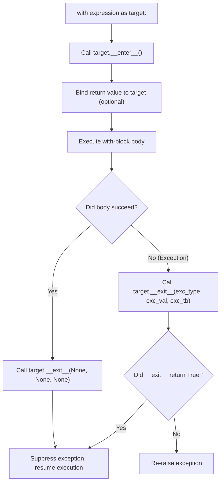

### 🎯 学習目標
- リソース管理とは何か、またリソースのクローズがなぜ重要であるかを説明できる。
- `try...finally` 文がどのようにクリーンアップ処理を行うかを理解する。
- `__enter__` と `__exit__` プロトコルを使用してカスタムコンテキストマネージャを実装できる。
- `contextlib.contextmanager` とジェネレータ関数を使用してコンテキストマネージャを作成できる。
- 複数のリソースを安全に扱うために、コンテキストマネージャを入れ子（ネスト）にして使用できる。

### 🧩 中核概念（なぜ）
ソフトウェア開発において、プログラムは常に外部のリソースとやり取りを行います。これには、ハードディスク上のファイル、データベースへの接続、ネットワークソケット、あるいはシステム全体の排他制御（ロック）などが含まれます。

プログラムがこれらのリソースを開いたり（あるいは取得したり）すると、オペレーティングシステムはプロセスに対してハンドル（ファイル記述子など）を割り当てます。使用後にこれらのリソースを閉じ忘れてしまうと、リソースはメモリ上にロックされたままになります。これを **リソースリーク（メモリリーク）** と呼びます。

プログラムが繰り返しリソースをリークさせると、最終的には利用可能なハンドルを使い果たし、クラッシュ、プロセスのフリーズ、データベース接続の切断などの致命的な問題を引き起こします。

これを解決するために、Pythonは **コンテキストマネージャ** を提供しています。コンテキストマネージャを使用すると、コードブロックの前後で自動的に実行されるセットアップ処理とクリーンアップ処理を定義でき、例外が発生したりクラッシュしたりした場合でも、リソースが確実にクローズされるようになります。

### 🔁 ロジックと動作
コンテキストマネージャの最も一般的な使用方法は、`with` 文を経由することです。`with` 文のライフサイクルは、Pythonの内部で以下のように管理されます。



### 📝 注釈付きサンプル

#### 1. クラスベースのコンテキストマネージャ
クラスを使用してコンテキストマネージャを実装する場合、次の2つの特殊メソッドを定義します。
- `__enter__`: リソースを取得し、`as` の後に続く変数にバインドされるオブジェクトを返します。
- `__exit__`: リソースの解放と例外のハンドリングを行います。
```python
class DatabaseConnection:
    def __init__(self, db_name):
        self.db_name = db_name

    def __enter__(self):
        print(f"Connecting to database: {self.db_name}")
        return self # このオブジェクトが as の後の変数に代入されます

    def __exit__(self, exc_type, exc_val, exc_tb):
        print("Closing database connection")
        if exc_type:
            print(f"An error occurred: {exc_val}")
        return False # 例外があった場合、それをそのまま呼び出し元へ伝播させます

with DatabaseConnection("user_db") as conn:
    print("Executing queries...")
# 出力:
# Connecting to database: user_db
# Executing queries...
# Closing database connection
```

#### 2. ジェネレータベースのコンテキストマネージャ
`contextlib` モジュールを使用すると、クラスを明示的に作成することなく、制御を1回だけ `yield` するジェネレータ関数を定義するだけでコンテキストマネージャを作成できます。
```python
from contextlib import contextmanager
import os

@contextmanager
def temporary_dir_change(destination):
    original_dir = os.getcwd()
    os.chdir(destination)
    try:
        yield # 'with' ブロック内の処理がここで実行されます
    finally:
        os.chdir(original_dir) # 確実に実行されるクリーンアップコード

# 使用例:
# with temporary_dir_change("/tmp"):
#     # /tmp ディレクトリ内で何かを実行する
```

#### 3. 複数のコンテキストマネージャのネスト
1つの `with` 文の中で、カンマで区切ることで複数のリソースを管理できます。
```python
# コピー元ファイルからコピー先ファイルへ内容をコピーする
with open("source.txt", "r") as src, open("dest.txt", "w") as dest:
    dest.write(src.read())
```

### ❌ よくある間違い

**間違い 1: `@contextmanager` 内で try-finally の使い忘れ**
```python
from contextlib import contextmanager

@contextmanager
def unsafe_resource():
    print("Acquire Resource")
    yield "data"
    print("Release Resource") # 例外が発生すると、このクリーンアップ処理は実行されません！

with unsafe_resource() as data:
    raise ValueError("Something went wrong!")
```
```text
Acquire Resource
Traceback (most recent call last):
  ...
ValueError: Something went wrong!
```
```python
from contextlib import contextmanager

@contextmanager
def safe_resource():
    print("Acquire Resource")
    try:
        yield "data"
    finally:
        print("Release Resource") # 例外が発生しても確実に実行されます

try:
    with safe_resource() as data:
        raise ValueError("Something went wrong!")
except ValueError:
    pass
```
> `@contextmanager` を使用する場合、`with` ブロック内で例外が発生すると、その例外はジェネレータ内の `yield` 部分で発生（スロー）します。`yield` が `try...finally` ブロックで囲まれていない場合、`yield` の後に記述したクリーンアップ処理はスキップされてしまいます。

**間違い 2: `__exit__` 内ですべての例外を誤って隠蔽してしまう**
```python
class SuppressEverything:
    def __enter__(self):
        return self
    def __exit__(self, exc_type, exc_val, exc_tb):
        return True # すべての例外を無条件で隠蔽してしまいます！

with SuppressEverything():
    result = 1 / 0
print("Program continued running despite ZeroDivisionError!")
```
```text
Program continued running despite ZeroDivisionError!
```
```python
class SuppressNone:
    def __enter__(self):
        return self
    def __exit__(self, exc_type, exc_val, exc_tb):
        if exc_type is ZeroDivisionError:
            print("Suppressed division by zero error")
            return True
        return False # 他のすべての例外はそのまま伝播させます

try:
    with SuppressNone():
        result = 1 / 0
except ZeroDivisionError:
    pass
```
> `__exit__` メソッドから `True` を返すと、発生した例外を「握りつぶす（隠蔽する）」よう Python に指示します。これを無条件で行うと、変数名の誤字や構文エラー、論理バグなどの予期しないエラーまで隠蔽されてしまい、デバッグが極めて困難になります。

### 💡 コツ・イディオム
- **`contextlib.suppress`**: 空の `try...except` ブロックを書く代わりに、想定内の例外をクリーンに無視できます。
  ```python
  from contextlib import suppress
  with suppress(FileNotFoundError):
      os.remove("nonexistent.txt")
  ```
- **`contextlib.closing`**: オブジェクトに `close()` メソッドはあるものの、コンテキストマネージャ自体が実装されていない場合、`closing()` でラップすることで安全にクローズ処理を自動化できます。
  ```python
  from contextlib import closing
  from urllib.request import urlopen

  with closing(urlopen('https://www.python.org')) as page:
      for line in page:
          pass
  ```

### 🧠 深掘り（内部の仕組み）
<details><summary>with 文のバイトコードの仕組み</summary>

バイトコードレベルにおいて、Pythonは `with` 文を実装するために専用の命令を使用しています。`with` 文を含む関数を逆アセンブル（disassemble）すると、`SETUP_WITH` や `WITH_EXCEPT_START` といった命令が確認できます。

Pythonが `with` ブロックに入ると：
1. `SETUP_WITH` がコンテキストマネージャの `__exit__` メソッドを実行スタックにプッシュします。
2. ブロック内のコードが実行されます。
3. 例外が発生した場合、インタプリタはスタックから `__exit__` をポップし、例外の詳細情報（`exc_type`, `exc_val`, `exc_tb`）を引数として `__exit__` を呼び出します。
4. `WITH_EXCEPT_START` が `__exit__` メソッドの返り値を検証します。返り値が真（True）であれば例外は破棄され、次の文から実行が再開されます。返り値が偽（False）であれば、例外はそのまま再送出（re-raise）されます。
</details>

### 🏋️ 演習
ジェネレータベースのコンテキストマネージャ `temp_file(filename, content)` を実装してください。このコンテキストマネージャは、ブロックに入るときに指定された内容を持つテキストファイルを作成し、ブロックを抜けるときにそのファイルを削除します（ブロック内で例外が発生した場合でも確実に削除されるようにしてください）。

```python
import os
from contextlib import contextmanager

@contextmanager
def temp_file(filename, content):
    # Create file with content on enter, delete it on exit
    pass
```

### ✅ 自己チェック
1. `with` ブロックが例外なく正常に終了した場合、Pythonは `__exit__` にどのような値を渡しますか？
2. ジェネレータベースのコンテキストマネージャから、`with` 文の `as` 変数にバインドされるオブジェクトを戻すにはどうすればよいですか？
<details><summary>回答</summary>

1. 引数 `exc_type, exc_val, exc_tb` に対して、それぞれ `None, None, None` を渡します。
2. `yield` 文にその値を指定します（例： `yield resource`）。
</details>

### 📌 まとめ
- **コンテキストマネージャ** を使用すると、リソースのクローズ処理やクリーンアップ処理を確実に実行できます。
- **`with` 文** は、内部で `__enter__` と `__exit__` プロトコルの呼び出しを自動化します。
- クラスで `__enter__` と `__exit__` を実装するか、`@contextmanager` デコレータをジェネレータ関数に適用することで、コンテキストマネージャを自作できます。
- ジェネレータベースのコンテキストマネージャを使用する際は、クリーンアップ処理がスキップされないよう、必ず `yield` 文を `try...finally` ブロックで囲んでください。
