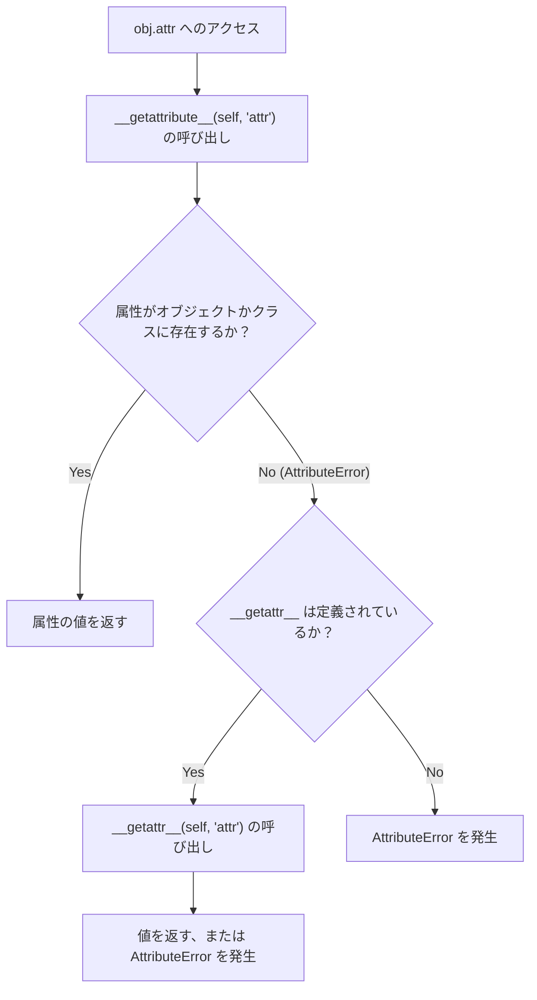

### 🎯 学習目標
- 特殊メソッド `__getattr__`、`__getattribute__`、`__setattr__`、および `__delattr__` を使用した動的な属性制御を習得する。
- `__getattr__` と `__getattribute__` の違いを理解し、適切に使い分けることができる。
- `type()` を使用して、実行時に動的にクラスを生成する。
- メタクラスの概念とライフサイクルを理解し、`__new__` や `__init__` を使用したカスタムメタクラスを実装できる。

### 🧩 中核概念（なぜ）
通常のオブジェクト指向プログラミングでは、クラスやオブジェクトはあらかじめ定義された固定の構造を持ちます。ソースコード上で属性やメソッドを定義し、それらは実行時もそのまま固定されます。

しかし、モダンなソフトウェア設計では、より柔軟な対応が求められることがあります。たとえば、データベースのテーブル列を自動的に Python のクラス属性にマッピングする O/R マッパー（ORM）の作成や、Web API のレスポンスを動的にオブジェクトのプロパティとしてラップするラッパーの作成などです。

ここで登場するのが **メタプログラミング** です。メタプログラミングとは、「プログラムを操作するプログラム」を書く手法であり、実行時にクラスやオブジェクトを動的に検査、変更、あるいは自動生成することを可能にします。Python は極めて動的な言語であり、クラス生成や属性アクセスの深い部分に介入するための「フック（Hook）」を提供しています。これらのフックをマスターすることで、表現力が豊かでクリーンな API やライブラリを構築できるようになります。

### 🔁 ロジックと動作
属性の検索フローを正しく理解することは非常に重要です。Python でオブジェクトの属性 `obj.attr` にアクセスすると、インタプリタは以下の流れに従って処理を進めます。



1. **`__getattribute__`** は、オブジェクトの属性アクセス時に *常に* 例外なく呼び出されます。
2. 通常の属性検索で属性が見つからない場合、あるいは `__getattribute__` が `AttributeError` を発生させた場合、Python はフォールバックとして **`__getattr__`** を呼び出します。
3. **`__setattr__`** は、すべての属性への代入（値のセット）処理（`obj.attr = value`）に介入します。
4. **`__delattr__`** は、すべての属性の削除処理（`del obj.attr`）に介入します。

### 📝 注釈付きサンプル

#### 1. 動的な属性制御
`__getattr__` メソッドは、オブジェクトに存在しない属性にアクセスされたときにのみトリガーされます。そのため、デフォルトの挙動や他オブジェクトへの委譲（デリゲーション）処理に最適です。
```python
class DynamicDictWrapper:
    def __init__(self, data_dict):
        # 内部データを保持。属性代入の無限再帰を避けるため、親クラスの setattr を呼び出す
        super().__setattr__('_data', data_dict)

    def __getattr__(self, name):
        # 通常の属性が見つからない場合にのみ実行されるフォールバック
        if name in self._data:
            return self._data[name]
        raise AttributeError(f"'{self.__class__.__name__}' has no attribute '{name}'")

    def __setattr__(self, name, value):
        # 属性への代入処理をすべてフックし、内部辞書を更新
        self._data[name] = value

# 使用例:
wrapper = DynamicDictWrapper({'title': 'Sensei Hub', 'version': 1.0})
print(wrapper.title)    # 出力: Sensei Hub (__getattr__ 経由で取得)
wrapper.version = 2.0   # (__setattr__ 経由で設定)
print(wrapper.version)  # 出力: 2.0
```

#### 2. `type()` を使用したクラスの動的生成
クラスは通常 `class` キーワードを使って宣言しますが、`type(name, bases, dict)` を呼び出すことで実行時に動的に作成することもできます。
```python
# 実行時に動的にクラスを作成する
# type(name, bases, dict)
# - name: クラス名（文字列）
# - bases: 継承するベースクラスのタプル
# - dict: クラスの属性とメソッドを格納した辞書

def greet(self):
    return f"Hello, I am {self.name}!"

# DynamicPerson クラスを動的に作成（object を継承し、属性 species とメソッド greet を持つ）
DynamicPerson = type(
    'DynamicPerson',
    (object,),
    {
        'species': 'Human',
        'greet': greet
    }
)

# 生成された動的クラスを利用する
person = DynamicPerson()
person.name = "Bob"
print(person.greet())   # 出力: Hello, I am Bob!
print(person.species)  # 出力: Human
```

#### 3. カスタムメタクラスの実装
メタクラスとは、クラスそのものの型（クラスを作るクラス）です。Python におけるデフォルトのメタクラスは `type` です。`type` を継承することで、クラス作成時に独自の処理を挟み込むことができます。
```python
class PrefixMetaclass(type):
    # __new__ はクラスオブジェクトのメモリ割り当てと生成を行います
    # mcs: メタクラス自身
    # name: 定義されるクラス名
    # bases: ベースクラス
    # dct: クラスの名前空間辞書（メソッドやクラス変数）
    def __new__(mcs, name, bases, dct):
        prefixed_dct = {}
        for key, val in dct.items():
            # 特殊メソッド（__で始まる名前）以外のメソッドに自動で 'api_' 接頭辞を付与
            if not key.startswith('__') and callable(val):
                prefixed_dct[f'api_{key}'] = val
            else:
                prefixed_dct[key] = val
        return super().__new__(mcs, name, bases, prefixed_dct)

class Endpoint(metaclass=PrefixMetaclass):
    def fetch_users(self):
        return ["Alice", "Bob"]

# インスタンスの生成
ep = Endpoint()
# メタクラスによって 'fetch_users' が 'api_fetch_users' にリネームされている
print(hasattr(ep, 'fetch_users'))      # 出力: False
print(ep.api_fetch_users())            # 出力: ['Alice', 'Bob']
```

### ❌ よくある間違い

**Mistake 1: `__setattr__` 内で通常の代入を行うことによる無限再帰**
```python
class UnsafeSetAttr:
    def __setattr__(self, name, value):
        self.name = value # 自身の属性を設定することで __setattr__ が再度呼び出され、無限再帰に！
```
```text
RecursionError: maximum recursion depth exceeded in comparison
```
```python
class SafeSetAttr:
    def __setattr__(self, name, value):
        # 親オブジェクトの setattr を呼び出して無限再帰を回避する
        super().__setattr__(name, value)
```
> `__setattr__` メソッドの内部で `self.name = value` のようにオブジェクトの属性に直接代入しようとすると、その処理が再び `__setattr__` を呼び出すため無限再帰が発生します。これを防ぐには、`super().__setattr__(name, value)` を使用するか、オブジェクトの名前空間辞書に直接書き込む `self.__dict__[name] = value` を使用する必要があります。

**Mistake 2: `__getattribute__` 内で通常の属性アクセスを行うことによる無限再帰**
```python
class UnsafeGetAttribute:
    def __getattribute__(self, name):
        print(f"Log: accessing {name}")
        return self.name # __getattribute__ を再度再帰的に呼び出してしまう！
```
```text
RecursionError: maximum recursion depth exceeded while calling a Python object
```
```python
class SafeGetAttribute:
    def __getattribute__(self, name):
        print(f"Log: accessing {name}")
        # 親クラスの __getattribute__ に処理を委譲する
        return super().__getattribute__(name)
```
> `__getattribute__` は、属性アクセスの際に例外なく呼び出されるため、メソッド内部で `self.name` のように属性にアクセスすると再度 `__getattribute__` が呼び出され、無限ループに陥ります。オブジェクトの属性値を取得する際は、必ず `super().__getattribute__(name)` を介して呼び出してください。

### 💡 コツ・イディオム
- **`__getattribute__` よりも `__getattr__` を優先する**: `__getattr__` は、属性が存在しない場合の最終手段としてのみ呼び出されるため、安全かつ動作も高速です。すべてのアクセスを監視する必要がない限り（セキュリティ上のサンドボックス化やリアルタイムのアクセスログ出力など）、`__getattr__` を使用してください。
- **組み込み関数による動的アクセス**: 属性名が文字列として実行時にしか判明しない場合は、`getattr()`、`setattr()`、`hasattr()`、および `delattr()` を使用してプログラム上で動的に操作します。
- **メタクラスとクラスデコレータの使い分け**: メタクラスで解決できる多くのケースは、クラスデコレータを使用することでもよりシンプルに解決できます。ただし、クラス作成の仕組みをサブクラスすべてに自動で継承させたい場合は、メタクラスが最も適しています。

### 🧠 深掘り（内部の仕組み）
<details><summary>メタクラスのライフサイクルとクラスの動的生成</summary>

Python が `class` 定義ブロックを実行するとき、裏側では次のステップが踏まれます。
1. **メタクラスの決定**: 定義文内の `metaclass=` キーワード、親クラスのメタクラス、またはデフォルトの `type` から適切なメタクラスを決定します。
2. **名前空間（名前空間辞書）の準備**: メタクラスの `__prepare__(name, bases, **kwargs)` メソッドが呼び出され、クラス変数を定義するための名前空間（辞書ライクなオブジェクト）を返します。
3. **クラス本体の実行**: クラス定義ブロック内の命令を実行し、用意された名前空間にメソッドや変数を格納します。
4. **クラスオブジェクトのインスタンス化**: メタクラスのコンストラクタが呼び出されます。
   `metaclass(name, bases, namespace_dict)`
   この呼び出し中、メタクラスの以下のメソッドが実行されます。
   - `__new__(mcs, name, bases, dct)`: メモリを確保し、クラスオブジェクト自体を返します。
   - `__init__(cls, name, bases, dct)`: 生成されたクラスオブジェクトの初期設定を行います。
</details>

### 🏋️ 演習
許可された属性へのアクセスのみを制限する `SafeAttribute` クラスを実装してください。このクラスは `__init__` で許可する属性名のリスト（文字列）を受け取ります。許可されたリストに含まれていない属性へのアクセスや新規設定の操作は、すべて `AttributeError` を発生させてください。

```python
class SafeAttribute:
    # 許可された属性名のリストを __init__ に渡す必要があります
    # それ以外の属性へのアクセスは AttributeError を発生させる必要があります
    pass
```

### ✅ 自己チェック
1. `__getattr__` と `__getattribute__` の最も決定的な違いは何ですか？
2. クラスオブジェクト自体がある種の「インスタンス」とされるのはなぜですか？
<details><summary>解答</summary>

1. `__getattribute__` は属性が存在するかどうかにかかわらず、すべての属性アクセスで常に呼び出されます。一方、`__getattr__` は通常の属性検索で見つからなかった（`AttributeError` が発生した）場合のみフォールバックとして呼び出されます。
2. Python においては、クラスも含む「すべてのもの」がオブジェクトです。そのため、クラスオブジェクトもメタクラス（デフォルトでは `type`）のインスタンスとして扱われます。
</details>

### 📌 まとめ
- **メタプログラム**によって、Python プログラムは実行時に動的にクラスを作成し、属性制御をカスタマイズできます。
- 属性が見つからなかった場合のフォールバックには `__getattr__` を、すべてのアクセスを監視・制御したい場合には `__getattribute__` を使用します。
- 無限再帰を避けるため、属性制御メソッド内で自身の属性に直接触れることは避け、`super()` を経由させて処理を行います。
- メタクラスは `type` を継承したクラスであり、`__new__` と `__init__` を介してクラス自体の作成と初期化を制御します。
