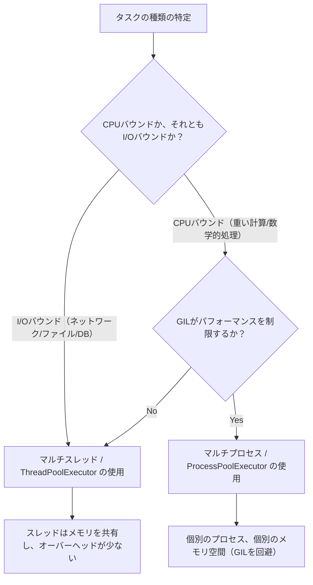

### 🎯 学習目標
- 「並行処理（Concurrency）」と「並列処理（Parallelism）」の違いを明確に説明できる。
- Python のグローバルインタプリタロック（GIL）の仕組みと、それがプログラムの実行速度に与える影響を理解する。
- マルチスレッド（I/Oバウンド向き）とマルチプロセス（CPUバウンド向き）の使い分けを理解する。
- `concurrent.futures` モジュールを使用して、スレッドプールやプロセスプールを効率的に管理できる。

### 🧩 中核概念（なぜ）
現代のコンピュータは複数のコアを持つプロセッサを搭載しており、同時に多くの命令を実行できます。このハードウェア性能を最大限に引き出すために、プログラム内でタスクを同時に実行する必要があります。

しかし、Python（特に標準の CPython インタプリタ）の開発者には固有の課題が存在します。それが **グローバルインタプリタロック（GIL：Global Interpreter Lock）** です。GIL は、Python のバイトコードを実行できる OS スレッドを「常に 1 つだけ」に制限する仕組みです。このため、たとえば 16 コアの CPU を持つマシンであっても、マルチスレッドの Python プログラムは CPU バウンドな処理を行う際には実質的に 1 つのコアしか利用できません。

高性能なアプリケーションを構築するためには、この GIL を回避する方法を知る必要があります。そのためには、**I/Oバウンドなタスク**（ネットワーク、ディスク、データベースの待機時間が発生する処理。待機中に GIL を解放するためスレッドが非常に有効）と、**CPUバウンドなタスク**（重い計算処理。真の並列処理を実現するために、メモリ空間とインタプリタ自体を別々にした独立プロセスを使う必要がある）を明確に区別し、適切なアプローチを選択しなければなりません。

### 🔁 ロジックと動作
Python で並行処理プログラムの構成を決定する際は、以下の意思決定フローを使用します。



- **並行処理（Concurrency）** は、「複数のタスクを切り替えながら進めること」を指します（Web リクエストのレスポンス待ちなど、複数のタスクが重なり合って進行するようプログラムを構造化します）。
- **並列処理（Parallelism）** は、「複数のタスクを物理的に同時に実行すること」を指します（複数の CPU コア上で同時に複数の演算を実行します）。

### 📝 注釈付きサンプル

#### 1. I/Oバウンドタスクに対する `ThreadPoolExecutor` の使用
`concurrent.futures` モジュールは、スレッドプールやプロセスプールを利用してタスクを非同期に実行するためのシンプルで高レベルなインターフェースを提供します。
```python
from concurrent.futures import ThreadPoolExecutor
import urllib.request
import time

URLS = [
    'https://www.python.org',
    'https://www.wikipedia.org',
    'https://httpbin.org/delay/1'
]

def load_url(url):
    # 代表的な I/Oバウンド処理: Web ページの取得
    with urllib.request.urlopen(url, timeout=5) as conn:
        return conn.read()

# context manager を使用することで、処理完了後にスレッドプールが自動的かつ確実にクローズされます
start_time = time.time()
with ThreadPoolExecutor(max_workers=3) as executor:
    # executor.map は、URLS の各要素に対して load_url を並行して適用します
    results = list(executor.map(load_url, URLS))

print(f"Downloaded {len(results)} pages in {time.time() - start_time:.2f} seconds")
```

#### 2. CPUバウンドタスクに対する `ProcessPoolExecutor` の使用
重い計算処理を実行する場合、GIL の影響によりマルチスレッドは効果がありません。代わりに `ProcessPoolExecutor` を使用して、別々のプロセス上でタスクを実行します。
```python
from concurrent.futures import ProcessPoolExecutor
import time

def calculate_prime_factors(n):
    # 代表的な CPUバウンド処理: 素因数分解
    factors = []
    d = 2
    while d * d <= n:
        while (n % d) == 0:
            factors.append(d)
            n //= d
        d += 1
    if n > 1:
        factors.append(n)
    return factors

numbers = [1000000007, 2000000014, 3000000019, 4000000021]

# Windows や macOS では、子プロセスがスクリプトを無限に再帰実行するのを防ぐため、
# 必ず if __name__ == '__main__': ブロック内で実行します
if __name__ == '__main__':
    start_time = time.time()
    # ProcessPoolExecutor は、個別の Python インタプリタを起動して GIL を回避します
    with ProcessPoolExecutor(max_workers=4) as executor:
        results = list(executor.map(calculate_prime_factors, numbers))
    
    print(f"Calculated factors in {time.time() - start_time:.2f} seconds")
```

#### 3. `submit()` と `as_completed` による詳細な実行制御
`executor.map` は入力されたリストと同じ順序で結果を返しますが、`submit()` は `Future` オブジェクトを返します。これにより、各タスクの進行状況を監視したり、完了したものから順次処理したりできます。
```python
from concurrent.futures import ThreadPoolExecutor, as_completed
import time

def delayed_task(n):
    time.sleep(n)
    return f"Task with {n}s delay done"

delays = [3, 1, 2]

with ThreadPoolExecutor(max_workers=3) as executor:
    # タスクを送信し、Future オブジェクトと遅延時間をマッピングする
    future_to_delay = {executor.submit(delayed_task, d): d for d in delays}
    
    # 順序に関係なく、完了した順に結果を取得して処理する
    for future in as_completed(future_to_delay):
        delay = future_to_delay[future]
        try:
            result = future.result()
            print(f"Result: {result} (original delay: {delay}s)")
        except Exception as exc:
            print(f"Task generated an exception: {exc}")
# 出力結果の例:
# Result: Task with 1s delay done (original delay: 1s)
# Result: Task with 2s delay done (original delay: 2s)
# Result: Task with 3s delay done (original delay: 3s)
```

### ❌ よくある間違い

**Mistake 1: CPUバウンドなタスクの高速化にマルチスレッドを使用すること**
```python
import threading

def cpu_heavy_work():
    # 大量の整数の二乗和を求める（CPU 負荷が高い処理）
    sum(i * i for i in range(10**7))

# スレッドを使用して並行して実行しようとする
t1 = threading.Thread(target=cpu_heavy_work)
t2 = threading.Thread(target=cpu_heavy_work)
t1.start(); t2.start()
t1.join(); t2.join()
```
```text
(スレッドの競合や切り替えのオーバーヘッドにより、結果として順次処理するよりも実行時間が長くなるか、同等になります)
```
```python
from multiprocessing import Process

def cpu_heavy_work():
    sum(i * i for i in range(10**7))

if __name__ == '__main__':
    # 個別のシステムプロセス上で実行することで GIL を回避する
    p1 = Process(target=cpu_heavy_work)
    p2 = Process(target=cpu_heavy_work)
    p1.start(); p2.start()
    p1.join(); p2.join()
```
> GIL の影響により、Python のバイトコードを実行できるスレッドは常に 1 つに制限されています。そのため、CPU バウンドな処理でマルチスレッドを使用すると、スレッド切り替えのオーバーヘッドや GIL を巡る競合（Lock Contention）により、かえってパフォーマンスが低下します。計算処理を並列化するには、`multiprocessing` モジュールまたは `ProcessPoolExecutor` を使用する必要があります。

**Mistake 2: 共有されたミュータブルな状態を同期せずに変更すること（レースコンディション）**
```python
import threading

counter = 0

def unsafe_increment():
    global counter
    for _ in range(100000):
        counter += 1 # スレッドセーフではありません！

t1 = threading.Thread(target=unsafe_increment)
t2 = threading.Thread(target=unsafe_increment)
t1.start(); t2.start()
t1.join(); t2.join()
assert counter == 200000
```
```text
Traceback (most recent call last):
  ...
AssertionError
```
```python
import threading

counter = 0
lock = threading.Lock()

def safe_increment():
    global counter
    for _ in range(100000):
        # ロックを取得し、カウンタの更新がアトミックに行われるように保証する
        with lock:
            counter += 1

t1 = threading.Thread(target=safe_increment)
t2 = threading.Thread(target=safe_increment)
t1.start(); t2.start()
t1.join(); t2.join()
assert counter == 200000
```
> スレッドは同じメモリ空間を共有します。`counter += 1` という操作はアトミック（不可分）ではありません（内部では、値の読み込み、加算、書き込みの 3 ステップが行われます）。複数のスレッドが同期なしに同時にこれを実行すると、データが上書きされ整合性が失われます。共有リソースの操作には `threading.Lock` を使用してください。

### 💡 コツ・イディオム
- **生の `threading`/`multiprocessing` よりも `concurrent.futures` を優先する**: スレッド/プロセスの生成、タスクキューの管理、スレッドの再利用、およびクリーンアップが自動化されるため、バグが入り込む余地が少なくなります。
- **例外の保持**: タスク内で例外が発生した場合、その例外は即座にプログラムをクラッシュさせるのではなく `Future` オブジェクトに保存されます。`future.result()` を呼び出したとき、または `executor.map` の結果をイテレートしたときに再スローされます。
- **ワーカー数の設定基準**: `ThreadPoolExecutor` の場合は、待機時間が多いため物理コア数よりも多め（例: コア数 * 5）に設定しても問題ありません。しかし、`ProcessPoolExecutor` の場合は、プロセス生成コストが高く CPU 負荷が高いため、物理コア数（`os.cpu_count()`）を超えないように設定するのが基本です。

### 🧠 深掘り（内部の仕組み）
<details><summary>Python の GIL の仕組みとマルチプロセスにおけるデータ共有</summary>

**GIL の内部動作:**
GIL は、CPython のメモリ管理をスレッドセーフにするために設計されたシンプルなミューテックス（排他制御ロック）です。CPython はガベージコレクションに参照カウント方式を採用しています。もし GIL がないと、2 つのスレッドが同時に参照カウントをインクリメント/デクリメントしてしまい、メモリリークや、解放されるべきでないメモリが解放される問題が発生します。

Python のスレッドは、OS カーネルが管理する本物の OS スレッドです。スレッドが実行を開始する際、必ず GIL を取得します。そして、一定時間（`sys.getswitchinterval()` で設定、デフォルトは 5 ミリ秒）が経過するか、I/O 処理が開始されると、スレッドは GIL を手放して他のスレッドに実行権を譲ります。

**マルチプロセス間の通信:**
プロセスはメモリ空間を共有しないため、Python の変数を直接共有することはできません。子プロセスにデータを送信する際、Python は以下の処理を行います。
1. 親プロセスが `pickle` モジュールを使用して、関数や引数をシリアライズ（バイト列に変換）します。
2. シリアライズされたデータが、IPC（プロセス間通信）のパイプを経由して子プロセスに送られます。
3. 子プロセスは受信したデータをデシリアライズ（復元）して実行し、結果を再びシリアライズして親プロセスに返します。
このシリアライズ/デシリアライズ処理（Pickling）には大きなオーバーヘッドが伴います。渡すデータが巨大な場合、マルチプロセス化しても通信コストのせいで、シングルスレッドよりも遅くなることがあるので注意が必要です。
</details>

### 🏋️ 演習
`concurrent.futures` の `ThreadPoolExecutor` を使用して、`concurrent_downloader(urls)` 関数を実装してください。この関数は、指定された複数の URL に対して `fake_fetch(url)` を並行して実行し、すべての結果をリストに格納して返します。

```python
from concurrent.futures import ThreadPoolExecutor

def fake_fetch(url):
    import time
    time.sleep(0.01)
    return f"Fetched {url}"

def concurrent_downloader(urls):
    # ThreadPoolExecutor を使用して fake_fetch を並行処理し、結果のリストを返します
    pass
```

### ✅ 自己チェック
1. 100 ページを取得する Web スクレイピング用のツールを作成する場合、`ThreadPoolExecutor` と `ProcessPoolExecutor` のどちらを使用すべきですか？
2. `ThreadPoolExecutor` 内で実行したタスクが例外を投げた場合、何が起こりますか？
<details><summary>解答</summary>

1. `ThreadPoolExecutor` を使用すべきです。Web スクレイピングは主に I/Oバウンド（ネットワークパケットの応答待ち）なタスクです。スレッドはネットワーク I/O 待機中に GIL を解放するため、メモリを多く消費することなく効率的に並行処理できます。
2. 例外は即座にスローされるわけではありません。そのタスクを表す `Future` オブジェクトに保持されます。結果を取得するために `future.result()` を呼び出すか、`executor.map()` のイテレータを処理するときに初めて例外が再発生します。そのため、適切に `try-except` ブロックで囲んでハンドリングする必要があります。
</details>

### 📌 まとめ
- **並行処理**はタスクを重ね合わせて進める構造であり、**並列処理**はマルチコア CPU で複数の計算を物理的に同時実行することです。
- Python の **GIL** はマルチスレッド処理を 1 コアに制限するため、CPU バウンドな計算処理ではスレッドの効果がありません。
- I/O バウンドなタスク（待ち時間の多い処理）には、待機中に GIL を解放する **マルチスレッド（`ThreadPoolExecutor`）** が適しています。
- CPU バウンドな計算処理には、個別の Python インタプリタを起動して GIL を回避する **マルチプロセス（`ProcessPoolExecutor`）** を使用します。
