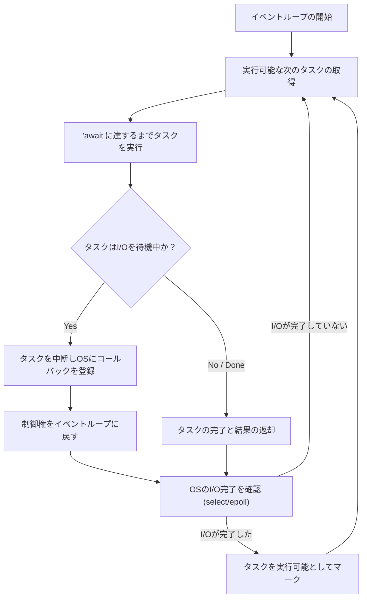

### 🎯 学習目標
- イベントループ（Event Loop）と協調的マルチタスク（Cooperative Multitasking）の概念を説明できる。
- コルーチン（Coroutine）と標準的な同期関数の違いを対比できる。
- `async` と `await` 構文を使用して、非ブロッキングコードを記述できる。
- `asyncio.create_task()` を使用して、並行してタスクをスケジュールできる。
- `asyncio.gather()` を使用して、複数の非同期タスクの完了を待機できる。

### 🧩 中核概念（なぜ）
従来の同期プログラミングでは、すべての操作が「ブロッキング（ブロッキング処理）」です。コードがデータベースやリモートサーバーにリクエストを送信すると、CPU はネットワークパケットやディスク操作が完了するまで何もせずに待機します。Day 36 では、OS が実行を切り替えることでスレッドがこの問題をどのように軽減できるかを見ました。しかし、スレッドにはかなりのメモリオーバーヘッドがあり、スレッドのコンテキストスイッチは高コストです。

**Asyncio** は、**協調的マルチタスク**を使用することでこの問題に対処します。多くの OS スレッドを起動する代わりに、アプリケーション全体が **イベントループ** によって管理される単一のスレッド上で動作します。タスクは I/O 待機ポイントに達したときに、自発的に実行権限を解放（譲渡）します。このシングルスレッドの並行処理により、Python はわずかなリソースオーバーヘッドで数千の同時接続を処理できるようになり、高パフォーマンスな Web アプリケーションやネットワーク API の業界標準となっています。

### 🔁 ロジックと動作
`asyncio` の実行モデルは、イベントループに基づいています。ループはアクティブなタスクを管理し、I/O 多重化を処理します。



- **コルーチン（Coroutines）**: `async def` で定義される特別な Python 関数。これらを呼び出すと、コードを実行せずにコルーチンオブジェクトが返されます。
- **イベントループ（Event Loop）**: I/O の準備状態に基づいてコルーチンのスケジュールと実行を調整する無限ループ。
- **協調的マルチタスク（Cooperative Multitasking）**: 実行中のタスクが `await` キーワードを使用して自発的にイベントループに制御権を譲る仕組み。

### 📝 注釈付きサンプル

#### 1. コルーチンと通常の関数
コルーチン関数を呼び出すとコルーチンオブジェクトが返されます。そのコードを実行するには、イベントループ内で実行する必要があります。
```python
import asyncio

# 'async def' 構文はコルーチン関数を定義します
async def say_hello():
    print("コルーチンの内部です！")
    return "Hello World"

# これを呼び出すと、すぐにコルーチンオブジェクトが返されます
coro = say_hello()
print(type(coro))  # 出力: <class 'coroutine'>

# 実行するには、asyncio.run() を使用してイベントループを起動します
result = asyncio.run(coro)
print(result)  # 出力: Hello World
```

#### 2. `asyncio.create_task()` による協調的マルチタスク
コルーチンを「タスク（Task）」としてスケジュールすることで、イベントループに登録され、並行して実行されます。
```python
import asyncio
import time

async def fetch_web_page(site_id, delay):
    print(f"サイト {site_id} の取得を開始...")
    # asyncio.sleep は time.sleep と異なり、イベントループに制御権を譲ります
    await asyncio.sleep(delay)
    print(f"サイト {site_id} の取得が完了！")
    return f"サイト {site_id} からのデータ"

async def main():
    start = time.time()
    
    # 2つの取得処理を並行してスケジュール
    task1 = asyncio.create_task(fetch_web_page(1, 2.0))
    task2 = asyncio.create_task(fetch_web_page(2, 3.0))
    
    # 結果を待機します。両方のタスクが並行して実行されます。
    data1 = await task1
    data2 = await task2
    
    print(f"結果: {data1}, {data2}")
    print(f"経過時間: {time.time() - start:.2f} 秒")  # 5.00秒ではなく約3.00秒と表示されます

asyncio.run(main())
```

#### 3. `asyncio.gather()` による複数タスクの管理
`asyncio.gather` は、複数の await 可能タスクを並行して実行し、結果を入力順に展開する高レベルな関数です。
```python
import asyncio

async def compute_square(x):
    await asyncio.sleep(0.1)
    return x * x

async def main():
    numbers = [1, 2, 3, 4, 5]
    
    # コルーチンオブジェクトのリストを作成
    tasks = [compute_square(num) for num in numbers]
    
    # すべてのタスクを並行して待機し、結果を順序通りに取得
    results = await asyncio.gather(*tasks)
    print(results)  # 出力: [1, 4, 9, 16, 25]

asyncio.run(main())
```

### ❌ よくある間違い

**間違い 1: コルーチンを await せずに呼び出す**
```python
import asyncio

async def get_value():
    return 42

async def main():
    # コルーチン関数を 'await' なしで呼び出している
    value = get_value()
    print(f"値は: {value}")
```
```text
RuntimeWarning: coroutine 'get_value' was never awaited
値は: <coroutine object get_value at 0x7f884c...>
```
```python
import asyncio

async def get_value():
    return 42

async def main():
    # 正しくコルーチンを await する
    value = await get_value()
    print(f"値は: {value}")

asyncio.run(main())
```
> `async def` で定義された非同期関数は、呼び出しただけでは自動的に実行されません。コルーチンオブジェクトを返すだけです。コルーチンを実行してその戻り値を取得するには、明示的に `await` キーワードを使用する必要があります。

**間違い 2: ブロッキングする同期操作を使用する**
```python
import asyncio
import time

async def blocking_task(name):
    print(f"タスク {name} 開始")
    time.sleep(1.0)  # ブロッキング！イベントループのスレッドをフリーズさせます
    print(f"タスク {name} 終了")

async def main():
    await asyncio.gather(blocking_task("A"), blocking_task("B"))

asyncio.run(main())
```
```text
タスク A 開始
タスク A 終了
タスク B 開始
タスク B 終了
(順次実行され、合計で2.0秒かかる)
```
```python
import asyncio

async def non_blocking_task(name):
    print(f"タスク {name} 開始")
    await asyncio.sleep(1.0)  # 非ブロッキング！制御権を譲ります
    print(f"タスク {name} 終了")

async def main():
    await asyncio.gather(non_blocking_task("A"), non_blocking_task("B"))

asyncio.run(main())
```
> Asyncio はシングルスレッドで動作します。タスクのいずれかがブロッキングコード（`time.sleep()`、同期型 DB ドライバ、標準の `requests` など）を呼び出すと、イベントループがブロックされ、スケジュールされている他のすべてのタスクがフリーズします。非同期対応のライブラリ（例: `asyncio.sleep()`、`httpx`、`aiohttp`）を使用し、`await` を使って制御権を解放する必要があります。

**間違い 3: タスクの作成直後に await してしまう**
```python
import asyncio

async def task_worker(n):
    await asyncio.sleep(1)
    return n

async def main():
    # task2 が作成される前に task1 をすぐに await している
    t1 = await asyncio.create_task(task_worker(1))
    t2 = await asyncio.create_task(task_worker(2))
    return [t1, t2]

asyncio.run(main())
```
```text
(順次実行され、合計で2.0秒かかる)
```
```python
import asyncio

async def task_worker(n):
    await asyncio.sleep(1)
    return n

async def main():
    # 最初にタスクハンドルを作成（ループに登録）
    task1 = asyncio.create_task(task_worker(1))
    task2 = asyncio.create_task(task_worker(2))
    # スケジュールされたタスクを await する
    t1 = await task1
    t2 = await task2
    return [t1, t2]

asyncio.run(main())
```
> `await` を使用すると、現在の関数の実行が一時停止します。`t1 = await asyncio.create_task(...)` のように記述すると、次の行が実行される前に呼び出し元の関数が停止するため、実行フローが同期処理に戻ってしまいます。並行して実行させるには、まず複数の Task オブジェクトを作成し、その後に await する必要があります。

### 💡 コツ・イディオム
- **ライブラリを確認する**: 同期ライブラリ（`requests` など）と非同期ライブラリを混ぜて使用しないでください。HTTP には `httpx`、MongoDB には `motor`、PostgreSQL には `aiopg`/`asyncpg` などの非同期代替案を探してください。
- **`asyncio.run()` の使用場所**: `asyncio.run()` は、プログラムを起動するためのメインエントリポイントでのみ使用してください。すでに実行中の非同期関数内で呼び出すと、`RuntimeError: Timeout context manager should be used` などのエラーが発生します。
- **CPU バウンドなタスクの統合**: 非同期アプリケーション内で CPU 負荷の高い処理（画像レンダリングなど）を実行する必要がある場合は、`await loop.run_in_executor(None, cpu_bound_function)` を使用してプロセスプールエグゼキュータに処理を委譲します。

### 🧠 深掘り（内部の仕組み）
<details><summary>イベントループ、epoll/kqueue、およびジェネレータベースのコルーチン</summary>

**OSレベルの多重化:**
単一のスレッドで数千の同時 I/O 操作をどのように管理しているのでしょうか？それは、待機処理をオペレーティングシステム（OS）のカーネルに委譲しているからです。
非同期ライブラリがソケット接続を初期化するとき、ソケットを非ブロッキングモードに設定します。データが届くのを待つ代わりに、ライブラリはソケットのファイル記述子（file descriptor）を OS のイベント通知サービス（Linux の `epoll`、macOS の `kqueue`、Windows の `IOCP` など）に登録します。
イベントループは以下のサイクルを繰り返します。
1. カーネルに対して（`select()` や `epoll_wait()` などを介して）読み書き準備が整ったソケットのリストを照会します。
2. 準備が整ったソケットがない場合、スレッドは一時的にブロックされ、OS が割り込みを検出するまでスリープ状態になります。
3. I/O イベントが発生すると、OS がイベントループをウェイクアップし、対応するコルーチンを再開します。

**ジェネレータからコルーチンへ:**
内部的には、Python のコルーチンは特殊なジェネレータです。歴史的には（Python 3.5 より前）、非同期プログラミングは `@asyncio.coroutine` デコレータが付いたジェネレータと `yield from` を使用して実現されていました。
`await coro` と記述すると、Python は現在のコルーチンのフレームスタックを中断し、実行制御をイベントループに戻します。ループはコルーチンの低レベルメソッド `.send(value)` や `.throw(exception)` を呼び出して実行状態を進め、最終的に `StopIteration` 例外が発生することで、タスクの完了を検知します。
</details>

### 🏋️ 演習
`fake_async_fetch(url)` を使用して、すべての URL を並行して取得する関数 `async_fetch_all(urls)` を実装してください。タスクを並行処理し、すべての結果を含むリストを返してください。

```python
import asyncio

async def fake_async_fetch(url):
    await asyncio.sleep(0.01)
    return f"Async {url}"

async def async_fetch_all(urls):
    # asyncio.gather を使用してすべての url を並行して取得し、リストを返します
    pass
```

### ✅ 自己チェック
1. `asyncio.create_task(my_coroutine())` を実行すると、そのコルーチンはすぐに動作しますか？
2. イベントループは、どのようにして単一の OS スレッド上で複数のタスクを実行するのですか？
<details><summary>回答</summary>

1. すぐには実行されませんが、イベントループの実行可能キューに登録されます。現在実行中のコルーチンが制御権を譲る（`await` に達するか完了する）と、イベントループがこのタスクの実行を開始します。
2. OS レベルの非ブロッキング I/O 多重化を使用します。ループはタスクのソケットやファイル記述子をカーネルに登録してスリープします。カーネルが操作の完了を通知すると、ループがウェイクアップし、該当するコルーチンを再開します。
</details>

### 📌 まとめ
- **Asyncio** は単一スレッドで動作し、`await` キーワードによって制御権を譲る協調的マルチタスクを採用しています。
- **イベントループ** は、OS レベルの準備完了通知に応答して、タスクのスケジュール、一時停止、再開を調整します。
- 非同期関数内で**ブロッキングする同期コール**を使用するとアプリケーション全体がフリーズするため、避ける必要があります。
- バックグラウンド処理のスケジュールには `asyncio.create_task()` を、複数のタスクを並行して待つには `asyncio.gather()` を使用します。
