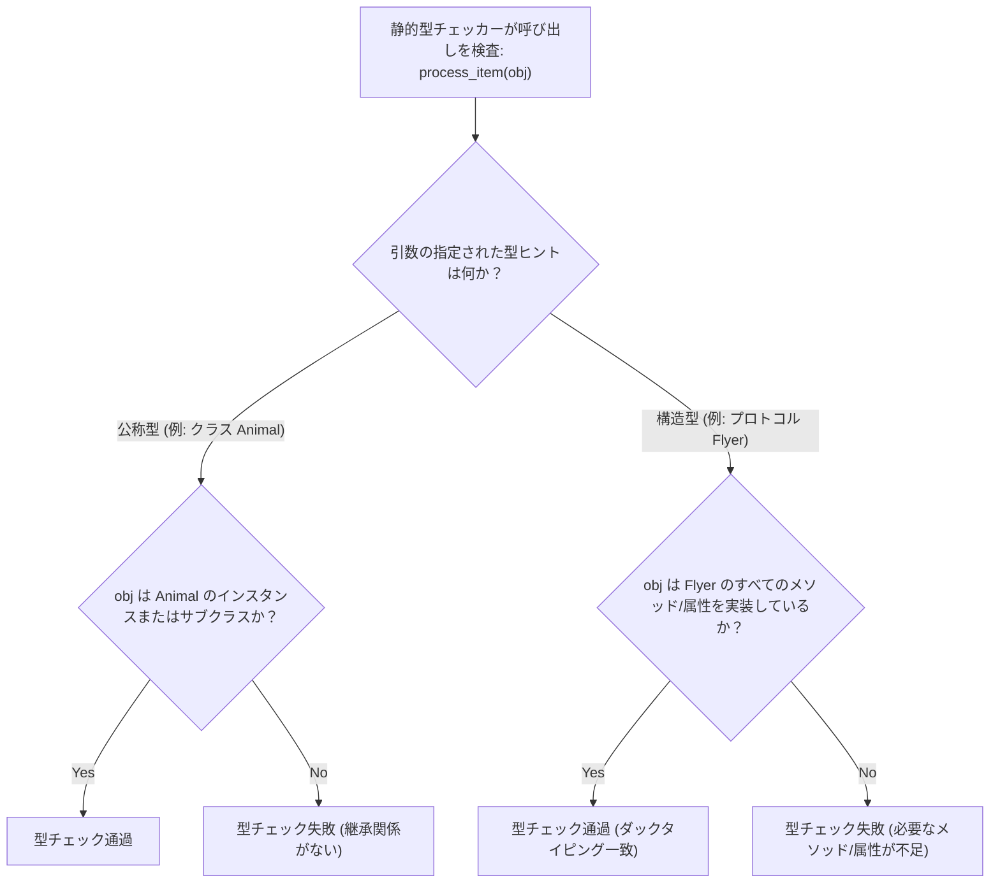

### 🎯 学習目標
- 公称型（Nominal Typing）と構造型（Structural Typing / 静的ダックタイピング）の違いを説明できる。
- `typing.Protocol` を使用して、構造的なインターフェースを定義できる。
- `Union`、`Optional`、および `Callable` などの高度な型ヒントを活用できる。
- ジェネリクス（`TypeVar`）を使用して、再利用可能なコンポーネントを実装できる。
- 静的型チェッカー（`mypy` や `pyright` など）を使用して、コードの型の正確性を検証できる。

### 🧩 中核概念（なぜ）
Python は動的型付け言語です。型は実行時にチェックされ、オブジェクトが期待通りに動作する限り、どのような型でも受け入れられます（ダックタイピング: *「アヒルのように歩き、アヒルのように鳴くなら、それはアヒルである」*）。しかし、大規模なコードベースでは、動的型付けによって追跡が困難な実行時エラーが発生する可能性があります。

これに対処するため、Python はオプションの静的型ヒント（PEP 484）を導入しました。型ヒントを使用すると、静的型チェッカー（`mypy` や VS Code の `pyright`/`Pylance` など）が、プログラムを実行することなくコード内のバグを分析できるようになります。

当初、Python の型システムは、オブジェクトが特定のクラスの明示的なサブクラスである場合にのみその型と一致する「**公称型（Nominal Typing）**」に依存していました。しかし、これは Python の伝統的なダックタイピングの思想と矛盾します。このギャップを埋めるために、PEP 544 で `typing.Protocol` を用いた「**構造的サブタイプ（Structural Subtyping）**」が導入されました。プロトコルを使用すると、継承階層ではなく、オブジェクトがどのメソッドや属性を実装しているかに基づいてインターフェースを定義できます。これにより、ダックタイピングの柔軟性と静的分析の安全性が両立します。

### 🔁 ロジックと動作
静的型チェッカーが引数を検証する仕組みは、公称型（Nominal Typing）を使用しているか、それとも構造型（Structural Typing）を使用しているかによって異なります。



- **公称型（Nominal Typing）**: クラスの明示的な宣言や継承関係（例: `class Dog(Animal)`）によって型の互換性を決定します。
- **構造型（Structural Typing / プロトコル）**: オブジェクトの「形状」（メソッド、属性、およびそのシグネチャ）によって型の互換性を決定します。継承は不要です。
- **ジェネリクス（Generics）**: 入力と出力の間の型の整合性を保ちながら、関数やクラスが異なる型を受け入れられるようにするパラメータ化された型です。

### 📝 注釈付きサンプル

#### 1. Union、Optional、および Callable
これらの注釈を使用すると、複雑な関数のシグネチャや戻り値の型を表現できます。
```python
from typing import Union, Optional, Callable

# Python 3.10以降では、int | str という構文もサポートされています
def parse_id(val: Union[int, str]) -> str:
    # int または str を受け取り、常に str を返します
    return str(val)

# Optional[T] は Union[T, None] の省略形です
def get_user_name(user_id: int) -> Optional[str]:
    # ユーザーが存在しない場合は文字列または None を返します
    if user_id == 1:
        return "Alice"
    return None

# Callable[[引数の型...], 戻り値の型] はコールバック関数を注釈します
def process_data(data: list, transform: Callable[[str], str]) -> list:
    return [transform(item) for item in data]
```

#### 2. `TypeVar` によるジェネリクス
ジェネリクスを使用すると、型の関係性を維持しながら、再利用可能なコードを記述できます。
```python
from typing import TypeVar, List

# TypeVar は入力型と出力型を関連付けます
T = TypeVar('T')

def get_first_element(items: List[T]) -> T:
    # List[int] が渡された場合、mypy は戻り値の型が int であると判断します
    # List[str] が渡された場合、戻り値の型が str であると判断します
    return items[0]

first_num = get_first_element([1, 2, 3])  # int として推論されます
first_word = get_first_element(["a", "b"])  # str として推論されます
```

#### 3. `typing.Protocol` による構造的サブタイプ
プロトコルを使用すると、クラスに特定の基本クラスを強制的に継承させることなく、インターフェースを規定できます。
```python
from typing import Protocol, List

# オブジェクトが満たすべき処理を記述したプロトコルを定義します
class Greeter(Protocol):
    def greet(self) -> str:
        ...  # 三点リーダー（...）は実装なしのシグネチャ定義を示します

class EnglishPerson:
    def greet(self) -> str:
        return "Hello"

class JapanesePerson:
    def greet(self) -> str:
        return "Konnichiwa"

# このクラスは戻り値の型が異なるため、プロトコルを満たしません
class BrokenGreeter:
    def greet(self) -> int:
        return 42

def introduce(people: List[Greeter]) -> None:
    for person in people:
        print(person.greet())

# EnglishPerson と JapanesePerson は明示的に継承していなくても Greeter プロトコルを満たします
introduce([EnglishPerson(), JapanesePerson()])

# 静的型チェッカーは BrokenGreeter がプロトコルに適合しないため、ここでエラーを発生させます
# introduce([BrokenGreeter()])
```

### ❌ よくある間違い

**間違い 1: Optional 型の処理を忘れる (None チェックの欠落)**
```python
from typing import Optional

def get_upper_name(name: Optional[str]) -> str:
    # Optional型に対して直接文字列メソッドを呼び出している
    return name.upper()
```
```text
error: Item "None" of "Optional[str]" has no attribute "upper"
```
```python
from typing import Optional

def get_upper_name(name: Optional[str]) -> str:
    # 処理を行う前に正しく None をチェックする
    if name is None:
        return "ANONYMOUS"
    return name.upper()
```
> 静的型チェッカーは安全性を強制します。`Optional[str]` は `None` になる可能性があるため、型ガード（`if name is None:` や `if not name:` など）を使って型を `str` に絞り込まない限り、直接文字列操作を行うことはできません。

**間違い 2: Protocol メソッド内で `self` 引数を忘れる**
```python
from typing import Protocol

class Printable(Protocol):
    # self なしでメソッドを定義している
    def print_item() -> str:
        ...
```
```text
error: Protocol member "print_item" must be a method (take self as first argument)
```
```python
from typing import Protocol

class Printable(Protocol):
    # 正しく self を含める
    def print_item(self) -> str:
        ...
```
> プロトコル定義はインスタンスメソッドを記述するため、最初の引数として `self` を受け取る必要があります。これを除外すると、型チェッカーはそれを静的メソッド（staticmethod）として扱い、クラスの通常のインスタンスメソッドとのマッチング時にエラーが発生します。

**間違い 3: 制約なしで TypeVar を乱用する (上限の欠如)**
```python
from typing import TypeVar

T = TypeVar('T')

# ジェネリック型 T の要素同士を加算しようとしている
def sum_two(a: T, b: T) -> T:
    return a + b
```
```text
error: Unsupported operand types for + ("T" and "T")
```
```python
from typing import TypeVar

# 加算をサポートする型（数値型など）に TypeVar を制限します
T = TypeVar('T', int, float)

def sum_two(a: T, b: T) -> T:
    return a + b
```
> 制約のないジェネリックな `TypeVar` は、任意のオブジェクト（`object`）を表します。任意のオブジェクトが加算演算子 `+` をサポートしているわけではないため、型チェッカーはエラーを報告します。引数に許可する型を渡すか、`bound` パラメータを使用してサブクラスを制限する必要があります。

### 💡 コツ・イディオム
- **実行時サポートのための `runtime_checkable`**: 通常、プロトコルは実行時には無視されます。`isinstance()` や `issubclass()` と組み合わせて使用したい場合は、プロトコルクラスに `typing.runtime_checkable` デコレータを付与します。
- **Python 3.10以降の新しい構文を優先する**: `typing` から `Union` や `Optional` をインポートする代わりに、`int | str` や `str | None` と記述します。こちらのほうが簡潔で読みやすいです。
- **`Any` の使用を控える**: `Any` を使用すると、その変数に対する型チェックが無効になります。多用すると静的型チェックの目的が失われてしまいます。代わりに `TypeVar` や `Protocol` を使用してください。

### 🧠 深掘り（内部の仕組み）
<details><summary>公称サブタイプ vs 構造的サブタイプと型消去（Type Erasure）</summary>

**公称型（Nominal） vs. 構造型（Structural）:**
公称型は「分類（名前）」に基づいています。クラス `Dog` が `Animal` のサブクラスであるためには、明示的に `class Dog(Animal):` と記述する必要があります。たとえ `Dog` が `Cat` と全く同じフィールドやメソッドを実装していても、共通の祖先を継承していない限り、`Cat` を期待する関数に `Dog` を渡すことはできません。
一方、構造型（プロトコル）は「形状」に基づいています。型チェッカーは、プロトコルのメソッドとシグネチャの内部表現を作成します。引数を検証する際、対象オブジェクトのクラスメソッドをループ処理し、シグネチャがプロトコルと一致するかどうかを確認します。一致していれば、クラスがそのプロトコルの存在を一切知らなくても、型チェックは成功します。

**型消去（Type Erasure）:**
Python の型ヒントは、実行時には Python インタプリタによって完全に無視されます。これを **型消去（Type Erasure）** と呼びます。Python がコードを実行する際、型アノテーションを使用することによるパフォーマンスのオーバーヘッドはありませんが、自動的な強制力もありません。
たとえば次のコード：
```python
def add(a: int, b: int) -> int:
    return a + b
```
これは、インタプリタによって以下と全く同じように実行されます：
```python
def add(a, b):
    return a + b
```
このため、型ヒントは純粋に開発者の利便性と静的解析ツールのための仕組みです。`pydantic` などのサードパーティ製の実行時バリデーションライブラリを使用しない限り、実行時に型が強制されることはありません。
</details>

### 🏋️ 演習
`shapes` が `Drawable` プロトコルを満たすオブジェクトのリストである関数 `render_shapes(shapes)` を実装してください。この関数は、各 shape に対して `draw()` を呼び出し、すべての結果を含むカンマ区切りの 1 つの文字列を返す必要があります。

```python
from typing import Protocol, List

class Drawable(Protocol):
    def draw(self) -> str:
        ...

def render_shapes(shapes):
    # shapes は List[Drawable] です
    # すべての shape の draw() を呼び出し、カンマ区切りの文字列を返します
    pass
```

### ✅ 自己チェック
1. `typing.Protocol` は、Python の「ダックタイピング」の思想をどのように静的にサポートしていますか？
2. `Union[str, None]` と `Optional[str]` の違いは何ですか？
<details><summary>回答</summary>

1. 継承関係ではなく、インターフェース（メソッドと属性）に基づいて期待される型を指定できます。クラスはプロトコルクラスを継承する必要はなく、単にそのメソッドを実装するだけで適合します。
2. 違いはありません。`Optional[str]` は `Union[str, None]` のエイリアス（省略形）です。Python 3.10以降では、どちらも単に `str | None` と記述できます。
</details>

### 📌 まとめ
- **静的型チェッカー**はソースコードを解析し、プログラムを実行せずにバグを検出します。
- **構造的サブタイプ**（`typing.Protocol`）を使用すると、動的なダックタイピングを静的に検証できます。
- **ジェネリクス**（`TypeVar`）を使用すると、境界を越えて型安全性を維持しながら、関数やクラスを異なる型に適応させることができます。
- **Optional**型を使用する場合は、元の型に対して操作を実行する前に、明示的に `None` のケースを処理する必要があります。
