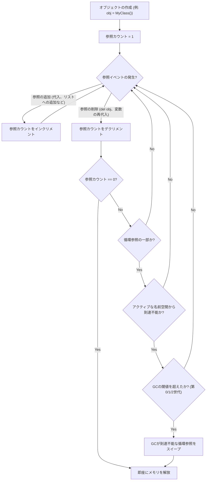

### 🎯 学習目標
- CPythonの参照カウント（Reference Counting）メカニズムを理解し、`sys.getrefcount` を用いてカウントを監視できる。
- 世代別ガベージコレクション（第0世代、第1世代、第2世代）の仕組みと閾値について説明できる。
- `weakref` モジュールを用いて弱参照（Weak Reference）を実装し、循環参照を回避・解消できる。
- グローバル変数やミュータブルなデフォルト引数によるメモリリークを検出し、防止できる。
- 大量にインスタンス化されるクラスで `__slots__` を使用し、辞書（`__dict__`）を排除してメモリ使用量を最適化できる。

### 🧩 中核概念（なぜ）
Pythonは自動メモリ管理を提供します。オブジェクトを作成するとメモリがヒープ上に割り当てられ、不要になると自動的に回収されます。しかし、大規模で高パフォーマンスなプロダクションコードを書くためには、その内部動作を理解することが不可欠です。

CPython（標準のPython実装）は、メモリ管理のために2つの相補的な戦略を使用しています。
1. **参照カウント（Reference Counting）**: 主要なメモリ解放手段です。各Pythonオブジェクトは、自身への参照がいくつ存在するかを追跡します。参照カウントがゼロになると、オブジェクトは即座に破棄され、そのメモリが解放されます。
2. **循環参照ガベージコレクション（Cyclic GC）**: 参照カウントだけでは、オブジェクトAがオブジェクトBを参照し、オブジェクトBがオブジェクトAを参照し合うような「循環参照」を検出できません。外部からの参照が消えても、これらはお互いを参照し続けてカウントが1のままになり、メモリリークを引き起こします。これを解決するため、CPythonは循環参照を検出して回収するガベージコレクタを備えています。

アプリケーションの規模が大きくなり、グラフのノードやデータベースクエリの結果など、何百万ものオブジェクトを扱うようになると、デフォルトのオブジェクト生成オーバーヘッドが問題になります。デフォルトでは、ユーザー定義クラスはインスタンスの属性を辞書（`__dict__`）に保持します。辞書は動的に属性を追加できて便利ですが、ハッシュテーブルのオーバーヘッドにより大量のメモリを消費します。`__slots__` を使用して `__dict__` を排除する方法を学ぶことで、メモリ使用量を最大80%近く削減できます。

### 🔁 ロジックと動作

以下は、メモリの割り当て、参照の追跡、およびガベージコレクションの相互作用を示すフローチャートです。



- **参照カウント**: 決定論的かつ即座に実行されます。循環参照がない限り、オブジェクトの参照カウントがゼロになった瞬間にメモリが解放されます。
- **世代別ガベージコレクション**: CPythonはオブジェクトの生存期間に応じて、第0世代、第1世代、第2世代の3つの世代に分類します。生存期間が短い第0世代が最も頻繁にスキャンされ、生き残ったオブジェクトは上の世代へ昇格します。
- **__slots__ による最適化**: インスタンスから動的な `__dict__` を排除します。ハッシュテーブルの代わりに、Cレベルで固定サイズのフラットな配列として属性を格納するため、メモリオーバーヘッドを劇的に抑えることができます。

### 📝 注釈付きサンプル

#### 1. 参照カウントの追跡
`sys.getrefcount()` を使用してオブジェクトの参照カウントを確認できます。なお、関数にオブジェクトを渡すことで、関数のローカルフレーム（引数）からの参照が一時的に1増えることに注意してください。

```python
import sys

# リストオブジェクトを作成
a = [1, 2, 3]
print(sys.getrefcount(a))  # 出力: 2 (変数 'a' + getrefcount 関数の引数による一時参照)

b = a  # 参照を b に代入
print(sys.getrefcount(a))  # 出力: 3 ('a', 'b', および引数)

c = [a]  # 別のリストの要素として追加
print(sys.getrefcount(a))  # 出力: 4 ('a', 'b', リスト内部の要素、および引数)

del b
print(sys.getrefcount(a))  # 出力: 3 ('a', リスト内部の要素、および引数)
```

#### 2. 循環参照と `gc` モジュール
以下は、2つのオブジェクトが互いに参照し合い、変数削除後も参照カウントが1のまま残る循環参照の例です。

```python
import gc

class Node:
    def __init__(self, value):
        self.value = value
        self.ref = None

# ガベージコレクションを有効化 (デフォルトで有効)
gc.enable()

# 循環参照を作成
n1 = Node(1)
n2 = Node(2)
n1.ref = n2
n2.ref = n1

# ローカル変数を削除
del n1
del n2

# この時点で Node オブジェクトは Python コードからアクセスできなくなりますが、
# 互いの参照があるため参照カウントは 1 のままで、参照カウント方式では解放されません。
# ガベージコレクタを手動で実行して、これらを回収します:
collected = gc.collect()
print(f"GCが {collected} 個のオブジェクトを回収しました。")  # 出力: 2
```

#### 3. `weakref` による循環の解消
弱参照はオブジェクトの参照カウントを増やしません。`weakref.ref` または `weakref.WeakValueDictionary` などのコンテナを使用して作成します。

```python
import sys
import weakref

class LargeObject:
    def __init__(self, data):
        self.data = data

obj = LargeObject("巨大なデータ文字列")
print(sys.getrefcount(obj))  # 出力: 2

# 弱参照を作成
wref = weakref.ref(obj)
print(sys.getrefcount(obj))  # 出力: 2 (カウントは増えない)

# 弱参照から元のオブジェクトにアクセス
retrieved = wref()
if retrieved is not None:
    print("オブジェクトはまだ生存しています:", retrieved.data)

# 唯一の強参照を削除
del obj

# 弱参照を再度確認
print(wref())  # 出力: None (自動的に無効化されている)
```

#### 4. `__slots__` によるメモリの最適化
通常のクラスと、`__slots__` を使用したメモリ最適化クラスの比較です。

```python
import sys

class StandardPoint:
    def __init__(self, x, y):
        self.x = x
        self.y = y

class OptimizedPoint:
    # slots を定義して __dict__ と __weakref__ の作成を防止
    __slots__ = ['x', 'y']
    def __init__(self, x, y):
        self.x = x
        self.y = y

sp = StandardPoint(1, 2)
op = OptimizedPoint(1, 2)

# 通常のインスタンスは属性を辞書に保存する
print(sp.__dict__)  # 出力: {'x': 1, 'y': 2}

# 最適化されたインスタンスには __dict__ がない
print(hasattr(op, '__dict__'))  # 出力: False

# slots に宣言されていない属性を設定しようとすると AttributeError になる
try:
    op.z = 10
except AttributeError as e:
    print(e)  # 出力: 'OptimizedPoint' object has no attribute 'z'
```

### ❌ よくある間違い

**間違い 1: グローバルリストにデータをクリアせずに追加し続ける（メモリリーク）**
```python
# 長時間稼働するサーバーのキャッシュを想定
CACHE = []

def process_request(data):
    # データをクリアせずにグローバルキャッシュに追加し続ける
    CACHE.append(data)
    return f"Processed: {len(data)} bytes"
```
```text
(トレースバックは発生しませんが、メモリ使用量が無限に増加し、最終的にシステムメモリ不足で MemoryError が発生してクラッシュします)
```
```python
# 長時間稼働するサーバーのキャッシュを想定
CACHE = []

def process_request(data):
    result = f"Processed: {len(data)} bytes"
    # キャッシュサイズを制限してメモリ枯渇を防ぐ
    CACHE.append(data)
    if len(CACHE) > 100:
        CACHE.pop(0)
    return result
```
> グローバル変数は、アプリケーションのプロセスが実行されている限り存続します。解放条件や上限を定めずにグローバルリストにデータを追加し続けると、参照カウントがゼロにならず、Python における典型的なメモリリークが発生します。

**間違い 2: `__slots__` を設定したクラスのサブクラスも自動的に最適化されるという誤解**
```python
class Parent:
    __slots__ = ['x']

class Child(Parent):
    # サブクラスで __slots__ を定義していない
    def __init__(self, x, y):
        self.x = x
        self.y = y
```
```text
(宣言時にはエラーになりませんが、子クラスのインスタンスには y などを格納するための __dict__ が自動生成されます)
```
```python
class Parent:
    __slots__ = ['x']

class Child(Parent):
    # サブクラスでも slots を明示的に定義する
    __slots__ = ['y']
    def __init__(self, x, y):
        self.x = x
        self.y = y
```
> 親クラスが `__slots__` を使っていても、サブクラスで `__slots__` を明示的に宣言しない場合、Python は自動的にサブクラスのインスタンスに `__dict__` を作成してしまいます。最適化を維持するには、サブクラスでも `__slots__ = [...]` （追加属性がない場合は空のタプル `()`）を定義する必要があります。

### 💡 コツ・イディオム
- **メモリサイズの確認**: 標準の `sys.getsizeof()` を使用して、オブジェクトのメモリサイズ（バイト単位）を確認できます。ただし、これはコンテナそのもののサイズであり、ネストされた参照オブジェクトのサイズは含まれない点に注意してください。
- **キャッシュには `weakref.WeakValueDictionary` を使用する**: キャッシュを実装する場合、`WeakValueDictionary` を使用すると、キャッシュされたオブジェクトに対する強参照が他になくなった時点で、キャッシュから自動的にそのエントリが削除されます。
- **必要な場合のみ `__slots__` を使う**: `__slots__` は、オブジェクトが何万、何百万と生成されることが予想される場合にのみ使用してください。デコレータやシリアライズライブラリの一部で、動的属性の欠如により動作しなくなることがあるため、過度な早期最適化は避けましょう。

### 🧠 深掘り（内部の仕組み）
<details><summary>世代別ガベージコレクションと循環参照の検出アルゴリズム</summary>

CPythonのガベージコレクタ（`gc` モジュール）は、「ほとんどのオブジェクトはすぐに不要になる（世代的仮説）」という前提に基づいて動作します。コレクタは、コンテナオブジェクトを管理するための3つの双方向連結リスト（世代）を持っています。
- **第0世代（Gen 0）**: 新しく作成されたすべてのコンテナオブジェクト。
- **第1世代（Gen 1）**: 第0世代の回収プロセスを生き残ったオブジェクト。
- **第2世代（Gen 2）**: 最も生存期間が長く、回収頻度が最も低いオブジェクト。

**循環参照検出アルゴリズム:**
GCは、以下の手順で不要な循環参照（ゴミ）を検出します。
1. **カウントの複製**: 走査対象の世代に属するすべてのコンテナオブジェクトについて、その参照カウント（`ob_refcnt`）をGC用の管理構造体である `gc_refs` フィールドにコピーします。
2. **参照の仮削減**: 世代内の全オブジェクトを走査し、各オブジェクトが指している他のオブジェクトの `gc_refs` をデクリメントします。例えば、オブジェクトAがオブジェクトBを参照している場合、Bの `gc_refs` を1減らします。
3. **候補の特定**: この走査が終わった時点で、`gc_refs` が0になったオブジェクトは、その世代の外部（スタックやグローバル名前空間）からの参照がなく、その世代内だけでお互いを参照し合っている「循環参照」の候補となります。
4. **到達可能オブジェクトの復活**: 外部からの参照が残っているオブジェクト（`gc_refs > 0`）から辿れるオブジェクトがある場合、それらの `gc_refs` は0であっても解放してはならないため、到達可能としてマークを戻し（復活させ）ます。
5. **スイープ**: 最終的にマークが戻らず、`gc_refs` が0のまま残ったオブジェクトが「真に到達不可能な循環参照」であり、これらをメモリから解放します。
</details>

### 🏋️ 演習
2次元座標を表す属性 `x` と `y` を持ち、インスタンス辞書を持たないように `__slots__` を用いて最適化された `OptimizedPoint` クラスを実装してください。

```python
class OptimizedPoint:
    # __slots__ を使用して x と y を持つ Point クラスを実装してください
    pass
```

### ✅ 自己チェック
1. `sys.getrefcount(obj)` が実際の参照カウントより1高い値を返すのはなぜですか？
2. 対象オブジェクトがガベージコレクションによって削除された場合、そのオブジェクトを指していた弱参照はどうなりますか？
3. `__slots__` を定義したクラスのインスタンスに対して、実行時に宣言されていない新しい属性を割り当てることはできますか？
<details><summary>回答</summary>

1. `sys.getrefcount` 関数に入力引数としてオブジェクトを渡す際、関数の実行フレーム（コールスタック）内で一時的な参照が1つ作成されるためです。
2. 弱参照オブジェクトは自動的に無効化され、弱参照を呼び出した際（例: `wref()`）に `None` を返すようになります。
3. いいえ、できません。`__slots__` に宣言されていない属性を追加しようとすると、`AttributeError` が発生します。
</details>

### 📌 まとめ
- **参照カウント**は、オブジェクトの参照が失われた瞬間に即座にメモリを解放する決定論的な仕組みです。
- **ガベージコレクタ**は、世代（0, 1, 2）管理と循環検出アルゴリズムによって、参照カウントでは解放できない循環参照を回収します。
- **弱参照（`weakref`）**は、オブジェクトへの強参照（カウント増加）を作らずにアクセスする方法を提供し、キャッシュやオブザーバーパターンの実装に役立ちます。
- **`__slots__`** はインスタンスごとの `__dict__` の生成を抑止し、メモリフットプリントを劇的に縮小するための強力な最適化手法です。
