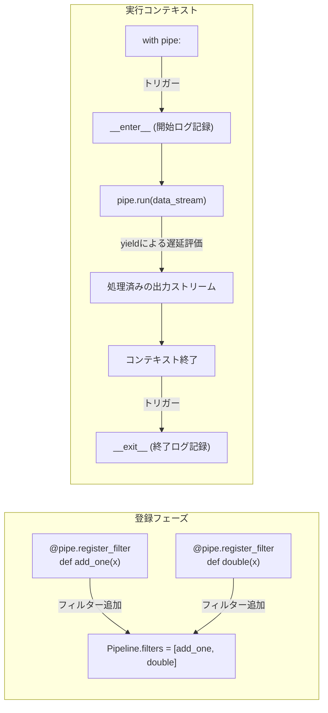
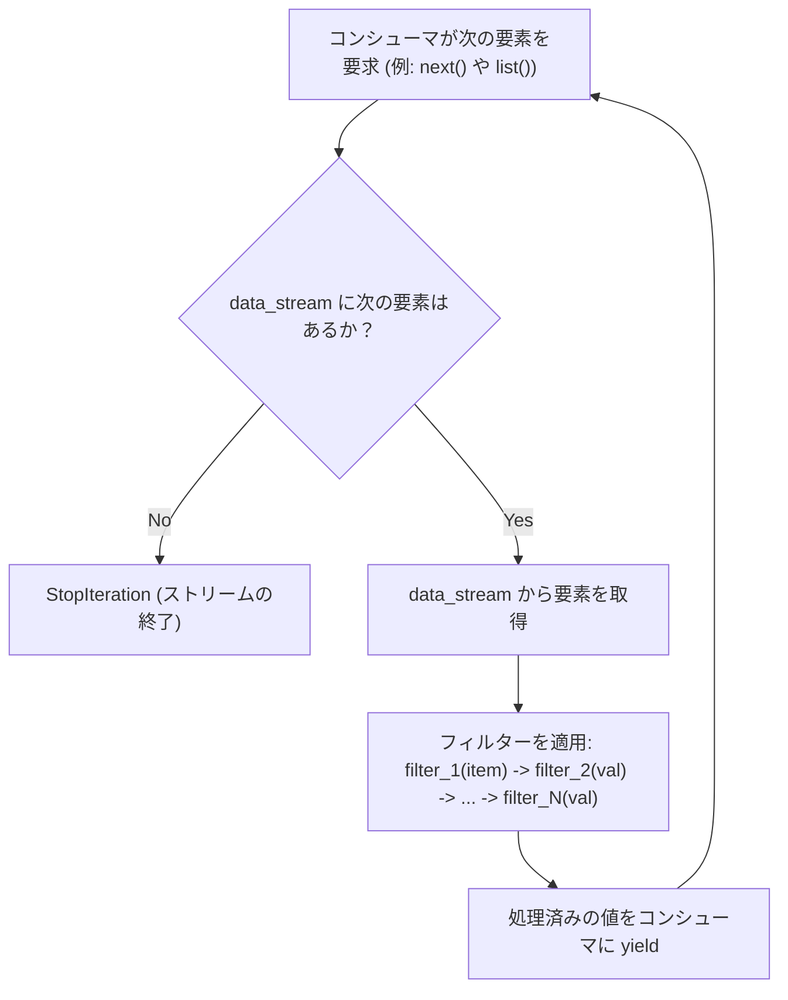

### 🎯 学習目標
- モジュール化され、メモリ効率の高いデータ処理パイプラインクラスを設計・構築できる。
- デコレータパターンを統合して、データ処理フィルターを動的に登録できる。
- コンテキストマネージャ（`__enter__` と `__exit__`）を実装して、パイプラインのライフサイクルや実行前後の状態を制御できる。
- ジェネレータによるストリーミング処理（`yield`）を利用して、遅延評価と $O(1)$ のメモリ使用量を達成できる。
- デコレータ、コンテキストマネージャ、ジェネレータを組み合わせて、実践的なシステム設計課題を解決できる。

### 🧩 中核概念（なぜ）
現代のソフトウェア開発において、データのクレンジング、変換、分析を行うデータパイプラインは非常に重要です。しかし、システムログやトランザクション履歴、センサーデータなどの巨大なデータセットを一度にすべてメモリに読み込むと、メモリ枯渇を引き起こすリスクがあります。

Pythonでプロダクションレベルの堅牢なデータパイプラインを構築するために、次の3つのデザインパラダイムを組み合わせます。
1. **デコレータによるフィルター登録**: パイプラインクラスの内部に変換処理をハードコードする代わりに、デコレータを使って外部からフィルター関数を動的に追加します。これは「オープン・クローズドの原則（拡張に対して開いており、修正に対して閉じている）」に従った設計です。
2. **コンテキストマネージャによるライフサイクル管理**: パイプラインの開始時と終了時のログ出力、リソースのセットアップやクリーンアップなど、実行前後の制御を行います。`with` 構文を用いることで、主処理と前後の処理を綺麗に分離できます。
3. **ジェネレータによる遅延ストリーミング**: 通常のリスト処理ではすべてのデータをメモリ上に保持しますが、`yield` を用いたジェネレータを使用することで、データを1件ずつオンデマンドで処理（遅延評価）します。これにより、処理するデータ数が数百万件であっても、メモリ消費量を常に一定（$O(1)$）に保つことができます。

本日の応用演習（Capstone）では、これらすべての概念を統合した **データ処理パイプラインコンパイラ** を構築します。

### 🔁 ロジックと動作

以下は、パイプラインコンパイラのアーキテクチャ設計と実行の流れを示すダイアグラムです。

#### 1. アーキテクチャ図


#### 2. 遅延処理のフローチャート（ジェネレータストリーム）


- **宣言的フィルター登録**: 関数を装飾（デコレート）することで、パイプラインの内部リストに自動的に登録し、元の関数はそのまま返して他の場所でも通常通り使用できるようにします。
- **コンテキストの境界**: `with` ブロックにより、例外が発生した場合であっても、実行前に初期化処理を行い、実行後に後処理やクリーンアップを確実に実行することを保証します。
- **オンデマンド処理**: `run()` メソッドでは、呼び出し元が次のデータを要求したときに初めて、元のデータソースから1つの値を抽出し、すべてのフィルターを順番に適用したのち即座に `yield` します。

### 📝 注釈付きサンプル

#### 1. シンプルなパイプラインの実装と実行
`Pipeline` クラスを使ってフィルターを登録し、データを遅延処理する基本的なフローです。

```python
LOGS = []

class Pipeline:
    def __init__(self):
        # 登録されたフィルター関数を保持するリスト
        self.filters = []
    
    def register_filter(self, func):
        # デコレートされた関数をリストに追加
        self.filters.append(func)
        return func  # デコレートされた元の関数をそのまま返す
    
    def __enter__(self):
        # パイプライン開始時の処理
        LOGS.append("Pipeline started")
        return self
        
    def __exit__(self, exc_type, exc_val, exc_tb):
        # パイプライン終了時の処理 (例外が発生した場合でも実行される)
        LOGS.append("Pipeline finished")
        return False  # 例外が発生した場合はそのまま外へ伝播させる
        
    def run(self, data_stream):
        # 各要素に対して順番にフィルターを適用し、yield するジェネレータ
        for item in data_stream:
            val = item
            for f in self.filters:
                val = f(val)
            yield val

# 使用例:
pipe = Pipeline()

@pipe.register_filter
def clean_whitespace(text):
    return text.strip()

@pipe.register_filter
def to_uppercase(text):
    return text.upper()

raw_data = ["  alice ", " bob  ", "   charlie"]

# コンテキストマネージャの内部で実行
with pipe:
    # この時点ではまだデータ処理は開始されていません。
    # run メソッドはジェネレータオブジェクトを返します。
    processed_generator = pipe.run(raw_data)
    
    # ジェネレータを評価してリスト化することで、処理が実行されます。
    final_output = list(processed_generator)

print("出力:", final_output)  # 出力: ['ALICE', 'BOB', 'CHARLIE']
print("ログ:", LOGS)          # 出力: ['Pipeline started', 'Pipeline finished']
```

#### 2. 無限ストリームの処理
ジェネレータを使用しているため、無限に続くデータストリームであってもメモリを使い果たすことなく処理できます。

```python
def infinite_number_stream():
    n = 1
    while True:
        yield n
        n += 1

pipe = Pipeline()

@pipe.register_filter
def square(x):
    return x * x

@pipe.register_filter
def format_str(x):
    return f"結果: {x}"

with pipe:
    # 無限ストリームから最初の5要素だけを切り出して処理する
    stream = pipe.run(infinite_number_stream())
    for _ in range(5):
        print(next(stream))
```
**出力:**
```text
結果: 1
結果: 4
結果: 9
結果: 16
結果: 25
```

### ❌ よくある間違い

**間違い 1: ジェネレータ内で `yield` する代わりにリストに蓄積して返してしまう（メモリ消費の増大）**
```python
class Pipeline:
    # ...
    def run(self, data_stream):
        results = []
        for item in data_stream:
            val = item
            for f in self.filters:
                val = f(val)
            results.append(val)
        return results  # 処理済みのリストを返している
```
```text
(構文エラーなどは出ませんが、巨大なデータや無限ストリームを渡した際にギガバイト単位でメモリを消費し、最終的に MemoryError を引き起こします)
```
```python
class Pipeline:
    # ...
    def run(self, data_stream):
        for item in data_stream:
            val = item
            for f in self.filters:
                val = f(val)
            yield val  # 各要素を遅延的に yield する
```
> 全要素をリストに保存してから返してしまうと、ジェネレータストリームの最大の利点（メモリの節約）が失われます。入力データのサイズに比例してメモリが消費されるため、大きなデータを扱うとプログラムがクラッシュします。

**間違い 2: 登録用デコレータから元の関数を返し忘れる**
```python
class Pipeline:
    # ...
    def register_filter(self, func):
        self.filters.append(func)
        # return func が抜けている
```
```text
TypeError: 'NoneType' object is not callable
```
```python
class Pipeline:
    # ...
    def register_filter(self, func):
        self.filters.append(func)
        return func  # 元の関数を正しく返す
```
> Pythonのデコレータは、装飾対象の関数をデコレータ関数が返したオブジェクトに置き換えます。何も返さない（あるいは `None` を返す）場合、装飾した関数自体が `None` に置き換わってしまうため、後からその関数を呼び出そうとしたときに `TypeError` が発生します。

### 💡 コツ・イディオム
- **継承よりもコンポジション（柔軟性の向上）**: 私たちのパイプラインは、フィルターを特定の基底クラスから継承させる必要はありません。呼び出し可能（`__call__` メソッドを持つオブジェクトや通常の関数）であればどのようなものでもフィルターとして動的に機能させることができます。
- **ジェネレータの連結**: パイプラインをさらにジェネレータ式でラップして、`filtered = (x for x in pipe.run(data) if x is not None)` のように遅延評価を維持したまま、特定の条件を満たす値だけをフィルタリングできます。
- **例外の処理**: コンテキストマネージャの `__exit__` メソッドで発生した例外情報を検知し、処理中のエラーのログ記録や特定の例外の抑制（握りつぶし）などを安全に行うことができます。

### 🧠 深掘り（内部の仕組み）
<details><summary>ジェネレータパイプラインとコールスタックの挙動</summary>

**ジェネレータ実行時のコールスタックの仕組み:**
通常の関数を呼び出すと、新しい実行フレームがコールスタックにプッシュされ、関数が終了するとフレームは破棄されます。しかし、ジェネレータのフレーム挙動はこれとは異なります。
1. `pipe.run()` が呼び出された時点では、Pythonは関数内の処理を実行しません。ただ関数をコンパイルして作成されたジェネレータオブジェクトを返します。
2. ジェネレータの実行フレームはスタックではなくヒープ領域に割り当てられます。これにより、ローカル変数の状態や次の処理をどこから再開するかを示すインストラクションポインタが保持されます。
3. `next(generator)` が呼ばれるたびに、Pythonはヒープ上の実行フレームをコールスタックに一時的にロードして実行を再開し、`yield` 文に達するまで処理を進めます。
4. `yield` が実行されると、フレームは現在の状態を保存したままスタックから取り除かれ（ポップ）、再びヒープ領域に戻されます。

このスタックとヒープ間の中断・再開プロセスにより、不要なリソース消費を抑えながら、安全かつ効率的にストリーミングデータパイプラインを処理することができます。
</details>

### 🏋️ 演習
デコレータ `@register_filter` を用いた関数の登録、コンテキストマネージャを用いた `LOGS` への動作状態のログ出力、およびジェネレータによる遅延ストリーミング処理 `run(data_stream)` をサポートする `Pipeline` クラスを完成させてください。

```python
LOGS = []

class Pipeline:
    def __init__(self):
        self.filters = []
    # register_filter, __enter__, __exit__, および run を実装してください
```

### ✅ 自己チェック
1. `pipe.run(data_stream)` を呼び出した時点で、登録されたフィルター処理は即座に開始されますか？
2. `with` ブロックの内部で例外が発生した場合でも、`__exit__` メソッドは確実に実行されますか？
3. クラスメソッドを `@pipe.register_filter` デコレータでパイプラインに登録することは可能ですか？
<details><summary>回答</summary>

1. いいえ。`run` は `yield` を使用するジェネレータ関数であるため、呼び出した時点ではジェネレータオブジェクトを生成するだけで、実際にイテレーション（`for` ループや `list()` による評価）が行われるまで処理は開始されません。
2. はい。`with` 構文の仕様により、ブロック内でエラーや例外が発生した場合でも `__exit__` メソッドは必ず最後に実行されます。そのため、リソースの確実なクリーンアップやエラーのログ記録に適しています。
3. はい、可能です。引数を1つ受け取り、処理後の値を返すメソッドであれば、デコレータを適用してフィルターとして登録し、問題なく機能させることができます。
</details>

### 📌 まとめ
- **データパイプライン**は、複数のフィルター処理を順番に適用し、データを効率的に加工する仕組みです。
- **デコレータ**により、パイプラインのコード自体を変更することなく、新しい処理フィルターを柔軟に動的登録できます。
- **コンテキストマネージャ**は、パイプライン実行前後の準備・後処理や例外処理を安全にカプセル化します。
- **ジェネレータ**は、`yield` を用いてデータを1件ずつ要求時にのみ処理する（遅延評価）ため、巨大なデータでもメモリ使用量を最小限（$O(1)$）に抑制します。
