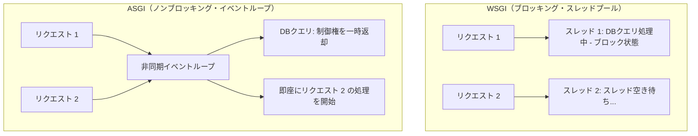

### 🎯 学習目標
- WSGIとASGIのウェブサーバー仕様の違いを説明し、なぜ現代のフレームワークがASGIを採用するのかを理解する。
- FastAPIとUvicornをインストール・設定し、開発サーバーを起動する。
- 基本的なFastAPIのインスタンスを生成し、パスオペレーションデコレータを使用してルートハンドラを登録する。
- 自動生成されるSwagger UIやReDocのインタラクティブなAPIドキュメントにアクセスする。
- `TestClient`を用いたインメモリの仮想HTTPリクエストにより、FastAPIエンドポイントのユニットテストを作成する。

### 🧩 中核概念（なぜ）
FlaskやDjango（従来のバージョン）のような従来のPythonウェブフレームワークは、**WSGI（Web Server Gateway Interface）**仕様に依存しています。2003年に設計されたWSGIは、同期処理・ブロッキング処理を前提としており、1つのリクエストがオペレーティングシステムの1つのスレッドまたはプロセスに直接マッピングされます。アプリケーションがデータベースのクエリや外部APIの呼び出しを待機している間、スレッド全体がブロックされます。このモデルは、数千件の同時接続を処理するスケールアップが難しく、WebSocketやHTTP/2といった現代の非同期プロトコルをネイティブに扱うことができません。

これを解決するために、Pythonコミュニティは**ASGI（Asynchronous Server Gateway Interface）**を開発しました。ASGIはWSGIの精神的な後継であり、非同期処理に対応したPythonウェブサーバー、フレームワーク、およびアプリケーション間の標準インターフェースを提供します。ASGIでは、ウェブサーバーはシングルスレッドの非同期イベントループ（`asyncio`など）を実行し、シングルスレッド上で何千もの同時リクエストをノンブロッキングで処理できます。

**Uvicorn**は極めて高速なASGIサーバーの実装であり、標準のasyncioイベントループの高速な代替である`uvloop`と、nodejsのHTTPパーサーのPythonバインディングである`httptools`をベースに構築されています。

**FastAPI**は、標準のPython型ヒントに基づいた、Python 3.8+でAPIを構築するためのモダンで高性能なウェブフレームワークです。ASGIとPydantic（データバリデーション用）を活用することで、FastAPIはNodeJSやGoに匹敵する圧倒的な高速動作を実現しています。また、設定なしで`/docs`にSwagger UIのAPIドキュメントを自動生成するため、フロントエンドとバックエンドの統合開発効率が劇的に向上します。

### 🔁 ロジックと動作

以下は、FastAPIリクエストのライフサイクルとアーキテクチャ設計の流れです。

#### 1. ASGI vs WSGI リクエスト処理


#### 2. FastAPIにおけるリクエスト・レスポンスのライフサイクル


- **非同期ルーティング**: FastAPIは、同期的な`def`と非同期的な`async def`のルートハンドラの両方をサポートしています。`async def`を使用した場合、FastAPIはメインのイベントループ上で直接実行します。`def`を使用した場合、FastAPIはメインループをブロックしないように、外部のスレッドプールでルートハンドラを実行します。
- **TestClientによる仮想リクエスト**: テスト時に、実際のUvicornサーバーを特定のTCPポートで起動するのは動作が遅くリソースを消費します。FastAPIの`TestClient`は、`Starlette`の仮想クライアントを利用してUvicornの動作をシミュレートします。ASGIスコープの辞書をFastAPIアプリケーションに直接渡すことで、インメモリで完全にHTTP通信を再現します。

### 📝 注釈付きサンプル

#### 1. 初めてのFastAPIサーバー設計
基本的なFastAPIサーバーの宣言方法とパスの定義方法を確認しましょう。

```python
# main.py
from fastapi import FastAPI

# 1. メインアプリケーションオブジェクトのインスタンス化
# このappオブジェクトがUvicornの接続先エントリーポイントになります
app = FastAPI(
    title="My First API",
    description="シンプルなFastAPI入門アプリケーション",
    version="1.0.0"
)

# 2. パスオペレーションデコレータの定義
# @app.get("/") は、以下の関数がルートパス（/）へのGETリクエストを処理することを宣言します
@app.get("/")
def read_root():
    # FastAPIは返却された辞書（dict）を自動的にJSONにシリアライズします
    # レスポンスのContent-Typeヘッダーも自動的に application/json に設定されます
    return {"message": "Hello World"}

# 3. パスパラメータとクエリパラメータの定義
@app.get("/items/{item_id}")
def read_item(item_id: int, q: str = None):
    # FastAPIは型ヒントに基づいてitem_idを自動的に整数型（int）にパースします。
    # ユーザーが /items/abc にアクセスした場合、FastAPIは自動的に 422 Unprocessable Entity エラーを返します。
    # 'q' はパスパターンに含まれていないため、クエリパラメータとして解釈されます。
    return {"item_id": item_id, "query": q}
```

このアプリケーションをローカルで起動するには、以下のコマンドを実行します。
```bash
uvicorn main:app --reload
```
- `main:app` は、`main.py` モジュールと、その中で定義されている `app` インスタンスを指します。
- `--reload` はコードの変更を監視し、ファイル保存時に自動的にサーバーを再起動する開発用オプションです。

#### 2. 仮想統合テストの記述
`TestClient`を使用することで、実際にWebサーバーを起動することなく、エンドポイントの検証テストを作成できます。

```python
# test_main.py
from fastapi.testclient import TestClient
from main import app

# FastAPIアプリケーションをラップしてTestClientインスタンスを作成
client = TestClient(app)

def test_read_root():
    # ルートURLに仮想的なGETリクエストを送信
    response = client.get("/")
    
    # アサーションの実行
    assert response.status_code == 200
    assert response.json() == {"message": "Hello World"}

def test_read_item_valid():
    # 有効なパスパラメータとクエリパラメータを渡してテスト
    response = client.get("/items/42?q=searchterm")
    assert response.status_code == 200
    assert response.json() == {"item_id": 42, "query": "searchterm"}

def test_read_item_invalid():
    # 無効なパスパラメータ（整数型を期待するところに文字列 "abc"）を送信してテスト
    response = client.get("/items/abc")
    assert response.status_code == 422  # バリデーションエラー
```

### ❌ よくある間違い

**間違い 1: `async def` ルート内で同期的・ブロッキングな処理を実行してしまう**
```python
import time
from fastapi import FastAPI

app = FastAPI()

@app.get("/slow")
async def slow_route():
    # async def内で同期的かつブロッキングな処理を実行している
    time.sleep(3)
    return {"status": "slept"}
```
```text
(例外は発生しませんが、サーバー全体のイベントループが3秒間完全にフリーズし、他のすべての同時リクエストがブロックされます)
```
```python
import asyncio
from fastapi import FastAPI

app = FastAPI()

@app.get("/slow")
async def slow_route():
    # 修正後: ノンブロッキングな非同期スリープを使用する
    await asyncio.sleep(3)
    return {"status": "slept"}
```
> `async def` を使ってルートハンドラを定義すると、FastAPIはシングルスレッドのイベントループ上でこれを直接実行します。そのため、内部で `time.sleep()` などの同期的でブロッキングな処理を呼び出すと、イベントループ自体が停止してしまいます。同期的な外部ライブラリ（`requests` など）を使用する場合は、`async def` ではなく通常の `def` を使ってルートハンドラを定義してください。そうすれば、FastAPIが自動的に別スレッドのプール上で処理を安全に実行します。

**間違い 2: Uvicorn起動時に `:app` の指定を忘れる、またはファイル名を間違える**
```python
uvicorn app --reload
```
```text
Error loading ASGI app. Import string "app" must be in format "<module>:<attribute>".
```
```python
# コードが main.py にあり、FastAPIの変数名が app である場合:
uvicorn main:app --reload
```
> Uvicornは指定されたアプリケーションを動的にインポートします。引数は必ず `<モジュール名>:<変数名>` の形式にする必要があります。モジュール名だけを指定した場合、インポート形式の不整合によりサーバーの起動に失敗します。

### 💡 コツ・イディオム
- **インタラクティブドキュメントの活用**: Uvicornサーバーを起動した状態で `http://127.0.0.1:8000/docs` にアクセスしてください。FastAPIはルート定義、クエリパラメータ、パス変数、および後述のPydanticスキーマから、インタラクティブに操作できるOpenAPI/Swaggerドキュメントを完全自動生成します。
- **同期と非同期の使い分け基準**: 使用する外部ライブラリが `async/await` に対応している場合（`httpx`、`tortoise-orm` など）のみ `async def` を使用します。標準的な同期ブロッキングライブラリ（`requests`、`sqlite3` など）を使用する場合は、安全なスレッド割り当てが行われるように通常の `def` を使用してください。

### 🧠 深掘り（内部の仕組み）
<details><summary>ASGIプロトコルとStarletteのリクエストルーティング</summary>

FastAPI自身は、生のHTTP解析やソケット接続を直接処理していません。内部的には、FastAPIは軽量なASGIツールキットである**Starlette**の上に構築されています。

Uvicornがリクエストを受信すると、以下の3つの引数を持つシグネチャを介してASGIアプリケーションを呼び出します。
```python
async def app(scope, receive, send):
    ...
```
1. **`scope`**: 接続に関するメタデータ（リクエストタイプが `"http"` または `"websocket"` であるか、クライアントIP、HTTPヘッダー、リクエストパスなど）を格納した辞書。
2. **`receive`**: クライアントから送信されるHTTPリクエストボディのチャンク（断片）を受信するための非同期呼び出し可能オブジェクト（callable）。
3. **`send`**: クライアントへHTTPレスポンスヘッダーやボディチャンクを送信するための非同期呼び出し可能オブジェクト。

Starletteはこれらの生のASGIデータをパースして扱いやすい `Request` オブジェクトにラップし、登録されたルーティングツリーと照合してパスパラメータなどを抽出し、FastAPIのルートラッパーに処理を引き渡します。FastAPIは関数の引数を検証（Pydanticを使用）してハンドラを実行し、最終的な返り値をJSON等のレスポンスにシリアライズした上で、`send` チャンネルを介してクライアントへ送信します。
</details>

### 🏋️ 演習
GETリクエストを `/` で受け取り、`{"message": "Hello World"}` を返すFastAPIアプリケーションを作成してください。

```python
from fastapi import FastAPI

# FastAPIインスタンスを作成し、{"message": "Hello World"}を返すGET / ルートを定義してください
app = None
```

### ✅ 自己チェック
1. パスパラメータが `{item_id: int}` と宣言されているルートに対し、`/items/hello` でリクエストを送信するとどうなりますか？
2. `TestClient` は、テスト実行時にローカルの `8000` ポートなどで実際にWebサーバーを起動しますか？
3. 自動生成されるインタラクティブなAPIドキュメントを閲覧するにはどうすればいいですか？
<details><summary>解答</summary>

1. FastAPIは文字列の `"hello"` を整数に自動パースしようと試みますが、失敗するため、詳細なエラー情報を含んだJSONレスポンスとHTTPステータスコード `422 Unprocessable Entity` を自動的に返します。
2. 起動しません。`TestClient` はASGIのモック転送機構を使用して、インメモリでアプリケーションに直接リクエストデータを送信するため、高速にテストが実行できます。
3. Uvicornでアプリケーションを起動した後、ブラウザで `http://127.0.0.1:8000/docs` （または ReDoc 形式の `/redoc`）にアクセスすることで閲覧できます。
</details>

### 📌 まとめ
- **WSGI**は同期的なウェブサーバーとPythonアプリケーションのゲートウェイ仕様であり、**ASGI**は非同期かつノンブロッキングな同時実行を可能にする仕様です。
- **Uvicorn**は極めて高速なASGIサーバーであり、FastAPIアプリケーションを読み込んで起動するために使われます。
- **FastAPI**は設定不要でSwaggerやReDocといったインタラクティブドキュメントを自動生成します。
- **TestClient**を使用することで、実際にポートを専有するサーバーを立てることなく、インメモリで極めて高速にAPIエンドポイントのテストが可能です。
